<!--
  ╔══════════════════════════════════════════════════════════════════════════╗
  ║  KAWIN.OS · GitHub profile README for P Kawin Raju                        ║
  ║  Accounts : kawincodes (primary) · kawinthedev (developer)                ║
  ║  Theme    : neon-green phosphor HUD + amber accents                       ║
  ║  Assets   : ./assets/*.svg are generated - edit the CONTENT block in      ║
  ║             scripts/build_assets.py, then run:                            ║
  ║             python3 scripts/build_assets.py                               ║
  ╚══════════════════════════════════════════════════════════════════════════╝
-->

<a name="top"></a>

<a href="#whoami"></a>

<div align="center">

<a href="#mission-select"></a>

<a href="https://github.com/kawincodes"></a>
<br/>
<a href="https://github.com/kawincodes"></a>
<a href="https://github.com/kawinthedev"></a>
<a href="mailto:kawin@krstechsolutions.in"></a>

<sub><b>⌘ COMMAND DOCK</b> &nbsp;·&nbsp; select a module to jump straight to it</sub>

<a href="#whoami"></a>
<a href="#capabilities"></a>
<a href="#arsenal"></a>
<a href="#pipeline"></a>
<a href="#missions"></a>
<a href="#telemetry"></a>
<a href="#mission-select"></a>
<a href="#knowledge-base"></a>
<a href="#comms"></a>

</div>

<br/>

<!-- ═══════════════════════════════════════ 01 · WHOAMI ═══════════════════════════════════════ -->

<a name="whoami"></a>
<picture>
  <source media="(prefers-color-scheme: dark)" srcset="assets/sections/01-whoami-dark.svg" />
  
</picture>

<a href="#mission-select"></a>

| ◢ PARAMETER | VALUE |
|:--|:--|
| `NAME` | **P Kawin Raju** |
| `CLASS` | Full-Stack Developer · AI Builder · Cloud Enthusiast |
| `ROLES` | Full-Stack Developer · Backend & API Engineer · AI Solutions Builder · Cloud & Automation Enthusiast · SaaS Product Builder |
| `BASE` | India · IST (UTC+05:30) |
| `MISSION` | I turn practical ideas into dependable software products. |
| `MOTTO` | *Ship thoughtfully. Learn continuously. Improve relentlessly.* |
| `PRIMARY NODE` | [`@kawincodes`](https://github.com/kawincodes) — primary public portfolio and contribution identity |
| `DEV NODE` | [`@kawinthedev`](https://github.com/kawinthedev) — additional developer account |
| `UPLINK` | **kawin@krstechsolutions.in** for projects & business · **kawinraju@gmail.com** for general communication |
| `STATUS` | 🟢 Open to thoughtful collaborations |

<details>
<summary><b>⟨/⟩ ALT VIEW — <code>profile.json</code></b> &nbsp;<sub>machine-readable identity</sub></summary>
<br/>

```json
{
  "profile": {
    "name": "P Kawin Raju",
    "location": "India",
    "timezone": "IST (UTC+05:30)",
    "headline": "Full-Stack Developer, AI Builder, and Cloud Enthusiast",
    "bio": "I turn practical ideas into dependable software products.",
    "motto": "Ship thoughtfully. Learn continuously. Improve relentlessly."
  },
  "github": {
    "primary": "https://github.com/kawincodes",
    "developer": "https://github.com/kawinthedev"
  },
  "contact": {
    "business": "kawin@krstechsolutions.in",
    "personal": "kawinraju@gmail.com",
    "preferred_for_projects": "business"
  },
  "roles": [
    "Full-Stack Developer",
    "Backend and API Engineer",
    "AI Solutions Builder",
    "Cloud and Automation Enthusiast",
    "SaaS Product Builder"
  ],
  "focus": [
    "Full-stack web products",
    "Scalable REST APIs",
    "AI and LLM integrations",
    "Developer tools and workflow automation",
    "Cloud-native and serverless applications",
    "Secure multi-tenant SaaS platforms"
  ],
  "technology": {
    "languages": ["Python", "TypeScript", "JavaScript", "Rust", "Kotlin", "PHP"],
    "frontend": ["React", "Next.js", "Tailwind CSS"],
    "backend": ["FastAPI", "Flask", "Node.js", "Express"],
    "data": ["PostgreSQL", "MongoDB", "Redis"],
    "cloud": ["AWS", "Azure", "Cloudflare", "Docker", "Kubernetes"],
    "mobile": ["Android (Kotlin)"],
    "ai_and_tools": ["OpenAI", "Git", "GitHub Actions", "Postman", "Linux"]
  },
  "currently_learning": [
    "Production AI agents and retrieval systems",
    "Rust backend development",
    "Kubernetes operations and observability",
    "Event-driven architecture",
    "Secure SaaS architecture"
  ],
  "engineering_principles": [
    "Clarity over cleverness",
    "Security by design",
    "Automate repeatable work",
    "Build observable systems",
    "Document decisions",
    "Measure outcomes and iterate"
  ],
  "availability": {
    "status": "Open to thoughtful collaborations",
    "options": [
      "Product and MVP development",
      "Backend and API engineering",
      "AI feature integration",
      "Automation and developer tooling",
      "Cloud and deployment improvements",
      "Architecture and code reviews",
      "Open-source collaboration"
    ]
  }
}
```

</details>

<details>
<summary><b>⎈ ALT VIEW — <code>kawin.yaml</code></b> &nbsp;<sub>the same engineer, as a Kubernetes manifest</sub></summary>
<br/>

```yaml
apiVersion: humans.dev/v1
kind: Engineer
metadata:
  name: p-kawin-raju
  namespace: india                      # IST · UTC+05:30
  labels:
    role: full-stack-developer
    focus: ai-cloud-automation
    status: open-to-collaborate
  annotations:
    github.com/primary: kawincodes
    github.com/developer: kawinthedev
    contact/projects: kawin@krstechsolutions.in
    contact/general: kawinraju@gmail.com
spec:
  replicas: 1                           # one of one
  mission: "I turn practical ideas into dependable software products."
  motto: "Ship thoughtfully. Learn continuously. Improve relentlessly."
  containers:
    - name: frontend
      image: kawin/frontend:react-nextjs-tailwind
    - name: backend
      image: kawin/backend:fastapi-flask-node-express
      ports:
        - name: rest-api
          containerPort: 443
    - name: data
      image: kawin/data:postgres-mongodb-redis
    - name: ai
      image: kawin/ai:llm-assistants-retrieval
    - name: cloud
      image: kawin/cloud:aws-azure-cloudflare-docker-k8s
    - name: automation
      image: kawin/automation:actions-bots-clis
    - name: mobile
      image: kawin/mobile:android-kotlin
  strategy:
    type: RollingUpdate                 # small milestones, continuous improvement
  readinessProbe:
    exec:
      command: ["ship", "--thoughtfully"]
  livenessProbe:
    exec:
      command: ["learn", "--continuously"]
status:
  phase: Running
  availability: Open to thoughtful collaborations
  conditions:
    - type: Learning
      status: "True"
      message: agents & retrieval · Rust backends · Kubernetes observability · event-driven systems · secure SaaS
```

</details>

<p align="right"><a href="#top"></a></p>

<!-- ═══════════════════════════════════════ 02 · CAPABILITIES ═══════════════════════════════════════ -->

<a name="capabilities"></a>
<picture>
  <source media="(prefers-color-scheme: dark)" srcset="assets/sections/02-capabilities-dark.svg" />
  
</picture>

| MODULE | WHAT I BUILD | WHAT YOU GET |
|:--|:--|:--|
| 💻 **FULL-STACK PRODUCTS** | Responsive interfaces, dashboards, authentication and complete web applications | A working product, from interface to database |
| ⚙️ **BACKEND ENGINEERING** | REST APIs, integrations, background jobs, caching and data pipelines | Documented, testable services other systems can rely on |
| 🤖 **AI SOLUTIONS** | LLM features, assistants, retrieval workflows and intelligent automation | AI features grounded in a reliable application architecture |
| ☁️ **CLOUD DELIVERY** | Containerized services, serverless systems, CI/CD and observable deployments | Repeatable releases you can monitor |
| 🧩 **DEVELOPER TOOLS** | Telegram & WhatsApp bots, command-line tools, workflow automation and reusable internal platforms | Less manual work, fewer repeated steps |
| 📱 **ANDROID APPS** | Native Android apps written in Kotlin | Installable mobile tools for real workflows |
| 🔐 **SECURE SAAS** | Multi-tenant foundations, access control, validated APIs and safer defaults | Clear boundaries between tenants, data and operations |

<details open>
<summary><b>⚡ ENGINEERING DIRECTIVES</b> &nbsp;<sub>always enforced</sub></summary>
<br/>

```diff
  ── engineering.directives ─────────────────── always enforced ──
+ CLARITY     over cleverness
+ SECURITY    by design
+ AUTOMATE    repeatable work
+ FEEDBACK    in small, fast loops
+ OBSERVE     every system that ships
+ DOCUMENT    decisions, not just code
+ MEASURE     outcomes, then iterate

  ── anti-patterns ────────────────────────── blocked at the gate ──
- clever-but-opaque abstractions
- security bolted on at the end
- manual, error-prone release steps
- shipping blind: no logs, metrics or traces
- decisions that live only in someone's head
```

</details>

<p align="right"><a href="#top"></a></p>

<!-- ═══════════════════════════════════════ 03 · ARSENAL ═══════════════════════════════════════ -->

<a name="arsenal"></a>
<picture>
  <source media="(prefers-color-scheme: dark)" srcset="assets/sections/03-arsenal-dark.svg" />
  
</picture>

| LAYER | LOADOUT | DEPLOYED FOR |
|:--|:--|:--|
| **LANGUAGES** |  | APIs, automation, web apps and tooling — Rust for safe, efficient backends |
| **FRONTEND** |  | Responsive interfaces, dashboards and product UIs |
| **BACKEND** |  | REST APIs, integrations and background jobs |
| **DATA** |  | Relational and document storage, caching |
| **CLOUD & DEVOPS** |  | Containers, serverless, CI/CD and observable deployments |
| **AI** |    | Assistants, retrieval workflows, generation and classification |
| **MOBILE** |  | Native Android apps |
| **TOOLING** |  | Version control, API testing and Linux environments |

<details>
<summary><b>▦ ALT VIEW — badge matrix</b> &nbsp;<sub>the same stack as text badges</sub></summary>
<br/>
<div align="center">


<br/>


<br/>


<br/>


</div>
</details>

<details>
<summary><b>◎ ALT VIEW — neural map</b> &nbsp;<sub>the stack as a mind map</sub></summary>
<br/>

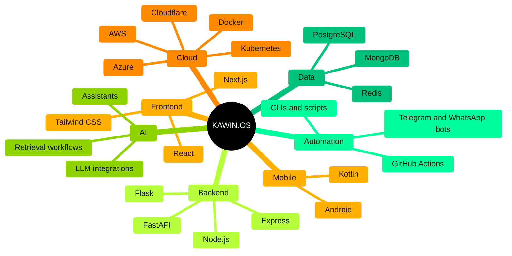

</details>

<p align="right"><a href="#top"></a></p>

<!-- ═══════════════════════════════════════ 04 · PIPELINE ═══════════════════════════════════════ -->

<a name="pipeline"></a>
<picture>
  <source media="(prefers-color-scheme: dark)" srcset="assets/sections/04-pipeline-dark.svg" />
  
</picture>

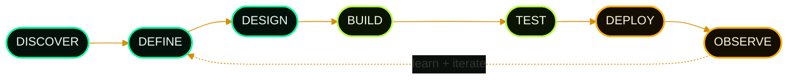

| # | PHASE | WHAT HAPPENS | OUTPUT |
|:-:|:--|:--|:--|
| `01` | **DISCOVER** | Find the real problem, the users and the constraints | Problem statement |
| `02` | **DEFINE** | Agree on the smallest useful outcome and the milestones | Scope & milestones |
| `03` | **DESIGN** | Shape the data model, APIs, UX and architecture | Diagrams & documented decisions |
| `04` | **BUILD** | Ship small, reviewable increments with quality and security built in | Working increments |
| `05` | **TEST** | Automated and manual checks against the expected behaviour | Green checks |
| `06` | **DEPLOY** | Repeatable, automated releases | A running service |
| `07` | **OBSERVE** | Logs, metrics, traces and user feedback | Insights that feed the next loop |

<p align="right"><a href="#top"></a></p>

<!-- ═══════════════════════════════════════ 05 · ACTIVE MISSIONS ═══════════════════════════════════════ -->

<a name="missions"></a>
<picture>
  <source media="(prefers-color-scheme: dark)" srcset="assets/sections/05-missions-dark.svg" />
  
</picture>

<a href="#mission-select"></a>

<details>
<summary><b>▤ TEXT VIEW</b> &nbsp;<sub>the dashboard above, as plain text</sub></summary>
<br/>

| ACTIVE MISSION | OUTCOME |
|:--|:--|
| **AI-native products** | Useful AI features grounded in reliable application architecture |
| **SaaS foundations** | Secure multi-tenant systems with clear operational boundaries |
| **Platform automation** | Faster, repeatable builds, tests, deployments and maintenance |
| **Cloud-native engineering** | Resilient services that are observable and straightforward to operate |
| **Open-source learning** | Practical contributions, shared knowledge and stronger developer communities |

**Research queue — what I'm learning now**

- [ ] Production patterns for agents, retrieval, evaluation and guardrails
- [ ] Rust for safe and efficient backend development
- [ ] Kubernetes operations and cloud-native observability
- [ ] Event-driven architecture and real-time systems
- [ ] Secure multi-tenant SaaS design

</details>

<p align="right"><a href="#top"></a></p>

<!-- ═══════════════════════════════════════ 06 · TELEMETRY ═══════════════════════════════════════ -->

<a name="telemetry"></a>
<picture>
  <source media="(prefers-color-scheme: dark)" srcset="assets/sections/06-telemetry-dark.svg" />
  
</picture>

<div align="center">


</div>

<details>
<summary><b>▸ EXTENDED TELEMETRY</b> &nbsp;<sub>language breakdown + developer node <code>@kawinthedev</code></sub></summary>
<br/>
<div align="center">


<br/><br/>
<sub><b>DEVELOPER NODE</b> · <a href="https://github.com/kawinthedev">@kawinthedev</a></sub>
<br/>
<a href="https://github.com/kawinthedev"></a>
</div>
</details>

<div align="center">

<sub><b>⌁ REPO LAB</b> &nbsp;·&nbsp; browse public repositories by language</sub>

<a href="https://github.com/kawincodes?tab=repositories&language=python"></a>
<a href="https://github.com/kawincodes?tab=repositories&language=typescript"></a>
<a href="https://github.com/kawincodes?tab=repositories&language=javascript"></a>
<a href="https://github.com/kawincodes?tab=repositories&language=kotlin"></a>
<a href="https://github.com/kawincodes?tab=repositories&language=php"></a>
<a href="https://github.com/kawincodes?tab=repositories"></a>

</div>

<p align="right"><a href="#top"></a></p>

<!-- ═══════════════════════════════════════ 07 · MISSION SELECT ═══════════════════════════════════════ -->

<a name="mission-select"></a>
<picture>
  <source media="(prefers-color-scheme: dark)" srcset="assets/sections/07-mission-select-dark.svg" />
  
</picture>

#### ◢ CHOOSE YOUR PATH

| IF YOU ARE… | YOU PROBABLY WANT | NEXT STEP |
|:--|:--|:--|
| 🚀 **A founder or client** with a product idea | `M01` Product / MVP · `M03` Backend / API · `M04` AI Integration | Hit a **LAUNCH** button below — it opens a ready-made brief |
| 💼 **A team or recruiter** hiring for product engineering | [Capabilities](#capabilities) · [Arsenal](#arsenal) · [Telemetry](#telemetry) | Email **kawin@krstechsolutions.in** |
| ⌨️ **A developer or maintainer** | `M12` Open Source · `M09` Architecture Review · `M11` Developer Tooling | [Browse repositories](https://github.com/kawincodes?tab=repositories) or launch the **OPEN SOURCE** brief |
| 👋 **Just exploring** | The story so far | Start at [WHOAMI](#whoami) or say hello at **kawinraju@gmail.com** |

#### ◢ COLLABORATION MODULES

| CODE | MODULE | WHAT WE CAN BUILD OR IMPROVE | IDEAL STARTING INFO |
|:--|:--|:--|:--|
| `M01` | 🚀 **Product / MVP** | A complete product from interface to deployment | Users, core problem, must-have features, timeline |
| `M02` | 💻 **Frontend Experience** | Responsive websites, dashboards and product interfaces | Designs, brand direction, pages, integrations |
| `M03` | ⚙️ **Backend / API** | REST APIs, authentication, databases, jobs and caching | Endpoints, consumers, data model, performance needs |
| `M04` | 🤖 **AI Integration** | Assistants, RAG, generation, classification and AI workflows | Use case, source data, quality and safety expectations |
| `M05` | ⚡ **Automation** | Bots, scripts, CLIs, scheduled jobs and workflow integrations | Manual process, inputs, outputs, frequency |
| `M06` | ☁️ **Cloud / DevOps** | Containers, CI/CD, serverless delivery and observability | Current stack, environment, reliability goals |
| `M07` | 🔐 **Security Hardening** | API validation, access control, secrets and safer defaults | Architecture, threat concerns, existing controls |
| `M08` | 📈 **Performance Review** | Faster APIs, pages, database access and resource usage | Metrics, bottlenecks, traces, reproduction steps |
| `M09` | 🧭 **Architecture Review** | System boundaries, technology choices and growth planning | Diagram, requirements, constraints, expected scale |
| `M10` | 🧪 **API Testing** | Test strategy, Postman collections and integration checks | API definition, environments, expected behaviour |
| `M11` | 🛠️ **Developer Tooling** | Internal platforms, reusable tooling and better developer UX | Team workflow, recurring friction, target outcome |
| `M12` | 🧩 **Open Source** | Features, issue fixes, documentation and maintenance | Repository, issue, contribution guide, priorities |
| `M13` | 💬 **Technical Consultation** | Focused brainstorming and implementation planning | Context, decisions to make, desired next steps |

#### ◢ QUICK LAUNCH

<div align="center">

<sub>Each button opens an email with the subject and a short brief template already filled in.</sub>

<a href="mailto:kawin@krstechsolutions.in?subject=%5BMVP%5D%20Product%20/%20MVP%20inquiry&body=Hi%20Kawin%2C%0A%0AModule%3A%20M01%20Product%20/%20MVP%0AProblem%3A%20%0ADesired%20outcome%3A%20%0AUsers%3A%20%0AMust-haves%3A%20%0ALinks%3A%20%0ATimeline%3A%20%0A%0AThanks%21"></a>
<a href="mailto:kawin@krstechsolutions.in?subject=%5BAPI%5D%20Backend%20/%20API%20project&body=Hi%20Kawin%2C%0A%0AModule%3A%20M03%20Backend%20/%20API%0AProblem%3A%20%0ADesired%20outcome%3A%20%0AUsers%3A%20%0AMust-haves%3A%20%0ALinks%3A%20%0ATimeline%3A%20%0A%0AThanks%21"></a>
<a href="mailto:kawin@krstechsolutions.in?subject=%5BAI%5D%20AI%20integration%20project&body=Hi%20Kawin%2C%0A%0AModule%3A%20M04%20AI%20Integration%0AProblem%3A%20%0ADesired%20outcome%3A%20%0AUsers%3A%20%0AMust-haves%3A%20%0ALinks%3A%20%0ATimeline%3A%20%0A%0AThanks%21"></a>
<a href="mailto:kawin@krstechsolutions.in?subject=%5BAUTOMATION%5D%20Workflow%20automation&body=Hi%20Kawin%2C%0A%0AModule%3A%20M05%20Automation%0AProblem%3A%20%0ADesired%20outcome%3A%20%0AUsers%3A%20%0AMust-haves%3A%20%0ALinks%3A%20%0ATimeline%3A%20%0A%0AThanks%21"></a>
<a href="mailto:kawin@krstechsolutions.in?subject=%5BCLOUD%5D%20Cloud%20/%20DevOps%20project&body=Hi%20Kawin%2C%0A%0AModule%3A%20M06%20Cloud%20/%20DevOps%0AProblem%3A%20%0ADesired%20outcome%3A%20%0AUsers%3A%20%0AMust-haves%3A%20%0ALinks%3A%20%0ATimeline%3A%20%0A%0AThanks%21"></a>
<a href="mailto:kawin@krstechsolutions.in?subject=%5BREVIEW%5D%20Architecture%20review&body=Hi%20Kawin%2C%0A%0AModule%3A%20M09%20Architecture%20Review%0AProblem%3A%20%0ADesired%20outcome%3A%20%0AUsers%3A%20%0AMust-haves%3A%20%0ALinks%3A%20%0ATimeline%3A%20%0A%0AThanks%21"></a>
<a href="mailto:kawin@krstechsolutions.in?subject=%5BOSS%5D%20Open-source%20collaboration&body=Hi%20Kawin%2C%0A%0AModule%3A%20M12%20Open%20Source%0AProblem%3A%20%0ADesired%20outcome%3A%20%0AUsers%3A%20%0AMust-haves%3A%20%0ALinks%3A%20%0ATimeline%3A%20%0A%0AThanks%21"></a>
<a href="mailto:kawinraju@gmail.com?subject=Hello%20from%20your%20GitHub%20profile"></a>

</div>

#### ◢ ENGAGEMENT PROTOCOL

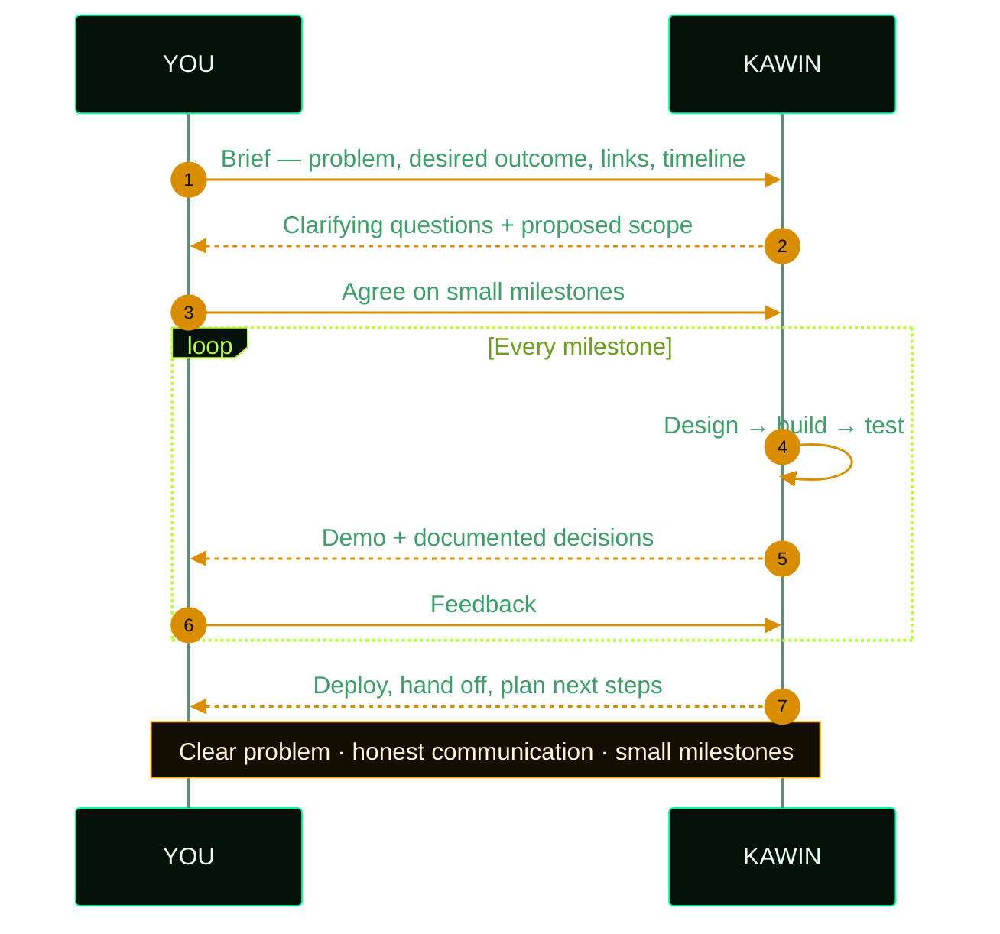

#### ◢ BRIEF TEMPLATE

```text
┌─ PROJECT BRIEF ──────────────────────────────────────────────┐
│ MODULE ......... M01–M13 (see the table above)               │
│ PROBLEM ........ what hurts today?                           │
│ OUTCOME ........ what does success look like?                │
│ USERS .......... who is it for?                              │
│ MUST-HAVES ..... the non-negotiables                         │
│ LINKS .......... designs, repos, docs, demos                 │
│ TIMELINE ....... preferred start and deadline                │
└──────────────────────────────── → kawin@krstechsolutions.in ─┘
```

> [!TIP]
> **What makes a good collaboration:** a clear problem, honest communication, small milestones, documented decisions, and a shared commitment to delivering something genuinely useful.

<p align="right"><a href="#top"></a></p>

<!-- ═══════════════════════════════════════ 08 · KNOWLEDGE BASE ═══════════════════════════════════════ -->

<a name="knowledge-base"></a>
<picture>
  <source media="(prefers-color-scheme: dark)" srcset="assets/sections/08-knowledge-base-dark.svg" />
  
</picture>

<details>
<summary><b>❯ Why two GitHub accounts?</b></summary>
<br/>

- [`kawincodes`](https://github.com/kawincodes) is my primary public portfolio and contribution identity.
- [`kawinthedev`](https://github.com/kawinthedev) is my additional developer account.

</details>

<details>
<summary><b>❯ What opportunities am I open to?</b></summary>
<br/>

Product engineering, full-stack development, backend APIs, AI integrations, developer tooling, cloud automation, and meaningful open-source collaboration.

</details>

<details>
<summary><b>❯ How should you contact me?</b></summary>
<br/>

Use **kawin@krstechsolutions.in** for project and business conversations. Use **kawinraju@gmail.com** for general communication.

</details>

<details>
<summary><b>❯ What should a first message include?</b></summary>
<br/>

A short description of the problem, the desired outcome, relevant links and your preferred timeline. Adding a module code (`M01`–`M13`) from [Mission Select](#mission-select) helps route it — or just press one of the **LAUNCH** buttons, which pre-fill all of this for you.

</details>

<details>
<summary><b>❯ What makes a good collaboration?</b></summary>
<br/>

A clear problem, honest communication, small milestones, documented decisions, and a shared commitment to delivering something genuinely useful.

</details>

<details>
<summary><b>❯ What am I learning right now?</b></summary>
<br/>

- Production patterns for agents, retrieval, evaluation and guardrails
- Rust for safe and efficient backend development
- Kubernetes operations and cloud-native observability
- Event-driven architecture and real-time systems
- Secure multi-tenant SaaS design

</details>

<details>
<summary><b>❯ Which timezone am I in?</b></summary>
<br/>

India Standard Time — **IST, UTC+05:30**.

</details>

<details>
<summary><b>❯ How is this profile built?</b></summary>
<br/>

- **Animated panels** (hero, terminal, status board, section headers, footer) are hand-built SVGs with CSS and SMIL animation, generated by [`scripts/build_assets.py`](scripts/build_assets.py) — pure Python, no dependencies. They respect `prefers-reduced-motion`, and the section headers switch between light and dark variants with your GitHub theme.
- **Live data** comes from [GitHub Profile Summary Cards](https://github.com/vn7n24fzkq/github-profile-summary-cards), [GitHub Readme Streak Stats](https://github.com/DenverCoder1/github-readme-streak-stats), [Skill Icons](https://github.com/tandpfun/skill-icons), [shields.io](https://shields.io) and [komarev](https://github.com/antonkomarev/github-profile-views-counter).
- **Diagrams** are native GitHub [Mermaid](https://mermaid.js.org) blocks.

</details>

<p align="right"><a href="#top"></a></p>

<!-- ═══════════════════════════════════════ 09 · COMMS ═══════════════════════════════════════ -->

<a name="comms"></a>
<picture>
  <source media="(prefers-color-scheme: dark)" srcset="assets/sections/09-comms-dark.svg" />
  
</picture>

| CHANNEL | ADDRESS | BEST FOR |
|:--|:--|:--|
| 💼 **Business · projects** | [kawin@krstechsolutions.in](mailto:kawin@krstechsolutions.in) | Projects, proposals and business conversations — *preferred for projects* |
| ✉️ **Personal** | [kawinraju@gmail.com](mailto:kawinraju@gmail.com) | General communication |
| ⌨️ **GitHub · primary** | [@kawincodes](https://github.com/kawincodes) | Portfolio, code and contributions |
| 🧪 **GitHub · developer** | [@kawinthedev](https://github.com/kawinthedev) | Additional developer account |

<div align="center">

<a href="mailto:kawin@krstechsolutions.in"></a>
<a href="mailto:kawinraju@gmail.com"></a>
<br/>
<a href="https://github.com/kawincodes"></a>
<a href="https://github.com/kawinthedev"></a>

</div>

<br/>

<a href="#top"></a>

<div align="center">
<sub>Designed and maintained by <a href="https://github.com/kawincodes"><b>P Kawin Raju</b></a> · KAWIN.OS · 2026</sub>
</div>
