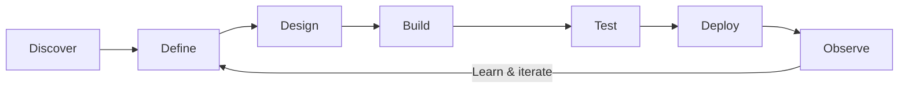

<!--
  Production GitHub Profile README
  Owner: P Kawin Raju
  Primary account: kawincodes
  Developer account: kawinthedev
-->


<div align="center">

<a href="https://github.com/kawincodes"></a>

[](https://github.com/kawincodes)
[](https://github.com/kawinthedev)
[](https://github.com/kawincodes)

**[About JSON](#about-json) · [Expertise](#expertise) · [Technology](#technology) · [Workflow](#workflow) · [Analytics](#analytics) · [Options](#collaboration-options) · [Contact](#contact)**

</div>

---

## About JSON

```json
{
  "profile": {
    "name": "P Kawin Raju",
    "location": "India",
    "headline": "Full-Stack Developer, AI Builder, and Cloud Enthusiast",
    "bio": "I turn practical ideas into dependable software products.",
    "motto": "Ship thoughtfully. Learn continuously. Improve relentlessly."
  },
  "github": {
    "primary": "https://github.com/kawincodes",
    "developer": "https://github.com/kawinthedev"
  },
  "contact": {
    "business": "kawin@krstechsolutions.in",
    "personal": "kawinraju@gmail.com",
    "preferred_for_projects": "business"
  },
  "roles": [
    "Full-Stack Developer",
    "Backend and API Engineer",
    "AI Solutions Builder",
    "Cloud and Automation Enthusiast",
    "SaaS Product Builder"
  ],
  "focus": [
    "Full-stack web products",
    "Scalable REST APIs",
    "AI and LLM integrations",
    "Developer tools and workflow automation",
    "Cloud-native and serverless applications",
    "Secure multi-tenant SaaS platforms"
  ],
  "technology": {
    "languages": ["Python", "TypeScript", "JavaScript", "Rust"],
    "frontend": ["React", "Next.js", "Tailwind CSS"],
    "backend": ["FastAPI", "Flask", "Node.js", "Express"],
    "data": ["PostgreSQL", "MongoDB", "Redis"],
    "cloud": ["AWS", "Azure", "Cloudflare", "Docker", "Kubernetes"],
    "ai_and_tools": ["OpenAI", "Git", "GitHub Actions", "Postman"]
  },
  "currently_learning": [
    "Production AI agents and retrieval systems",
    "Rust backend development",
    "Kubernetes operations and observability",
    "Event-driven architecture",
    "Secure SaaS architecture"
  ],
  "engineering_principles": [
    "Clarity over cleverness",
    "Security by design",
    "Automate repeatable work",
    "Build observable systems",
    "Document decisions",
    "Measure outcomes and iterate"
  ],
  "availability": {
    "status": "Open to thoughtful collaborations",
    "options": [
      "Product and MVP development",
      "Backend and API engineering",
      "AI feature integration",
      "Automation and developer tooling",
      "Cloud and deployment improvements",
      "Architecture and code reviews",
      "Open-source collaboration"
    ]
  }
}
```

<div align="center">

</div>

---

## Expertise

<div align="center">

| Area | What I Build |
|:--|:--|
| 🌐 **Full-Stack Products** | Responsive interfaces, dashboards, authentication, and complete web applications |
| ⚙️ **Backend Engineering** | REST APIs, integrations, background jobs, caching, and data pipelines |
| 🤖 **AI Solutions** | LLM features, assistants, retrieval workflows, and intelligent automation |
| ☁️ **Cloud Delivery** | Containerized services, serverless systems, CI/CD, and observable deployments |
| 🧩 **Developer Tools** | Bots, command-line tools, workflow automation, and reusable internal platforms |

</div>

### Engineering values

```text
Clarity over cleverness  •  Security by design  •  Automate repeatable work
Small feedback loops     •  Observable systems  •  Documentation that helps
```

---

## Technology

<div align="center">

### Languages


### Frontend


### Backend & Data


### Cloud, AI & Tooling


</div>

---

## Workflow



<div align="center">

</div>

---

## Current Direction

| Focus | Outcome |
|:--|:--|
| **AI-native products** | Useful AI features grounded in reliable application architecture |
| **SaaS foundations** | Secure multi-tenant systems with clear operational boundaries |
| **Platform automation** | Faster, repeatable builds, tests, deployments, and maintenance |
| **Cloud-native engineering** | Resilient services that are observable and straightforward to operate |
| **Open-source learning** | Practical contributions, shared knowledge, and stronger developer communities |

<details>
<summary><strong>What I’m learning now</strong></summary>
<br/>

- Production patterns for agents, retrieval, evaluation, and guardrails
- Rust for safe and efficient backend development
- Kubernetes operations and cloud-native observability
- Event-driven architecture and real-time systems
- Secure multi-tenant SaaS design

</details>

<details>
<summary><strong>What makes a good collaboration</strong></summary>
<br/>

A clear problem, honest communication, small milestones, documented decisions, and a shared commitment to delivering something genuinely useful.

</details>

---

## Analytics

<div align="center">

### Primary account · `kawincodes`

<picture>
  <source media="(prefers-color-scheme: dark)" srcset="https://github-readme-stats.vercel.app/api?username=kawincodes&show_icons=true&hide_border=true&bg_color=0D1117&title_color=00C9A7&icon_color=7C3AED&text_color=C9D1D9&ring_color=00C9A7" />
  
</picture>
<picture>
  <source media="(prefers-color-scheme: dark)" srcset="https://github-readme-stats.vercel.app/api/top-langs/?username=kawincodes&layout=compact&hide_border=true&bg_color=0D1117&title_color=00C9A7&text_color=C9D1D9&langs_count=8" />
  
</picture>


### Developer account · `kawinthedev`

<a href="https://github.com/kawinthedev"></a>


</div>

---

## Collaboration Options

<div align="center">

| Option | What We Can Build or Improve | Ideal Starting Information |
|:--|:--|:--|
| 🚀 **Product / MVP** | A complete product from interface to deployment | Users, core problem, must-have features, timeline |
| 🌐 **Frontend Experience** | Responsive websites, dashboards, and product interfaces | Designs, brand direction, pages, integrations |
| ⚙️ **Backend / API** | REST APIs, authentication, databases, jobs, and caching | Endpoints, consumers, data model, performance needs |
| 🤖 **AI Integration** | Assistants, RAG, generation, classification, and AI workflows | Use case, source data, quality and safety expectations |
| 🔁 **Automation** | Bots, scripts, CLIs, scheduled jobs, and workflow integrations | Manual process, inputs, outputs, frequency |
| ☁️ **Cloud / DevOps** | Containers, CI/CD, serverless delivery, and observability | Current stack, environment, reliability goals |
| 🔐 **Security Hardening** | API validation, access control, secrets, and safer defaults | Architecture, threat concerns, existing controls |
| 📈 **Performance Review** | Faster APIs, pages, database access, and resource usage | Metrics, bottlenecks, traces, reproduction steps |
| 🧭 **Architecture Review** | System boundaries, technology choices, and growth planning | Diagram, requirements, constraints, expected scale |
| 🧪 **API Testing** | Test strategy, Postman collections, and integration checks | API definition, environments, expected behavior |
| 🛠️ **Developer Tooling** | Internal platforms, reusable tooling, and better developer UX | Team workflow, recurring friction, target outcome |
| 🧩 **Open Source** | Features, issue fixes, documentation, and maintenance | Repository, issue, contribution guide, priorities |
| 💬 **Technical Consultation** | Focused brainstorming and implementation planning | Context, decisions to make, and desired next steps |

### Quick action menu

[](mailto:kawin@krstechsolutions.in?subject=MVP%20Development%20Inquiry)
[](mailto:kawin@krstechsolutions.in?subject=Backend%20API%20Project)
[](mailto:kawin@krstechsolutions.in?subject=AI%20Integration%20Project)
[](mailto:kawin@krstechsolutions.in?subject=Workflow%20Automation%20Project)

[](mailto:kawin@krstechsolutions.in?subject=Cloud%20and%20DevOps%20Project)
[](mailto:kawin@krstechsolutions.in?subject=Architecture%20Review)
[](mailto:kawin@krstechsolutions.in?subject=Open%20Source%20Collaboration)
[](mailto:kawinraju@gmail.com?subject=Idea%20Discussion)

<br/><br/>

> Choose an option above or send a short description of the problem, desired outcome, relevant links, and preferred timeline.

</div>

---

## Quick Profile

<details>
<summary><strong>Why two GitHub accounts?</strong></summary>
<br/>

- [`kawincodes`](https://github.com/kawincodes) is my primary public portfolio and contribution identity.
- [`kawinthedev`](https://github.com/kawinthedev) is my additional developer account.

</details>

<details>
<summary><strong>What opportunities am I open to?</strong></summary>
<br/>

Product engineering, full-stack development, backend APIs, AI integrations, developer tooling, cloud automation, and meaningful open-source collaboration.

</details>

<details>
<summary><strong>How should you contact me?</strong></summary>
<br/>

Use **kawin@krstechsolutions.in** for project and business conversations. Use **kawinraju@gmail.com** for general communication.

</details>

---

## Contact

<div align="center">

<a href="https://github.com/kawincodes"></a>
<a href="https://github.com/kawinthedev"></a>
<a href="mailto:kawinraju@gmail.com"></a>
<a href="mailto:kawin@krstechsolutions.in"></a>

<br/><br/>


</div>


<div align="center">
<sub>Designed and maintained by <a href="https://github.com/kawincodes"><strong>P Kawin Raju</strong></a> · 2026</sub>
</div>
