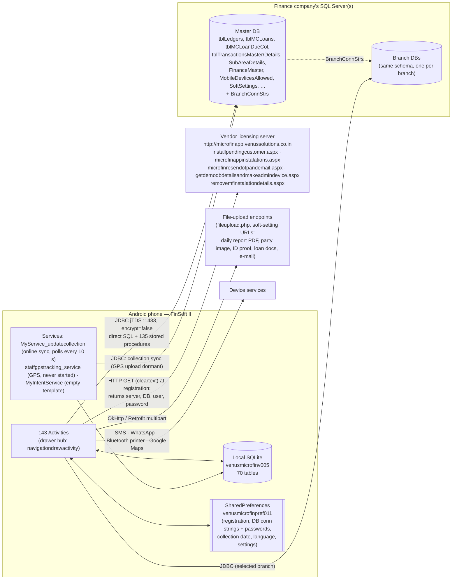
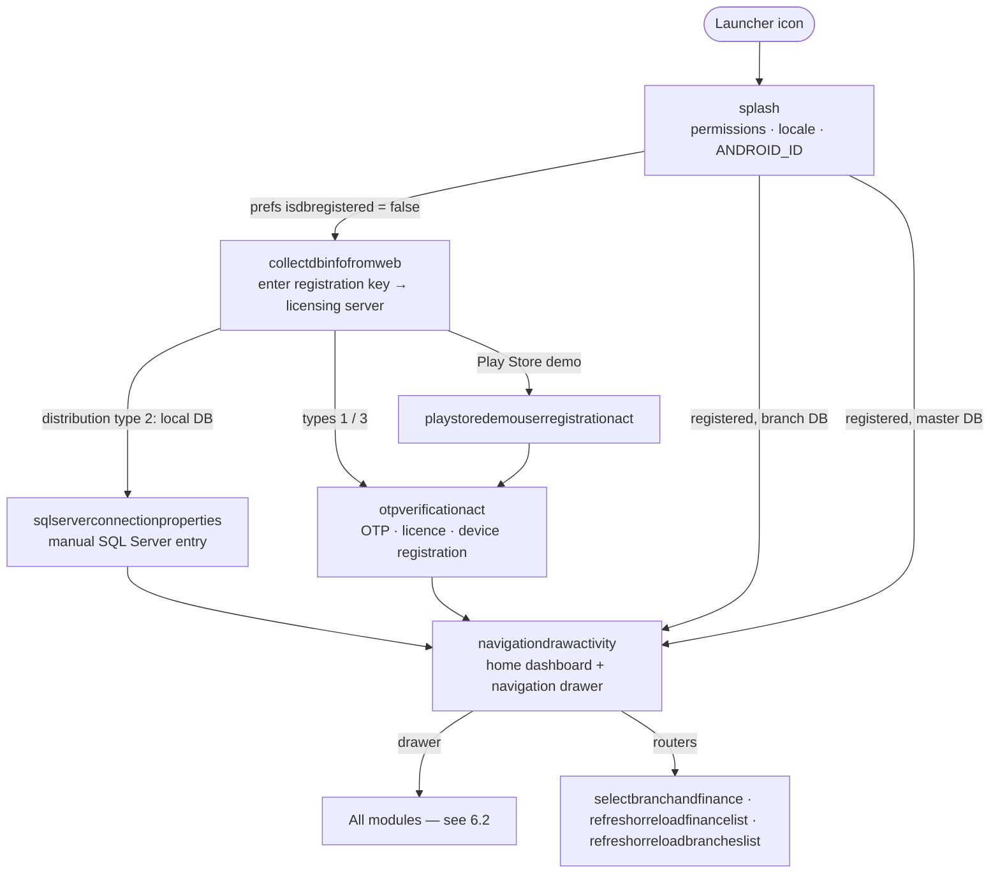

# brain.md — FinSoft II · Venus Micro-Finance Daily / Weekly Collection (Android) — complete decode

> Functional specification reverse-engineered from the uploaded `base1.apk`. It covers every screen, function and data flow: all **390 app classes**, **146 activity classes** (143 declared in the manifest, plus 3 orphans), **209 app layouts**, **30 menus**, **3 services**, the local SQLite schema, and every SQL Server table and stored procedure the app uses.
>
> Decoded on 2026-11-04 with **JADX 1.5.5** (Java source) and **apktool 2.12.1** (resources, manifest, smali), using the static-analysis workflow of [morluto/rea](https://github.com/morluto/rea) (APK → manifest → class/method inventory → decompilation → references). The app was never run.
>
> **Raw extraction:** every SQL query in full, an image of every screen (English and Tamil), all drawables, UI messages, SharedPreferences keys and intent extras are in the companion file [**work.md**](work.md).
>
> **Redaction policy:** the app does not hardcode database passwords. It downloads them at registration (described below). The two embedded secrets, the Google Maps API key in the manifest and an SMS-gateway API key in `editing_collectionswithfulloptions_act`, are written as `[REDACTED]`. No customer data was present in the APK.

## Contents

1. [At a glance](#1-at-a-glance)
2. [How this was decoded, and coverage](#2-how-this-was-decoded-and-coverage)
3. [Technology stack](#3-technology-stack)
4. [Architecture](#4-architecture)
5. [Core business concepts](#5-core-business-concepts)
6. [Navigation map](#6-navigation-map)
7. [Screen catalogue (every screen)](#7-screen-catalogue-every-screen)
8. [Module chapters](#8-module-chapters) (the detailed per-screen documentation)
9. [Security, privacy and quality review](#9-security-privacy-and-quality-review)
10. [Rebuild notes](#10-rebuild-notes)
11. [Appendices](#11-appendices)

---

## 1. At a glance

| | |
|---|---|
| **App name** | FinSoft II (`@string/app_name`; Tamil: FinSoft). The drawer screen is titled "Micro FinSoft" |
| **Vendor** | Venus Solutions, Tamil Nadu, India. Web: `microfinapp.venussolutions.co.in`, `financesoftware.in`. In-app support numbers: +91 96558 42840, +91 97900 70227, +91 94877 92840 |
| **Package / applicationId** | `net.venussolutions.venusmicrofindailyweeklycollection.clone` (Java package `net.venussolutions.venusmicrofindailyweeklycollection`) |
| **Version** | versionName **16.0.220125**, versionCode **20** |
| **Build** | `BuildConfig.BUILD_TYPE = "debug"`, `DEBUG = true`, product flavor **`clone`**, `android:debuggable="true"` |
| **SDK levels** | minSdk 28 (Android 9), targetSdk / compileSdk 37 |
| **Signing** | APK Signature Scheme **v2 only** (no v1/JAR signature). Certificate `CN=Android Debug, O=Android, C=US`, serial 01, valid 2023-09-12 → 2053-09-04, SHA-256 `5e4e4801f667ed7c28bfd518db63bb7af402a012471bf01319686951b0b31aa1`. This is the developer's local **debug keystore**, not a release key |
| **APK** | `base1.apk`, 29,208,929 bytes, SHA-256 `4ce34ef69e6a4653b483a9db95f8912b65b67a3312b20ecad728ce7e1c3a4fbc`. 1,819 entries, 8 DEX files (`classes.dex`…`classes8.dex`), **no native libraries** |
| **Languages** | English and Tamil (`values-ta`; `android.supportedLocales = en,ta`). Language id 1 = Tamil, 2 = English |
| **Purpose** | Back-office plus field app for **micro-finance companies** that run daily, weekly and monthly installment loans ("lines"). Field **collection executives** download each day's collection list, collect installments from **parties** (borrowers) area by area, offline or online, record new parties, new loans, expenses and incomes, then upload. Managers and admins get the cash book and cash-book verification, collection reports (day, abstract, 7-day, unpaid, day-wise pending), the daily *Patti* (outstanding) statement, *Thittam* (collection plan) reports, PDF collection sheets in 10 layouts, loan and savings closures, double-entry accounting (payments, receipts, contra, journal, P&L, trial balance, balance sheet), the **ST loans** book (short-term loans the finance gives) and **OF loans** book (money the finance borrows), each with interest, plus partner reports, attendance, users, roles, devices and access control. An inventory module is present but hidden by default. A GPS staff-tracking service and Bluetooth receipt printing are present but non-functional in this build (see §8) |
| **Backend** | The phone connects **directly to Microsoft SQL Server over JDBC (jTDS)**: the customer's master database, plus branch databases. The vendor's licensing server (ASP.NET `.aspx` over HTTP) hands out the database connection details at registration |

## 2. How this was decoded, and coverage

| Step | Tool | Result |
|---|---|---|
| Archive triage | `unzip -l`, Python | 1,819 entries, 8 DEX, assets (20 fonts, 2 images), no `lib/` |
| Resources and manifest | apktool 2.12.1 `d` | Manifest, 337 layouts (209 app-specific, plus 2 Material-library `m3expressive_*` dialog layouts), 30 menus, strings in English and Tamil, smali for all 8 DEX files |
| Java decompilation | JADX 1.5.5 (`--show-bad-code`) | 6,849 classes → 7,513 Java files. 40 classes had partial decompile errors (28 of them app classes, still readable; smali used as ground truth) |
| Signing | APK Signing Block parse + `openssl x509` | v2 block only, debug certificate |
| Cross-reference index | Custom scripts | For each of the 390 app classes: layouts, menus, screens started, intent extras, prefs keys, SQL literals (1,629), stored procedures (135), tables, URLs, methods, toasts |
| Semantic analysis | 18 parallel reviewers, one per module, each with the module's sources and a checklist | Module chapters in §8. Every class and layout was verified as covered |

**Coverage:** 390 / 390 app classes · 146 / 146 activity classes · 209 / 209 app layouts · 30 / 30 menus · 3 / 3 app services · 135 / 135 stored procedures · 70 local SQLite tables · 64 remote tables.

**Decompiler caveat:** JADX sometimes replaces a numeric literal with an unrelated library constant that has the same value. For example, `PeriodicWorkRequest.MIN_PERIODIC_FLEX_MILLIS` in the GPS service is really the number 300000 ms, and `constantvalues.Partydetails_AccessRequest` used as a request code is really 9001. This document gives the real numbers.

## 3. Technology stack

| Area | Library / API (version) | Used for |
|---|---|---|
| Language / UI | Java with AndroidX (appcompat 1.7.1, core 1.18.0, activity 1.13.0, fragment 1.6.1, recyclerview 1.4.0, constraintlayout 2.2.1, viewpager / viewpager2 1.1.0-beta02, swiperefreshlayout, cardview), Material Components 1.14.0 | All screens: activities with Toolbar, NavigationView drawer, RecyclerView lists with SearchView filters, bottom sheets, dialogs, TabLayout and ViewPager |
| Remote database | **jTDS 1.3.0** JDBC driver (`net.sourceforge.jtds.jdbc.Driver`) | Direct SQL Server access from **117 classes** (173 `DriverManager.getConnection` sites, 302 prepared/callable statements, 163 plain statements) |
| Local database | Android SQLite (`openOrCreateDatabase("venusmicrofinv005")`) | Offline store and cache. 70 tables are created ad hoc. Room 2.7.0 is bundled but unused by app code |
| HTTP | OkHttp **5.4.0**, Retrofit 2 + Gson converter, Apache HttpClient 4.3.6 / HttpCore 4.3.3 / HttpMime 4.3.6, `java.net.URLConnection` | Licensing and registration calls (`*.aspx`), multipart uploads of PDFs and images (`fileupload.php` and URLs set in soft settings) |
| Location and maps | Play services location 21.4.0, maps 20.0.0 (base/basement 18.9.0, tasks 18.4.0) | GPS on online collection entries, party records and collection areas; maps of areas and parties; a foreground staff-tracking service and route-replay map (both present but never started) |
| Images | Glide (with OkHttp integration, generated `GlideApp`), uCrop 2.2.8-native, Zoomage (`com.jsibbold.zoomage`), CircularImageView (`com.mikhaellopez`) | Party, ID-proof and document photos, cropping, zoomable full-screen viewer |
| Permissions | Dexter (`com.karumi.dexter`) plus `ActivityCompat.requestPermissions` | Runtime permissions |
| Printing / PDF | `android.graphics.pdf.PdfDocument` (30 classes), `android.print` (system print dialog), NGX Technologies Bluetooth printer SDK (`com.ngx.BluetoothPrinter`, `PrinterWidth`) | Every report and the 10 collection-sheet layouts are drawn as A4 PDF pages, then shown, shared or printed through the system print dialog. The NGX SDK is wired to one "Print receipt" button, which prints only the app-logo bitmap (receipt printing is a stub) |
| Messaging | `android.telephony.SmsManager`, WhatsApp / WhatsApp Business intents (`api.whatsapp.com/send`), `tel:` dial intents | SIM-based SMS alerts from templates (an HTTP SMS-gateway path exists but cannot work: its URL and key are never loaded), sharing reports and receipts, calling parties and partners |
| Files | `androidx.core.content.FileProvider` (`…clone.provider`, all paths exposed), commons-io, `com.ngxtech.selector` file picker | Sharing generated PDFs and images |
| Other bundled libraries | JavaMail for Android (`javax.mail`, `javax.activation`, `myjava.awt.datatransfer`, Apache Harmony AWT), Kotlin stdlib and coroutines 1.9.0, WorkManager 2.11.2, Room, Emoji2, ProfileInstaller | Present through dependencies. App code does not call JavaMail, WorkManager or Room directly |
| Fonts (assets) | 20 files: akshar, andale-mono, BOOKOS, calibri, CALIST, CENSCBK, CENTURY, CourierPrime, Cousine (regular and bold), DejaVuSerif (and condensed), DroidSansMono, DroidSerif, F25_Bank_Printer (regular and bold), LBRITE, NotoSansTamil-Regular, Roboto, RobotoMono | Effectively unused. Only `Cousine-Regular.ttf` is loaded (`tabbedindividualcollectionentry`), and the result is discarded. PDFs use system typefaces (`serif`, "Courier New"); Tamil text renders with the system font |
| Images (assets) | `assets/image/img.png`, `assets/image/ngx.jpg` | App logo (the only thing the Bluetooth "Print receipt" button prints) and NGX printer sample image |

## 4. Architecture

### 4.1 Database topology and connection strings
`globalvars` holds five connection contexts, built as jTDS URLs that contain the user and password:

| Context | Built where | Used by |
|---|---|---|
| `MasterDBconnString` (+ user/password) | `collectdbinfofromweb`, from the licensing server's JSON: `jdbc:jtds:sqlserver://<ServerName>:1433/<DatabaseName>;encrypt=false;user=…;password=…;` | Registration, branch list, device and licence tables, master-level admin (10 sites) |
| `branchconnString` | Master DB: same as master. Branch / customer-local DB: from `BranchConnStrs` or the manual `sqlserverconnectionproperties` form (`jdbc:jtds:sqlserver://<server>;databaseName=…;instance=…;user=…; password=…`) | 16 sites |
| `selbranchconnString` | Currently selected branch (`refreshorreloadbrancheslist`) | **Most business screens (119 sites)** |
| `branchlevelReport_branchconnString` | Branch chosen for branch-level reports | 21 sites |
| `ImagesuploadconnString` | Master or branch, for image blobs | 4 sites |

DB distribution types (`constantvalues.dbdistributiontypes`): **1** online database hosted for a specific customer · **2** local database at the customer's premises (entered manually) · **3** Play Store demo database.

### 4.2 Local state
* **SQLite `venusmicrofinv005`** is the working copy for offline executives. Main tables: `MobileAppCollData` (the day's collection list), `Parties`, `SubAreaDetails`, `NewParties`, `NewMCLoans`, `ExpensesEntries`, `PrevCollections`, `PrevLocations`, `LastUpload`, `StaffLocationQueue`. It also caches masters and settings (`FinanceDetails`, `LoanMethods`, `tblLedgers`, `SMSTemplates`, `SpecialAccessRules`, `BranchConnStrs`, …). Full schema: [Appendix A](brain/A_local_sqlite_schema.md).
* **SharedPreferences `venusmicrofinpref011`** holds `isdbregistered`, `ismasterdb`, `dbidentificationno`, `MasterDBconnString`/`MasterDBusername`/`MasterDBpassword`, `branchconnString`/`branchdbusername`/`branchdbpassword`, `selbranch*`, `CollectionDate`, `applangid`, `isoverallcollectionenabled`, and many per-screen options. (A second prefs file, `MyPref`, belongs to the unused `App` class.)
* **Static globals (`globalvars`)** hold the session: current finance/line (`curfin`, `finid`, `financename`), `BranchId`/`BranchName`, `MobileUserLedgerId`, `app_userroleid`, `cashbookledgerid`, `FinanceCashBookLedgerId`, `collectiondate`, `todaydate`, the two collection executives, `device_id` (= `Settings.Secure.ANDROID_ID`, stored server-side in columns named `IMEI`), `specialaccessrules`, `isFullAccessAllowed`, and JSON caches for the 7-day collection, daily patti and upload limits.

### 4.3 Threading and UI patterns
* All database and network work runs in inner **`AsyncTask`** subclasses. `onPreExecute` shows a progress bar, `doInBackground` calls `Class.forName(driver)` and `DriverManager.getConnection(...)` and runs the statements, and `onPostExecute` binds RecyclerView adapters or shows a toast or dialog.
* Lists use `RecyclerView.Adapter` subclasses (82 of them) with a `ContactsAdapterListener` callback and `Filterable` search through a toolbar `SearchView`. Pickers use the generic **`spinnersearch_list`**, a searchable list that returns `displaymember` and `valuemember`.
* Screens talk to each other through `startActivityForResult` request codes (`constantvalues`, `requestcodes`) and intent extras such as `ttid`, `calledfrom`, `requestcode`, `actiontype` and `passed*`.
* **Server-driven behaviour:** about 60 flags in `softsettingsvalue` are loaded from the `SoftSettings` / `VenusSoftSettings` tables. Role-based menu visibility comes from `AndroidMenus` and `UserRoles`. Twenty **special access rules** (`specialaccessids`) toggle sensitive abilities per role.

### 4.4 External endpoints (all cleartext HTTP; `usesCleartextTraffic="true"`)

| Endpoint (`http://microfinapp.venussolutions.co.in/…`) | Called by | Purpose |
|---|---|---|
| `installpendingcustomer.aspx?…` (via `jsondataretriver.retrivedatabaseinfofromweb`) | `collectdbinfofromweb` | Exchanges the customer's registration key for the DB descriptor `dbdetailsobj`: `CId`, `ServerName`, `DatabaseName`, `DBUserId`, **`DBPassword`**, `dbdistributiontypeid`, `dbidentificationno`, `ismasterdb` |
| `microfinappinstalations.aspx?FinanceName=…` | `playstoredemouserregistrationact` | Registers a demo or self-registered installation |
| `microfinresendotpandemail.aspx?FinanceName=…` | `otpverificationact` | Resends the OTP by SMS and e-mail |
| `getdemodbdetailsandmakeadmindevice.aspx?ContactPerson=…` | `otpverificationact` | Play Store demo: gets the demo DB and makes this device an admin |
| `removemfinstalationdetails.aspx?deviceid=…` | `navigationdrawactivity` ("Clear My Data") | Unregisters the device |
| `POST /fileupload.php` (Retrofit `ApiService.uploadDatabase`, multipart) | upload flows | File and database upload |
| Soft-setting URLs `daily_report_file_upload_url`, `party_image_file_upload_url`, `idproof_file_upload_url`, `LoanRelatedDocumentsUploadURL`, `email_sending_url` | `uploadcollection`, `partydetails_act`, `documentsupload`, `cashbook`, … | Daily report PDF, party image and ID-proof uploads, loan documents, report e-mails. Multipart fields include `website=www.venussolutions.net` and a fixed vendor e-mail address |
| `http://financesoftware.in/` | `financesoftwaredontinwebview` | Vendor website in a WebView |
| `https://youtu.be/…` | `collectdbinfofromweb` | Help video |
| `https://api.whatsapp.com/send?phone=…&text=…` | `meetingreport`, `partnerwiseloansandperformance_fragment`, ST/OF receipts | WhatsApp sharing |
| `http://maps.google.com/maps?q=loc:lat,lng` | `tabbedindividualcollectionentry` | Opens a party's location |

## 5. Core business concepts

### 5.1 Entities
* **Branch.** One SQL Server database per branch, listed in the master DB's `BranchConnStrs`. Multi-branch access exists only when the device is registered on the master DB.
* **Finance / Line** (`FinanceMaster` → `financemaster_data` / `globalvars.curfin`). A lending line with its own cash book ledger, collection-break pattern (daily, weekly, bi-weekly, monthly; `isselectedlineisweeklyline`), default loan method, collection executives and e-mail identifier. "Select Line" picks the working line.
* **Collection area / Sub area** (`SubAreaDetails`: `SubAreaNo`, `SubAreaName`, `FinId`, `WeekdayId`, `IsVisible`, `ShowId` (display order), latitude/longitude). Parties are grouped by area, and an area is visited on a set weekday or month-day.
* **Party.** A borrower ledger in `tblLedgers` / `Parties`: user-defined number `UDLedgerId`, company-wise number `CWLedgerId`, name, spouse or guardian, address, mobiles, business tag, ID proofs, photos, GPS position. **Partners** (investors) and **suppliers** are other ledger groups.
* **MC loan** (`tblMCLoans`, local `NewMCLoans`): a micro-credit installment loan created from a **Loan Method** (amount, interest deduction, document charges, installment amount, number of installments, collection break, grace period, warning days). Dues are tracked in `tblMCLoanDueCol`, and collections post to `tblTransactionsMaster` / `tblTransactionsDetails`.
* **Collection executive.** Field staff, an employee ledger with a user role. Up to two executives (`currentcollectionexecutivelederid1/2`) are recorded per day's collection.
* **Device.** Identified by ANDROID_ID. It must be approved in `MobileDevlicesAllowed` (or `BranchMobileDevlicesAllowed`), which maps it to an employee ledger (`LId`) and a role.

### 5.2 Daily operating cycle (offline executive)
1. **Select Branch → Select Line → Sync Resources.** Masters, ledgers, soft settings, SMS templates, menus and access rules are pulled into SQLite. Choosing a line or branch silently deletes any un-uploaded offline data on the device.
2. **Amount Received** ([`cashreceiveandreturns`](brain/modules/13-accounts-transactions-cash-bank-book-expenses.md#executive-cash-received-from--returned-to-office--cashreceiveandreturns)): a voucher records the cash the executive takes from the office (finance cash book → staff cash book), optionally with an SMS alert (template 12/14).
3. **Download Data** ([`downloaddata`](brain/modules/03-offline-mode-download-upload-sync-services.md#download-data--downloaddata)): first clears all un-uploaded offline data, then checks device access, download windows and subscription expiry, then pulls the line's collection list (`MobileAppCollData`), parties, areas, ledgers, loan methods, expense heads and previous collections. Can send a download SMS.
4. **Collect** area by area ([`tabbedcollectionlistmviewpager`](brain/modules/04-offline-collection-entry-area-wise-collection.md#area-wise-collection-list-party-pages-per-collection-area--tabbedcollectionlistmviewpager) → [`tabbedindividualcollectionentry`](brain/modules/04-offline-collection-entry-area-wise-collection.md#individual-collection-entry-per-party-swipe-form--tabbedindividualcollectionentry)). For each party: today's due collection, optional penalty/interest and savings, and the cash/bank split. Values are saved to `MobileAppCollData` on every keystroke. The executive can also call or SMS the party, see the last 5 collections and previous locations, and open the party on a map. New parties, new loans and expenses/incomes are also recorded offline (`NewParties`, `NewMCLoans`, `ExpensesEntries`) until upload.
5. **Upload Data** ([`uploadcollection`](brain/modules/03-offline-mode-download-upload-sync-services.md#upload-data--uploadcollection)): a daily-report PDF is generated, uploaded and e-mailed. Then, after access and upload-window checks, the data is written to SQL Server in four independent phases: new parties, new loans (with on-day collections), the day's collections (one group-collection voucher plus per-loan dues), and expenses/incomes. Re-running Upload updates rather than duplicates, until a cash-book verification exists. Can send an upload SMS.
6. **Amount Paid** ([`cashreceiveandreturns`](brain/modules/13-accounts-transactions-cash-bank-book-expenses.md#executive-cash-received-from--returned-to-office--cashreceiveandreturns)): cash goes back to the office (template 13/15). The **Cash Book** ([`cashbook`](brain/modules/13-accounts-transactions-cash-bank-book-expenses.md#day-cash--bank-book-with-verification--cashbook)) shows the day. When an admin verifies it (`CashBookVerification`, SMS template 3/7), further download and upload for that line and date are blocked. With soft setting 12, local data is wiped once every book for the day is verified.

**Online executives** skip download and upload. They enter collections live in [`editing_collectionswithfulloptions_act`](brain/modules/05-online-collection-entry-editing.md#collection-entry-online--full-options-collection-editor--editingcollectionswithfulloptionsact), which writes straight to `tblMCLoanDueCol`, `tblMCLoanGroupCollectionMaster` and `tblTransactionsMaster`. That screen also starts the background service [`MyService_updatecollection`](brain/modules/03-offline-mode-download-upload-sync-services.md#background-collection-sync--myserviceupdatecollection), which polls every 10 s to push unsent collection rows and is never stopped. Payments and receipts also go straight to the server.

### 5.3 Transaction types (TTID)

| TTID | Meaning | TTID | Meaning |
|---|---|---|---|
| 3 | ST Loan | 16 | Receipt note (inventory) |
| 4 | ST Loan interest | 21 | Micro (MC) loan disbursal |
| 5 | OF Loan | 22 | MC loan collection |
| 6 | OF Loan interest | 23 | MC loan closure |
| 7 | Payment | 24 | Hand-loan payment |
| 8 | Receipt | 25 | Hand-loan receipt |
| 9 | Contra | 26 | Salary advance payment |
| 10 | Journal | 27 | Salary advance receipt |
| 11 | Capital receipt (also Sales in inventory) | 28 | Savings account closure |
| 12 | Capital return | 75 · 116 | Delivery note · Purchase |

Account groups used in code: 5 bank accounts · 6 cash in hand · 11 suppliers · 18 indirect expenses · 19 indirect incomes. Fixed ledgers: 151 purchase, 112 interest paid on savings.

### 5.4 Tamil terms used in the UI and code

| Term | Meaning |
|---|---|
| **Patti** (பட்டி) | Outstanding (OS) register. *Dhinappatti / Thinapatti* is the daily outstanding statement. *Pattiathikam / pattikuraivu* is an OS increase / decrease |
| **Thittam** (திட்டம்) | Collection plan or estimate. *Dhinathittam* is daily, *Varathittam* weekly; *Simple thittam* is a simplified version |
| **Nadappu** (நடப்பு) / **Nippu** (நிப்பு) | Live (current) loans / pending loans: the term is over but money is still due. *Nipputhakkal* is posting a loan to nippu |
| **Varakadan illappu** (வாராக் கடன் இழப்பு) | Bad-debt loss |
| **Kadan patru / Kadan varavu** | Loans given (debit) / loan collection (credit) |
| **Magimai** (மகிமை) | Document charges |
| **Kaimaathu** (கைமாத்து) | Hand loans (informal borrowing and lending) |
| **Athaya varavu** | Interest income |
| **Line** | A finance or collection line. **Party** = borrower. **Executive** = field collector |

### 5.5 Access-control model (summary; details in the module chapters)
* **Device allow-list.** The device's ANDROID_ID must be active in `MobileDevlicesAllowed` and have at least one `FinanceAccessAllowed` row (line access), linked to an employee ledger and a role. Admins approve devices in [`mobiledeviceaccescontrol_act`](brain/modules/01-app-start-registration-device-identity-settings.md#mobile-device-access-setup--mobiledeviceaccescontrolact), whose "GI" button picks up the newest `NewIMEIRequests` row; those rows are created outside the app. Multi-branch master DBs use `BranchMobileDevlicesAllowed` / `BranchAccessAllowed`. Branch access is requested from [`deviceidentity`](brain/modules/01-app-start-registration-device-identity-settings.md#device-and-app-info--deviceidentity) (`InsertBranchNewIMEIRequests`) and approved in [`branchmobiledeviceaccescontrol_act`](brain/modules/01-app-start-registration-device-identity-settings.md#branch-level-device-access--branchmobiledeviceaccescontrolact).
* **Finance and branch scoping.** `FinanceAccessAllowed` lists the lines a device may use, and `BranchAccessAllowed` the branches.
* **User roles** (`UserRoles`) with per-role **Android menu visibility** (`AndroidMenus`, `userroleprevilages_act`) and **20 special access rules** (`SpecialAccessRules` / `SpecialAccessAllowed`, `specialaccesscontrolact`):

| Id | Special access | Id | Special access |
|---|---|---|---|
| 1 | Change maximum loan amount | 11 | Change existing party details |
| 2 | Change number of loans | 12 | Add new parties |
| 3 | Show collected amount in collection list | 13 | Add new loans |
| 4 | Show loan collection status in collection list | 14 | Change values in loan screen |
| 5 | Show balance in collection list | 15 | Check complete collection details |
| 6 | Unconditional download | 16 | Clear cash-book verification |
| 7 | Change user roles in mobile device access | 17 | View combined cash book |
| 8 | Change weekday in loan screen | 18 | Create new loans against on-day-closed loans |
| 9 | See previous loans | 19 | Unconditional access in account transactions |
| 10 | Change loan closing date in loan closure | 20 | Rearrange collection areas and parties |

* **Licence / subscription.** `globalvars.expirydate` is set from `FinanceMaster.ExpiryDate` during Download Data, which is the only place expiry is enforced (with "Subscription will be expired on …" / "Subscription expired" dialogs). [`deviceidentity`](brain/modules/01-app-start-registration-device-identity-settings.md#device-and-app-info--deviceidentity) shows "Licence Valid up to".

### 5.6 SMS templates (`smstemplateids`, text in `SMSTemplates`)
1 download alert (branch variant 4) · 2 upload alert (5) · 3 cash-book verification (7) · 8 loan edited · 9 loan deleted · 10 collection deleted · 11 collection updated · 12 amount received (14) · 13 amount paid (15) · 16 SMS on collection · 17 SMS on new loan (defined but never used). Alerts go to the line's admin numbers (`FinanceDetails.AdminMobileNos` → `globalvars.AdminMobileNos`, comma-separated) or, for collection SMS, to the party. They are sent through the SIM (`SmsManager`).

## 6. Navigation map

### 6.1 Launch flow

### 6.2 Navigation drawer (`res/menu/activity_navigation_drawer.xml`)
Items are listed in drawer order. Visibility is adjusted per role, per handling method (offline or online), per DB type (master or branch) and by soft settings (see [`navigationdrawactivity`](brain/modules/02-navigation-hub-routers-line-branch-selection.md#home-dashboard--navigation-drawer--navigationdrawactivity)). Extras passed to each target are shown in brackets.

| Group (title) | Item (id → title) | Opens |
|---|---|---|
| **Executive Trans** | `nav_sync` → Sync Resources | [`syncresources`](brain/modules/01-app-start-registration-device-identity-settings.md#sync-resources--syncresources) (for result 9026) |
| | `nav_selectline` → Select Line | [`refreshorreloadfinancelist`](brain/modules/02-navigation-hub-routers-line-branch-selection.md#line-finance-list--line-chooser--refreshorreloadfinancelist) (`calledfrom` = 1, for result 9028) |
| | `nav_selectbranch` → Select Branch | [`refreshorreloadbrancheslist`](brain/modules/02-navigation-hub-routers-line-branch-selection.md#branch-selection--branch-re-sync--refreshorreloadbrancheslist) (for result 9025) |
| | `nav_collectionareas` → Collection Areas | [`collectionareassearchlist`](brain/modules/09-collection-areas-maps-gps-staff-tracking.md#collection-areas-list--collectionareassearchlist) |
| | `nav_receivemoney` → Amount Received | [`cashreceiveandreturns`](brain/modules/13-accounts-transactions-cash-bank-book-expenses.md#executive-cash-received-from--returned-to-office--cashreceiveandreturns) (finance cash book → staff cash book, SMS template 12, or 14 for branch-managed DBs) |
| | `nav_returnmoney` → Amount Paid | [`cashreceiveandreturns`](brain/modules/13-accounts-transactions-cash-bank-book-expenses.md#executive-cash-received-from--returned-to-office--cashreceiveandreturns) (staff → finance cash book, SMS template 13 / 15) |
| **Executive Entries** (offline) | `nav_newloans` → New Loans | [`newloanslist_act`](brain/modules/08-loan-lists-loan-savings-closures-party.md#today-new-loans-offline--newloanslistact) |
| | `nav_newparties` → New Parties | [`newpartieslist_act`](brain/modules/08-loan-lists-loan-savings-closures-party.md#today-new-parties-offline--newpartieslistact) |
| | `nav_partytransfer` → Party Transfer | [`partytransfer`](brain/modules/08-loan-lists-loan-savings-closures-party.md#party-transfer--partytransfer) |
| | `nav_SavingsClosures` → Savings Account Closures | [`selectbranchandfinance`](brain/modules/02-navigation-hub-routers-line-branch-selection.md#branch--line--period-picker--selectbranchandfinance) (rc 9013) → [`closablesavings_list`](brain/modules/08-loan-lists-loan-savings-closures-party.md#live-saving-accounts--closablesavingslist) |
| | `nav_newcollection` → Today Collection | [`newtodaycollectionofflinedata_list`](brain/modules/03-offline-mode-download-upload-sync-services.md#today-collection-offline-list--newtodaycollectionofflinedatalist) |
| | `nav_expensesentrlistnew` → Expenses | [`expensesentry_searchlist`](brain/modules/13-accounts-transactions-cash-bank-book-expenses.md#offline-expenses--incomes-list--expensesentrysearchlist) (ttid 7) |
| | `nav_incomes` → Incomes | [`expensesentry_searchlist`](brain/modules/13-accounts-transactions-cash-bank-book-expenses.md#offline-expenses--incomes-list--expensesentrysearchlist) (ttid 8) |
| | `nav_import` → Download Data | [`downloaddata`](brain/modules/03-offline-mode-download-upload-sync-services.md#download-data--downloaddata) (`calledfrom` 102; requires a selected line) |
| | `nav_UploadData` → Upload Data | [`uploadcollection`](brain/modules/03-offline-mode-download-upload-sync-services.md#upload-data--uploadcollection) |
| **Executive Entries** (online) | `nav_collectionentry` → Collection Entry | [`editing_collectionswithfulloptions_act`](brain/modules/05-online-collection-entry-editing.md#collection-entry-online--full-options-collection-editor--editingcollectionswithfulloptionsact) (`calledfrom` 9907) |
| | `nav_loansfortoday` → Loans | [`loanslist_act`](brain/modules/08-loan-lists-loan-savings-closures-party.md#loans-list-for-a-line--for-today--loanslistact) (`calledfrom` 1022, executives) |
| | `nav_executivepayments` → Payments | [`accounttrans_list`](brain/modules/13-accounts-transactions-cash-bank-book-expenses.md#accounts-transaction-list--accounttranslist) (ttid 7) |
| | `nav_executivereceipts` → Incomes | [`accounttrans_list`](brain/modules/13-accounts-transactions-cash-bank-book-expenses.md#accounts-transaction-list--accounttranslist) (ttid 8) |
| | `nav_onlinepartytransfer` → Party Transfer | [`partytransfer`](brain/modules/08-loan-lists-loan-savings-closures-party.md#party-transfer--partytransfer) |
| **Inventory Master** (hidden by default) | `nav_StockCat`, `nav_StockGrp`, `nav_StockUOM`, `nav_itemmaster` | [`stockcat_list`](brain/modules/17-inventory-module-stock-masters-items-customers.md#stock-categories-list--stockcatlist), [`stockgrp_list`](brain/modules/17-inventory-module-stock-masters-items-customers.md#stock-groups-list--stockgrplist), [`stockUOM_list`](brain/modules/17-inventory-module-stock-masters-items-customers.md#stock-uom-list--stockuomlist), [`itemmaster_list`](brain/modules/17-inventory-module-stock-masters-items-customers.md#item-master-list--itemmasterlist) |
| | `nav_supplier` → Suppliers | [`customers_list`](brain/modules/17-inventory-module-stock-masters-items-customers.md#suppliers-list--customerslist) (screentype 17, groupid 11, rc 3003) |
| | `nav_stockpurchase` → Stock Purchase | [`invtransactnew`](brain/modules/17-inventory-module-stock-masters-items-customers.md#purchase-note-entry--invtransactnew) (ttid 116 "PURCHASE", actiontype 1006, "Purchase Notes") |
| | `nav_StockinHand` → Stock in Hand | [`stockinhand_list`](brain/modules/17-inventory-module-stock-masters-items-customers.md#stock-in-hand--stockinhandlist) |
| **Admin** | `nav_uploadcontrol` / `nav_downloadcontrol` → Upload / Download Control | AsyncTask `ASYNCGetDownloadUploadAllowedDetails` → [`uploaddownloadcontroling`](brain/modules/03-offline-mode-download-upload-sync-services.md#upload-control--download-control--uploaddownloadcontroling) |
| | `nav_LoanClosures` → Loan Closures | [`selectbranchandfinance`](brain/modules/02-navigation-hub-routers-line-branch-selection.md#branch--line--period-picker--selectbranchandfinance) (rc 9010; local table `closableliveloans` is reset first) → [`loanclosoureentry`](brain/modules/08-loan-lists-loan-savings-closures-party.md#loan-closure-entry--loanclosoureentry) |
| | `nav_loanparties` → Loan Parties | [`selectbranchandfinance`](brain/modules/02-navigation-hub-routers-line-branch-selection.md#branch--line--period-picker--selectbranchandfinance) (rc 113) → [`partydetails_searchlist`](brain/modules/07-parties-borrowers-new-loan-creation-kyc.md#loan-parties-admin-list--partydetailssearchlist) |
| | `nav_loans` → Loans | [`selectbranchandfinance`](brain/modules/02-navigation-hub-routers-line-branch-selection.md#branch--line--period-picker--selectbranchandfinance) (rc 114) → [`loanslist_act`](brain/modules/08-loan-lists-loan-savings-closures-party.md#loans-list-for-a-line--for-today--loanslistact) |
| | `nav_loanscollection` → Loans Collection | [`selectbranchandfinance`](brain/modules/02-navigation-hub-routers-line-branch-selection.md#branch--line--period-picker--selectbranchandfinance) (rc 115, `calledfrom` 9908) → [`editing_collectionlist_act`](brain/modules/05-online-collection-entry-editing.md#loans-collection-register--editingcollectionlistact) |
| | `nav_branchemployee` → Branch Employee | [`branchemployeelist`](brain/modules/16-admin-masters-employees-branch-employees-access.md#branch-employees-master-db--branchemployeelist) (only for a master DB with multi-branch access) |
| | `nav_branchaccesscontrol` → Branch Access Control | [`branchemployeesaccessearchlist`](brain/modules/16-admin-masters-employees-branch-employees-access.md#branch-mobile-device-access-control--branchemployeesaccessearchlist) (same condition) |
| | `nav_employee` → Employee | [`employeesearchlist`](brain/modules/16-admin-masters-employees-branch-employees-access.md#employees-list--employeesearchlist) |
| | `nav_accesscontrol` → Access Control | [`employeesaccessearchlist`](brain/modules/16-admin-masters-employees-branch-employees-access.md#mobile-device-access-control--employeesaccessearchlist) |
| | `nav_loanmethods` → Loan Methods | [`loanmethods_searchlist`](brain/modules/16-admin-masters-employees-branch-employees-access.md#loan-methods-list--loanmethodssearchlist) |
| | `nav_accledgers` → Account Ledgers | [`accledgers_searchlist`](brain/modules/13-accounts-transactions-cash-bank-book-expenses.md#account-ledgers-list--accledgerssearchlist) |
| | `nav_prevsavingclosure` → Prev Saving Closure | [`selectbranchandfinance`](brain/modules/02-navigation-hub-routers-line-branch-selection.md#branch--line--period-picker--selectbranchandfinance) (rc 9012) → [`prevsavingclosure_list_act`](brain/modules/08-loan-lists-loan-savings-closures-party.md#previous-saving-closures--prevsavingclosurelistact) |
| | `nav_partnerdetails` → Partner details | [`parties_list`](brain/modules/15-finance-transactions-lists-party-loan-ledgers.md#parties--partners-list-and-party-picker--partieslist) (screentype 22, rc 3001) |
| | `nav_finwisepartners` → Finwise partners | [`financewisepartners_list`](brain/modules/15-finance-transactions-lists-party-loan-ledgers.md#finance-wise-partners--financewisepartnerslist) |
| | `nav_financedetalis` → Finance/Line Details | [`refreshorreloadfinancelist`](brain/modules/02-navigation-hub-routers-line-branch-selection.md#line-finance-list--line-chooser--refreshorreloadfinancelist) (`calledfrom` 4) → [`financelinesaddandedit`](brain/modules/16-admin-masters-employees-branch-employees-access.md#edit-line-finance-details--financelinesaddandedit) |
| **Reports** | `nav_cashbook` → Cash/Bank Book | [`cashbook`](brain/modules/13-accounts-transactions-cash-bank-book-expenses.md#day-cash--bank-book-with-verification--cashbook) (`cashbooktype` = staffcashbook; local `CashBook` table is reset first) |
| | `nav_cashbookabstract` → Cash Abstract | [`cashbookabstract`](brain/modules/13-accounts-transactions-cash-bank-book-expenses.md#cash--bank-balance-abstract--cashbookabstract) |
| | `nav_handloansreport` → HandLoans | [`handloans_list`](brain/modules/13-accounts-transactions-cash-bank-book-expenses.md#hand-loans-kaimaathu-report--handloanslist) |
| | `nav_unpaidparties` → Unpaid Parties | [`selectdateforreport`](brain/modules/06-collection-reports-collection-day-abstract-7.md#unpaid-parties--date-selection--selectdateforreport) → [`unpaidpartiesonselectedday`](brain/modules/06-collection-reports-collection-day-abstract-7.md#unpaid-parties-result--unpaidpartiesonselectedday) |
| | `nav_collectionreporstprinting` → Collection List Print | [`collectionlistprints`](brain/modules/18-printing-collection-list-prints-receipts-bluetooth.md#collection-list-print--collectionlistprints) |
| | `nav_closedandrenewedloans` → Parties to be Reviewed | [`selectbranchandfinance`](brain/modules/02-navigation-hub-routers-line-branch-selection.md#branch--line--period-picker--selectbranchandfinance) (rc 9021) → [`closed_renewedloanslist_act`](brain/modules/08-loan-lists-loan-savings-closures-party.md#parties-to-be-reviewed-closed--renewed-loans--closedrenewedloanslistact) |
| | `nav_newpartyloans` → New Party Loans | [`selectbranchandfinance`](brain/modules/02-navigation-hub-routers-line-branch-selection.md#branch--line--period-picker--selectbranchandfinance) (rc 9022) → [`newpartiesnewloanslist_act`](brain/modules/08-loan-lists-loan-savings-closures-party.md#new-party-loans-report--newpartiesnewloanslistact) |
| | `nav_todaycollection` → Collection for a Day | [`todaycollectionlist`](brain/modules/06-collection-reports-collection-day-abstract-7.md#collection-for-a-day--todaycollectionlist) (`ctid` 7, "All Parties", collection date from prefs) |
| | `nav_todaycollectionabstract` → Collection Abstract for a Day | [`todaycollectionabstractlist`](brain/modules/06-collection-reports-collection-day-abstract-7.md#collection-abstract-for-a-day--todaycollectionabstractlist) |
| | `nav_sevendayscollection` → Seven Days Collection | [`selectbranchandfinance`](brain/modules/02-navigation-hub-routers-line-branch-selection.md#branch--line--period-picker--selectbranchandfinance) (rc 9001) → [`collectionarealistforsevendayscollection`](brain/modules/06-collection-reports-collection-day-abstract-7.md#7-days-collection--area-list--collectionarealistforsevendayscollection) |
| | `nav_allfinancedailythittam` → Daily Thittam | [`refreshorreloadfinancelist`](brain/modules/02-navigation-hub-routers-line-branch-selection.md#line-finance-list--line-chooser--refreshorreloadfinancelist) (`calledfrom` 3) → [`dailythittamforallowedlines`](brain/modules/12-thittam-collection-plan-weekly-analysis-reports.md#daily-thittam-per-line-swipe-pager--dailythittamforallowedlines) |
| | `nav_allfinancedailypatti` → Daily Patti | [`selectbranchandfinance`](brain/modules/02-navigation-hub-routers-line-branch-selection.md#branch--line--period-picker--selectbranchandfinance) (rc 9004) → [`dailypattinew_act`](brain/modules/11-daily-patti-outstanding-reports-meeting-report.md#daily-patti-statement--dailypattinewact) |
| | `nav_ledgerstatements` → Ledger Statements | [`ledgerstatmentsdateselection`](brain/modules/13-accounts-transactions-cash-bank-book-expenses.md#ledger-and-period-selection--ledgerstatmentsdateselection) → [`ledgerstatement_act`](brain/modules/13-accounts-transactions-cash-bank-book-expenses.md#ledger-statement--ledgerstatementact) |
| | `nav_simplethittam` → Simple Thittam | [`selectbranchandfinance`](brain/modules/02-navigation-hub-routers-line-branch-selection.md#branch--line--period-picker--selectbranchandfinance) (rc 9006) → [`simplethittamlist_act`](brain/modules/12-thittam-collection-plan-weekly-analysis-reports.md#simple-thittam-period-cashbank-flow--simplethittamlistact) |
| | `nav_Daywisepending` → Daywise Pending | [`selectbranchandfinance`](brain/modules/02-navigation-hub-routers-line-branch-selection.md#branch--line--period-picker--selectbranchandfinance) (rc 9025) → [`daywisependingreport_act`](brain/modules/06-collection-reports-collection-day-abstract-7.md#day-wise-pending--daywisependingreportact) |
| | `nav_attendance` → Attendance | [`selectbranchandfinance`](brain/modules/02-navigation-hub-routers-line-branch-selection.md#branch--line--period-picker--selectbranchandfinance) (rc 9024) → [`executiveattendance_displayboard`](brain/modules/09-collection-areas-maps-gps-staff-tracking.md#executive-attendance-board--executiveattendancedisplayboard) |
| | `nav_varathittam` → Varathittam (hidden) | [`varathittam`](brain/modules/12-thittam-collection-plan-weekly-analysis-reports.md#weekly-thittam-sheet-வரததடடம--varathittam) (rc 9025, but no date or finance passed) |
| | `nav_varathittamanalysis` → Varathittam Analysis | [`selectbranchandfinance`](brain/modules/02-navigation-hub-routers-line-branch-selection.md#branch--line--period-picker--selectbranchandfinance) (rc 304: Sunday-date spinner and four buttons) → [`weeklycollectionanalysis_act`](brain/modules/12-thittam-collection-plan-weekly-analysis-reports.md#weekly-collection-analysis--weeklycollectionanalysisact) · [`simplethittamlist_act`](brain/modules/12-thittam-collection-plan-weekly-analysis-reports.md#simple-thittam-period-cashbank-flow--simplethittamlistact) · [`dailypattinew_act`](brain/modules/11-daily-patti-outstanding-reports-meeting-report.md#daily-patti-statement--dailypattinewact) · [`varathittam`](brain/modules/12-thittam-collection-plan-weekly-analysis-reports.md#weekly-thittam-sheet-வரததடடம--varathittam) |
| **Accounts Trans** | Payments · Receipts · Contra · Journal · Salary Advance Payment · Salary Advance Receipt · Capital Receipts · Capital Returns · HL Payments · HL Receipts | [`accounttransactions_act`](brain/modules/13-accounts-transactions-cash-bank-book-expenses.md#accounts-voucher-entry-payment--receipt--contra--journal--capital--hand-loan--salary-advance--accounttransactionsact) (`actiontype` 501, ttid 7 · 8 · 9 · 10 · 26 · 27 · 11 · 12 · 24 · 25) |
| **ST Loans** | ST Loans · ST Loans Int · ST Loans Parties · ST Loan Analysis · ST Loans Ledgers | [`fintrans_list`](brain/modules/15-finance-transactions-lists-party-loan-ledgers.md#st--of-loans-list--fintranslist) (ttid 3) · [`parties_list`](brain/modules/15-finance-transactions-lists-party-loan-ledgers.md#parties--partners-list-and-party-picker--partieslist) (screentype 21, ttid 4) · [`partyledgers_parameters`](brain/modules/15-finance-transactions-lists-party-loan-ledgers.md#stof-loan-accounts--ledgers--parameters--partyledgersparameters) (ttid 4, rc 7014) · [`loananddepositanalyisreport`](brain/modules/15-finance-transactions-lists-party-loan-ledgers.md#loan--deposit-analysis-reports-host--loananddepositanalyisreport) (ttid 3) · [`partyledgers_parameters`](brain/modules/15-finance-transactions-lists-party-loan-ledgers.md#stof-loan-accounts--ledgers--parameters--partyledgersparameters) (ttid 3, rc 7027) |
| **OF Loans** | OF Loans · OF Loans Int · OF Loans Parties · OF Loan Analysis · OF Loans Ledgers | same screens with ttid 5 / 6 |
| **Accounts Reports** | Monthwise P and L · Trail Balance · Balancesheet · Profit and Loss Statements | [`accountsreports_parameters`](brain/modules/10-accounts-reports-trial-balance-balance-sheet.md#accounts-report-parameters--accountsreportsparameters) (rc 6021 · 6019 · 6018 · 6020) → [`tbbspl_list`](brain/modules/10-accounts-reports-trial-balance-balance-sheet.md#balance-sheet--trial-balance--pl-statement--tbbspllist) / [`monthwisepandl`](brain/modules/10-accounts-reports-trial-balance-balance-sheet.md#month-wise-pl-pager--monthwisepandl) |
| **Settings** | Settings · Menu Access Control (hidden) · Special Access Control (hidden) | [`settings_act`](brain/modules/01-app-start-registration-device-identity-settings.md#settings--settingsact) · [`userroleprevilages_act`](brain/modules/01-app-start-registration-device-identity-settings.md#menu-access-control-user-privileges--userroleprevilagesact) · [`specialaccesscontrolact`](brain/modules/01-app-start-registration-device-identity-settings.md#special-access-settings--specialaccesscontrolact) |
| **About us** | Help · Venus Solutions · Device Identity | (help) · [`financesoftwaredontinwebview`](brain/modules/01-app-start-registration-device-identity-settings.md#vendor-website--financesoftwaredontinwebview) · [`deviceidentity`](brain/modules/01-app-start-registration-device-identity-settings.md#device-and-app-info--deviceidentity) |
| **Exit** | Clear My Data · Close APP | Confirm, then `asyncremovethisdevicefromMobileDevicesAllowedTable`: HTTP GET `removemfinstalationdetails.aspx?deviceid=<ANDROID_ID>`, then **always** wipes internal files, the cache, prefs `venusmicrofinpref011` and the SQLite DB, even if the server call fails · `Process.killProcess` + `System.exit(1)` |

### 6.3 Router: `selectbranchandfinance` (by `requestcode`)
This picker chooses branch, line, weekday and date range, then forwards to the target. It is only started from the drawer, so some branches can never run.

| requestcode | Drawer item | Report / screen |
|---|---|---|
| 9001 | Seven Days Collection | `ASYNCGet7DaysCollection` (procedures `app_get7dayscollection*`) → [`collectionarealistforsevendayscollection`](brain/modules/06-collection-reports-collection-day-abstract-7.md#7-days-collection--area-list--collectionarealistforsevendayscollection) |
| 9004 | Daily Patti | [`dailypattinew_act`](brain/modules/11-daily-patti-outstanding-reports-meeting-report.md#daily-patti-statement--dailypattinewact) |
| 9006 | Simple Thittam | [`simplethittamlist_act`](brain/modules/12-thittam-collection-plan-weekly-analysis-reports.md#simple-thittam-period-cashbank-flow--simplethittamlistact) |
| 9021 | Parties to be Reviewed | weekly line → weekday picker (rc 400) → [`closed_renewedloanslist_act`](brain/modules/08-loan-lists-loan-savings-closures-party.md#parties-to-be-reviewed-closed--renewed-loans--closedrenewedloanslistact) (`calledfrom` "closedloans") |
| 9022 | New Party Loans | weekly line → weekday picker (rc 500) → [`newpartiesnewloanslist_act`](brain/modules/08-loan-lists-loan-savings-closures-party.md#new-party-loans-report--newpartiesnewloanslistact) |
| 9024 | Attendance | `ASYNCDataforAttendance` → [`executiveattendance_displayboard`](brain/modules/09-collection-areas-maps-gps-staff-tracking.md#executive-attendance-board--executiveattendancedisplayboard) |
| 9025 | Daywise Pending | [`daywisependingreport_act`](brain/modules/06-collection-reports-collection-day-abstract-7.md#day-wise-pending--daywisependingreportact) ("From Date" / "Report Date") |
| 113 | Loan Parties | [`partydetails_searchlist`](brain/modules/07-parties-borrowers-new-loan-creation-kyc.md#loan-parties-admin-list--partydetailssearchlist) |
| 114 | Loans | daily line → [`loanslist_act`](brain/modules/08-loan-lists-loan-savings-closures-party.md#loans-list-for-a-line--for-today--loanslistact); weekly line → weekday picker (rc 2001) → [`loanslist_act`](brain/modules/08-loan-lists-loan-savings-closures-party.md#loans-list-for-a-line--for-today--loanslistact) |
| 115 | Loans Collection | [`editing_collectionlist_act`](brain/modules/05-online-collection-entry-editing.md#loans-collection-register--editingcollectionlistact) (`calledfrom` 9908) |
| 9010 | Loan Closures | [`loanclosoureentry`](brain/modules/08-loan-lists-loan-savings-closures-party.md#loan-closure-entry--loanclosoureentry) |
| 9012 | Prev Saving Closure | weekly line → weekday picker (rc 300) → [`prevsavingclosure_list_act`](brain/modules/08-loan-lists-loan-savings-closures-party.md#previous-saving-closures--prevsavingclosurelistact) |
| 9013 | Savings Account Closures | [`closablesavings_list`](brain/modules/08-loan-lists-loan-savings-closures-party.md#live-saving-accounts--closablesavingslist) |
| 304 | Varathittam Analysis | Sunday-date spinner and four buttons: Collection Analysis → [`weeklycollectionanalysis_act`](brain/modules/12-thittam-collection-plan-weekly-analysis-reports.md#weekly-collection-analysis--weeklycollectionanalysisact), Thittam → [`simplethittamlist_act`](brain/modules/12-thittam-collection-plan-weekly-analysis-reports.md#simple-thittam-period-cashbank-flow--simplethittamlistact), Patti → [`dailypattinew_act`](brain/modules/11-daily-patti-outstanding-reports-meeting-report.md#daily-patti-statement--dailypattinewact), Print → [`varathittam`](brain/modules/12-thittam-collection-plan-weekly-analysis-reports.md#weekly-thittam-sheet-வரததடடம--varathittam) |
| 9002, 9005, 9011, 9023 | none (unreachable) | Would open [`todaycollectionabstractlist`](brain/modules/06-collection-reports-collection-day-abstract-7.md#collection-abstract-for-a-day--todaycollectionabstractlist), [`periodicloareportlist_act`](brain/modules/06-collection-reports-collection-day-abstract-7.md#periodic-loans--periodicloareportlistact), [`prevloanclosure_list_act`](brain/modules/08-loan-lists-loan-savings-closures-party.md#previous-loan-closures--prevloanclosurelistact), [`singlefinancedailythittam_act`](brain/modules/12-thittam-collection-plan-weekly-analysis-reports.md#daily-thittam-for-one-line-legacy--singlefinancedailythittamact). The `calledfor`="loanparties" branch to [`collectionarealistforloanpartyandloans`](brain/modules/06-collection-reports-collection-day-abstract-7.md#collection-areas-for-loan-partiesloans--collectionarealistforloanpartyandloans) and the rc 100 branch to [`closableloanssearchlistact`](brain/modules/08-loan-lists-loan-savings-closures-party.md#live-loans-picker-for-closure--closableloanssearchlistact) are also dead |

Pickers throughout the app use [`spinnersearch_list`](brain/modules/13-accounts-transactions-cash-bank-book-expenses.md#generic-searchable-picker--spinnersearchlist), a generic searchable single-select list that returns `displaymember` and `valuemember`.

## 7. Screen catalogue (every screen)

Every screen-level class (activities, fragments, services, custom report views): **160 entries**. Each title links to its full specification in the module chapters. Rows marked *not in manifest* cannot be opened.

| # | Screen | Class | Kind | Module | What it does |
|---|---|---|---|---|---|
| 1 | [Splash / boot router](brain/modules/01-app-start-registration-device-identity-settings.md#splash--boot-router--splash) | `splash` | Activity | [8.1](brain/modules/01-app-start-registration-device-identity-settings.md) | An invisible router. |
| 2 | [Registration key entry](brain/modules/01-app-start-registration-device-identity-settings.md#registration-key-entry--collectdbinfofromweb) | `collectdbinfofromweb` | Activity | [8.1](brain/modules/01-app-start-registration-device-identity-settings.md) | First-run registration. |
| 3 | [Local SQL Server connection setup](brain/modules/01-app-start-registration-device-identity-settings.md#local-sql-server-connection-setup--sqlserverconnectionproperties) | `sqlserverconnectionproperties` | Activity | [8.1](brain/modules/01-app-start-registration-device-identity-settings.md) | Manual entry of the on-premises MS SQL Server (LAN IP, named instance, login, database) for customers who host the FinSoft DB themselves. |
| 4 | [Play-Store demo registration](brain/modules/01-app-start-registration-device-identity-settings.md#play-store-demo-registration--playstoredemouserregistrationact) | `playstoredemouserregistrationact` | Activity | [8.1](brain/modules/01-app-start-registration-device-identity-settings.md) | A demo user introduces themselves; the vendor server records the installation and sends an OTP. |
| 5 | [OTP verification and demo admin-device registration](brain/modules/01-app-start-registration-device-identity-settings.md#otp-verification-and-demo-admin-device-registration--otpverificationact) | `otpverificationact` | Activity | [8.1](brain/modules/01-app-start-registration-device-identity-settings.md) | Checks the 4-digit OTP sent to the demo user's e-mail/mobile, then asks the vendor server to create this device as an admin device of the shared demo DB and starts the first sync. |
| 6 | [Sync Resources](brain/modules/01-app-start-registration-device-identity-settings.md#sync-resources--syncresources) | `syncresources` | Activity | [8.1](brain/modules/01-app-start-registration-device-identity-settings.md) | Refreshes all master data, permissions and server-controlled feature flags for this device and branch into SQLite, static fields and prefs. |
| 7 | [Device and APP Info](brain/modules/01-app-start-registration-device-identity-settings.md#device-and-app-info--deviceidentity) | `deviceidentity` | Activity | [8.1](brain/modules/01-app-start-registration-device-identity-settings.md) | Shows the identifiers an administrator needs to authorise this phone, the licence validity and the app version. |
| 8 | [Settings](brain/modules/01-app-start-registration-device-identity-settings.md#settings--settingsact) | `settings_act` | Activity | [8.1](brain/modules/01-app-start-registration-device-identity-settings.md) | An administrator edits the company-wide behaviour switches stored in the selected branch DB's `SoftSettings` table: download controls, collection-list display, report parameters, loan-screen limits, party-creation rules, and SMS / data-clearing options. |
| 9 | [Collection report printing method picker](brain/modules/01-app-start-registration-device-identity-settings.md#collection-report-printing-method-picker--collectionreportprintingmethodssearchlist) | `collectionreportprintingmethods_searchlist` | Activity | [8.1](brain/modules/01-app-start-registration-device-identity-settings.md) | A searchable list of the 10 collection-list print layouts used by `collectionlistprints` and Bluetooth/PDF printing. |
| 10 | [Special Access Settings](brain/modules/01-app-start-registration-device-identity-settings.md#special-access-settings--specialaccesscontrolact) | `specialaccesscontrolact` | Activity | [8.1](brain/modules/01-app-start-registration-device-identity-settings.md) | For a chosen user role, switch on or off the 20 special rights that individual screens check through `globalvars.specialaccessrules`. |
| 11 | [Menu Access Control (User Privileges)](brain/modules/01-app-start-registration-device-identity-settings.md#menu-access-control-user-privileges--userroleprevilagesact) | `userroleprevilages_act` | Activity | [8.1](brain/modules/01-app-start-registration-device-identity-settings.md) | Defines what each role sees and may do in the Android app. |
| 12 | [Mobile device access setup](brain/modules/01-app-start-registration-device-identity-settings.md#mobile-device-access-setup--mobiledeviceaccescontrolact) | `mobiledeviceaccescontrol_act` | Activity | [8.1](brain/modules/01-app-start-registration-device-identity-settings.md) | Approves a phone for an employee on the current branch DB: links the device id to an employee ledger and a user role, marks it active, and chooses which lines (finances) it may work on. |
| 13 | [Branch-level device access](brain/modules/01-app-start-registration-device-identity-settings.md#branch-level-device-access--branchmobiledeviceaccescontrolact) | `branchmobiledeviceaccescontrol_act` | Activity | [8.1](brain/modules/01-app-start-registration-device-identity-settings.md) | In multi-branch (master DB) installations, decides which branches a phone may switch to, and whether that user may manage branch users ("Is Branch User Control Allowed"). |
| 14 | [Vendor website](brain/modules/01-app-start-registration-device-identity-settings.md#vendor-website--financesoftwaredontinwebview) | `financesoftwaredontinwebview` | Activity | [8.1](brain/modules/01-app-start-registration-device-identity-settings.md) | Shows the vendor's product website inside the app. |
| 15 | [Home dashboard & navigation drawer](brain/modules/02-navigation-hub-routers-line-branch-selection.md#home-dashboard--navigation-drawer--navigationdrawactivity) | `navigationdrawactivity` | Activity | [8.2](brain/modules/02-navigation-hub-routers-line-branch-selection.md) | This is the landing page. |
| 16 | [Branch / line / period picker](brain/modules/02-navigation-hub-routers-line-branch-selection.md#branch--line--period-picker--selectbranchandfinance) | `selectbranchandfinance` | Activity | [8.2](brain/modules/02-navigation-hub-routers-line-branch-selection.md) | A single front end for picking the branch, line and period (or weekday and loan types) before opening an admin list or report on the chosen branch DB. |
| 17 | [Branch selection & branch re-sync](brain/modules/02-navigation-hub-routers-line-branch-selection.md#branch-selection--branch-re-sync--refreshorreloadbrancheslist) | `refreshorreloadbrancheslist` | Activity | [8.2](brain/modules/02-navigation-hub-routers-line-branch-selection.md) | For a multi-branch master DB: the user picks the branch DB the device will work on. |
| 18 | [Line (finance) list & line chooser](brain/modules/02-navigation-hub-routers-line-branch-selection.md#line-finance-list--line-chooser--refreshorreloadfinancelist) | `refreshorreloadfinancelist` | Activity | [8.2](brain/modules/02-navigation-hub-routers-line-branch-selection.md) | Lists the lines (finances) this device may access. |
| 19 | [Download Data](brain/modules/03-offline-mode-download-upload-sync-services.md#download-data--downloaddata) | `downloaddata` | Activity | [8.3](brain/modules/03-offline-mode-download-upload-sync-services.md) | Start of the executive's day: choose the two collection executives and the collection date for the selected line, then download that day's collection list plus all reference data the offline screens need. |
| 20 | [Upload Data](brain/modules/03-offline-mode-download-upload-sync-services.md#upload-data--uploadcollection) | `uploadcollection` | Activity | [8.3](brain/modules/03-offline-mode-download-upload-sync-services.md) | End of the executive's day: review the proposed cash book for the downloaded line/date, then press **Update** to push everything captured offline to the server — new parties, new loans (with products, documents and on-day collection), all loan collections (cash/bank, penalty, savings, visit status) and expenses/incomes — after optionally uploading and e-mailing a PDF day report to the administrator; admins then get an upload SMS. |
| 21 | [Background collection sync](brain/modules/03-offline-mode-download-upload-sync-services.md#background-collection-sync--myserviceupdatecollection) | `MyService_updatecollection` | Service | [8.3](brain/modules/03-offline-mode-download-upload-sync-services.md) | Near-real-time upload of collections confirmed one by one in the ONLINE collection screen. |
| 22 | [Intent service template](brain/modules/03-offline-mode-download-upload-sync-services.md#intent-service-template--myintentservice) | `MyIntentService` | Service | [8.3](brain/modules/03-offline-mode-download-upload-sync-services.md) | Android Studio "IntentService" template left in the app; it has no live function. |
| 23 | [Upload Control / Download Control](brain/modules/03-offline-mode-download-upload-sync-services.md#upload-control--download-control--uploaddownloadcontroling) | `uploaddownloadcontroling` | Activity | [8.3](brain/modules/03-offline-mode-download-upload-sync-services.md) | Admin screen to open or close uploading (or downloading) for each line on each date; `uploadcollection` and `downloaddata` check these rows when server soft setting 32 is on. |
| 24 | [Today Collection (offline list)](brain/modules/03-offline-mode-download-upload-sync-services.md#today-collection-offline-list--newtodaycollectionofflinedatalist) | `newtodaycollectionofflinedata_list` | Activity | [8.3](brain/modules/03-offline-mode-download-upload-sync-services.md) | Read-only, searchable list of the loans that have a collection entered in the current offline download, with the cash/bank split. |
| 25 | [Archived loan details](brain/modules/03-offline-mode-download-upload-sync-services.md#archived-loan-details--archievedloandisplay) | `archievedloandisplay` | Activity | [8.3](brain/modules/03-offline-mode-download-upload-sync-services.md) | Shows the summary of a closed loan that has been moved to the archive table: amounts, dates and collection-behaviour statistics. |
| 26 | [Area-wise collection list (party pages per collection area)](brain/modules/04-offline-collection-entry-area-wise-collection.md#area-wise-collection-list-party-pages-per-collection-area--tabbedcollectionlistmviewpager) | `tabbedcollectionlistmviewpager` | Activity | [8.4](brain/modules/04-offline-collection-entry-area-wise-collection.md) | This is the executive's main offline working list. |
| 27 | [Legacy area-wise collection list (ViewPager2)](brain/modules/04-offline-collection-entry-area-wise-collection.md#legacy-area-wise-collection-list-viewpager2--tabbedcollectionlist) | `tabbedcollectionlist` | Activity | [8.4](brain/modules/04-offline-collection-entry-area-wise-collection.md) | It is an older version of the area list. |
| 28 | [Individual collection entry (per-party swipe form)](brain/modules/04-offline-collection-entry-area-wise-collection.md#individual-collection-entry-per-party-swipe-form--tabbedindividualcollectionentry) | `tabbedindividualcollectionentry` | Activity | [8.4](brain/modules/04-offline-collection-entry-area-wise-collection.md) | This is the full collection form for one party. |
| 29 | [Direct collection entry (online, single loan)](brain/modules/04-offline-collection-entry-area-wise-collection.md#direct-collection-entry-online-single-loan--directcollectionentry) | `directcollectionentry` | Activity | [8.4](brain/modules/04-offline-collection-entry-area-wise-collection.md) | From the admin loans list, lets the user enter one collection for one loan directly into the server books for a chosen date. |
| 30 | [Individual loan collection details (history, print & share)](brain/modules/04-offline-collection-entry-area-wise-collection.md#individual-loan-collection-details-history-print--share--selectedloancollectiondetails) | `selectedloancollectiondetails` | Activity | [8.4](brain/modules/04-offline-collection-entry-area-wise-collection.md) | Shows the complete collection history of one loan (server data) with a loan summary. |
| 31 | [Edit one party's collection (cash/bank split)](brain/modules/04-offline-collection-entry-area-wise-collection.md#edit-one-partys-collection-cashbank-split--collectioneditindividualcollection) | `collectionedit_individualcollection` | Activity | [8.4](brain/modules/04-offline-collection-entry-area-wise-collection.md) | Inside collection editing, the user re-enters how one party's collected amount was received, in cash and by bank, and the edited row goes back to the editing list. |
| 32 | [Collection Entry (online) / full-options collection editor](brain/modules/05-online-collection-entry-editing.md#collection-entry-online--full-options-collection-editor--editingcollectionswithfulloptionsact) | `editing_collectionswithfulloptions_act` | Activity | [8.5](brain/modules/05-online-collection-entry-editing.md) | In 9907 mode the field executive sees every loan due on the line for the collection date, grouped by collection area. |
| 33 | [Collection editor (basic)](brain/modules/05-online-collection-entry-editing.md#collection-editor-basic--editingcollectionsact) | `editing_collections_act` | Activity | [8.5](brain/modules/05-online-collection-entry-editing.md) | A lighter admin editor for one saved day. |
| 34 | [Loans Collection register](brain/modules/05-online-collection-entry-editing.md#loans-collection-register--editingcollectionlistact) | `editing_collectionlist_act` | Activity | [8.5](brain/modules/05-online-collection-entry-editing.md) | Lets an admin browse one finance line's daily group collections between two dates and open a day to edit or delete it. |
| 35 | [Collection for a Day](brain/modules/06-collection-reports-collection-day-abstract-7.md#collection-for-a-day--todaycollectionlist) | `todaycollectionlist` | Activity | [8.6](brain/modules/06-collection-reports-collection-day-abstract-7.md) | Shows, for one line and one date, every party (or one collection category from the abstract) with the amount collected in cash and through the bank. |
| 36 | [Collection Abstract for a Day](brain/modules/06-collection-reports-collection-day-abstract-7.md#collection-abstract-for-a-day--todaycollectionabstractlist) | `todaycollectionabstractlist` | Activity | [8.6](brain/modules/06-collection-reports-collection-day-abstract-7.md) | A day summary for one line: one row per collection category (server-defined `Particulars`) with the number of parties and the amount collected. |
| 37 | [7-Days Collection — area list](brain/modules/06-collection-reports-collection-day-abstract-7.md#7-days-collection--area-list--collectionarealistforsevendayscollection) | `collectionarealistforsevendayscollection` | Activity | [8.6](brain/modules/06-collection-reports-collection-day-abstract-7.md) | The entry list of the 7-day collection report. |
| 38 | [7-Days Collection — area pages](brain/modules/06-collection-reports-collection-day-abstract-7.md#7-days-collection--area-pages--sevendayscollectionforselline) | `sevendayscollectionforselline` | Activity | [8.6](brain/modules/06-collection-reports-collection-day-abstract-7.md) | One swipeable page per collection area. |
| 39 | [Seven-days tabbed stub (unused template)](brain/modules/06-collection-reports-collection-day-abstract-7.md#seven-days-tabbed-stub-unused-template--newsevendayscollection) | `newsevendayscollection` | Activity | [8.6](brain/modules/06-collection-reports-collection-day-abstract-7.md) | The Android Studio "Tabbed Activity" template, left in the APK. |
| 40 | [Unpaid Parties — date selection](brain/modules/06-collection-reports-collection-day-abstract-7.md#unpaid-parties--date-selection--selectdateforreport) | `selectdateforreport` | Activity | [8.6](brain/modules/06-collection-reports-collection-day-abstract-7.md) | Pick a date, copy the current line's unpaid loans for that date into SQLite, then show them grouped by area. |
| 41 | [Unpaid Parties (result)](brain/modules/06-collection-reports-collection-day-abstract-7.md#unpaid-parties-result--unpaidpartiesonselectedday) | `unpaidpartiesonselectedday` | Activity | [8.6](brain/modules/06-collection-reports-collection-day-abstract-7.md) | A read-only list of the parties who did not pay on the chosen date, grouped by collection area in route (ShowId) order. |
| 42 | [Day-wise Pending](brain/modules/06-collection-reports-collection-day-abstract-7.md#day-wise-pending--daywisependingreportact) | `daywisependingreport_act` | Activity | [8.6](brain/modules/06-collection-reports-collection-day-abstract-7.md) | Lists the line's loans with pending dues as of the report date, with installment, balance and collected-so-far figures. |
| 43 | [Periodic Loans](brain/modules/06-collection-reports-collection-day-abstract-7.md#periodic-loans--periodicloareportlistact) | `periodicloareportlist_act` | Activity | [8.6](brain/modules/06-collection-reports-collection-day-abstract-7.md) | Lists the loans issued on a line in a date range: loan amount, dues, interest, document charges (Mahimai) and balance. |
| 44 | [Collection areas for Loan Parties/Loans](brain/modules/06-collection-reports-collection-day-abstract-7.md#collection-areas-for-loan-partiesloans--collectionarealistforloanpartyandloans) | `collectionarealistforloanpartyandloans` | Activity | [8.6](brain/modules/06-collection-reports-collection-day-abstract-7.md) | Intended as the collection-area picker for the admin Loan Parties / Loans flows. |
| 45 | [New / edit MC loan](brain/modules/07-parties-borrowers-new-loan-creation-kyc.md#new--edit-mc-loan--newloancreation) | `newloancreation` | Activity | [8.7](brain/modules/07-parties-borrowers-new-loan-creation-kyc.md) | The user enters a daily, weekly or monthly MC loan for a party. |
| 46 | [Party (borrower) details & KYC](brain/modules/07-parties-borrowers-new-loan-creation-kyc.md#party-borrower-details--kyc--partydetailsact) | `partydetails_act` | Activity | [8.7](brain/modules/07-parties-borrowers-new-loan-creation-kyc.md) | Create or maintain a borrower record: number, name, business, spouse/father name, family name, address, two mobiles, active flag, GPS position, a profile photo and up to two ID-proof images. |
| 47 | [Party / partner ledger master](brain/modules/07-parties-borrowers-new-loan-creation-kyc.md#party--partner-ledger-master--partyandpartnerdetails) | `partyandpartnerdetails` | Activity | [8.7](brain/modules/07-parties-borrowers-new-loan-creation-kyc.md) | Maintain the generic ledger record for a "party" (screen type 21) or a "partner" (screen type 22): name, tag, guardian (father or husband), address, PIN, mobiles and an optional master party. |
| 48 | [Party picker for a new loan (per collection area)](brain/modules/07-parties-borrowers-new-loan-creation-kyc.md#party-picker-for-a-new-loan-per-collection-area--partylistwithprevloansfornewloanselection) | `partylistwithprevloansfornewloanselection` | Activity | [8.7](brain/modules/07-parties-borrowers-new-loan-creation-kyc.md) | Shows the parties of one collection area so the executive can pick a borrower for a new loan, or add a new borrower. |
| 49 | [Loan parties admin list](brain/modules/07-parties-borrowers-new-loan-creation-kyc.md#loan-parties-admin-list--partydetailssearchlist) | `partydetails_searchlist` | Activity | [8.7](brain/modules/07-parties-borrowers-new-loan-creation-kyc.md) | Admin list of all MC-loan parties of a line (finance), used to open a party for online admin edit or delete. |
| 50 | [Loan documents (photo list)](brain/modules/07-parties-borrowers-new-loan-creation-kyc.md#loan-documents-photo-list--documentsphotossearchlist) | `documentsphotossearchlist` | Activity | [8.7](brain/modules/07-parties-borrowers-new-loan-creation-kyc.md) | Shows one row per required loan document type (for example agreement or ID copies) with its photo and remarks. |
| 51 | [Upload one loan document](brain/modules/07-parties-borrowers-new-loan-creation-kyc.md#upload-one-loan-document--documentsupload) | `documentsupload` | Activity | [8.7](brain/modules/07-parties-borrowers-new-loan-creation-kyc.md) | Capture or replace the photo of one loan document, add remarks, and upload it. |
| 52 | [Image picker & cropper](brain/modules/07-parties-borrowers-new-loan-creation-kyc.md#image-picker--cropper--imagepickeractivity) | `ImagePickerActivity` | Activity | [8.7](brain/modules/07-parties-borrowers-new-loan-creation-kyc.md) | Shared helper that takes a camera photo or picks a gallery image, crops and compresses it, and returns its Uri. |
| 53 | [Full-screen image viewer](brain/modules/07-parties-borrowers-new-loan-creation-kyc.md#full-screen-image-viewer--fullimageview) | `fullimageview` | Activity | [8.7](brain/modules/07-parties-borrowers-new-loan-creation-kyc.md) | Show one server image full screen with pinch-zoom. |
| 54 | [Loans list for a line / for today](brain/modules/08-loan-lists-loan-savings-closures-party.md#loans-list-for-a-line--for-today--loanslistact) | `loanslist_act` | Activity | [8.8](brain/modules/08-loan-lists-loan-savings-closures-party.md) | Lists the MC loans given on one line. |
| 55 | [Today New Loans (offline)](brain/modules/08-loan-lists-loan-savings-closures-party.md#today-new-loans-offline--newloanslistact) | `newloanslist_act` | Activity | [8.8](brain/modules/08-loan-lists-loan-savings-closures-party.md) | Lists the loans the offline executive created on this device since the last upload, for both new and existing parties, so they can be opened and corrected before upload. |
| 56 | [Today New Parties (offline)](brain/modules/08-loan-lists-loan-savings-closures-party.md#today-new-parties-offline--newpartieslistact) | `newpartieslist_act` | Activity | [8.8](brain/modules/08-loan-lists-loan-savings-closures-party.md) | Lists the parties (borrowers) created offline on this device, and opens each one for viewing or correcting before upload. |
| 57 | [New Party Loans report](brain/modules/08-loan-lists-loan-savings-closures-party.md#new-party-loans-report--newpartiesnewloanslistact) | `newpartiesnewloanslist_act` | Activity | [8.8](brain/modules/08-loan-lists-loan-savings-closures-party.md) | Report of loans given in the period to new parties. |
| 58 | [Parties to be Reviewed (closed & renewed loans)](brain/modules/08-loan-lists-loan-savings-closures-party.md#parties-to-be-reviewed-closed--renewed-loans--closedrenewedloanslistact) | `closed_renewedloanslist_act` | Activity | [8.8](brain/modules/08-loan-lists-loan-savings-closures-party.md) | Lists the loans that closed in a period and shows whether each party took a new (renewal) loan, and whether it was larger, smaller or the same. |
| 59 | [Party loan history](brain/modules/08-loan-lists-loan-savings-closures-party.md#party-loan-history--prevloanslistact) | `prevloanslist_act` | Activity | [8.8](brain/modules/08-loan-lists-loan-savings-closures-party.md) | Shows every loan a party has had, optionally limited to one loan-index slot, with amount, amount collected, days and status. |
| 60 | [Loans of a party by loan index](brain/modules/08-loan-lists-loan-savings-closures-party.md#loans-of-a-party-by-loan-index--loanindexloanswiselistact) | `loanindexloanswiselist_act` | Activity | [8.8](brain/modules/08-loan-lists-loan-savings-closures-party.md) | A party can hold several loans at once, each in a numbered "loan index" slot. |
| 61 | [Loan closure entry](brain/modules/08-loan-lists-loan-savings-closures-party.md#loan-closure-entry--loanclosoureentry) | `loanclosoureentry` | Activity | [8.8](brain/modules/08-loan-lists-loan-savings-closures-party.md) | Closes ("settles") a live MC loan: |
| 62 | [Live loans picker for closure](brain/modules/08-loan-lists-loan-savings-closures-party.md#live-loans-picker-for-closure--closableloanssearchlistact) | `closableloanssearchlistact` | Activity | [8.8](brain/modules/08-loan-lists-loan-savings-closures-party.md) | Pick the live loan to close. |
| 63 | [Previous loan closures](brain/modules/08-loan-lists-loan-savings-closures-party.md#previous-loan-closures--prevloanclosurelistact) | `prevloanclosure_list_act` | Activity | [8.8](brain/modules/08-loan-lists-loan-savings-closures-party.md) | Lists loan closures in a date range. |
| 64 | [Live saving accounts](brain/modules/08-loan-lists-loan-savings-closures-party.md#live-saving-accounts--closablesavingslist) | `closablesavings_list` | Activity | [8.8](brain/modules/08-loan-lists-loan-savings-closures-party.md) | Lists the savings accounts that can be closed on a line, and opens the closure form. |
| 65 | [Savings account closure](brain/modules/08-loan-lists-loan-savings-closures-party.md#savings-account-closure--closingsavingsaccount) | `closingsavingsaccount` | Activity | [8.8](brain/modules/08-loan-lists-loan-savings-closures-party.md) | Pays out and closes a party's savings account. |
| 66 | [Previous saving closures](brain/modules/08-loan-lists-loan-savings-closures-party.md#previous-saving-closures--prevsavingclosurelistact) | `prevsavingclosure_list_act` | Activity | [8.8](brain/modules/08-loan-lists-loan-savings-closures-party.md) | Lists past savings-account closures. |
| 67 | [Party transfer](brain/modules/08-loan-lists-loan-savings-closures-party.md#party-transfer--partytransfer) | `partytransfer` | Activity | [8.8](brain/modules/08-loan-lists-loan-savings-closures-party.md) | Moves a party (borrower) from one collection area (sub-area) of the current line to another, on the server and on the device. |
| 68 | [Rearrange parties](brain/modules/08-loan-lists-loan-savings-closures-party.md#rearrange-parties--partyrearrange) | `partyrearrange` | Activity | [8.8](brain/modules/08-loan-lists-loan-savings-closures-party.md) | Drag-and-drop reordering of an area's parties into the collection route order. |
| 69 | [Collection Areas list](brain/modules/09-collection-areas-maps-gps-staff-tracking.md#collection-areas-list--collectionareassearchlist) | `collectionareassearchlist` | Activity | [8.9](brain/modules/09-collection-areas-maps-gps-staff-tracking.md) | Shows the collection areas of the currently selected line. |
| 70 | [Add / Edit Collection Area](brain/modules/09-collection-areas-maps-gps-staff-tracking.md#add--edit-collection-area--collectionareadetailsact) | `collectionareadetails_act` | Activity | [8.9](brain/modules/09-collection-areas-maps-gps-staff-tracking.md) | Create or rename a collection area, mark it active or inactive, set its weekday (weekly lines), capture its GPS coordinates, or delete it. |
| 71 | [Rearrange Areas](brain/modules/09-collection-areas-maps-gps-staff-tracking.md#rearrange-areas--collectionarearearrangeact) | `collectionarearearrangeact` | Activity | [8.9](brain/modules/09-collection-areas-maps-gps-staff-tracking.md) | Drag-and-drop the route order of collection areas, save it locally and push it to the server. |
| 72 | [Collection areas on map](brain/modules/09-collection-areas-maps-gps-staff-tracking.md#collection-areas-on-map--mapscollectionareadisplay) | `maps_collectionareadisplay` | Activity | [8.9](brain/modules/09-collection-areas-maps-gps-staff-tracking.md) | Shows each area's saved coordinates on Google Maps, in route (ShowId) order. |
| 73 | [Parties on map](brain/modules/09-collection-areas-maps-gps-staff-tracking.md#parties-on-map--mapspartydisplay) | `maps_partydisplay` | Activity | [8.9](brain/modules/09-collection-areas-maps-gps-staff-tracking.md) | Plots the parties (borrowers) of one area, or of all areas, on Google Maps. |
| 74 | [GPS staff-tracking service](brain/modules/09-collection-areas-maps-gps-staff-tracking.md#gps-staff-tracking-service--staffgpstrackingservice) | `staffgpstracking_service` | Service | [8.9](brain/modules/09-collection-areas-maps-gps-staff-tracking.md) | Record the collection executive's route during duty hours and upload it to the server, so that `staffgpstrackmap_act` can replay it. |
| 75 | [Staff Route (GPS track replay)](brain/modules/09-collection-areas-maps-gps-staff-tracking.md#staff-route-gps-track-replay--staffgpstrackmapact) | `staffgpstrackmap_act` | Activity | [8.9](brain/modules/09-collection-areas-maps-gps-staff-tracking.md) | Replay one staff member's recorded route for a chosen day on Google Maps, with stops, distance and fake-GPS detection. |
| 76 | [Executive Attendance board](brain/modules/09-collection-areas-maps-gps-staff-tracking.md#executive-attendance-board--executiveattendancedisplayboard) | `executiveattendance_displayboard` | Activity | [8.9](brain/modules/09-collection-areas-maps-gps-staff-tracking.md) | For the From–To date range chosen in `selectbranchandfinance`, shows which line (finance) each active collection executive worked on each day. |
| 77 | [Attendance grid (scrollable table view)](brain/modules/09-collection-areas-maps-gps-staff-tracking.md#attendance-grid-scrollable-table-view--executiveattendancedashboard) | `executiveattendance_dashboard` | Custom report view | [8.9](brain/modules/09-collection-areas-maps-gps-staff-tracking.md) | A spreadsheet-style grid with a frozen first row and first column: executives down the side, dates across the top. |
| 78 | [Accounts report parameters](brain/modules/10-accounts-reports-trial-balance-balance-sheet.md#accounts-report-parameters--accountsreportsparameters) | `accountsreports_parameters` | Activity | [8.10](brain/modules/10-accounts-reports-trial-balance-balance-sheet.md) | Choose the lines (finances) to consolidate, the financial year, and the report date (not asked for month-wise P&L). |
| 79 | [Balance Sheet / Trial Balance / P&L Statement](brain/modules/10-accounts-reports-trial-balance-balance-sheet.md#balance-sheet--trial-balance--pl-statement--tbbspllist) | `tbbspl_list` | Activity | [8.10](brain/modules/10-accounts-reports-trial-balance-balance-sheet.md) | Shows the consolidated balance sheet, trial balance or P&L of the selected lines as on the report date, with drill-down and print/PDF/share. |
| 80 | [Component particulars (drill-down)](brain/modules/10-accounts-reports-trial-balance-balance-sheet.md#component-particulars-drill-down--tbbsplparticulars) | `tbbspl_particulars` | Activity | [8.10](brain/modules/10-accounts-reports-trial-balance-balance-sheet.md) | Lists the ledgers or loans behind one statement line, for example every bank ledger, or every live loan with its outstanding balance. |
| 81 | [Month-wise P&L pager](brain/modules/10-accounts-reports-trial-balance-balance-sheet.md#month-wise-pl-pager--monthwisepandl) | `monthwisepandl` | Activity | [8.10](brain/modules/10-accounts-reports-trial-balance-balance-sheet.md) | A swipeable P&L, one page per month from April to March of the current financial year. |
| 82 | [Monthly P&L page](brain/modules/10-accounts-reports-trial-balance-balance-sheet.md#monthly-pl-page--monthlypandlfragment) | `monthlypandl_fragment` | Fragment | [8.10](brain/modules/10-accounts-reports-trial-balance-balance-sheet.md) | The P&L for one calendar month. |
| 83 | [Daily Patti statement](brain/modules/11-daily-patti-outstanding-reports-meeting-report.md#daily-patti-statement--dailypattinewact) | `dailypattinew_act` | Activity | [8.11](brain/modules/11-daily-patti-outstanding-reports-meeting-report.md) | Shows how one line's outstanding moved over a date range: the opening OS, what was added and removed, the closing OS, and whether the OS rose or fell. |
| 84 | [Live / nippu balance list](brain/modules/11-daily-patti-outstanding-reports-meeting-report.md#live--nippu-balance-list--dailypattinadapunippuphakkilistact) | `dailypatti_nadapunippuphakkilist_act` | Activity | [8.11](brain/modules/11-daily-patti-outstanding-reports-meeting-report.md) | Printable per-loan list behind the opening live balance or the opening nippu balance. |
| 85 | [Collection-type list (collection, nippu posting, extra collection, closed loans)](brain/modules/11-daily-patti-outstanding-reports-meeting-report.md#collection-type-list-collection-nippu-posting-extra-collection-closed-loans--dailypattinadapunippucollectionlistact) | `dailypatti_nadapunippucollectionlist_act` | Activity | [8.11](brain/modules/11-daily-patti-outstanding-reports-meeting-report.md) | Lists the loans behind a collection-type patti figure. |
| 86 | [Bad-debt loss list](brain/modules/11-daily-patti-outstanding-reports-meeting-report.md#bad-debt-loss-list--dailypattivarakadanillapulistact) | `dailypatti_varakadanillapulist_act` | Activity | [8.11](brain/modules/11-daily-patti-outstanding-reports-meeting-report.md) | Lists loans written off as bad debts (varakadan illappu) in the period. |
| 87 | [New loans (kadan patru) list](brain/modules/11-daily-patti-outstanding-reports-meeting-report.md#new-loans-kadan-patru-list--dailypattikadanpatrulistact) | `dailypatti_kadanpatrulist_act` | Activity | [8.11](brain/modules/11-daily-patti-outstanding-reports-meeting-report.md) | Lists loans disbursed in the period with their interest and document charges. |
| 88 | [All-finance daily patti pager (legacy)](brain/modules/11-daily-patti-outstanding-reports-meeting-report.md#all-finance-daily-patti-pager-legacy--allfinancedailypatti) | `allfinancedailypatti` | Activity | [8.11](brain/modules/11-daily-patti-outstanding-reports-meeting-report.md) | An older design: one swipeable page per finance, showing that finance's patti lines from a pre-computed JSON. |
| 89 | [Patti line loan details (legacy)](brain/modules/11-daily-patti-outstanding-reports-meeting-report.md#patti-line-loan-details-legacy--pattidetailsloansact) | `pattidetails_loans_act` | Activity | [8.11](brain/modules/11-daily-patti-outstanding-reports-meeting-report.md) | Lists the loans that make up one line ("patti component number") of the legacy all-finance patti. |
| 90 | [ST/OF loan interest-pending meeting report](brain/modules/11-daily-patti-outstanding-reports-meeting-report.md#stof-loan-interest-pending-meeting-report--meetingreport) | `meetingreport` | Activity | [8.11](brain/modules/11-daily-patti-outstanding-reports-meeting-report.md) | A report for review or partner meetings. |
| 91 | [Daily Thittam per line (swipe pager)](brain/modules/12-thittam-collection-plan-weekly-analysis-reports.md#daily-thittam-per-line-swipe-pager--dailythittamforallowedlines) | `dailythittamforallowedlines` | Activity | [8.12](brain/modules/12-thittam-collection-plan-weekly-analysis-reports.md) | Shows the Daily Thittam for the chosen date: the line's cash-book or plan rows as returned by the server. |
| 92 | [Daily Thittam for one line (legacy)](brain/modules/12-thittam-collection-plan-weekly-analysis-reports.md#daily-thittam-for-one-line-legacy--singlefinancedailythittamact) | `singlefinancedailythittam_act` | Activity | [8.12](brain/modules/12-thittam-collection-plan-weekly-analysis-reports.md) | Single-line version of Daily Thittam for one chosen date. |
| 93 | [Daily Thittam all finances (orphan)](brain/modules/12-thittam-collection-plan-weekly-analysis-reports.md#daily-thittam-all-finances-orphan--allfinancedailythittam) | `allfinancedailythittam` | Activity | [8.12](brain/modules/12-thittam-collection-plan-weekly-analysis-reports.md) | Older pager version of Daily Thittam, with one page per finance in local `FinanceDetails`. |
| 94 | [Simple Thittam (period cash/bank flow)](brain/modules/12-thittam-collection-plan-weekly-analysis-reports.md#simple-thittam-period-cashbank-flow--simplethittamlistact) | `simplethittamlist_act` | Activity | [8.12](brain/modules/12-thittam-collection-plan-weekly-analysis-reports.md) | A simple cash-flow plan for one line over a date range: |
| 95 | [Weekly Thittam sheet (வாரத்திட்டம்)](brain/modules/12-thittam-collection-plan-weekly-analysis-reports.md#weekly-thittam-sheet-வரததடடம--varathittam) | `varathittam` | Activity | [8.12](brain/modules/12-thittam-collection-plan-weekly-analysis-reports.md) | Produces the one-page A4-landscape weekly thittam for a line, as of the chosen Sunday. |
| 96 | [Weekly Collection Analysis](brain/modules/12-thittam-collection-plan-weekly-analysis-reports.md#weekly-collection-analysis--weeklycollectionanalysisact) | `weeklycollectionanalysis_act` | Activity | [8.12](brain/modules/12-thittam-collection-plan-weekly-analysis-reports.md) | Lists the 24-week collection analysis behind the weekly thittam. |
| 97 | [Weekly patti dashboard (loader)](brain/modules/12-thittam-collection-plan-weekly-analysis-reports.md#weekly-patti-dashboard-loader--weeklycollectionpattidashboard) | `weeklycollectionpatti_dashboard` | Activity | [8.12](brain/modules/12-thittam-collection-plan-weekly-analysis-reports.md) | Loads the party-wise weekly patti (installment register) for the loans in the selected week bucket: each loan's amount, collected/pending, and the amount paid on each collection date. |
| 98 | [Weekly patti grid view](brain/modules/12-thittam-collection-plan-weekly-analysis-reports.md#weekly-patti-grid-view--weeklycollectionpattidashboardlayout) | `weeklycollectionpatti_dashboardlayout` | Custom report view | [8.12](brain/modules/12-thittam-collection-plan-weekly-analysis-reports.md) | Draws the weekly patti as a spreadsheet-like grid, with a frozen header row (dates) and a frozen first column (parties). |
| 99 | [Accounts voucher entry (Payment / Receipt / Contra / Journal / Capital / Hand loan / Salary advance)](brain/modules/13-accounts-transactions-cash-bank-book-expenses.md#accounts-voucher-entry-payment--receipt--contra--journal--capital--hand-loan--salary-advance--accounttransactionsact) | `accounttransactions_act` | Activity | [8.13](brain/modules/13-accounts-transactions-cash-bank-book-expenses.md) | Create, view, edit or delete one two-legged voucher of a given transaction type (TTID). |
| 100 | [Accounts transaction list](brain/modules/13-accounts-transactions-cash-bank-book-expenses.md#accounts-transaction-list--accounttranslist) | `accounttrans_list` | Activity | [8.13](brain/modules/13-accounts-transactions-cash-bank-book-expenses.md) | Browse the vouchers of one type for a date range, then pick one to edit or start a new one. |
| 101 | [Executive cash received from / returned to office](brain/modules/13-accounts-transactions-cash-bank-book-expenses.md#executive-cash-received-from--returned-to-office--cashreceiveandreturns) | `cashreceiveandreturns` | Activity | [8.13](brain/modules/13-accounts-transactions-cash-bank-book-expenses.md) | At the start of the day the executive records the cash received from the manager or office. |
| 102 | [Offline expenses / incomes list](brain/modules/13-accounts-transactions-cash-bank-book-expenses.md#offline-expenses--incomes-list--expensesentrysearchlist) | `expensesentry_searchlist` | Activity | [8.13](brain/modules/13-accounts-transactions-cash-bank-book-expenses.md) | Shows today's locally recorded expense or income entries for the offline executive. |
| 103 | [Offline expense / receipt entry](brain/modules/13-accounts-transactions-cash-bank-book-expenses.md#offline-expense--receipt-entry--expensesandreceiptofflineentry) | `expensesandreceipt_offlineentry` | Activity | [8.13](brain/modules/13-accounts-transactions-cash-bank-book-expenses.md) | Record an expense paid (TTID 7) or an income received (TTID 8) by the executive while offline. |
| 104 | [Day cash / bank book with verification](brain/modules/13-accounts-transactions-cash-bank-book-expenses.md#day-cash--bank-book-with-verification--cashbook) | `cashbook` | Activity | [8.13](brain/modules/13-accounts-transactions-cash-bank-book-expenses.md) | Shows the day's cash book of one cash or bank ledger of the current line (the staff cash book), or the combined cash book of all its cash and bank ledgers. |
| 105 | [Cash / bank balance abstract](brain/modules/13-accounts-transactions-cash-bank-book-expenses.md#cash--bank-balance-abstract--cashbookabstract) | `cashbookabstract` | Activity | [8.13](brain/modules/13-accounts-transactions-cash-bank-book-expenses.md) | A read-only list of cash and bank ledger balances, with group or total lines as the procedure returns them. |
| 106 | [Hand loans (kaimaathu) report](brain/modules/13-accounts-transactions-cash-bank-book-expenses.md#hand-loans-kaimaathu-report--handloanslist) | `handloans_list` | Activity | [8.13](brain/modules/13-accounts-transactions-cash-bank-book-expenses.md) | Lists every hand-loan party with the amount receivable from them or payable to them, across all lines. |
| 107 | [Ledger and period selection](brain/modules/13-accounts-transactions-cash-bank-book-expenses.md#ledger-and-period-selection--ledgerstatmentsdateselection) | `ledgerstatmentsdateselection` | Activity | [8.13](brain/modules/13-accounts-transactions-cash-bank-book-expenses.md) | The user picks a period ("From Date"/"ஆரம்ப தேதி", "To Date"/"நிறைவு தேதி"; both default to today) and then an account ledger ("Accounts Ledgers"/"வரவு செலவு கணக்குகள்") with transactions in the current line. |
| 108 | [Ledger statement](brain/modules/13-accounts-transactions-cash-bank-book-expenses.md#ledger-statement--ledgerstatementact) | `ledgerstatement_act` | Activity | [8.13](brain/modules/13-accounts-transactions-cash-bank-book-expenses.md) | A debit/credit statement of one ledger for a period, with totals and the closing balance as computed by the server. |
| 109 | [Account ledgers list](brain/modules/13-accounts-transactions-cash-bank-book-expenses.md#account-ledgers-list--accledgerssearchlist) | `accledgers_searchlist` | Activity | [8.13](brain/modules/13-accounts-transactions-cash-bank-book-expenses.md) | Lists the user-created account ledgers: ScreenType 5, ids above 200, so built-in ledgers are hidden. |
| 110 | [Account ledger create / edit / delete](brain/modules/13-accounts-transactions-cash-bank-book-expenses.md#account-ledger-create--edit--delete--accountledgerdetails) | `accountledgerdetails` | Activity | [8.13](brain/modules/13-accounts-transactions-cash-bank-book-expenses.md) | Maintain one account ledger: its name, its accounts group, the owning finance or line (bank accounts only), and the "Treat as Executive level Ledger" flag. |
| 111 | [Generic searchable picker](brain/modules/13-accounts-transactions-cash-bank-book-expenses.md#generic-searchable-picker--spinnersearchlist) | `spinnersearch_list` | Activity | [8.13](brain/modules/13-accounts-transactions-cash-bank-book-expenses.md) | A reusable "spinner with search": it shows a list of `spinnersearch_data` items and returns the tapped one. |
| 112 | [Loan due schedule viewer](brain/modules/13-accounts-transactions-cash-bank-book-expenses.md#loan-due-schedule-viewer--dueschdule) | `dueschdule` | Activity | [8.13](brain/modules/13-accounts-transactions-cash-bank-book-expenses.md) | Shows the planned dues of the loan being created: "Due No", "Due Date" and "Due Amount". |
| 113 | [ST Loan entry / edit](brain/modules/14-st-loans-of-loans-interest-bearing.md#st-loan-entry--edit--stloans) | `stloans` | Activity | [8.14](brain/modules/14-st-loans-of-loans-interest-bearing.md) | Lend money to a party: create a new ST loan, review all of the party's ST loans with repaid/balance/status, edit or delete a loan, and print or share the Tamil loan voucher. |
| 114 | [OF Loan entry / edit](brain/modules/14-st-loans-of-loans-interest-bearing.md#of-loan-entry--edit--ofloans) | `ofloans` | Activity | [8.14](brain/modules/14-st-loans-of-loans-interest-bearing.md) | Record money the finance takes in from a party or partner as an OF loan/deposit: create one, review the party's OF loans, edit, delete and print the voucher. |
| 115 | [ST Loan Interest collection](brain/modules/14-st-loans-of-loans-interest-bearing.md#st-loan-interest-collection--stloaninterestcalculationandpayments) | `stloaninterestcalculationandpayments` | Activity | [8.14](brain/modules/14-st-loans-of-loans-interest-bearing.md) | For one borrower: see their ST loans, compute the interest due on all live loans up to a chosen date, collect interest and/or principal in one go (one voucher set per loan), reopen/edit/delete earlier receipts of the accounting year, and print or WhatsApp the Tamil interest receipt. |
| 116 | [OF Loan Interest payment](brain/modules/14-st-loans-of-loans-interest-bearing.md#of-loan-interest-payment--ofloansinterestcalculationandpayments) | `ofloans_interestcalculationandpayments` | Activity | [8.14](brain/modules/14-st-loans-of-loans-interest-bearing.md) | For one OF lender: compute the interest the finance owes up to a date (using the "overall penalty" procedure), pay interest and/or repay principal, reopen earlier payments, and print or share the voucher. |
| 117 | [ST interest row editor](brain/modules/14-st-loans-of-loans-interest-bearing.md#st-interest-row-editor--stloaninterestcalculationdetails) | `stloan_interestcalculationdetails` | Activity | [8.14](brain/modules/14-st-loans-of-loans-interest-bearing.md) | Adjust one INT or Pri line before UPDATE: the interest period, the principal basis, the amount actually received, the cash/bank account it goes into, and the narration. |
| 118 | [OF interest row editor](brain/modules/14-st-loans-of-loans-interest-bearing.md#of-interest-row-editor--ofloaninterestcalculationdetails) | `ofloan_interestcalculationdetails` | Activity | [8.14](brain/modules/14-st-loans-of-loans-interest-bearing.md) | Same as the ST editor, for an OF interest-payment or principal-repayment line. |
| 119 | [ST / OF Loans list](brain/modules/15-finance-transactions-lists-party-loan-ledgers.md#st--of-loans-list--fintranslist) | `fintrans_list` | Activity | [8.15](brain/modules/15-finance-transactions-lists-party-loan-ledgers.md) | Lists every ST (or OF) loan in the local mirror, newest first. |
| 120 | [Parties / Partners list and party picker](brain/modules/15-finance-transactions-lists-party-loan-ledgers.md#parties--partners-list-and-party-picker--partieslist) | `parties_list` | Activity | [8.15](brain/modules/15-finance-transactions-lists-party-loan-ledgers.md) | A generic party/partner list. |
| 121 | [Finance-wise Partners](brain/modules/15-finance-transactions-lists-party-loan-ledgers.md#finance-wise-partners--financewisepartnerslist) | `financewisepartners_list` | Activity | [8.15](brain/modules/15-finance-transactions-lists-party-loan-ledgers.md) | Decides which partners belong to which finance (line), and whether each link is active. |
| 122 | [ST/OF loan accounts & ledgers — parameters](brain/modules/15-finance-transactions-lists-party-loan-ledgers.md#stof-loan-accounts--ledgers--parameters--partyledgersparameters) | `partyledgers_parameters` | Activity | [8.15](brain/modules/15-finance-transactions-lists-party-loan-ledgers.md) | Pick the finances (lines), the period and, for party ledgers, the party. |
| 123 | [Party loan-account statement](brain/modules/15-finance-transactions-lists-party-loan-ledgers.md#party-loan-account-statement--partyledgerslist) | `partyledgers_list` | Activity | [8.15](brain/modules/15-finance-transactions-lists-party-loan-ledgers.md) | A ledger statement of one party's ST/OF loan account: each loan given, each interest posting and each repayment. |
| 124 | [ST/OF loan ledgers register](brain/modules/15-finance-transactions-lists-party-loan-ledgers.md#stof-loan-ledgers-register--loanledgerslist) | `loanledgers_list` | Activity | [8.15](brain/modules/15-finance-transactions-lists-party-loan-ledgers.md) | A chronological register of every ST (or OF) loan given and every return (repayment) in the period, across the selected finances. |
| 125 | [Loan & Deposit Analysis Reports (host)](brain/modules/15-finance-transactions-lists-party-loan-ledgers.md#loan--deposit-analysis-reports-host--loananddepositanalyisreport) | `loananddepositanalyisreport` | Activity | [8.15](brain/modules/15-finance-transactions-lists-party-loan-ledgers.md) | Six swipeable portfolio analyses of the ST (or OF) loan book, as on the app's working date. |
| 126 | [Finance-wise abstract (analysis page 0)](brain/modules/15-finance-transactions-lists-party-loan-ledgers.md#finance-wise-abstract-analysis-page-0--analysisrepfinancewiseabstractfragment) | `analysisrep_financewiseabstract_fragment` | Fragment | [8.15](brain/modules/15-finance-transactions-lists-party-loan-ledgers.md) | The total ST/OF loan amount per finance (line) as on the working date. |
| 127 | [Partner-wise abstract (analysis page 1)](brain/modules/15-finance-transactions-lists-party-loan-ledgers.md#partner-wise-abstract-analysis-page-1--analysisreppartnerwiseabstractfragment) | `analysisrep_partnerwiseabstract_fragment` | Fragment | [8.15](brain/modules/15-finance-transactions-lists-party-loan-ledgers.md) | The ST/OF loan amount grouped by recommending partner (`RecPartnerId`). |
| 128 | [Finance and partner-wise (analysis page 2)](brain/modules/15-finance-transactions-lists-party-loan-ledgers.md#finance-and-partner-wise-analysis-page-2--analysisrepfinpartnerwiseabstractfragment) | `analysisrepfin_partnerwiseabstract_fragment` | Fragment | [8.15](brain/modules/15-finance-transactions-lists-party-loan-ledgers.md) | The loan amount for each finance × partner combination. |
| 129 | [Party-wise (analysis page 3)](brain/modules/15-finance-transactions-lists-party-loan-ledgers.md#party-wise-analysis-page-3--analysisrepfinpartyrwiseabstractfragment) | `analysisrepfin_partyrwiseabstract_fragment` | Fragment | [8.15](brain/modules/15-finance-transactions-lists-party-loan-ledgers.md) | A party-by-party (borrower) list of ST/OF loan amounts, with the recommending partner, the finance and the interest rate. |
| 130 | [Interest-rate distribution (analysis page 4)](brain/modules/15-finance-transactions-lists-party-loan-ledgers.md#interest-rate-distribution-analysis-page-4--analysisrepfininterestratedistfragment) | `analysisrepfin_interestratedist_fragment` | Fragment | [8.15](brain/modules/15-finance-transactions-lists-party-loan-ledgers.md) | For each finance and each interest rate: how many loans there are (`count`), their total amount (`loan`), and the smallest, largest and average loan. |
| 131 | [Overall interest-rate distribution (analysis page 5)](brain/modules/15-finance-transactions-lists-party-loan-ledgers.md#overall-interest-rate-distribution-analysis-page-5--analysisrepfinoverallinterestratedistfragment) | `analysisrepfin_overallinterestratedist_fragment` | Fragment | [8.15](brain/modules/15-finance-transactions-lists-party-loan-ledgers.md) | The same distribution as page 4, by interest rate across all finances combined. |
| 132 | [Partner-wise loans & performance (home)](brain/modules/15-finance-transactions-lists-party-loan-ledgers.md#partner-wise-loans--performance-home--partnerwiseloansandperformancehome) | `partnerwiseloansandperformancehome` | Activity (not in manifest) | [8.15](brain/modules/15-finance-transactions-lists-party-loan-ledgers.md) |  |
| 133 | [Partner-wise interest pending (loans & performance page)](brain/modules/15-finance-transactions-lists-party-loan-ledgers.md#partner-wise-interest-pending-loans--performance-page--partnerwiseloansandperformancefragment) | `partnerwiseloansandperformance_fragment` | Fragment | [8.15](brain/modules/15-finance-transactions-lists-party-loan-ledgers.md) |  |
| 134 | [Employees list](brain/modules/16-admin-masters-employees-branch-employees-access.md#employees-list--employeesearchlist) | `employeesearchlist` | Activity | [8.16](brain/modules/16-admin-masters-employees-branch-employees-access.md) | Browse and search the company's employees (staff ledgers), open one to edit it, or add a new one. |
| 135 | [Employee add / edit](brain/modules/16-admin-masters-employees-branch-employees-access.md#employee-add--edit--employeedetailsact) | `employeedetails_act` | Activity | [8.16](brain/modules/16-admin-masters-employees-branch-employees-access.md) | Create, modify, activate/deactivate or delete one employee ledger. |
| 136 | [Mobile device access control](brain/modules/16-admin-masters-employees-branch-employees-access.md#mobile-device-access-control--employeesaccessearchlist) | `employeesaccessearchlist` | Activity | [8.16](brain/modules/16-admin-masters-employees-branch-employees-access.md) | List every registered device with its employee and user role. |
| 137 | [Branch employees (master DB)](brain/modules/16-admin-masters-employees-branch-employees-access.md#branch-employees-master-db--branchemployeelist) | `branchemployeelist` | Activity | [8.16](brain/modules/16-admin-masters-employees-branch-employees-access.md) | Group-level staff list for multi-branch installations, open only to devices that have been granted branch user control. |
| 138 | [Branch employee add / edit](brain/modules/16-admin-masters-employees-branch-employees-access.md#branch-employee-add--edit--branchemployee) | `branch_employee` | Activity | [8.16](brain/modules/16-admin-masters-employees-branch-employees-access.md) | Add, edit, activate/deactivate or delete a group-level (master DB) employee. |
| 139 | [Branch mobile device access control](brain/modules/16-admin-masters-employees-branch-employees-access.md#branch-mobile-device-access-control--branchemployeesaccessearchlist) | `branchemployeesaccessearchlist` | Activity | [8.16](brain/modules/16-admin-masters-employees-branch-employees-access.md) | Branch-level counterpart of Mobile Device Access Control. |
| 140 | [Branch employee list clone (unreachable)](brain/modules/16-admin-masters-employees-branch-employees-access.md#branch-employee-list-clone-unreachable--branchemployeesearchlist) | `branchemployeesearchlist` | Activity (not in manifest) | [8.16](brain/modules/16-admin-masters-employees-branch-employees-access.md) | An older copy of the Employees list, despite its name. |
| 141 | [Loan methods list](brain/modules/16-admin-masters-employees-branch-employees-access.md#loan-methods-list--loanmethodssearchlist) | `loanmethods_searchlist` | Activity | [8.16](brain/modules/16-admin-masters-employees-branch-employees-access.md) | List the loan products (loan methods) and open one to edit, or add a new one. |
| 142 | [Loan method add / edit](brain/modules/16-admin-masters-employees-branch-employees-access.md#loan-method-add--edit--loanmethods) | `loanmethods` | Activity | [8.16](brain/modules/16-admin-masters-employees-branch-employees-access.md) | Define a loan product: the reference loan amount and the matching interest, hand-over, document charge, number and size of instalments, collection frequency and warning/grace rules. |
| 143 | [Edit line (finance) details](brain/modules/16-admin-masters-employees-branch-employees-access.md#edit-line-finance-details--financelinesaddandedit) | `financelinesaddandedit` | Activity | [8.16](brain/modules/16-admin-masters-employees-branch-employees-access.md) | Edit an existing line's master data. |
| 144 | [Stock Categories list](brain/modules/17-inventory-module-stock-masters-items-customers.md#stock-categories-list--stockcatlist) | `stockcat_list` | Activity | [8.17](brain/modules/17-inventory-module-stock-masters-items-customers.md) | Browse the stock categories (called "Category/Brand" in the item picker) and add or edit them. |
| 145 | [Stock Category editor](brain/modules/17-inventory-module-stock-masters-items-customers.md#stock-category-editor--stockcategories) | `stockcategories` | Activity | [8.17](brain/modules/17-inventory-module-stock-masters-items-customers.md) | Create, rename, re-order, (de)activate or delete one stock category. |
| 146 | [Stock Groups list](brain/modules/17-inventory-module-stock-masters-items-customers.md#stock-groups-list--stockgrplist) | `stockgrp_list` | Activity | [8.17](brain/modules/17-inventory-module-stock-masters-items-customers.md) | Browse, add and edit stock groups (product groups carrying an HSN/SAC code). |
| 147 | [Stock Group editor](brain/modules/17-inventory-module-stock-masters-items-customers.md#stock-group-editor--stockgroupact) | `stockgroup_act` | Activity | [8.17](brain/modules/17-inventory-module-stock-masters-items-customers.md) | Maintain one stock group: name, HSN code, active flag and display order. |
| 148 | [Stock UOM list](brain/modules/17-inventory-module-stock-masters-items-customers.md#stock-uom-list--stockuomlist) | `stockUOM_list` | Activity | [8.17](brain/modules/17-inventory-module-stock-masters-items-customers.md) | Browse, add and edit units of measure. |
| 149 | [Stock UOM editor](brain/modules/17-inventory-module-stock-masters-items-customers.md#stock-uom-editor--stockuomact) | `stockUOM_act` | Activity | [8.17](brain/modules/17-inventory-module-stock-masters-items-customers.md) | Maintain one unit of measure. |
| 150 | [Item master list](brain/modules/17-inventory-module-stock-masters-items-customers.md#item-master-list--itemmasterlist) | `itemmaster_list` | Activity | [8.17](brain/modules/17-inventory-module-stock-masters-items-customers.md) | Browse the product catalogue and add or edit items. |
| 151 | [Item editor](brain/modules/17-inventory-module-stock-masters-items-customers.md#item-editor--itemmasteractivity) | `itemmaster_activity` | Activity | [8.17](brain/modules/17-inventory-module-stock-masters-items-customers.md) | Define an item with its unit, group, category and reorder parameters. |
| 152 | [Suppliers list](brain/modules/17-inventory-module-stock-masters-items-customers.md#suppliers-list--customerslist) | `customers_list` | Activity | [8.17](brain/modules/17-inventory-module-stock-masters-items-customers.md) | List the supplier ledgers (account ledgers with ScreenType 17) and add or edit them. |
| 153 | [Supplier / customer details](brain/modules/17-inventory-module-stock-masters-items-customers.md#supplier--customer-details--customerdetailsact) | `customerdetails_act` | Activity | [8.17](brain/modules/17-inventory-module-stock-masters-items-customers.md) | Create, update or delete a supplier ledger and its address and contact fields. |
| 154 | [Purchase note entry](brain/modules/17-inventory-module-stock-masters-items-customers.md#purchase-note-entry--invtransactnew) | `invtransactnew` | Activity | [8.17](brain/modules/17-inventory-module-stock-masters-items-customers.md) | Record a supplier's purchase bill: bill number, date, supplier and item lines (qty × price). |
| 155 | [Item line editor](brain/modules/17-inventory-module-stock-masters-items-customers.md#item-line-editor--invtransrowdetails) | `invtrans_rowdetails` | Activity | [8.17](brain/modules/17-inventory-module-stock-masters-items-customers.md) | Edit one line of a purchase note or a loan's product list: item, quantity and price; the line total is computed. |
| 156 | [Purchase bills list](brain/modules/17-inventory-module-stock-masters-items-customers.md#purchase-bills-list--inventorytransactionslistact) | `inventorytransactionslist_act` | Activity | [8.17](brain/modules/17-inventory-module-stock-masters-items-customers.md) | Browse purchase bills in a date range, open one to edit or delete it, or add a new one. |
| 157 | [Stock in hand](brain/modules/17-inventory-module-stock-masters-items-customers.md#stock-in-hand--stockinhandlist) | `stockinhand_list` | Activity | [8.17](brain/modules/17-inventory-module-stock-masters-items-customers.md) | Read-only report of the current stock balance per item. |
| 158 | [Collection List Print](brain/modules/18-printing-collection-list-prints-receipts-bluetooth.md#collection-list-print--collectionlistprints) | `collectionlistprints` | Activity | [8.18](brain/modules/18-printing-collection-list-prints-receipts-bluetooth.md) | The user (an executive or office staff member) picks a collection date and one of the ten sheet formats, and can choose to include collections already recorded. |
| 159 | [NGX Bluetooth printer setup (unreachable)](brain/modules/18-printing-collection-list-prints-receipts-bluetooth.md#ngx-bluetooth-printer-setup-unreachable--bluetoothprintermain) | `BluetoothPrinterMain` | Activity (not in manifest) | [8.18](brain/modules/18-printing-collection-list-prints-receipts-bluetooth.md) | It would let the user pick and connect an NGX Bluetooth thermal printer, forget the preferred printer, or unpair printers, with the connection status shown at the bottom of the screen. |
| 160 | [Fragment base classes](brain/modules/19-shared-data-access-layer-server-driven.md#fragment-base-classes--basefragment-abslistviewbasefragment-unicodefragment) | `BaseFragment` | Fragment | [8.19](brain/modules/19-shared-data-access-layer-server-driven.md) |  |

## 8. Module chapters

The detailed specification is split into **20 module chapters** in [`brain/modules/`](brain/modules/), so each file stays readable on GitHub and fits an AI tool's context. Each chapter has an overview, then one block per screen (type, layouts, entry points, data; purpose, UI, menus and actions, a step-by-step walk-through of the logic, every function, rules and edge cases), then tables of the module's adapters, models, helpers and layouts.

### 8.1 [App start, registration, device identity, settings and access control](brain/modules/01-app-start-registration-device-identity-settings.md)

This module covers everything between the launcher icon and a working, authorised device: the vendor web-service registration (a 6-character Registration Key is exchanged for SQL Server connection details), the three database-distribution paths (1 = vendor-hosted customer DB, 2 = customer's on-premises SQL Server typed in by hand, 3 = shared Play-Store demo DB with self-registration and e-mail/SMS OTP), and "Sync Resources", which pulls menus, roles, rights, loan methods and server feature flags into SQLite, static fields and prefs. It also holds the administrator screens that decide who may use the app: device approval and line access (`MobileDevlicesAllowed`/`FinanceAccessAllowed`), branch-level device access on the master DB (`BranchMobileDevlicesAllowed`/`BranchAccessAllowed`), per-role menu rights (`AndroidMenus`/`tblSalesDetailsforAndroid`) and the 20 special access rules (`SpecialAccessRules`/`SpecialAccessAllowed`). The server-side Settings screen (`SoftSettings`), the device-info/language screen and the vendor-website viewer are here too. All registration state lives in SharedPreferences `venusmicrofinpref011`. DB credentials arrive from the vendor web service (or manual entry) and are stored there in plain text.

Covers: [Splash / boot router](brain/modules/01-app-start-registration-device-identity-settings.md#splash--boot-router--splash) · [Registration key entry](brain/modules/01-app-start-registration-device-identity-settings.md#registration-key-entry--collectdbinfofromweb) · [Local SQL Server connection setup](brain/modules/01-app-start-registration-device-identity-settings.md#local-sql-server-connection-setup--sqlserverconnectionproperties) · [Play-Store demo registration](brain/modules/01-app-start-registration-device-identity-settings.md#play-store-demo-registration--playstoredemouserregistrationact) · [OTP verification and demo admin-device registration](brain/modules/01-app-start-registration-device-identity-settings.md#otp-verification-and-demo-admin-device-registration--otpverificationact) · [Sync Resources](brain/modules/01-app-start-registration-device-identity-settings.md#sync-resources--syncresources) · [Device and APP Info](brain/modules/01-app-start-registration-device-identity-settings.md#device-and-app-info--deviceidentity) · [Settings](brain/modules/01-app-start-registration-device-identity-settings.md#settings--settingsact) · [Collection report printing method picker](brain/modules/01-app-start-registration-device-identity-settings.md#collection-report-printing-method-picker--collectionreportprintingmethodssearchlist) · [Special Access Settings](brain/modules/01-app-start-registration-device-identity-settings.md#special-access-settings--specialaccesscontrolact) · [Menu Access Control (User Privileges)](brain/modules/01-app-start-registration-device-identity-settings.md#menu-access-control-user-privileges--userroleprevilagesact) · [Mobile device access setup](brain/modules/01-app-start-registration-device-identity-settings.md#mobile-device-access-setup--mobiledeviceaccescontrolact) · [Branch-level device access](brain/modules/01-app-start-registration-device-identity-settings.md#branch-level-device-access--branchmobiledeviceaccescontrolact) · [Vendor website](brain/modules/01-app-start-registration-device-identity-settings.md#vendor-website--financesoftwaredontinwebview)

### 8.2 [Navigation hub, routers and line/branch selection](brain/modules/02-navigation-hub-routers-line-branch-selection.md)

This module is the app's spine. `navigationdrawactivity` is the home screen after registration/login. Its navigation drawer opens every other module, filtered by role rights, server soft settings and DB type. Its body is the offline collection dashboard: one card per collection area plus three totals. `refreshorreloadbrancheslist` (multi-branch master DB only) picks a branch and re-syncs all branch-level master data. `refreshorreloadfinancelist` picks the current *line* (finance) and doubles as a line chooser for daily thittam, line editing and other callers. `selectbranchandfinance` ("sbf") is the generic branch + line + date/weekday picker that sits in front of most admin lists and reports. It also loads the data for the 7-days-collection and attendance reports itself.

Covers: [Home dashboard & navigation drawer](brain/modules/02-navigation-hub-routers-line-branch-selection.md#home-dashboard--navigation-drawer--navigationdrawactivity) · [Branch / line / period picker](brain/modules/02-navigation-hub-routers-line-branch-selection.md#branch--line--period-picker--selectbranchandfinance) · [Branch selection & branch re-sync](brain/modules/02-navigation-hub-routers-line-branch-selection.md#branch-selection--branch-re-sync--refreshorreloadbrancheslist) · [Line (finance) list & line chooser](brain/modules/02-navigation-hub-routers-line-branch-selection.md#line-finance-list--line-chooser--refreshorreloadfinancelist)

### 8.3 [Offline mode: download, upload and sync services](brain/modules/03-offline-mode-download-upload-sync-services.md)

This module is the backbone of the **offline executive workflow** (`softsettingsvalue.vss_executivehandlingmethod` = 1). **Download Data** (`downloaddata`) wipes the phone's working tables and pulls one line's collection list, parties, sub-areas, ledgers, loan methods, user rights and collection history for a chosen date and pair of collection executives into SQLite; the executive then works offline in other screens (collections, new parties/loans, expenses/incomes) on those tables. **Upload Data** (`uploadcollection`) shows a proposed cash book, optionally uploads and e-mails a PDF day report, then writes new parties, new loans, collections and expenses to SQL Server in four independent, re-runnable phases and SMS-alerts the admins. Administrators open or close upload/download per line and date in `uploaddownloadcontroling`. `MyService_updatecollection` is the ONLINE-mode background pusher of individually confirmed collections, `MyIntentService` is an unused template, and two small viewers list today's offline collections and an archived (closed) loan.

Covers: [Download Data](brain/modules/03-offline-mode-download-upload-sync-services.md#download-data--downloaddata) · [Upload Data](brain/modules/03-offline-mode-download-upload-sync-services.md#upload-data--uploadcollection) · [Background collection sync](brain/modules/03-offline-mode-download-upload-sync-services.md#background-collection-sync--myserviceupdatecollection) · [Intent service template](brain/modules/03-offline-mode-download-upload-sync-services.md#intent-service-template--myintentservice) · [Upload Control / Download Control](brain/modules/03-offline-mode-download-upload-sync-services.md#upload-control--download-control--uploaddownloadcontroling) · [Today Collection (offline list)](brain/modules/03-offline-mode-download-upload-sync-services.md#today-collection-offline-list--newtodaycollectionofflinedatalist) · [Archived loan details](brain/modules/03-offline-mode-download-upload-sync-services.md#archived-loan-details--archievedloandisplay)

### 8.4 [Offline collection entry (area-wise collection list & individual collection)](brain/modules/04-offline-collection-entry-area-wise-collection.md)

This module is the field executive's daily collection workspace. `downloaddata` first fills the local SQLite tables (`MobileAppCollData`, `Parties`, `PrevCollections`, `SubAreaDetails`). Tapping an area on the home screen then opens **`tabbedcollectionlistmviewpager`**, which shows one swipeable page per collection area listing every loan, with an inline amount box. Tapping a party opens **`tabbedindividualcollectionentry`**, a swipeable per-party form. It writes every amount to `MobileAppCollData` on each keystroke (there is no Save button), and `uploadcollection` uploads those rows later. The module also has three online helpers that talk to SQL Server directly. **`directcollectionentry`** books one collection straight into the server accounts. **`selectedloancollectiondetails`** shows one loan's full collection history, with print/PDF/share and a hand-off to collection editing. **`collectionedit_individualcollection`** lets the user re-split one party's collection between cash and bank while a saved group collection is being edited. `tabbedcollectionlist` and `tabbedcollectionlistadaptermviewpager` are unreachable legacy code.

Covers: [Area-wise collection list (party pages per collection area)](brain/modules/04-offline-collection-entry-area-wise-collection.md#area-wise-collection-list-party-pages-per-collection-area--tabbedcollectionlistmviewpager) · [Legacy area-wise collection list (ViewPager2)](brain/modules/04-offline-collection-entry-area-wise-collection.md#legacy-area-wise-collection-list-viewpager2--tabbedcollectionlist) · [Individual collection entry (per-party swipe form)](brain/modules/04-offline-collection-entry-area-wise-collection.md#individual-collection-entry-per-party-swipe-form--tabbedindividualcollectionentry) · [Direct collection entry (online, single loan)](brain/modules/04-offline-collection-entry-area-wise-collection.md#direct-collection-entry-online-single-loan--directcollectionentry) · [Individual loan collection details (history, print & share)](brain/modules/04-offline-collection-entry-area-wise-collection.md#individual-loan-collection-details-history-print--share--selectedloancollectiondetails) · [Edit one party's collection (cash/bank split)](brain/modules/04-offline-collection-entry-area-wise-collection.md#edit-one-partys-collection-cashbank-split--collectioneditindividualcollection)

### 8.5 [Online collection entry & editing](brain/modules/05-online-collection-entry-editing.md)

These screens read and write the day's micro-loan (MC loan) collection directly on the SQL Server, with no offline download/upload step. `editing_collectionswithfulloptions_act` has two jobs. With `calledfrom` 9907 (`collectionlistrequest_fromtodaycollectionentry`) it is the executive's live **Collection Entry** for today's line. With `calledfrom` 9908 (`collectionlistrequest_fromtodaycollectionlist`) it is the admin's full-list editor for a day that is already saved. `editing_collectionlist_act` is the admin **Loans Collection** register: one row per `tblMCLoanGroupCollectionMaster` record in a date range. It opens either the full-options editor or the simpler `editing_collections_act`, depending on soft setting SSId 61. On the server, each collection day for a line is stored as one group-collection master (`MCLGCollId`, with the finance-wise number `FWGColId`), one TTId-22 voucher (`tblTransactionsMaster` + `tblTransactionsDetails`) and one `tblMCLoanDueCol` row per loan paid.

Covers: [Collection Entry (online) / full-options collection editor](brain/modules/05-online-collection-entry-editing.md#collection-entry-online--full-options-collection-editor--editingcollectionswithfulloptionsact) · [Collection editor (basic)](brain/modules/05-online-collection-entry-editing.md#collection-editor-basic--editingcollectionsact) · [Loans Collection register](brain/modules/05-online-collection-entry-editing.md#loans-collection-register--editingcollectionlistact)

### 8.6 [Collection reports (collection for a day, abstract, 7-days, unpaid parties, day-wise pending, periodic loans)](brain/modules/06-collection-reports-collection-day-abstract-7.md)

Read-only collection reports that query the branch SQL Server live over jTDS (string-built `exec` calls on stored procedures). They do not read the offline download tables, except for Tag/Remarks look-ups, and the unpaid-parties report, which copies server rows into a local SQLite table before showing them. The module covers: **Collection for a Day** (per-party cash/bank collected for a line and date, with Paid/Cash/Bank/Unpaid filter buttons, search and persisted sorting); the **Collection Abstract** (one row per collection category, which drills down into the day list); the **7-days collection** report (area list → swipeable per-area pages of loans with 7 day-columns and an "attention required" flag saved back to the server); **Unpaid parties** for a date (area → party expandable list); **Day-wise pending**; and **Periodic loans** (loans issued in a date range). No screen in this module prints, shares or creates PDFs. Several screens are unreachable or partly broken in this build; each case is noted under its screen.

Covers: [Collection for a Day](brain/modules/06-collection-reports-collection-day-abstract-7.md#collection-for-a-day--todaycollectionlist) · [Collection Abstract for a Day](brain/modules/06-collection-reports-collection-day-abstract-7.md#collection-abstract-for-a-day--todaycollectionabstractlist) · [7-Days Collection — area list](brain/modules/06-collection-reports-collection-day-abstract-7.md#7-days-collection--area-list--collectionarealistforsevendayscollection) · [7-Days Collection — area pages](brain/modules/06-collection-reports-collection-day-abstract-7.md#7-days-collection--area-pages--sevendayscollectionforselline) · [Seven-days tabbed stub (unused template)](brain/modules/06-collection-reports-collection-day-abstract-7.md#seven-days-tabbed-stub-unused-template--newsevendayscollection) · [Unpaid Parties — date selection](brain/modules/06-collection-reports-collection-day-abstract-7.md#unpaid-parties--date-selection--selectdateforreport) · [Unpaid Parties (result)](brain/modules/06-collection-reports-collection-day-abstract-7.md#unpaid-parties-result--unpaidpartiesonselectedday) · [Day-wise Pending](brain/modules/06-collection-reports-collection-day-abstract-7.md#day-wise-pending--daywisependingreportact) · [Periodic Loans](brain/modules/06-collection-reports-collection-day-abstract-7.md#periodic-loans--periodicloareportlistact) · [Collection areas for Loan Parties/Loans](brain/modules/06-collection-reports-collection-day-abstract-7.md#collection-areas-for-loan-partiesloans--collectionarealistforloanpartyandloans)

### 8.7 [Parties (borrowers), new loan creation and KYC documents](brain/modules/07-parties-borrowers-new-loan-creation-kyc.md)

This module is where a field executive (or an admin) registers a borrower ("party") with KYC data and photos, and creates, edits or deletes a micro-credit (MC) loan for that party. Every screen works in one of two modes. **Offline** mode writes to the local SQLite tables `NewParties`, `NewMCLoans`, `NewItems` and `RelatedDocCollection`, which are uploaded later by `uploadcollection`. **Online** mode writes straight to the branch SQL Server through `dbo.InsertNewParties`, `dbo.InserttblTransactionsMaster` + `dbo.InserttblMCLoanswithWeekdayId`, and posts a double-entry voucher in `tblTransactionsDetails`. The loan form takes its figures from the selected **loan method** (`LoanMethods` row), using either an interest-added or an interest-deducted formula and either a fixed or a proportional document-charge rule. It applies per-party limits (`MaximumAmountAllowed`, `NoOfLoansAllowed`), role rights for menus `nav_loans` and `nav_loanparties`, and special-access rules 1, 2, 8, 9, 11, 12, 13, 14 and 20 (rule 18 is checked by the caller `loanindexloanswiselist_act`). The module also holds the generic party/partner ledger master used by the ST/OF loan books (`partyandpartnerdetails`, screen types 21/22), the loan-document photo list and upload screens, a shared camera/gallery picker with uCrop, and a zoomable full-screen image viewer.

Covers: [New / edit MC loan](brain/modules/07-parties-borrowers-new-loan-creation-kyc.md#new--edit-mc-loan--newloancreation) · [Party (borrower) details & KYC](brain/modules/07-parties-borrowers-new-loan-creation-kyc.md#party-borrower-details--kyc--partydetailsact) · [Party / partner ledger master](brain/modules/07-parties-borrowers-new-loan-creation-kyc.md#party--partner-ledger-master--partyandpartnerdetails) · [Party picker for a new loan (per collection area)](brain/modules/07-parties-borrowers-new-loan-creation-kyc.md#party-picker-for-a-new-loan-per-collection-area--partylistwithprevloansfornewloanselection) · [Loan parties admin list](brain/modules/07-parties-borrowers-new-loan-creation-kyc.md#loan-parties-admin-list--partydetailssearchlist) · [Loan documents (photo list)](brain/modules/07-parties-borrowers-new-loan-creation-kyc.md#loan-documents-photo-list--documentsphotossearchlist) · [Upload one loan document](brain/modules/07-parties-borrowers-new-loan-creation-kyc.md#upload-one-loan-document--documentsupload) · [Image picker & cropper](brain/modules/07-parties-borrowers-new-loan-creation-kyc.md#image-picker--cropper--imagepickeractivity) · [Full-screen image viewer](brain/modules/07-parties-borrowers-new-loan-creation-kyc.md#full-screen-image-viewer--fullimageview)

### 8.8 [Loan lists, loan & savings closures, party transfer and rearrangement](brain/modules/08-loan-lists-loan-savings-closures-party.md)

This module holds the MC-loan list and review screens, the loan-closure and savings-account-closure workflows, and two party-maintenance tools. The offline lists (`newloanslist_act`, `newpartieslist_act`) read only the device's SQLite tables `NewMCLoans`, `NewParties`, `Parties` and `SubAreaDetails`. All other lists call SQL Server stored procedures over jTDS: `GetMCLoansListforAPPforselectedperiod[withweekdayid]`, `LoanClosedandRenewedforwindowsAPP` / `LoanClosedandRenewedwithweekdayid` / `NIPLoansClosed`, `NewPartiesNewLoans[withweekdayid]`, `APP_ShowMCLStatus`, `Get_LoanindexwiseLoansforselectedparty`, `APP_ListofLiveLoans[WithWeekdayid]`, `MCLoanClosureList`, `GetClearableSavingAccounts` and `Savingaccountclosure`. A loan closure always writes an `MCLoansClosoure` row. When the collection fell short, it also posts a TTID 23 write-off voucher: Dr hard-coded ledger 125, Cr the party. A savings closure (TTID 28) pays out balance + interest from the line's cash ledger and inserts a `SavingsClosure` row. Party transfer moves one party to another collection area: on the server it changes `tblLedgers.SubAreaNo`, and on the device it changes the local copies. Party rearrange lets the user drag parties into a new route order, then saves the order as `UDLedgerId` on the device and the server. Connection strings: lists opened through the branch/line picker `selectbranchandfinance` read from `globalvars.branchlevelReport_branchconnString`, the branch chosen in the picker. All writes, and the other reads, use `globalvars.selbranchconnString`, the app's working branch. In a multi-branch setup these two can point to different databases.

Covers: [Loans list for a line / for today](brain/modules/08-loan-lists-loan-savings-closures-party.md#loans-list-for-a-line--for-today--loanslistact) · [Today New Loans (offline)](brain/modules/08-loan-lists-loan-savings-closures-party.md#today-new-loans-offline--newloanslistact) · [Today New Parties (offline)](brain/modules/08-loan-lists-loan-savings-closures-party.md#today-new-parties-offline--newpartieslistact) · [New Party Loans report](brain/modules/08-loan-lists-loan-savings-closures-party.md#new-party-loans-report--newpartiesnewloanslistact) · [Parties to be Reviewed (closed & renewed loans)](brain/modules/08-loan-lists-loan-savings-closures-party.md#parties-to-be-reviewed-closed--renewed-loans--closedrenewedloanslistact) · [Party loan history](brain/modules/08-loan-lists-loan-savings-closures-party.md#party-loan-history--prevloanslistact) · [Loans of a party by loan index](brain/modules/08-loan-lists-loan-savings-closures-party.md#loans-of-a-party-by-loan-index--loanindexloanswiselistact) · [Loan closure entry](brain/modules/08-loan-lists-loan-savings-closures-party.md#loan-closure-entry--loanclosoureentry) · [Live loans picker for closure](brain/modules/08-loan-lists-loan-savings-closures-party.md#live-loans-picker-for-closure--closableloanssearchlistact) · [Previous loan closures](brain/modules/08-loan-lists-loan-savings-closures-party.md#previous-loan-closures--prevloanclosurelistact) · [Live saving accounts](brain/modules/08-loan-lists-loan-savings-closures-party.md#live-saving-accounts--closablesavingslist) · [Savings account closure](brain/modules/08-loan-lists-loan-savings-closures-party.md#savings-account-closure--closingsavingsaccount) · [Previous saving closures](brain/modules/08-loan-lists-loan-savings-closures-party.md#previous-saving-closures--prevsavingclosurelistact) · [Party transfer](brain/modules/08-loan-lists-loan-savings-closures-party.md#party-transfer--partytransfer) · [Rearrange parties](brain/modules/08-loan-lists-loan-savings-closures-party.md#rearrange-parties--partyrearrange)

### 8.9 [Collection areas, maps, GPS staff tracking and attendance](brain/modules/09-collection-areas-maps-gps-staff-tracking.md)

Collection areas ("sub areas", table `SubAreaDetails`; relabelled "SH Groups"/"குழுக்கள்" when soft setting `GroupnameinsteadofAreaname_401` is on) are the route groups into which the parties of a line (finance) are organised. On weekly lines each area is tied to a weekday (`WeekdayId`, 1 = Sunday … 7 = Saturday), and `ShowId` sets the route order. This module lists and searches areas from the local SQLite copy, falling back to the server when that copy is empty. It creates, edits and deletes areas directly on SQL Server (`dbo.InsertSubAreaDetails`, `UPDATE`/`DELETE SubAreaDetails`), with an optional GPS fix, re-orders them by drag-and-drop (special access 20), and plots areas or parties on Google Maps. It also contains a foreground GPS-tracking service and a route-replay map. Both are fully coded, but nothing in this build launches them. Finally, it holds the executive "Attendance" grid (executive × date → line worked), whose data comes from `selectbranchandfinance`.

Covers: [Collection Areas list](brain/modules/09-collection-areas-maps-gps-staff-tracking.md#collection-areas-list--collectionareassearchlist) · [Add / Edit Collection Area](brain/modules/09-collection-areas-maps-gps-staff-tracking.md#add--edit-collection-area--collectionareadetailsact) · [Rearrange Areas](brain/modules/09-collection-areas-maps-gps-staff-tracking.md#rearrange-areas--collectionarearearrangeact) · [Collection areas on map](brain/modules/09-collection-areas-maps-gps-staff-tracking.md#collection-areas-on-map--mapscollectionareadisplay) · [Parties on map](brain/modules/09-collection-areas-maps-gps-staff-tracking.md#parties-on-map--mapspartydisplay) · [GPS staff-tracking service](brain/modules/09-collection-areas-maps-gps-staff-tracking.md#gps-staff-tracking-service--staffgpstrackingservice) · [Staff Route (GPS track replay)](brain/modules/09-collection-areas-maps-gps-staff-tracking.md#staff-route-gps-track-replay--staffgpstrackmapact) · [Executive Attendance board](brain/modules/09-collection-areas-maps-gps-staff-tracking.md#executive-attendance-board--executiveattendancedisplayboard) · [Attendance grid (scrollable table view)](brain/modules/09-collection-areas-maps-gps-staff-tracking.md#attendance-grid-scrollable-table-view--executiveattendancedashboard)

### 8.10 [Accounts reports: trial balance, balance sheet, P&L, month-wise P&L](brain/modules/10-accounts-reports-trial-balance-balance-sheet.md)

The drawer's Accounts Reports group produces three statements from a single screen, `tbbspl_list` (TB = trial balance, BS = balance sheet, PL = profit and loss), plus a month-by-month P&L pager. Everything is computed live on SQL Server (selected-branch connection, `selbranchconnString`) by stored procedures, for one or more lines (finances) chosen in `accountsreports_parameters`.
- **Balance sheet:** ledger components (capital, `BSComps` groups, cash, bank) plus the loan outstanding register ("patti"), split into Nadappu (live) and Nippu (overdue) loans.
- **P&L:** income and expense ledgers (via the `ComparedPL` scratch table) plus "extra collection" (கூடுதல் வசூல்) earned on loans.
- **Trial balance:** the union of both, closed by a "Difference" row.

Rows drill down to component particulars, loan collection history or ledger statements. Reports can be printed through the Android print framework or exported and shared as A4 PDFs.

Covers: [Accounts report parameters](brain/modules/10-accounts-reports-trial-balance-balance-sheet.md#accounts-report-parameters--accountsreportsparameters) · [Balance Sheet / Trial Balance / P&L Statement](brain/modules/10-accounts-reports-trial-balance-balance-sheet.md#balance-sheet--trial-balance--pl-statement--tbbspllist) · [Component particulars (drill-down)](brain/modules/10-accounts-reports-trial-balance-balance-sheet.md#component-particulars-drill-down--tbbsplparticulars) · [Month-wise P&L pager](brain/modules/10-accounts-reports-trial-balance-balance-sheet.md#month-wise-pl-pager--monthwisepandl) · [Monthly P&L page](brain/modules/10-accounts-reports-trial-balance-balance-sheet.md#monthly-pl-page--monthlypandlfragment)

### 8.11 [Daily Patti (outstanding) reports and meeting report](brain/modules/11-daily-patti-outstanding-reports-meeting-report.md)

The Daily Patti (தினப்பட்டி) is the line-level outstanding (OS) statement for MC loans over a chosen period. It shows the opening live (nadappu) and pending (nippu) balances, new loans (kadan patru), collections (kadan / nippu varavu), the transfer of matured unpaid loans from live to nippu (nipputhakkal), bad-debt write-offs (varakadan illappu), and the resulting closing OS and OS increase/decrease. `dailypattinew_act` runs four server procedures (`PattiProc_01…04`), builds the 21-line statement on the device, and lets the user drill from each amount line into a per-loan list (four list screens), then into that loan's collection history. A legacy all-finance pager (`allfinancedailypatti` → `pattidetails_loans_act`) is still compiled in, but nothing opens it. The module also contains `meetingreport`, the ST/OF-loan "interest pending" review report: an expandable party → loan list with PDF/print, call/SMS/WhatsApp reminders and a jump to interest entry. In this build no menu leads to it. The group has 22 classes: 8 screens (one with an inner Fragment), 7 adapters and 7 models.

Covers: [Daily Patti statement](brain/modules/11-daily-patti-outstanding-reports-meeting-report.md#daily-patti-statement--dailypattinewact) · [Live / nippu balance list](brain/modules/11-daily-patti-outstanding-reports-meeting-report.md#live--nippu-balance-list--dailypattinadapunippuphakkilistact) · [Collection-type list (collection, nippu posting, extra collection, closed loans)](brain/modules/11-daily-patti-outstanding-reports-meeting-report.md#collection-type-list-collection-nippu-posting-extra-collection-closed-loans--dailypattinadapunippucollectionlistact) · [Bad-debt loss list](brain/modules/11-daily-patti-outstanding-reports-meeting-report.md#bad-debt-loss-list--dailypattivarakadanillapulistact) · [New loans (kadan patru) list](brain/modules/11-daily-patti-outstanding-reports-meeting-report.md#new-loans-kadan-patru-list--dailypattikadanpatrulistact) · [All-finance daily patti pager (legacy)](brain/modules/11-daily-patti-outstanding-reports-meeting-report.md#all-finance-daily-patti-pager-legacy--allfinancedailypatti) · [Patti line loan details (legacy)](brain/modules/11-daily-patti-outstanding-reports-meeting-report.md#patti-line-loan-details-legacy--pattidetailsloansact) · [ST/OF loan interest-pending meeting report](brain/modules/11-daily-patti-outstanding-reports-meeting-report.md#stof-loan-interest-pending-meeting-report--meetingreport)

### 8.12 [Thittam (collection plan) and weekly analysis reports](brain/modules/12-thittam-collection-plan-weekly-analysis-reports.md)

"Thittam" (திட்டம், "plan") is the line-level cash and collection plan that managers check or print each day or week. The module has three report families: **Daily Thittam**, one day's cash-book plan for a line from stored procedure `singleFinanceCashBook` (`dailythittamforallowedlines` is the live screen; two older variants remain); **Simple Thittam**, a period summary of cash and bank movements from `LedgerwiseBalance` + `SimpleThittam` (`simplethittamlist_act`); and the **weekly reports** driven by `Rep24WeekCollection` (the 24-week collection analysis list `weeklycollectionanalysis_act`, its party-wise weekly patti grid `weeklycollectionpatti_dashboard` + custom view `weeklycollectionpatti_dashboardlayout`, and the one-page A4 "Varathittam" sheet `varathittam`). SQL Server stored procedures do almost all of the arithmetic; the app runs them in order, keeps the results in lists or local SQLite temp tables, and renders lists and PDFs. Most screens can print, show as PDF or share, and nothing is written back to the server except the procedures' own work tables.

Covers: [Daily Thittam per line (swipe pager)](brain/modules/12-thittam-collection-plan-weekly-analysis-reports.md#daily-thittam-per-line-swipe-pager--dailythittamforallowedlines) · [Daily Thittam for one line (legacy)](brain/modules/12-thittam-collection-plan-weekly-analysis-reports.md#daily-thittam-for-one-line-legacy--singlefinancedailythittamact) · [Daily Thittam all finances (orphan)](brain/modules/12-thittam-collection-plan-weekly-analysis-reports.md#daily-thittam-all-finances-orphan--allfinancedailythittam) · [Simple Thittam (period cash/bank flow)](brain/modules/12-thittam-collection-plan-weekly-analysis-reports.md#simple-thittam-period-cashbank-flow--simplethittamlistact) · [Weekly Thittam sheet (வாரத்திட்டம்)](brain/modules/12-thittam-collection-plan-weekly-analysis-reports.md#weekly-thittam-sheet-வரததடடம--varathittam) · [Weekly Collection Analysis](brain/modules/12-thittam-collection-plan-weekly-analysis-reports.md#weekly-collection-analysis--weeklycollectionanalysisact) · [Weekly patti dashboard (loader)](brain/modules/12-thittam-collection-plan-weekly-analysis-reports.md#weekly-patti-dashboard-loader--weeklycollectionpattidashboard) · [Weekly patti grid view](brain/modules/12-thittam-collection-plan-weekly-analysis-reports.md#weekly-patti-grid-view--weeklycollectionpattidashboardlayout)

### 8.13 [Accounts transactions, cash/bank book, expenses & incomes, hand loans and ledger statements](brain/modules/13-accounts-transactions-cash-bank-book-expenses.md)

This module is the app's small accounting front-end. It works directly on the selected branch's SQL Server books (`globalvars.selbranchconnString`): double-entry vouchers in `tblTransactionsMaster` / `tblTransactionsDetails`, and account ledgers in `tblLedgers`. One generic voucher screen (`accounttransactions_act`) posts payment, receipt, contra, journal, capital, hand-loan and salary-advance vouchers online. `cashreceiveandreturns` posts the cash an executive takes from the office, or hands back, as a contra voucher. Offline executives record their day's expenses and incomes in the local SQLite table `ExpensesEntries` instead; `uploadcollection` uploads them later. The reports are: the day cash/bank book (staff or combined) with its verification workflow (PDF → upload → e-mail → lock download/upload → SMS), the company cash/bank balance abstract, hand-loan receivables and payables, and per-ledger statements. The module also holds account-ledger maintenance, the app-wide searchable picker `spinnersearch_list`, and the loan due-schedule viewer.

Covers: [Accounts voucher entry (Payment / Receipt / Contra / Journal / Capital / Hand loan / Salary advance)](brain/modules/13-accounts-transactions-cash-bank-book-expenses.md#accounts-voucher-entry-payment--receipt--contra--journal--capital--hand-loan--salary-advance--accounttransactionsact) · [Accounts transaction list](brain/modules/13-accounts-transactions-cash-bank-book-expenses.md#accounts-transaction-list--accounttranslist) · [Executive cash received from / returned to office](brain/modules/13-accounts-transactions-cash-bank-book-expenses.md#executive-cash-received-from--returned-to-office--cashreceiveandreturns) · [Offline expenses / incomes list](brain/modules/13-accounts-transactions-cash-bank-book-expenses.md#offline-expenses--incomes-list--expensesentrysearchlist) · [Offline expense / receipt entry](brain/modules/13-accounts-transactions-cash-bank-book-expenses.md#offline-expense--receipt-entry--expensesandreceiptofflineentry) · [Day cash / bank book with verification](brain/modules/13-accounts-transactions-cash-bank-book-expenses.md#day-cash--bank-book-with-verification--cashbook) · [Cash / bank balance abstract](brain/modules/13-accounts-transactions-cash-bank-book-expenses.md#cash--bank-balance-abstract--cashbookabstract) · [Hand loans (kaimaathu) report](brain/modules/13-accounts-transactions-cash-bank-book-expenses.md#hand-loans-kaimaathu-report--handloanslist) · [Ledger and period selection](brain/modules/13-accounts-transactions-cash-bank-book-expenses.md#ledger-and-period-selection--ledgerstatmentsdateselection) · [Ledger statement](brain/modules/13-accounts-transactions-cash-bank-book-expenses.md#ledger-statement--ledgerstatementact) · [Account ledgers list](brain/modules/13-accounts-transactions-cash-bank-book-expenses.md#account-ledgers-list--accledgerssearchlist) · [Account ledger create / edit / delete](brain/modules/13-accounts-transactions-cash-bank-book-expenses.md#account-ledger-create--edit--delete--accountledgerdetails) · [Generic searchable picker](brain/modules/13-accounts-transactions-cash-bank-book-expenses.md#generic-searchable-picker--spinnersearchlist) · [Loan due schedule viewer](brain/modules/13-accounts-transactions-cash-bank-book-expenses.md#loan-due-schedule-viewer--dueschdule)

### 8.14 [ST Loans and OF Loans (interest-bearing loan books)](brain/modules/14-st-loans-of-loans-interest-bearing.md)

This module runs two mirror-image, day-rate loan books **online only** — every read/write goes by JDBC to the selected branch SQL Server (`globalvars.selbranchconnString`) — while a local SQLite mirror (`tblSTLoans`/`tblOFLoans`, `STLoanStatusforAPP`/`OFLoanStatusforAPP` — filled only by `otpverificationact` at OTP login, status via procs `GetSTLoansStatus`/`GetOFLoansStatus`; `refreshorreloadbrancheslist` empties the two loan tables without refilling them) is used for lists and for loading a loan into the form. **ST Loans** (TTID 3 "ST லோன்", interest TTID 4 "STL Int", principal repayment TTID 15 "STL RP"; tables `tblSTLoans`/`tblSTLoanInt`) are short-term loans the finance **gives** to a party: `defaulttables.fetchtranstype_inorout` returns −1 (money out) for TTID 3 and +1 (money in) for 4 and 15, the loan voucher debits the party and credits cash/bank, the printed voucher is signed by "கடன் பெறுபவர்" (borrower), and `meetingreport` labels the party action "Collect Interest". **OF Loans** (TTID 5 "OF லோன்", interest TTID 6 "OFL Int", repayment TTID 20 "OFL RP"; tables `tblOFLoans`/`tblOFLoanInt`) are the reverse — money the finance **receives/borrows** from a party or partner (TTID 5 = +1, 6 and 20 = −1; the party ledger is credited and cash/bank debited, the loan date is called "Deposit Date" in validation, and `meetingreport` says "Pay Interest"); the abbreviation "OF" is never expanded anywhere in the APK. Every loan carries a finance-wise partner recommender, a daily rate in ₹ per ₹100 per day (monthly = daily × 30), optional document charges (hard-coded ledger 104) and an interest-start date; the interest due is computed by server stored procedures and settled in the two "Interest" screens, which post the receipts/payments and print Tamil interest receipts.

Covers: [ST Loan entry / edit](brain/modules/14-st-loans-of-loans-interest-bearing.md#st-loan-entry--edit--stloans) · [OF Loan entry / edit](brain/modules/14-st-loans-of-loans-interest-bearing.md#of-loan-entry--edit--ofloans) · [ST Loan Interest collection](brain/modules/14-st-loans-of-loans-interest-bearing.md#st-loan-interest-collection--stloaninterestcalculationandpayments) · [OF Loan Interest payment](brain/modules/14-st-loans-of-loans-interest-bearing.md#of-loan-interest-payment--ofloansinterestcalculationandpayments) · [ST interest row editor](brain/modules/14-st-loans-of-loans-interest-bearing.md#st-interest-row-editor--stloaninterestcalculationdetails) · [OF interest row editor](brain/modules/14-st-loans-of-loans-interest-bearing.md#of-interest-row-editor--ofloaninterestcalculationdetails)

### 8.15 [Finance transactions lists, party/loan ledgers and loan & deposit analysis reports](brain/modules/15-finance-transactions-lists-party-loan-ledgers.md)

This module holds the screens behind the drawer's **ST Loans** and **OF Loans** groups and the partner masters. ST loans (TTID 3, interest TTID 4) and OF loans (TTID 5, interest TTID 6) are two separate interest-bearing loan books. Each loan belongs to a party (`PartyLedgerId`), a finance/line (`FinId`) and a recommending partner (`RecPartnerId`). The module covers:
- the ST/OF loan list (`fintrans_list`), read from the local SQLite mirror;
- the generic party/partner list and picker (`parties_list`);
- the finance-to-partner mapping editor (`financewisepartners_list`);
- one parameter screen (`partyledgers_parameters`) that leads to a party's loan-account statement (`partyledgers_list`) or the loan-ledger register (`loanledgers_list`);
- the 6-page **Analysis Reports** pager (`loananddepositanalyisreport`).

Every figure comes from SQL Server stored procedures (`Rep_*`, `RPT_*`, `STLoanLedgers`, `GetSTLoanPartyLedgers`, …), called by string-built `exec` statements on the selected-branch DB. Apart from showing the stored daily rate × 30 in the loan list, the app does no arithmetic: it formats rows, filters them, and draws print/PDF/share output with Android `PdfDocument`. A partner-wise "loans & performance" (interest-pending) pager also exists in code, but its activity is missing from the manifest, so it cannot open. `parties_list` crashes for every caller except **Partner details** (see that screen).

Covers: [ST / OF Loans list](brain/modules/15-finance-transactions-lists-party-loan-ledgers.md#st--of-loans-list--fintranslist) · [Parties / Partners list and party picker](brain/modules/15-finance-transactions-lists-party-loan-ledgers.md#parties--partners-list-and-party-picker--partieslist) · [Finance-wise Partners](brain/modules/15-finance-transactions-lists-party-loan-ledgers.md#finance-wise-partners--financewisepartnerslist) · [ST/OF loan accounts & ledgers — parameters](brain/modules/15-finance-transactions-lists-party-loan-ledgers.md#stof-loan-accounts--ledgers--parameters--partyledgersparameters) · [Party loan-account statement](brain/modules/15-finance-transactions-lists-party-loan-ledgers.md#party-loan-account-statement--partyledgerslist) · [ST/OF loan ledgers register](brain/modules/15-finance-transactions-lists-party-loan-ledgers.md#stof-loan-ledgers-register--loanledgerslist) · [Loan & Deposit Analysis Reports (host)](brain/modules/15-finance-transactions-lists-party-loan-ledgers.md#loan--deposit-analysis-reports-host--loananddepositanalyisreport) · [Finance-wise abstract (analysis page 0)](brain/modules/15-finance-transactions-lists-party-loan-ledgers.md#finance-wise-abstract-analysis-page-0--analysisrepfinancewiseabstractfragment) · [Partner-wise abstract (analysis page 1)](brain/modules/15-finance-transactions-lists-party-loan-ledgers.md#partner-wise-abstract-analysis-page-1--analysisreppartnerwiseabstractfragment) · [Finance and partner-wise (analysis page 2)](brain/modules/15-finance-transactions-lists-party-loan-ledgers.md#finance-and-partner-wise-analysis-page-2--analysisrepfinpartnerwiseabstractfragment) · [Party-wise (analysis page 3)](brain/modules/15-finance-transactions-lists-party-loan-ledgers.md#party-wise-analysis-page-3--analysisrepfinpartyrwiseabstractfragment) · [Interest-rate distribution (analysis page 4)](brain/modules/15-finance-transactions-lists-party-loan-ledgers.md#interest-rate-distribution-analysis-page-4--analysisrepfininterestratedistfragment) · [Overall interest-rate distribution (analysis page 5)](brain/modules/15-finance-transactions-lists-party-loan-ledgers.md#overall-interest-rate-distribution-analysis-page-5--analysisrepfinoverallinterestratedistfragment) · [Partner-wise loans & performance (home)](brain/modules/15-finance-transactions-lists-party-loan-ledgers.md#partner-wise-loans--performance-home--partnerwiseloansandperformancehome) · [Partner-wise interest pending (loans & performance page)](brain/modules/15-finance-transactions-lists-party-loan-ledgers.md#partner-wise-interest-pending-loans--performance-page--partnerwiseloansandperformancefragment)

### 8.16 [Admin masters: employees, branch employees, access control, loan methods and finance lines](brain/modules/16-admin-masters-employees-branch-employees-access.md)

This module holds the Admin-menu master screens for employees, device access, loan methods and line details. **Employees** are account ledgers in the current line/branch database's `tblLedgers` (ScreenType 8, GroupId 29); the active ones are what sync downloads as `CollectionExecutives`. **Mobile Device Access Control** binds each device (the `IMEI` column stores `globalvars.device_id`, the ANDROID_ID) to an employee and user role in `MobileDevlicesAllowed`, with per-device line rights in `FinanceAccessAllowed`; multi-branch groups keep the same data at master-DB level (`BranchEMPLedgers`, `BranchMobileDevlicesAllowed`, `BranchAccessAllowed`, `BranchConnStrs`). **Loan Methods** is the loan-product master (`LoanMethods`) whose amounts act as a template that the new-loan screen scales, and **Edit Line Details** edits one `FinanceMaster` row. All screens work online against SQL Server (jTDS) and none uses SharedPreferences; the list screens also re-fill local SQLite caches that other screens read, and record rights come from the menu-permission object described under `employeesearchlist` (menu names `nav_employee`, `nav_accesscontrol`, `nav_branchemployee`, `nav_branchaccesscontrol`, `nav_loanmethods`, `nav_financedetalis`).

Covers: [Employees list](brain/modules/16-admin-masters-employees-branch-employees-access.md#employees-list--employeesearchlist) · [Employee add / edit](brain/modules/16-admin-masters-employees-branch-employees-access.md#employee-add--edit--employeedetailsact) · [Mobile device access control](brain/modules/16-admin-masters-employees-branch-employees-access.md#mobile-device-access-control--employeesaccessearchlist) · [Branch employees (master DB)](brain/modules/16-admin-masters-employees-branch-employees-access.md#branch-employees-master-db--branchemployeelist) · [Branch employee add / edit](brain/modules/16-admin-masters-employees-branch-employees-access.md#branch-employee-add--edit--branchemployee) · [Branch mobile device access control](brain/modules/16-admin-masters-employees-branch-employees-access.md#branch-mobile-device-access-control--branchemployeesaccessearchlist) · [Branch employee list clone (unreachable)](brain/modules/16-admin-masters-employees-branch-employees-access.md#branch-employee-list-clone-unreachable--branchemployeesearchlist) · [Loan methods list](brain/modules/16-admin-masters-employees-branch-employees-access.md#loan-methods-list--loanmethodssearchlist) · [Loan method add / edit](brain/modules/16-admin-masters-employees-branch-employees-access.md#loan-method-add--edit--loanmethods) · [Edit line (finance) details](brain/modules/16-admin-masters-employees-branch-employees-access.md#edit-line-finance-details--financelinesaddandedit)

### 8.17 [Inventory module: stock masters, items, customers/suppliers, purchase and stock in hand](brain/modules/17-inventory-module-stock-masters-items-customers.md)

This is a small online inventory add-on. It covers master CRUD for stock categories, stock groups (with HSN code), units of measure and items, a supplier ledger list, a purchase-note entry screen with item lines (posted as an accounting voucher plus `InvTransMaster`/`InvTransDetails` rows), a purchase-bill list and a read-only stock-in-hand report (proc `StockinHand`). Every screen needs a live jTDS connection to the branch SQL Server. The lists mirror the masters into local SQLite tables (`Stockcat`, `StockGrp`, `StockUOM`, `Itemmaster`, `Suppliers`; SQLite table names are case-insensitive, so `stockcat`/`StockCat` and `ItemMaster`/`Itemmaster` are the same table), and the pickers read from those tables.

**How the menu is enabled.** The drawer group `nav_inventorycontrols` ("Inventory Master") is `android:visible="false"` in `activity_navigation_drawer.xml`. `navigationdrawactivity.onCreate` makes it visible only when two conditions hold:
1. The role's menu-permission rows (`globalvars.salesdetailsforandroid_datalist`, from local `tblSalesDetailsforAndroid`, synced by `syncresources` from server `AndroidMenus` LEFT JOIN `tblSalesDetailsforAndroid`) contain `nav_inventorycontrols` with `ShowState`=1.
2. `globalvars.curfin.isEnableinventory()` is true for the selected line. This is the `enableinventory` column of local `FinanceDetails`, filled from server proc `GetAllowedFinances @IMEI='<device_id>'`.

`globalvars.isinventoryenabled` (pref `isinventoryenabled`) mirrors that flag but the drawer does not read it.

**Rights inside the screens.** Each screen looks up the same permission row for its own menu name (`nav_StockCat`, `nav_StockGrp`, `nav_StockUOM`, `nav_itemmaster`, `nav_supplier`, `nav_stockpurchase`):
- AddState shows the FAB.
- ViewState lets the user open a row.
- UpDateState shows the Update button; DeleteState shows the Delete button.
- `globalvars.isFullAccessAllowed` grants all rights. It is read from `UserRoles.isFullAccessAllowed` for this device's role (`MobileDevlicesAllowed` joined on the device IMEI).

**Unreachable code.** Sales (TTID 11), delivery note (75) and receipt note (16) branches, automatic bill numbering, and printing/PDF all exist in code but cannot be reached from the UI in this build.

Covers: [Stock Categories list](brain/modules/17-inventory-module-stock-masters-items-customers.md#stock-categories-list--stockcatlist) · [Stock Category editor](brain/modules/17-inventory-module-stock-masters-items-customers.md#stock-category-editor--stockcategories) · [Stock Groups list](brain/modules/17-inventory-module-stock-masters-items-customers.md#stock-groups-list--stockgrplist) · [Stock Group editor](brain/modules/17-inventory-module-stock-masters-items-customers.md#stock-group-editor--stockgroupact) · [Stock UOM list](brain/modules/17-inventory-module-stock-masters-items-customers.md#stock-uom-list--stockuomlist) · [Stock UOM editor](brain/modules/17-inventory-module-stock-masters-items-customers.md#stock-uom-editor--stockuomact) · [Item master list](brain/modules/17-inventory-module-stock-masters-items-customers.md#item-master-list--itemmasterlist) · [Item editor](brain/modules/17-inventory-module-stock-masters-items-customers.md#item-editor--itemmasteractivity) · [Suppliers list](brain/modules/17-inventory-module-stock-masters-items-customers.md#suppliers-list--customerslist) · [Supplier / customer details](brain/modules/17-inventory-module-stock-masters-items-customers.md#supplier--customer-details--customerdetailsact) · [Purchase note entry](brain/modules/17-inventory-module-stock-masters-items-customers.md#purchase-note-entry--invtransactnew) · [Item line editor](brain/modules/17-inventory-module-stock-masters-items-customers.md#item-line-editor--invtransrowdetails) · [Purchase bills list](brain/modules/17-inventory-module-stock-masters-items-customers.md#purchase-bills-list--inventorytransactionslistact) · [Stock in hand](brain/modules/17-inventory-module-stock-masters-items-customers.md#stock-in-hand--stockinhandlist)

### 8.18 [Printing: collection list prints, receipts and Bluetooth printers](brain/modules/18-printing-collection-list-prints-receipts-bluetooth.md)

This module turns the selected line's live collection list (read from SQL Server) into printable "collection sheets" that field executives carry on their rounds, in one of ten fixed layouts (collection-list printing methods 1–10). The app draws every sheet itself with `android.graphics.pdf.PdfDocument` on A4-portrait, A4-landscape or legal-width pages, and the user opens the PDF in a viewer or shares it. These sheets have no Bluetooth or thermal-printer path, no hard-coded Tamil text, and use the default system typeface rather than any bundled asset font. Bluetooth printing exists only through the bundled NGX Technologies SDK (`com.ngx.BluetoothPrinter`): its demo-style setup screen `BluetoothPrinterMain` is not declared in the manifest, and its only live use is a "print receipt" button in the tabbed collection entry that prints just the app-logo bitmap. About 30 other report screens share a common PdfDocument + Android Print Framework template; they are listed in the call-site table below.

Covers: [Collection List Print](brain/modules/18-printing-collection-list-prints-receipts-bluetooth.md#collection-list-print--collectionlistprints) · [NGX Bluetooth printer setup (unreachable)](brain/modules/18-printing-collection-list-prints-receipts-bluetooth.md#ngx-bluetooth-printer-setup-unreachable--bluetoothprintermain)

### 8.19 [Shared data-access layer, server-driven settings and utilities](brain/modules/19-shared-data-access-layer-server-driven.md)

This module is the plumbing shared by almost every screen. `defaulttables` is a singleton DAO over the local SQLite cache `venusmicrofinv005`: about 110 helpers that fill pickers, build finance/party/loan objects, create the offline tables (`CREATE TABLE IF NOT EXISTS`), and hold fixed code lists (collection breaks, print layouts, financial years, transaction-type labels) plus the stored-procedure strings of the ST/OF loan analysis report. `softsettingsvalue` is a set of static fields holding the server-driven feature flags. They are read from the SQL Server tables `SoftSettings` and `venussoftsettings` by the sync screens, cached in SharedPreferences, and restored when the drawer starts. The remaining classes are utilities: Tamil amount-in-words (`tamilnumberlists` + `nototamilwords`), month names, an SMS sender, HTTP multipart upload helpers, the generated Glide API, a drag-to-reorder ListView and its adapter, RecyclerView dividers, fragment base classes and small data models. Several of them are dead code: `FileUpload`, `sortComparator`, `GlideApp`, `FileListAdapter`, `GetMonthName.GetMonthNo` and 12 `defaulttables` methods.

Covers: [Tamil number-word tables](brain/modules/19-shared-data-access-layer-server-driven.md#tamil-number-word-tables--tamilnumberlists) · [Amount in Tamil words](brain/modules/19-shared-data-access-layer-server-driven.md#amount-in-tamil-words--nototamilwords) · [Month names](brain/modules/19-shared-data-access-layer-server-driven.md#month-names--getmonthname) · [SMS sending](brain/modules/19-shared-data-access-layer-server-driven.md#sms-sending--smssender) · [HTTP upload helpers](brain/modules/19-shared-data-access-layer-server-driven.md#http-upload-helpers--fileupload-androidmultipartentity) · [Glide image loading](brain/modules/19-shared-data-access-layer-server-driven.md#glide-image-loading--myglidemodule-glideapp-gliderequests-gliderequest-glideoptions) · [Drag-to-reorder list](brain/modules/19-shared-data-access-layer-server-driven.md#drag-to-reorder-list--customlistview) · [Fragment base classes](brain/modules/19-shared-data-access-layer-server-driven.md#fragment-base-classes--basefragment-abslistviewbasefragment-unicodefragment) · [File-selector adapter](brain/modules/19-shared-data-access-layer-server-driven.md#file-selector-adapter--filelistadapter) · [RecyclerView dividers](brain/modules/19-shared-data-access-layer-server-driven.md#recyclerview-dividers--customersearchlistdivider-recyclerviewdivider) · [Sorting helper](brain/modules/19-shared-data-access-layer-server-driven.md#sorting-helper--sortcomparator)

### 8.20 [Core constants, global state and network helpers](brain/modules/20-core-constants-global-state-network-helpers.md)

These twelve small classes are the app's "kernel". They hold no UI. Every screen reads its connection strings and session context from `globalvars`, its request codes and transaction-type ids from `constantvalues` and `requestcodes`, and its permission ids from `specialaccessids` and `smstemplateids`.

Covers: [Application object](brain/modules/20-core-constants-global-state-network-helpers.md#application-object--app) · [Build constants](brain/modules/20-core-constants-global-state-network-helpers.md#build-constants--buildconfig) · [Session state](brain/modules/20-core-constants-global-state-network-helpers.md#session-state--globalvars) · [Constants](brain/modules/20-core-constants-global-state-network-helpers.md#constants--constantvalues-requestcodes-specialaccessids-smstemplateids) · [Network helpers](brain/modules/20-core-constants-global-state-network-helpers.md#network-helpers--jsondataretriver-retrofitclient-apiservice-synccallback-dbdetailsobj)

## 9. Security, privacy and quality review

All findings come from static analysis of this build. Severity reflects the impact on the finance company's data.

### 9.1 Findings

| # | Severity | Finding | Evidence |
|---|---|---|---|
| S1 | **Critical** | **Every phone holds full SQL Server credentials.** The licensing server returns the database user and password (`dbdetailsobj.DBPassword`) to anyone holding the customer's 6-character registration key, over plain HTTP. The app stores them in plaintext SharedPreferences (`MasterDBpassword`, `branchdbpassword`, `selbranchdbpassword`, and connection strings that embed the password) and copies branch DB credentials into local SQLite (`BranchConnStrs.DBPassword`, `ConStr`). Anyone who extracts them can connect to SQL Server directly and bypass every rule the app enforces | `collectdbinfofromweb`, `splash`, `refreshorreloadbrancheslist`, `defaulttables.createtableBranchConnStrs` |
| S2 | **Critical** | **Authorization is client-side only.** Device approval (`MobileDevlicesAllowed`), user roles, menu visibility (`AndroidMenus`), the 20 special access rules, finance and branch scoping, upload/download windows and cash-book locks are all checked inside the app. The database sees one shared login, so a modified app or a plain SQL client gets full read/write access | 173 `DriverManager.getConnection` sites across 117 classes; no server API layer |
| S3 | **High** | **No transport encryption.** The licensing endpoints, including the one that returns DB passwords, use cleartext HTTP (`usesCleartextTraffic="true"`). The jTDS URLs set `encrypt=false`, so SQL Server logins and all business data cross mobile networks unencrypted. The SQL Server must also be reachable from the internet on port 1433 | `constantvalues.*url`, `collectdbinfofromweb` connection string |
| S4 | **High** | **Debug build distributed.** `android:debuggable="true"`, `BuildConfig.DEBUG = true`, signed only with the developer's *Android Debug* certificate. On any device, `adb shell run-as <package>` can read the prefs (credentials) and the SQLite database. The app cannot be published on Google Play as is | Manifest, `BuildConfig`, signing block |
| S5 | Medium | `android:allowBackup="true"`. Device backups can include the prefs that hold credentials | Manifest |
| S6 | Medium | **Exported components without permission checks.** The service `MyService_updatecollection` (`exported="true"`) polls the DB every 10 s once started and is never stopped. The activities `executiveattendance_displayboard` and `weeklycollectionpatti_dashboard` (`exported="true"`) crash without extras, and with crafted extras run report queries using the app's DB credentials. Any app on the device can start them | Manifest, `MyService_updatecollection`, `weeklycollectionpatti_dashboard` |
| S7 | Medium | **SQL built by string concatenation.** 243 `execute*` calls build SQL with `+`, including quoted values such as `IMEI='…'` and dates. Values that contain quotes break queries (data-integrity risk) and in principle allow SQL injection. Parameter binding (`setString`/`setInt`, about 1,576 calls) is used elsewhere | e.g. `downloaddata`, `tbbspl_list`, `selectbranchandfinance`, `otpverificationact`, `cashbook` |
| S8 | Medium | **Device identity is spoofable.** The "IMEI" used for device approval is `Settings.Secure.ANDROID_ID`. It is per app-signing-key and per user, and it changes on factory reset | `splash` → `globalvars.device_id` |
| S9 | Low | Overly broad `FileProvider` paths: `external-path "."` (the whole shared storage root) plus all files and cache dirs. The provider is not exported, so exposure needs a granted URI | `res/xml/file_paths.xml` |
| S10 | Low | **Over-declared permissions.** `READ_CONTACTS`, `GET_ACCOUNTS`, `READ_PROFILE` and `SYSTEM_ALERT_WINDOW` are not used by app code. `READ_PHONE_STATE` is requested at runtime but never used. `android.permission.READ_STATE` is not a real permission. Coarse and fine location are each declared twice. `ACCESS_BACKGROUND_LOCATION` is declared for GPS tracking | Manifest vs code search |
| S11 | Low | The Google Maps API key is embedded in the manifest (`AIzaSyD_g83O…`, truncated here). This is normal for the Maps SDK, but the key should be restricted to the package and certificate in Google Cloud | Manifest `com.google.android.geo.API_KEY` |
| S12 | High | **OTP and admin registration can be bypassed.** In the Play Store demo flow both OTP values come back to the phone and are compared locally. The second value (`OtpValueopen`) is always accepted, and the "make admin device" call carries no proof that the OTP was verified. The device is marked registered before the admin call succeeds | `otpverificationact`, `playstoredemouserregistrationact` |
| S13 | Medium | **Unauthenticated device removal.** "Clear My Data" calls `removemfinstalationdetails.aspx?deviceid=<ANDROID_ID>` over plain HTTP with no other credential, so anyone who knows a device id can unregister it | `navigationdrawactivity` |
| S14 | Medium | **Hard-coded SMS-gateway API key** (`[REDACTED]`, sender id `STARCB`) in the online collection screen's "Finish" SMS code. The path cannot work, because the base URL is empty, but the key is extractable from the APK | `editing_collectionswithfulloptions_act` |
| S15 | Medium | **Customer PII in world-readable files.** The OF-loan screens write receipts and vouchers (party name, address, phone) as PDFs to public storage and share them as `file://` links | `ofloans`, `ofloans_interestcalculationandpayments` |
| S16 | Low | The NGX printer SDK's "unpair all" removes **every** Bluetooth pairing on the phone, not just printers | `com.ngx` SDK via `BluetoothPrinterMain` |
| S17 | Info | A fixed vendor e-mail address and website are sent as multipart fields on every report upload | `uploadcollection`, `documentsupload`, `cashbook` |

### 9.2 Code-quality and robustness issues found while decoding
* **Credential mix-ups in connection calls.** `DriverManager.getConnection(branchlevelReport_branchconnString, branchlevelReport_branchdbpassword, branchlevelReport_branchdbpassword)` passes the password as the username (`editing_collectionswithfulloptions_act`, line ≈1128). `refreshorreloadbrancheslist` passes `MasterDBusername` as the password (≈913) and `Imagesuploaddbpassword` for the master DB (≈1005). These may still work because jTDS also reads `user`/`password` from the URL. In `splash`, the non-master path sets `Imagesuploaddbpassword = MasterDBpassword` while `MasterDBpassword` is still `null`.
* **Process-death fragility.** Session state lives only in static `globalvars` fields. After Android kills the process, screens that dereference `globalvars.finid`, `curfin` or the connection strings can crash or run with empty values. Only `splash` and the selection screens restore them.
* **No connection reuse.** Each AsyncTask opens a new JDBC connection (173 sites). There is no pooling or central DAO for remote access. Local access is partly centralised in `defaulttables`.
* **Deprecated concurrency.** `AsyncTask` is used everywhere (deprecated since API 30). Errors are mostly caught and shown as toasts. There is no retry or backoff.
* **Ad hoc local schema.** About 70 SQLite tables are created with `CREATE TABLE IF NOT EXISTS` at the point of use, and some tables have different column lists in different classes (see Appendix A). There are no migrations.
* **Dead code.** `App` (never registered), activities absent from the manifest (`BluetoothPrinterMain`, `branchemployeesearchlist`, `partnerwiseloansandperformancehome`), the stub `jsondataretriver.parseJson`, an unused contact-picker request code (`partyselectionfromphonecontactsrequest = 7033`), the helpers `FileUpload` (which would upload the whole local SQLite database to `/fileupload.php`), `sortComparator`, `GlideApp` and `FileListAdapter`, the `otpverificationact` tasks `ASYNCSettings` / `AsyncDownloaddata`, and 12 never-called `defaulttables` methods.

### 9.3 Functional defects found while decoding
Each item was checked in decompiled code, and in smali where JADX output was unreliable. The module chapters give the details and exact locations.

**Data-loss risks (highest impact for field use)**
| Where | Defect |
|---|---|
| [`downloaddata`](brain/modules/03-offline-mode-download-upload-sync-services.md#download-data--downloaddata) | Tapping Download clears all un-uploaded offline data (collections, new parties, new loans, expenses, `LastUpload`) **before** the access, window and subscription checks. A refused or failed download still loses the day's work |
| [`navigationdrawactivity`](brain/modules/02-navigation-hub-routers-line-branch-selection.md#home-dashboard--navigation-drawer--navigationdrawactivity), [`refreshorreloadfinancelist`](brain/modules/02-navigation-hub-routers-line-branch-selection.md#line-finance-list--line-chooser--refreshorreloadfinancelist), [`refreshorreloadbrancheslist`](brain/modules/02-navigation-hub-routers-line-branch-selection.md#branch-selection--branch-re-sync--refreshorreloadbrancheslist) | Choosing a line, choosing a branch, or the first auto-sync silently deletes unsynced offline data |
| [`editing_collectionswithfulloptions_act`](brain/modules/05-online-collection-entry-editing.md#collection-entry-online--full-options-collection-editor--editingcollectionswithfulloptionsact) | Opening the admin full-options editor (`calledfrom` 9908) empties the local working tables (`MobileAppCollData`, `LastUpload`, `NewParties`, `NewMCLoans`, `ExpensesEntries`, …) |
| [`syncresources`](brain/modules/01-app-start-registration-device-identity-settings.md#sync-resources--syncresources) | Empties the local master tables before connecting. A failed sync leaves the device with no menus or rights |
| [`loanslist_act`](brain/modules/08-loan-lists-loan-savings-closures-party.md#loans-list-for-a-line--for-today--loanslistact), [`loanmethods_searchlist`](brain/modules/16-admin-masters-employees-branch-employees-access.md#loan-methods-list--loanmethodssearchlist), [`employeesearchlist`](brain/modules/16-admin-masters-employees-branch-employees-access.md#employees-list--employeesearchlist) | Rebuild or wipe local caches (`Parties`, `LoanMethods`, employees) on every open. Opening them offline breaks later offline work such as new-loan creation |
| [`uploaddownloadcontroling`](brain/modules/03-offline-mode-download-upload-sync-services.md#upload-control--download-control--uploaddownloadcontroling) | "Save" deletes **every** row of `UploadControling` / `DownloadControling` (no `WHERE`), re-inserts only this device's rows and shows no result |

**Accounting and calculation errors**
| Where | Defect |
|---|---|
| [`editing_collections_act`](brain/modules/05-online-collection-entry-editing.md#collection-editor-basic--editingcollectionsact) | Saves `tblTransactionsMaster.TransAmount` as **twice** the collection. It can only update or delete existing entries |
| [`editing_collectionswithfulloptions_act`](brain/modules/05-online-collection-entry-editing.md#collection-entry-online--full-options-collection-editor--editingcollectionswithfulloptionsact), [`MyService_updatecollection`](brain/modules/03-offline-mode-download-upload-sync-services.md#background-collection-sync--myserviceupdatecollection) | Penalty-only or savings-only amounts (installment 0) are never saved. Penalty and savings are never posted to a ledger, and the sync service always sends them as 0 |
| [`closingsavingsaccount`](brain/modules/08-loan-lists-loan-savings-closures-party.md#savings-account-closure--closingsavingsaccount) | A savings closure with interest is unbalanced: cash is credited balance + interest, the savings ledger is debited balance + interest, and ledger 112 is debited the interest again |
| [`loanclosoureentry`](brain/modules/08-loan-lists-loan-savings-closures-party.md#loan-closure-entry--loanclosoureentry), [`prevloanclosure_list_act`](brain/modules/08-loan-lists-loan-savings-closures-party.md#previous-loan-closures--prevloanclosurelistact) | Editing a past closure never sets mode 1011, so "Update" does nothing, duplicates the closure (with a duplicate TTID 23 voucher), or deletes it. Deleting a closure leaves its TTID 23 voucher behind |
| [`stloans`](brain/modules/14-st-loans-of-loans-interest-bearing.md#st-loan-entry--edit--stloans), [`ofloans`](brain/modules/14-st-loans-of-loans-interest-bearing.md#of-loan-entry--edit--ofloans) | The delete path falls through into posting and re-inserts voucher lines for the loan just deleted |
| [`ofloans_interestcalculationandpayments`](brain/modules/14-st-loans-of-loans-interest-bearing.md#of-loan-interest-payment--ofloansinterestcalculationandpayments) | The save check `getSel2Del() \|\| !getSel2Del()` is always true, so OF interest rows marked for deletion are saved. On both interest screens, editing a saved row never updates `tblTransactionsMaster` |
| [`invtransactnew`](brain/modules/17-inventory-module-stock-masters-items-customers.md#purchase-note-entry--invtransactnew) | Purchase header and detail rows post debit and credit in opposite directions, and ledger 151 is hard-coded for every type. Editing a purchase silently changes its date to today |
| [`varathittam`](brain/modules/12-thittam-collection-plan-weekly-analysis-reports.md#weekly-thittam-sheet-வரததடடம--varathittam) | Week incomes are printed under receipts but added to the payments total, which understates closing cash in hand |
| [`tbbspl_list`](brain/modules/10-accounts-reports-trial-balance-balance-sheet.md#balance-sheet--trial-balance--pl-statement--tbbspllist) | The trial-balance Total row shows the debit total when credits ≥ debits |
| [`monthwisepandl`](brain/modules/10-accounts-reports-trial-balance-balance-sheet.md#month-wise-pl-pager--monthwisepandl) | Ignores the chosen financial year. FY 2029-30 crashes |
| `defaulttables` (`fetchfinancialyears`) | The financial-year list is hard-coded 2011-12 … 2028-29, and the 2029-30 row has the wrong id (29) and is never added. **Every accounts report and the settings screen will crash once the current date reaches April 2029** |
| `defaulttables` (`prepareandreturnduelist`) | The new-loan due schedule is generated only for weekly and monthly loans; daily and twice-a-month loans get an empty schedule. There is no rounding or holiday handling, and weekly instalment totals after the first due ignore the reduced weekly interest. A weekday typo maps Sunday to 0, and in Tamil every weekday maps to 0 |
| [`collectionlistprints`](brain/modules/18-printing-collection-list-prints-receipts-bluetooth.md#collection-list-print--collectionlistprints) | Monthly methods 7 and 8 are wrong on weekly lines (`plusWeeks`). No method prints totals |

**Crashes**
| Where | Trigger |
|---|---|
| [`parties_list`](brain/modules/15-finance-transactions-lists-party-loan-ledgers.md#parties--partners-list-and-party-picker--partieslist) | Opening from any caller except Partner details (null access object). This breaks "ST/OF Loans Int" and the party and partner pickers |
| [`accounttransactions_act`](brain/modules/13-accounts-transactions-cash-bank-book-expenses.md#accounts-voucher-entry-payment--receipt--contra--journal--capital--hand-loan--salary-advance--accounttransactionsact) | A restricted user opens a voucher type other than 7/8/9 (TTID 10, 11, 12, 24–27). A decimal amount. A hand-loan payment started from the hand-loans report |
| [`settings_act`](brain/modules/01-app-start-registration-device-identity-settings.md#settings--settingsact) | Picking "Collection Report Printing Method" (wrong result key). A blank or decimal numeric field. FY 2029-30 |
| [`dailypatti_varakadanillapulist_act`](brain/modules/11-daily-patti-outstanding-reports-meeting-report.md#bad-debt-loss-list--dailypattivarakadanillapulistact) / [`dailypatti_kadanpatrulist_act`](brain/modules/11-daily-patti-outstanding-reports-meeting-report.md#new-loans-kadan-patru-list--dailypattikadanpatrulistact) | Opening the bad-debt drill-down (no `@id/main`). Tapping any row in the new-loans drill-down |
| [`otpverificationact`](brain/modules/01-app-start-registration-device-identity-settings.md#otp-verification-and-demo-admin-device-registration--otpverificationact) | OK on any failure dialog |
| [`collectionarearearrangeact`](brain/modules/09-collection-areas-maps-gps-staff-tracking.md#rearrange-areas--collectionarearearrangeact) | "Save and Sync" (`Integer.parseInt("12.0")` on a REAL `SubAreaNo`) |
| [`branchemployeelist`](brain/modules/16-admin-masters-employees-branch-employees-access.md#branch-employees-master-db--branchemployeelist) | Access denied (dialog built on a null context) |
| [`stloan_interestcalculationdetails`](brain/modules/14-st-loans-of-loans-interest-bearing.md#st-interest-row-editor--stloaninterestcalculationdetails) / [`ofloan_interestcalculationdetails`](brain/modules/14-st-loans-of-loans-interest-bearing.md#of-interest-row-editor--ofloaninterestcalculationdetails) | Editing the "Int from" date (the rate watcher is attached to the wrong field) |
| [`editing_collectionswithfulloptions_act`](brain/modules/05-online-collection-entry-editing.md#collection-entry-online--full-options-collection-editor--editingcollectionswithfulloptionsact) | Ticking "visited" (writes a non-existent `Visited` column) |
| Several lists in [`sevendayscollectionforselline`](brain/modules/06-collection-reports-collection-day-abstract-7.md#7-days-collection--area-pages--sevendayscollectionforselline), [`todaycollectionabstractlist`](brain/modules/06-collection-reports-collection-day-abstract-7.md#collection-abstract-for-a-day--todaycollectionabstractlist), [`dailypattinew_act`](brain/modules/11-daily-patti-outstanding-reports-meeting-report.md#daily-patti-statement--dailypattinewact) and the ledger lists | Search text that matches nothing (exception inside the filter). In other lists, upper/lower-case mismatches mean letters never match |
| Marked/visited SQLite writes | Unquoted `true`/`false` literals are rejected by SQLite < 3.23 (Android 9–10) |

**Silent failures and wrong feedback.** Many saves swallow SQL errors and still report success: loans ("Loan is saved"), direct collection ("Collection Entry Updated"), cash receive/return ("Transaction added", even for negative amounts), party transfer ("Transfer Completed"), ST/OF row edits ("Updated"), inventory masters, and finance-wise partners (which closes silently). Cash-book verification goes ahead even when its PDF upload or e-mail fails. CLEAR VERIFICATION clears every ledger's verification for the day.

**Wrong navigation or data plumbing**
* Ledger-statement drill-down from the trial balance, balance sheet and P&L passes `ledgername`/`receivedledgerid`, but [`ledgerstatement_act`](brain/modules/13-accounts-transactions-cash-bank-book-expenses.md#ledger-statement--ledgerstatementact) reads `selectedledgername`/`ledgeridpassed`. The result is an empty "null(…)" statement.
* Row taps in [`todaycollectionlist`](brain/modules/06-collection-reports-collection-day-abstract-7.md#collection-for-a-day--todaycollectionlist) and [`daywisependingreport_act`](brain/modules/06-collection-reports-collection-day-abstract-7.md#day-wise-pending--daywisependingreportact) build an Intent but never start it.
* The 7-days "attention required" flags are saved to the drawer-selected branch, not the branch picked on the selection screen.
* [`partyledgers_parameters`](brain/modules/15-finance-transactions-lists-party-loan-ledgers.md#stof-loan-accounts--ledgers--parameters--partyledgersparameters) date pickers overwrite the app-wide accounting-year globals.
* Pref keys are read under different names than they are written. The loan-update cutoff is always 31-Mar-2025, "disable today collection" is always off, the weekly nip break uses the monthly value, and the special-access rules 15–20 load incorrectly.
* Branch device-access saves run INSERT/DELETE through `executeQuery` (partial saves). [`financewisepartners_list`](brain/modules/15-finance-transactions-lists-party-loan-ledgers.md#finance-wise-partners--financewisepartnerslist) reads an `OUTPUT` value without `next()`.

**Unreachable or stub features in this build:** GPS staff tracking ([`staffgpstracking_service`](brain/modules/09-collection-areas-maps-gps-staff-tracking.md#gps-staff-tracking-service--staffgpstrackingservice), [`staffgpstrackmap_act`](brain/modules/09-collection-areas-maps-gps-staff-tracking.md#staff-route-gps-track-replay--staffgpstrackmapact)), Bluetooth receipt printing (prints only the logo), [`meetingreport`](brain/modules/11-daily-patti-outstanding-reports-meeting-report.md#stof-loan-interest-pending-meeting-report--meetingreport) (request code 7013 is never sent), [`partnerwiseloansandperformancehome`](brain/modules/15-finance-transactions-lists-party-loan-ledgers.md#partner-wise-loans--performance-home--partnerwiseloansandperformancehome), [`BluetoothPrinterMain`](brain/modules/18-printing-collection-list-prints-receipts-bluetooth.md#ngx-bluetooth-printer-setup-unreachable--bluetoothprintermain) and [`branchemployeesearchlist`](brain/modules/16-admin-masters-employees-branch-employees-access.md#branch-employee-list-clone-unreachable--branchemployeesearchlist) (not in the manifest), [`periodicloareportlist_act`](brain/modules/06-collection-reports-collection-day-abstract-7.md#periodic-loans--periodicloareportlistact), [`collectionarealistforloanpartyandloans`](brain/modules/06-collection-reports-collection-day-abstract-7.md#collection-areas-for-loan-partiesloans--collectionarealistforloanpartyandloans), [`closableloanssearchlistact`](brain/modules/08-loan-lists-loan-savings-closures-party.md#live-loans-picker-for-closure--closableloanssearchlistact), [`singlefinancedailythittam_act`](brain/modules/12-thittam-collection-plan-weekly-analysis-reports.md#daily-thittam-for-one-line-legacy--singlefinancedailythittamact), [`allfinancedailythittam`](brain/modules/12-thittam-collection-plan-weekly-analysis-reports.md#daily-thittam-all-finances-orphan--allfinancedailythittam), [`allfinancedailypatti`](brain/modules/11-daily-patti-outstanding-reports-meeting-report.md#all-finance-daily-patti-pager-legacy--allfinancedailypatti), [`pattidetails_loans_act`](brain/modules/11-daily-patti-outstanding-reports-meeting-report.md#patti-line-loan-details-legacy--pattidetailsloansact), [`tabbedcollectionlist`](brain/modules/04-offline-collection-entry-area-wise-collection.md#legacy-area-wise-collection-list-viewpager2--tabbedcollectionlist), [`newsevendayscollection`](brain/modules/06-collection-reports-collection-day-abstract-7.md#seven-days-tabbed-stub-unused-template--newsevendayscollection) and [`MyIntentService`](brain/modules/03-offline-mode-download-upload-sync-services.md#intent-service-template--myintentservice) (template stubs), inventory sales, delivery-note and receipt-note types, the HTTP SMS gateway, and the new-loan SMS template 17.

## 10. Rebuild notes

Use this section to re-implement the app, or to build a compatible replacement, from this document.

**1. What the APK gives you, and what it doesn't.** The APK fully specifies the client: every screen, field, validation, calculation done on the device, local table, SQL statement and stored-procedure call (name, parameters, returned columns), plus the print and PDF layouts. It does **not** contain the SQL Server schema DDL, the 135 stored-procedure bodies, or the licensing server. Server-side logic such as the patti and thittam aggregations, interest calculation lists and the 7-day collection matrices must be re-derived from the inputs and outputs documented in the module chapters, or obtained from the database itself.

**2. Minimum backend to keep the current app working unchanged.**
* A SQL Server database with the tables in Appendix B, reachable over JDBC (jTDS URL format in §4.1).
* The 135 stored procedures, with the same names and parameter order.
* Seed rows for `SoftSettings` / `VenusSoftSettings`, `SMSTemplates`, `AndroidMenus`, `UserRoles`, `SpecialAccessRules`, `FinanceMaster`, `LoanMethods`, plus the ledger groups (5 bank, 6 cash, 11 suppliers, 18 indirect expenses, 19 indirect incomes) and fixed ledgers (112, 151).
* A licensing endpoint that answers `installpendingcustomer.aspx` with the `dbdetailsobj` JSON fields.

**3. Recommended architecture for a rebuild.** Put an authenticated HTTPS API between the phone and the database. Keep DB credentials on the server only. Move the role, special-access, device, upload/download-window and cash-book-lock checks to the server. Replace string-concatenated SQL with parameterised queries. Replace the ad hoc SQLite tables with one versioned local schema (for example Room) that keeps the same offline download → collect → upload model. Replace static globals with persisted session state.

**4. Screen build list.** The screen catalogue (§7) is the backlog: one entry per screen, each linking to its specification. The navigation map (§6) gives the menu structure and entry points. The module chapters give each screen's fields, actions and data contract.

**5. Localisation.** Appendix D lists every UI string in English and Tamil. Print layouts use the bundled `NotoSansTamil-Regular` and `F25_Bank_Printer` fonts (see the printing chapter).

## 11. Appendices

The bulky reference material is generated straight from the decompiled code and resources, and lives next to this file in [`brain/`](brain/):

| Appendix | Contents |
|---|---|
| [A — Local SQLite schema](brain/A_local_sqlite_schema.md) | Every `CREATE TABLE` in the app (70 tables), with every distinct column definition and the classes that create, read and write each table |
| [B — SQL Server tables and stored procedures](brain/B_sql_server_tables_and_procedures.md) | All 64 remote tables and all 135 stored procedures, with parameter counts, calling classes and example call text |
| [C — Layout inventory](brain/C_layouts.md) | All 209 app layouts (plus the 2 Material `m3expressive_*` dialog layouts packaged alongside): which class inflates each one, `<include>` relations, and the full widget tree with ids and English/Tamil labels |
| [D — Strings (English / Tamil)](brain/D_strings_en_ta.md) | Every app string resource in both languages, plus string arrays |
| [E — Class index](brain/E_class_index.md) | All 390 app classes with kind, size, documenting module, layouts and decompiler warnings |
| [F — Menus](brain/F_menus.md) | All app menus and their items, icons, default visibility and inflating classes |

**Companion extraction:** [work.md](work.md) has the complete SQL catalogue (all 1,664 statements with parameters and result columns, indexed by table and stored procedure), rendered images of every screen and layout, the drawable assets, every UI message, and the SharedPreferences and intent-extra contracts.

**Not recoverable from the APK:** the *bodies* of the 135 SQL Server stored procedures, the server-side table definitions (columns are inferred from the queries), the content of the `SoftSettings` / `SMSTemplates` / `AndroidMenus` rows, and the licensing server's internal logic. These exist only on the servers. The app only shows how they are called and what fields come back.
