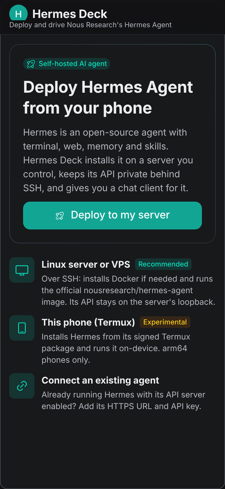
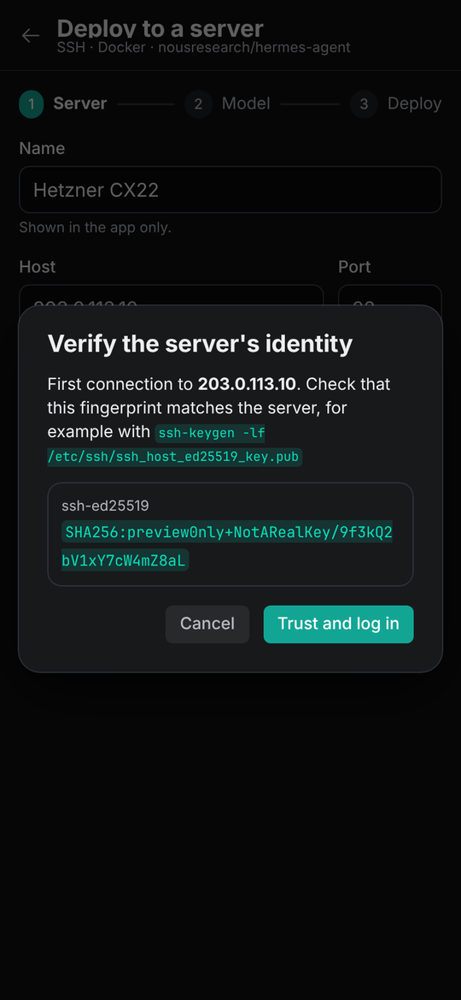
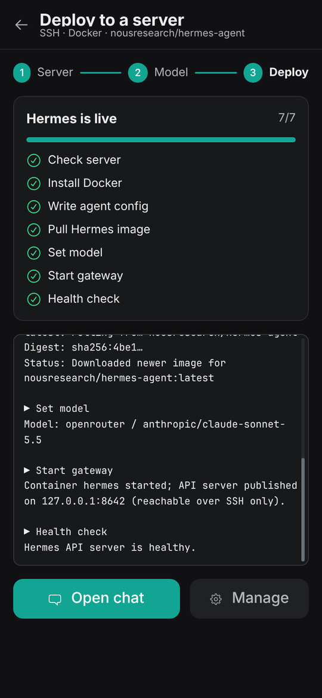
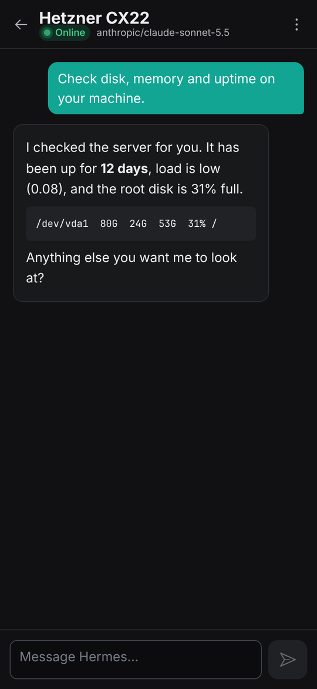
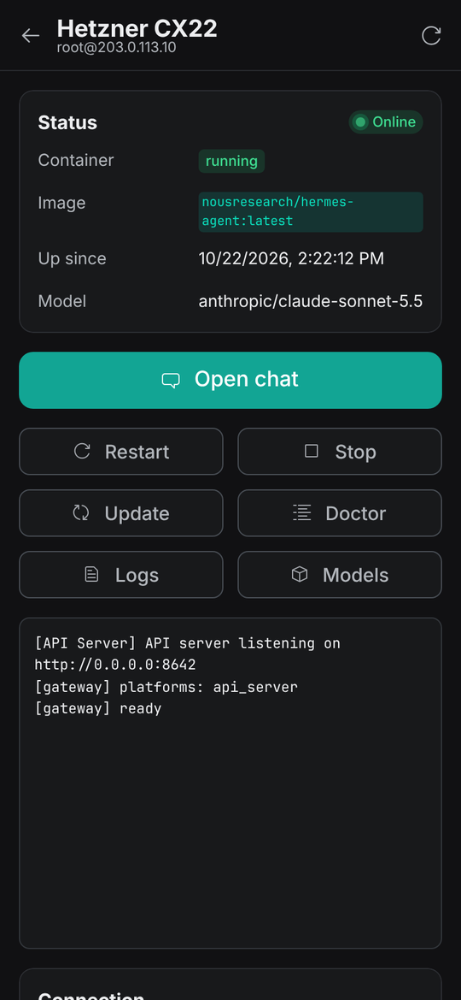

# Hermes Deck

An Android app, built with **[Radix UI Themes](https://www.radix-ui.com/themes)**, that **deploys [Hermes Agent](https://github.com/NousResearch/hermes-agent)** (Nous Research's open-source AI agent) and lets you chat with it from your phone.

<p>
  
  
  
  
  
</p>

## Download

**[Download hermes-deck.apk](https://github.com/kawincodes/kawincodes/releases/latest/download/hermes-deck.apk)** (Android 7.0+). Open it on your phone and allow installing apps from your browser when Android asks. It is a debug-signed build, so Play Protect may show a warning.

## What it does

| Target | How Hermes gets deployed |
|:--|:--|
| **Linux server / VPS** (recommended) | Over SSH, the app installs Docker if it's missing, writes Hermes' `.env` (provider key and API server key, mode 600), sets the model, and runs the official `nousresearch/hermes-agent` image with `gateway run`. It then checks `/health` before reporting success. |
| **This phone (Termux)**, experimental | Installs Hermes from its signed Termux APT repository and checks the repository key fingerprint first. It then starts the gateway on `127.0.0.1:8642` through Termux's `RUN_COMMAND` API. |
| **Existing agent** | Connects to any Hermes with `API_SERVER_ENABLED=true` over HTTPS. |

After deployment:

- **Chat** streams replies from Hermes' OpenAI-compatible `/v1/chat/completions` endpoint. When the agent runs a tool, a live tool chip shows what it's doing (from Hermes' `hermes.tool.progress` events).
- **Manage** gives you status, restart, stop/start, update (pulls a new image and recreates the container), `hermes doctor`, logs, the model list, remove container, and forget agent.

## Security model

- **The API port never opens to the internet.** The container publishes 8642 on the server's `127.0.0.1` only. The app reaches it through an SSH local forward, which the phone also binds to `127.0.0.1`.
- **Host keys are pinned before authentication.** The first connection shows the server's `SHA256:` fingerprint so you can compare it with `ssh-keygen -lf`. After that, any other key is refused before your password or key is ever sent.
- **Secrets stay out of argv and logs.** The deploy script is staged into `~/.hermes-deck/` (0700, file 0600), run, then deleted. A sudo password travels on stdin, and the script detaches its own stdin, so nothing else can read it. Keys go into `.env` through a quoted heredoc and are validated against a strict character set, so they can't break out of the file or the shell.
- **Local storage is encrypted.** SSH credentials, API keys and chat history are encrypted with AES-256-GCM using a non-exportable Android Keystore key. Backups are disabled.
- **Cleartext traffic is limited.** The network security config allows plain HTTP to `127.0.0.1`/`localhost` only. Agent HTTP runs in native code with redirects disabled, so the bearer token can't follow a redirect to another origin.

## Architecture

```
React 19 + Radix UI Themes (src/)          ← all screens
        │  Capacitor bridge
Native Java plugins (android/app/src/main/java/dev/kawin/hermesdeck/plugins/)
  Ssh         JSch + Bouncy Castle (Ed25519/X25519 on any Android), exec streaming, port forward
  HermesHttp  native HTTP + SSE streaming (no WebView CORS)
  Termux      RUN_COMMAND intents + result PendingIntent
  Vault       Android Keystore AES-GCM storage
```

Radix UI is a React library, so the app is a React UI packaged with Capacitor, with native plugins for the things a WebView can't do (SSH sockets, keystore, Termux).

## Build

Requirements: Node 22+, JDK 21, and the Android SDK (platform 36).

```bash
cd hermes-deck
npm ci
npm run android:apk          # build web, sync Capacitor, ./gradlew assembleDebug
adb install android/app/build/outputs/apk/debug/app-debug.apk
```

The **Hermes Deck Android** GitHub Actions workflow builds the same debug APK on every push that touches `hermes-deck/` and uploads it as an artifact. Pushing a `hermes-deck-v*` tag, or running the workflow manually with **release** set to such a tag, also publishes it as a GitHub release. That release is what the download link above points to.

For a release build, create a signing key and run `./gradlew assembleRelease` with your signing config. Signing keys are not checked in.

### Browser preview

```bash
npm run dev
```

This runs the UI in a browser. A browser can't open SSH connections, so SSH and Termux are **simulated** there (`src/native/web.ts`), including a fake agent at `127.0.0.1:18642`, so every screen can be clicked through. The Android build uses the real plugins.

## Tests

```bash
npm test                                         # 30 tests: SSE parser, chat client, script generation,
                                                 # plus the generated bash run with fake docker + shellcheck
cd android && ./gradlew testDebugUnitTest        # SSH plugin logic against a throwaway local OpenSSH server
```

`SshSupportTest` is skipped when `sshd` isn't installed. It checks four things against a real server:

- the fingerprint matches `ssh-keygen`
- Ed25519 keys work, including passphrase-protected ones
- a wrong pin is rejected before authentication
- stdin EOF handling and the tunnel work

## Using it

1. Get a VPS (amd64 or arm64, about 2 GB RAM) and an API key from OpenRouter, Anthropic, OpenAI, Google AI Studio or DeepSeek.
2. **Deploy to my server**: enter the host and user, then a password or private key. Verify the fingerprint, then pick the provider and model.
3. Watch the seven deploy steps, then tap **Open chat**.

Messaging platforms (Telegram, Discord, Slack, WhatsApp) can be added later. Run `docker exec -it hermes hermes gateway setup` on the server, then **Restart** in the app. The app's redeploys keep any other `.env` entries.

## Limitations

- Hermes' own docs currently list the Termux package as broken while a fix ships. Android can also stop background Termux processes, so prefer a server.
- Server deployment needs root or sudo, and an amd64/arm64 host where `get.docker.com` supports the distro (or Docker already installed).
- Model ids in the picker mirror Hermes' curated catalog at the time of writing. Choose **Other model id…** for anything else.
