# work.md — FinSoft II full extraction: every SQL query, every screen image, assets and runtime keys

> Companion to [brain.md](brain.md), which holds the functional specification. This file and [`work/`](work/) hold the raw extraction from `base1.apk`:
> **1664 SQL statements** (every one, in full) · **402 screen and layout images** rendered by Android's own layout engine (English and Tamil) · **161 drawables** · **782 UI messages** · **155 SharedPreferences keys** · **163 intent-extra keys** · **14 URLs**.

## Contents

1. [How this was produced](#1-how-this-was-produced)
2. [Screen gallery (every screen)](#2-screen-gallery-every-screen)
3. [SQL catalogue (every query)](#3-sql-catalogue-every-query)
4. [Messages, preferences, intent extras, URLs](#4-messages-preferences-intent-extras-urls)
5. [Layouts and assets](#5-layouts-and-assets)
6. [Reproducing](#6-reproducing)

## 1. How this was produced

| Output | Method |
|---|---|
| SQL catalogue | Each decompiled class (JADX 1.5.5) was parsed into a Java syntax tree with tree-sitter. Every database call was located: SQLite `rawQuery`, `execSQL`, `compileStatement` and the ContentValues helpers `insert`/`insertOrThrow`/`update`/`delete`; JDBC `prepareStatement`, `prepareCall` and `Statement.execute*`. Each statement's full text was rebuilt by resolving string concatenation, local variables, `+=` and `StringBuilder.append`. Parts that are not literals are shown as `${expression}`. Bound parameters (`setString`/`bindString`…), `registerOutParameter` and the columns read back (`getColumnIndex`, `rs.getX("col")`) are linked to each statement. Only 1 of the statements could not be resolved to text |
| Screen images | The app's own resources (3,514 app-owned resource entries, separated from library resources using every dependency AAR's `R.txt`) were compiled with the **same library versions as the APK** (Material 1.14.0, AppCompat 1.7.1, ConstraintLayout 2.2.1, RecyclerView 1.4.0). Every layout was rendered with **Android layoutlib** through Paparazzi 2.0 (AGP 9.0, Pixel 5 device profile). For each screen, `<include>`s are inlined, lists are filled with three sample rows of the real row layout, ViewPagers show their fragment layout, and screens with an action-bar theme get their toolbar with the title the code sets. Text is the layout's own placeholder text; no live data. Images are 540 px wide |
| Messages / prefs / extras | The same syntax-tree pass: `Toast.makeText`, `Snackbar.make`, dialog `setTitle`/`setMessage`/buttons, `setError`, `setHint`; SharedPreferences get/put calls on real prefs and Editor objects; `putExtra` linked to the Intent's target class; `get*Extra` / `getExtras().get*` |
| Drawables | Vectors converted to SVG (app colours resolved), rasters taken at the highest packaged density, shapes and selectors rendered by layoutlib |

The app was never executed. The images show each layout as Android draws it, before the code fills in data. Some views that the code shows or hides at runtime may differ.

## 2. Screen gallery (every screen)

**153 screens** (144 activities, 8 fragments and the open navigation drawer), each shown in English and Tamil. Click an image for full size. **Spec** links to the screen's functional specification in brain.md, and **SQL** to its queries. Two screens, `executiveattendance_displayboard` and `weeklycollectionpatti_dashboard`, build their whole UI in code from server data and have no XML layout to render.

### 8.1 App start, registration, device identity, settings and access control

| Screen | English | தமிழ் (Tamil) |
|---|---|---|
| **Branch-level device access** `branchmobiledeviceaccescontrol_act` activity [Spec](brain/modules/01-app-start-registration-device-identity-settings.md#branch-level-device-access--branchmobiledeviceaccescontrolact) · [SQL](work/sql/01-app-start-registration-device-identity-settings.md#branchmobiledeviceaccescontrolact) | <a href="work/screens/branchmobiledeviceaccescontrol_act.png">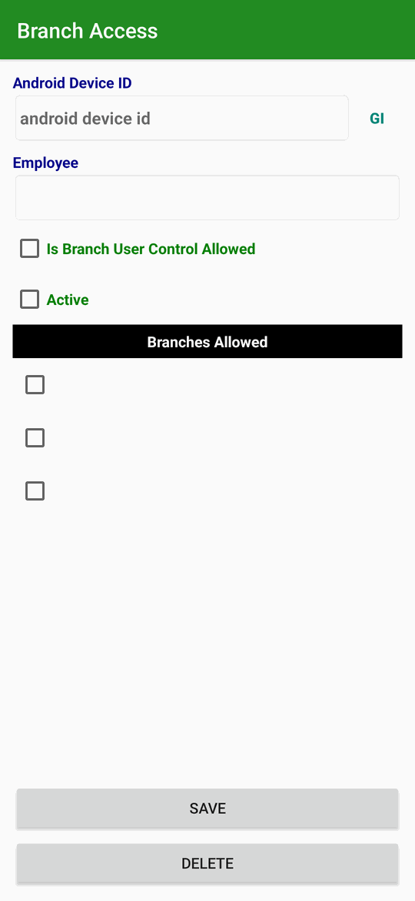</a> | <a href="work/screens/branchmobiledeviceaccescontrol_act.ta.png">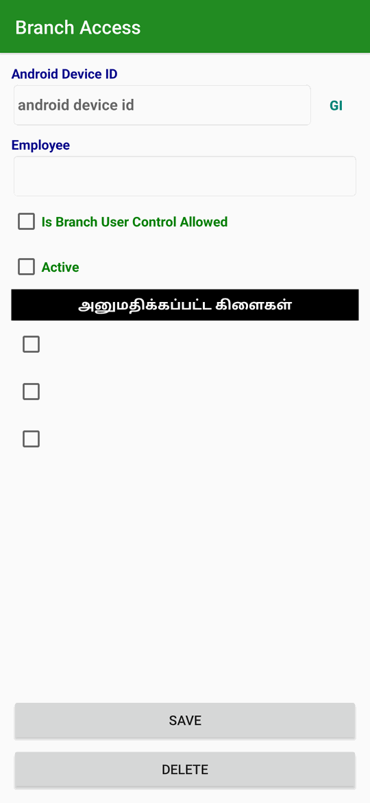</a> |
| **Collection report printing method picker** `collectionreportprintingmethods_searchlist` activity [Spec](brain/modules/01-app-start-registration-device-identity-settings.md#collection-report-printing-method-picker--collectionreportprintingmethodssearchlist) | <a href="work/screens/collectionreportprintingmethods_searchlist.png">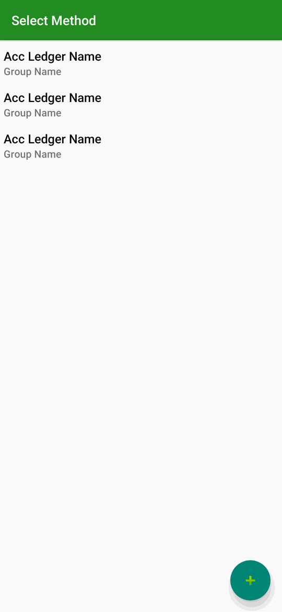</a> | <a href="work/screens/collectionreportprintingmethods_searchlist.ta.png">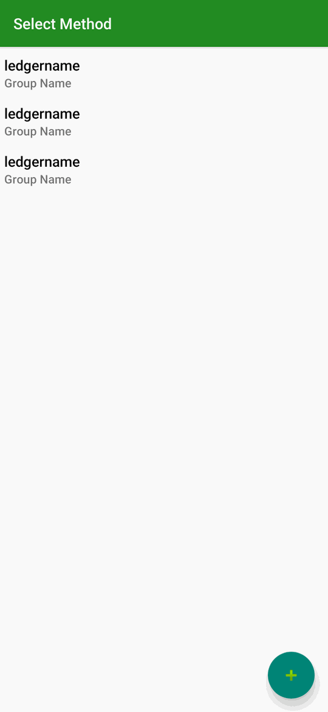</a> |
| **Device and APP Info** `deviceidentity` activity [Spec](brain/modules/01-app-start-registration-device-identity-settings.md#device-and-app-info--deviceidentity) · [SQL](work/sql/01-app-start-registration-device-identity-settings.md#deviceidentity) | <a href="work/screens/deviceidentity.png">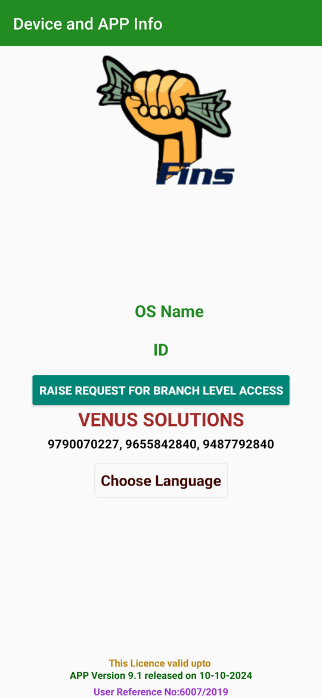</a> |  |
| **Local SQL Server connection setup** `sqlserverconnectionproperties` activity [Spec](brain/modules/01-app-start-registration-device-identity-settings.md#local-sql-server-connection-setup--sqlserverconnectionproperties) |  | <a href="work/screens/sqlserverconnectionproperties.ta.png">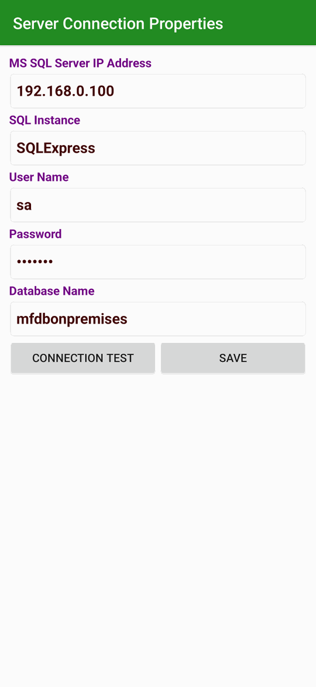</a> |
| **Menu Access Control (User Privileges)** `userroleprevilages_act` activity [Spec](brain/modules/01-app-start-registration-device-identity-settings.md#menu-access-control-user-privileges--userroleprevilagesact) · [SQL](work/sql/01-app-start-registration-device-identity-settings.md#userroleprevilagesact) | <a href="work/screens/userroleprevilages_act.png">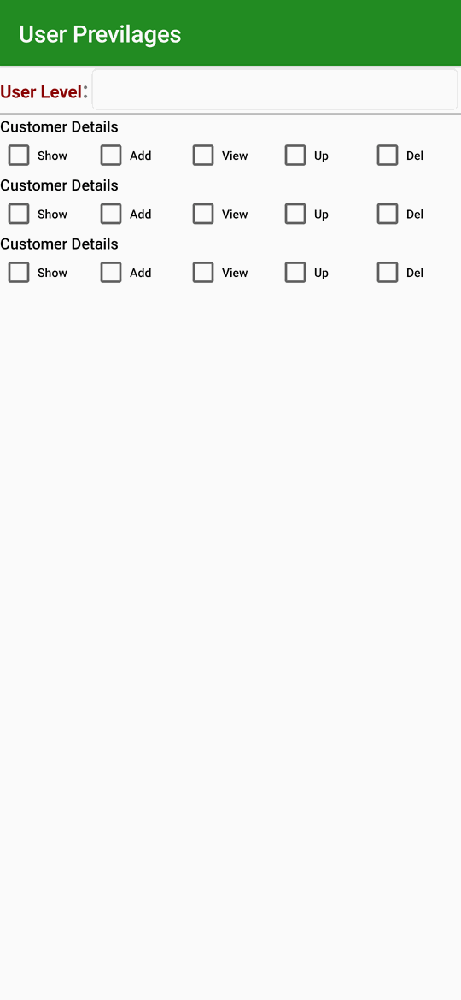</a> |  |
| **Mobile device access setup** `mobiledeviceaccescontrol_act` activity [Spec](brain/modules/01-app-start-registration-device-identity-settings.md#mobile-device-access-setup--mobiledeviceaccescontrolact) · [SQL](work/sql/01-app-start-registration-device-identity-settings.md#mobiledeviceaccescontrolact) | <a href="work/screens/mobiledeviceaccescontrol_act.png">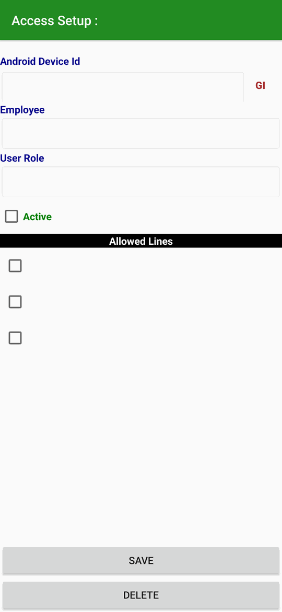</a> | <a href="work/screens/mobiledeviceaccescontrol_act.ta.png">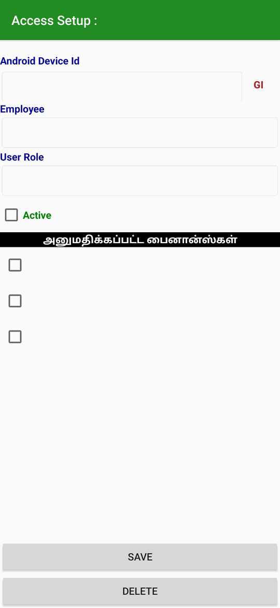</a> |
| **OTP verification and demo admin-device registration** `otpverificationact` activity [Spec](brain/modules/01-app-start-registration-device-identity-settings.md#otp-verification-and-demo-admin-device-registration--otpverificationact) · [SQL](work/sql/01-app-start-registration-device-identity-settings.md#otpverificationact) |  | <a href="work/screens/otpverificationact.ta.png">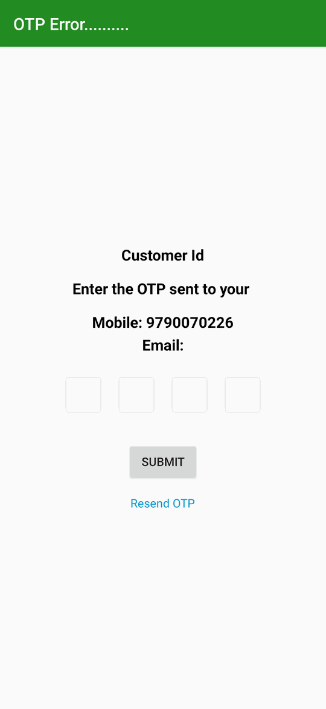</a> |
| **Play-Store demo registration** `playstoredemouserregistrationact` activity [Spec](brain/modules/01-app-start-registration-device-identity-settings.md#play-store-demo-registration--playstoredemouserregistrationact) |  | <a href="work/screens/playstoredemouserregistrationact.ta.png">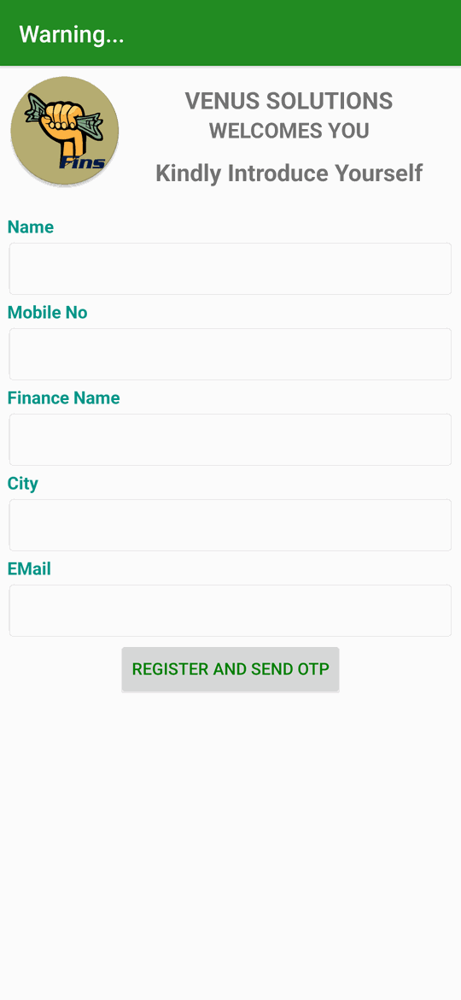</a> |
| **Registration key entry** `collectdbinfofromweb` activity [Spec](brain/modules/01-app-start-registration-device-identity-settings.md#registration-key-entry--collectdbinfofromweb) |  | <a href="work/screens/collectdbinfofromweb.ta.png">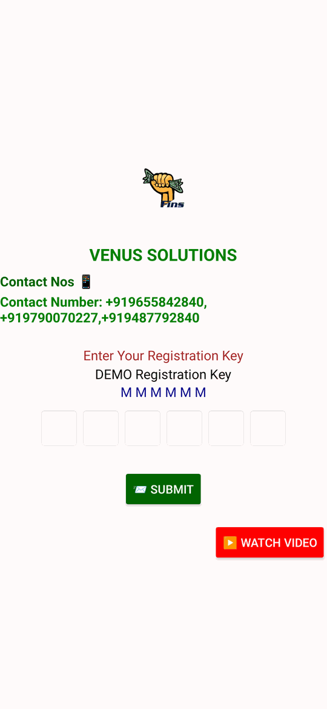</a> |
| **Settings** `settings_act` activity [Spec](brain/modules/01-app-start-registration-device-identity-settings.md#settings--settingsact) · [SQL](work/sql/01-app-start-registration-device-identity-settings.md#settingsact) |  | <a href="work/screens/settings_act.ta.png">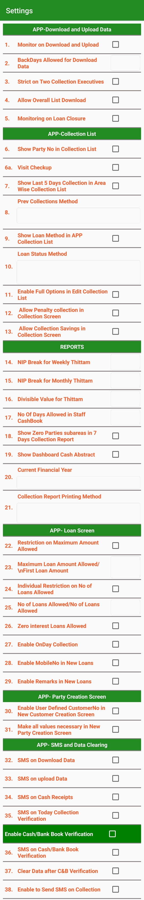</a> |
| **Special Access Settings** `specialaccesscontrolact` activity [Spec](brain/modules/01-app-start-registration-device-identity-settings.md#special-access-settings--specialaccesscontrolact) · [SQL](work/sql/01-app-start-registration-device-identity-settings.md#specialaccesscontrolact) |  | <a href="work/screens/specialaccesscontrolact.ta.png">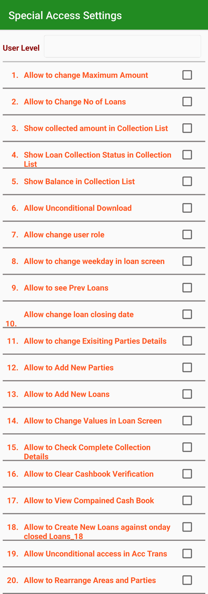</a> |
| **Splash / boot router** `splash` activity [Spec](brain/modules/01-app-start-registration-device-identity-settings.md#splash--boot-router--splash) |  |  |
| **Sync Resources** `syncresources` activity [Spec](brain/modules/01-app-start-registration-device-identity-settings.md#sync-resources--syncresources) · [SQL](work/sql/01-app-start-registration-device-identity-settings.md#syncresources) |  |  |
| **Vendor website** `financesoftwaredontinwebview` activity [Spec](brain/modules/01-app-start-registration-device-identity-settings.md#vendor-website--financesoftwaredontinwebview) |  |  |

### 8.2 Navigation hub, routers and line/branch selection

| Screen | English | தமிழ் (Tamil) |
|---|---|---|
| **Branch / line / period picker** `selectbranchandfinance` activity [Spec](brain/modules/02-navigation-hub-routers-line-branch-selection.md#branch--line--period-picker--selectbranchandfinance) · [SQL](work/sql/02-navigation-hub-routers-line-branch-selection.md#selectbranchandfinance) | <a href="work/screens/selectbranchandfinance.png">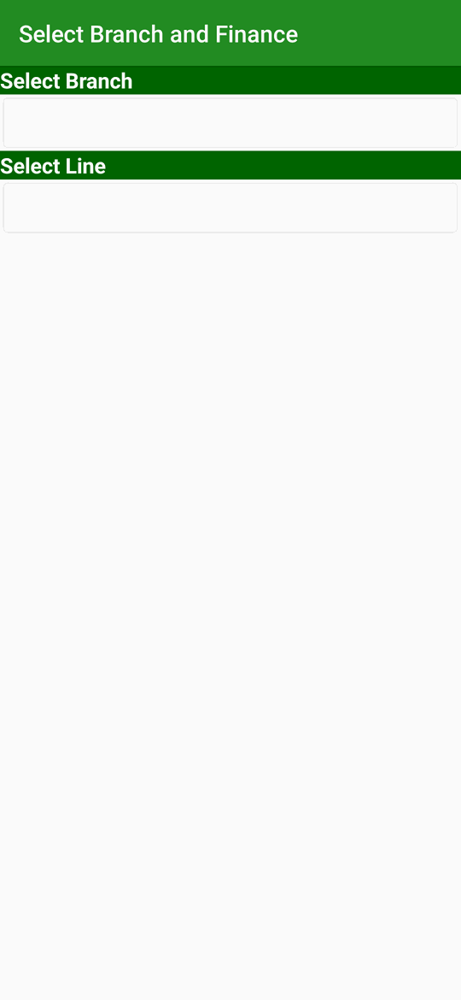</a> |  |
| **Branch selection & branch re-sync** `refreshorreloadbrancheslist` activity [Spec](brain/modules/02-navigation-hub-routers-line-branch-selection.md#branch-selection--branch-re-sync--refreshorreloadbrancheslist) · [SQL](work/sql/02-navigation-hub-routers-line-branch-selection.md#refreshorreloadbrancheslist) |  |  |
| **Navigation drawer (open)** `navigationdrawactivity` activity [Spec](brain/modules/02-navigation-hub-routers-line-branch-selection.md#home-dashboard--navigation-drawer--navigationdrawactivity) · [SQL](work/sql/02-navigation-hub-routers-line-branch-selection.md#navigationdrawactivity) | <a href="work/screens/navigation_drawer_open.png">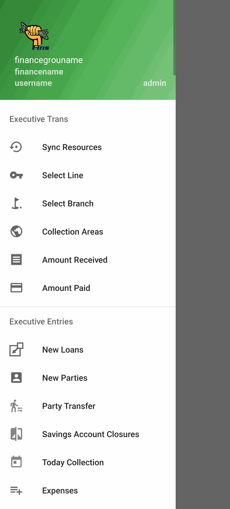</a> | <a href="work/screens/navigation_drawer_open.ta.png">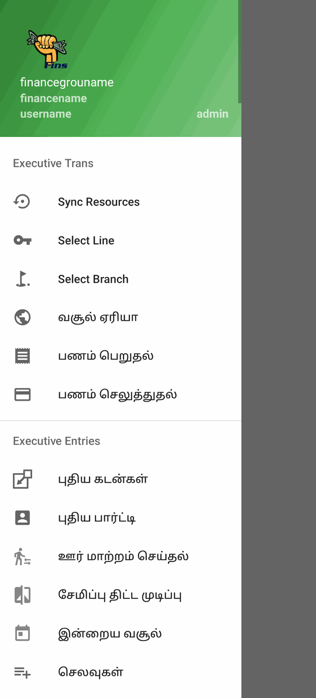</a> |
| **Line (finance) list & line chooser** `refreshorreloadfinancelist` activity [Spec](brain/modules/02-navigation-hub-routers-line-branch-selection.md#line-finance-list--line-chooser--refreshorreloadfinancelist) · [SQL](work/sql/02-navigation-hub-routers-line-branch-selection.md#refreshorreloadfinancelist) | <a href="work/screens/refreshorreloadfinancelist.png">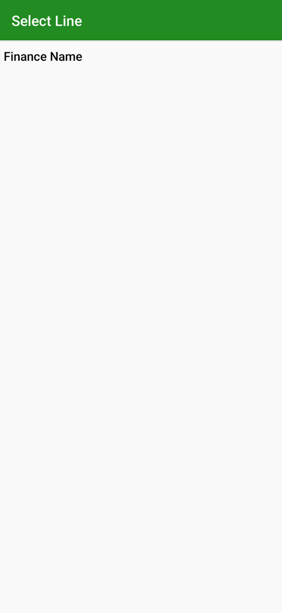</a> |  |

### 8.3 Offline mode: download, upload and sync services

| Screen | English | தமிழ் (Tamil) |
|---|---|---|
| **Archived loan details** `archievedloandisplay` activity [Spec](brain/modules/03-offline-mode-download-upload-sync-services.md#archived-loan-details--archievedloandisplay) |  | <a href="work/screens/archievedloandisplay.ta.png">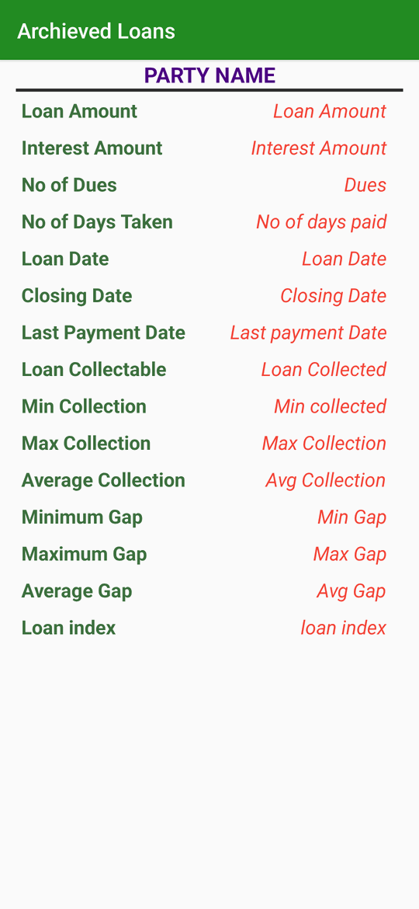</a> |
| **Download Data** `downloaddata` activity [Spec](brain/modules/03-offline-mode-download-upload-sync-services.md#download-data--downloaddata) · [SQL](work/sql/03-offline-mode-download-upload-sync-services.md#downloaddata) | <a href="work/screens/downloaddata.png">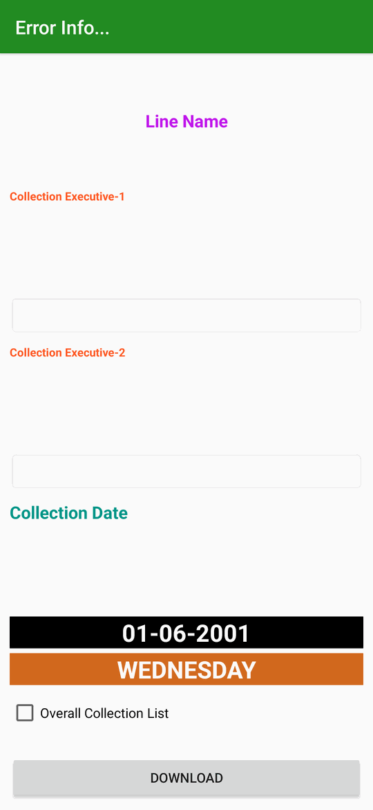</a> | <a href="work/screens/downloaddata.ta.png">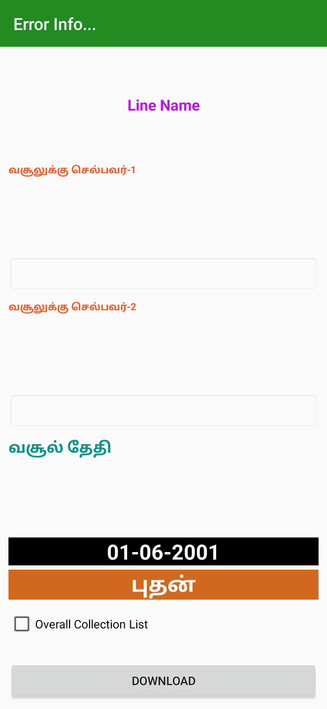</a> |
| **Today Collection (offline list)** `newtodaycollectionofflinedata_list` activity [Spec](brain/modules/03-offline-mode-download-upload-sync-services.md#today-collection-offline-list--newtodaycollectionofflinedatalist) · [SQL](work/sql/03-offline-mode-download-upload-sync-services.md#newtodaycollectionofflinedatalist) |  | <a href="work/screens/newtodaycollectionofflinedata_list.ta.png">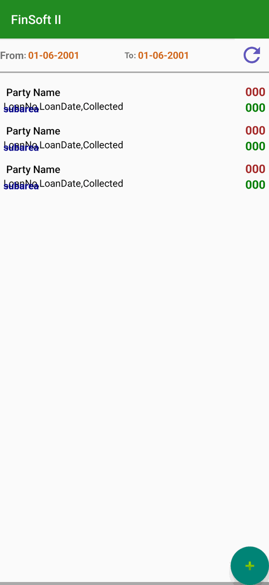</a> |
| **Upload Control / Download Control** `uploaddownloadcontroling` activity [Spec](brain/modules/03-offline-mode-download-upload-sync-services.md#upload-control--download-control--uploaddownloadcontroling) · [SQL](work/sql/03-offline-mode-download-upload-sync-services.md#uploaddownloadcontroling) |  | <a href="work/screens/uploaddownloadcontroling.ta.png">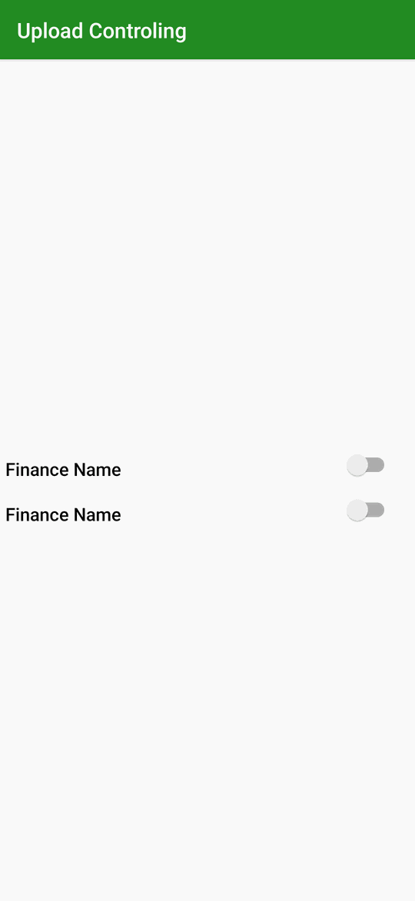</a> |
| **Upload Data** `uploadcollection` activity [Spec](brain/modules/03-offline-mode-download-upload-sync-services.md#upload-data--uploadcollection) · [SQL](work/sql/03-offline-mode-download-upload-sync-services.md#uploadcollection) | <a href="work/screens/uploadcollection.png">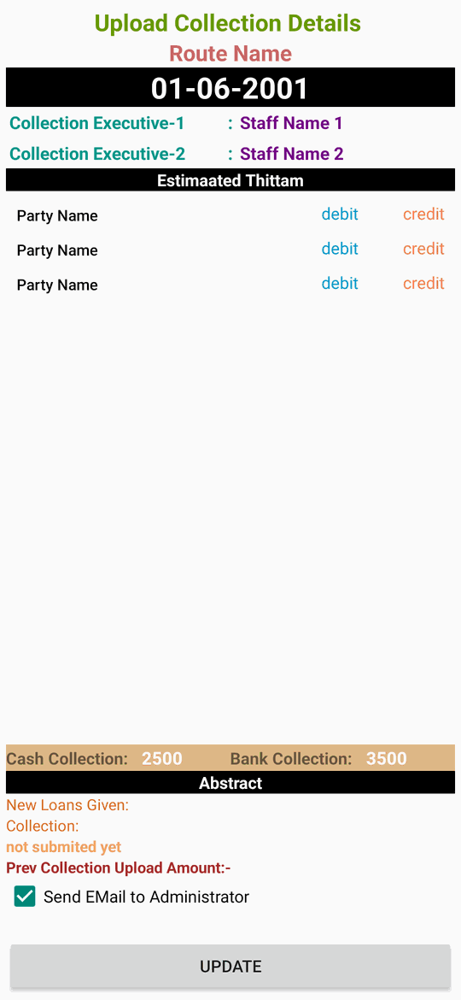</a> | <a href="work/screens/uploadcollection.ta.png">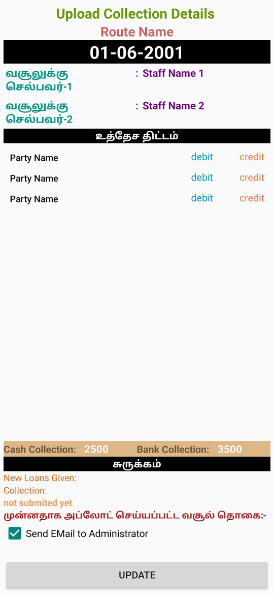</a> |

### 8.4 Offline collection entry (area-wise collection list & individual collection)

| Screen | English | தமிழ் (Tamil) |
|---|---|---|
| **Area-wise collection list (party pages per collection area)** `tabbedcollectionlistmviewpager` activity [Spec](brain/modules/04-offline-collection-entry-area-wise-collection.md#area-wise-collection-list-party-pages-per-collection-area--tabbedcollectionlistmviewpager) · [SQL](work/sql/04-offline-collection-entry-area-wise-collection.md#tabbedcollectionlistmviewpager) | <a href="work/screens/tabbedcollectionlistmviewpager.png">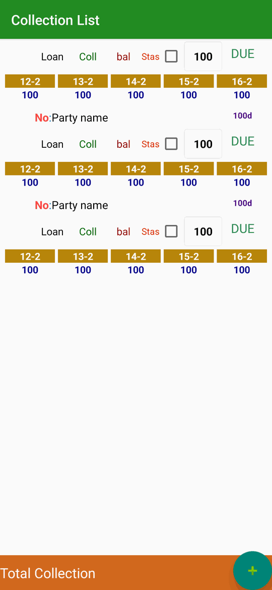</a> | <a href="work/screens/tabbedcollectionlistmviewpager.ta.png">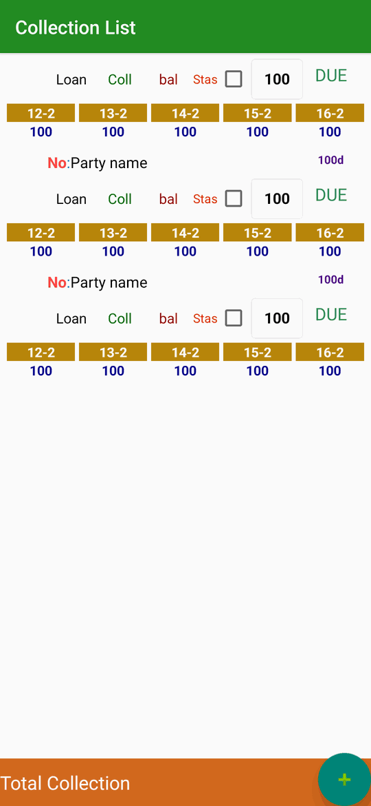</a> |
| **Direct collection entry (online, single loan)** `directcollectionentry` activity [Spec](brain/modules/04-offline-collection-entry-area-wise-collection.md#direct-collection-entry-online-single-loan--directcollectionentry) · [SQL](work/sql/04-offline-collection-entry-area-wise-collection.md#directcollectionentry) | <a href="work/screens/directcollectionentry.png">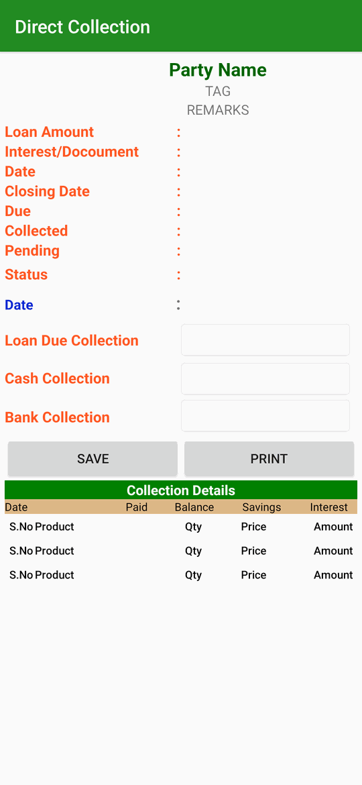</a> | <a href="work/screens/directcollectionentry.ta.png">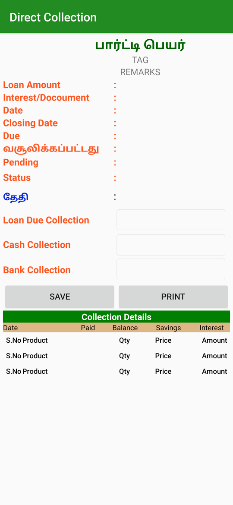</a> |
| **Edit one party's collection (cash/bank split)** `collectionedit_individualcollection` activity [Spec](brain/modules/04-offline-collection-entry-area-wise-collection.md#edit-one-partys-collection-cashbank-split--collectioneditindividualcollection) | <a href="work/screens/collectionedit_individualcollection.png">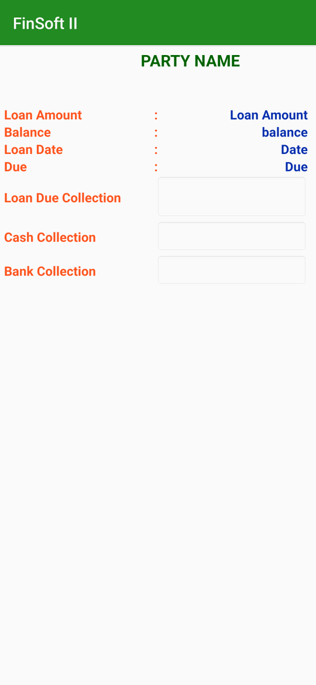</a> |  |
| **Individual collection entry (per-party swipe form)** `tabbedindividualcollectionentry` activity [Spec](brain/modules/04-offline-collection-entry-area-wise-collection.md#individual-collection-entry-per-party-swipe-form--tabbedindividualcollectionentry) · [SQL](work/sql/04-offline-collection-entry-area-wise-collection.md#tabbedindividualcollectionentry) | <a href="work/screens/tabbedindividualcollectionentry.png">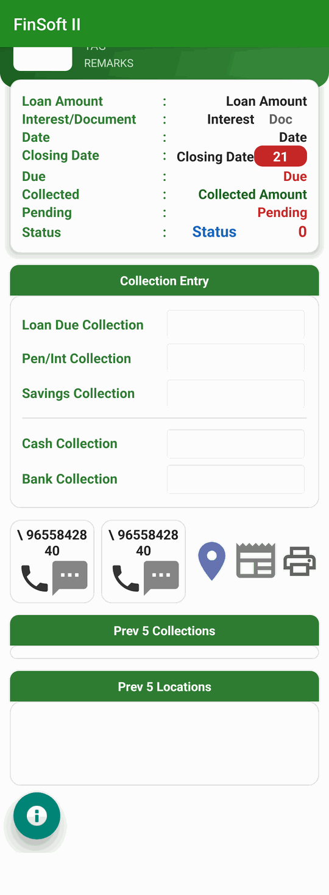</a> | <a href="work/screens/tabbedindividualcollectionentry.ta.png">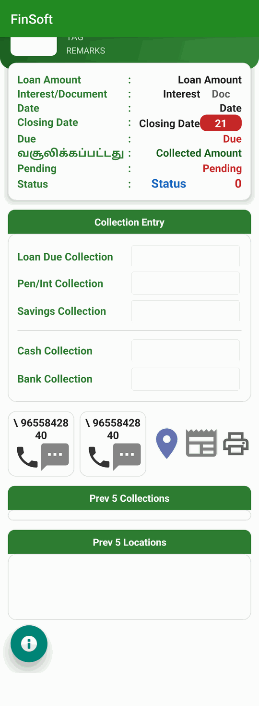</a> |
| **Individual loan collection details (history, print & share)** `selectedloancollectiondetails` activity [Spec](brain/modules/04-offline-collection-entry-area-wise-collection.md#individual-loan-collection-details-history-print--share--selectedloancollectiondetails) · [SQL](work/sql/04-offline-collection-entry-area-wise-collection.md#selectedloancollectiondetails) | <a href="work/screens/selectedloancollectiondetails.png">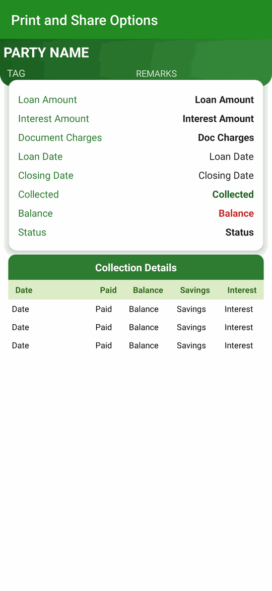</a> | <a href="work/screens/selectedloancollectiondetails.ta.png">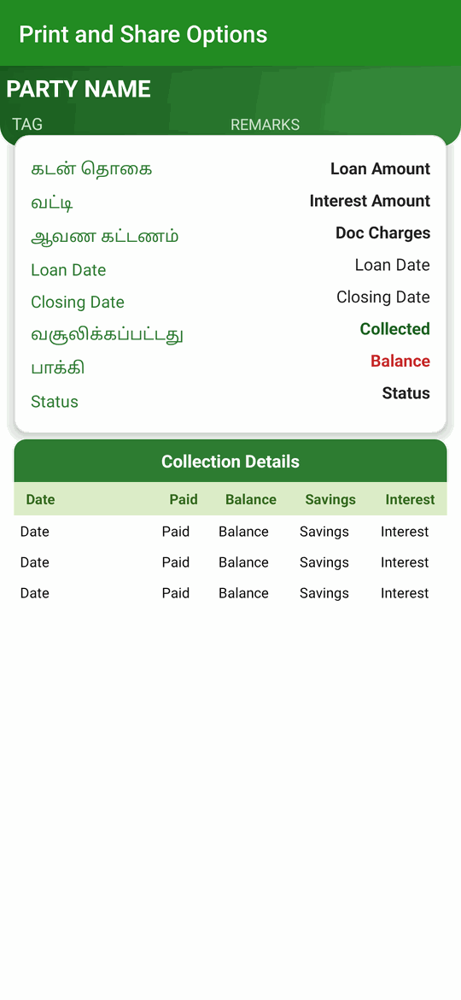</a> |
| **Legacy area-wise collection list (ViewPager2)** `tabbedcollectionlist` activity [Spec](brain/modules/04-offline-collection-entry-area-wise-collection.md#legacy-area-wise-collection-list-viewpager2--tabbedcollectionlist) · [SQL](work/sql/04-offline-collection-entry-area-wise-collection.md#tabbedcollectionlist) |  |  |

### 8.5 Online collection entry & editing

| Screen | English | தமிழ் (Tamil) |
|---|---|---|
| **Collection editor (basic)** `editing_collections_act` activity [Spec](brain/modules/05-online-collection-entry-editing.md#collection-editor-basic--editingcollectionsact) · [SQL](work/sql/05-online-collection-entry-editing.md#editingcollectionsact) | <a href="work/screens/editing_collections_act.png">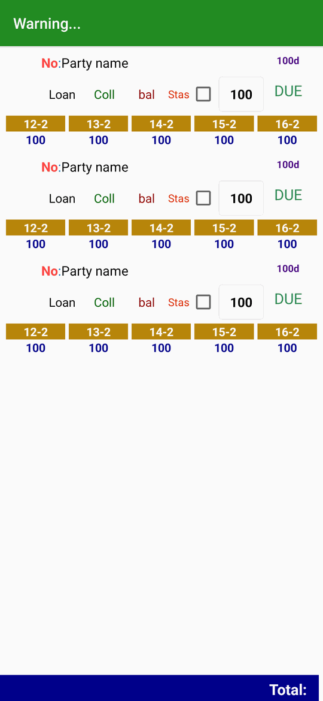</a> |  |
| **Collection Entry (online) / full-options collection editor** `editing_collectionswithfulloptions_act` activity [Spec](brain/modules/05-online-collection-entry-editing.md#collection-entry-online--full-options-collection-editor--editingcollectionswithfulloptionsact) · [SQL](work/sql/05-online-collection-entry-editing.md#editingcollectionswithfulloptionsact) |  | <a href="work/screens/editing_collectionswithfulloptions_act.ta.png">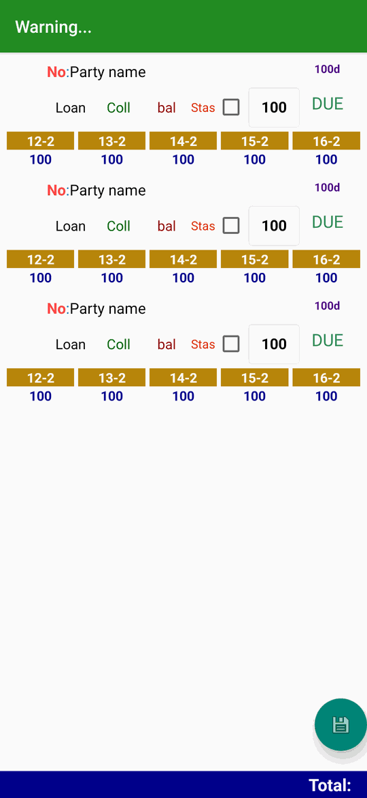</a> |
| **Loans Collection register** `editing_collectionlist_act` activity [Spec](brain/modules/05-online-collection-entry-editing.md#loans-collection-register--editingcollectionlistact) · [SQL](work/sql/05-online-collection-entry-editing.md#editingcollectionlistact) | <a href="work/screens/editing_collectionlist_act.png">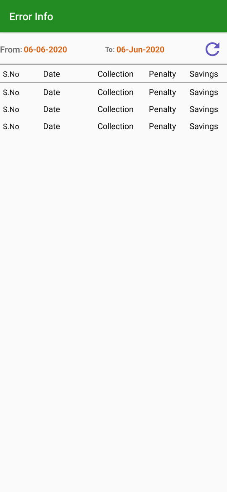</a> |  |

### 8.6 Collection reports (collection for a day, abstract, 7-days, unpaid parties, day-wise pending, periodic loans)

| Screen | English | தமிழ் (Tamil) |
|---|---|---|
| **7-Days Collection — area list** `collectionarealistforsevendayscollection` activity [Spec](brain/modules/06-collection-reports-collection-day-abstract-7.md#7-days-collection--area-list--collectionarealistforsevendayscollection) · [SQL](work/sql/06-collection-reports-collection-day-abstract-7.md#collectionarealistforsevendayscollection) |  |  |
| **7-Days Collection — area pages** `sevendayscollectionforselline` activity [Spec](brain/modules/06-collection-reports-collection-day-abstract-7.md#7-days-collection--area-pages--sevendayscollectionforselline) · [SQL](work/sql/06-collection-reports-collection-day-abstract-7.md#sevendayscollectionforselline) |  | <a href="work/screens/sevendayscollectionforselline.ta.png">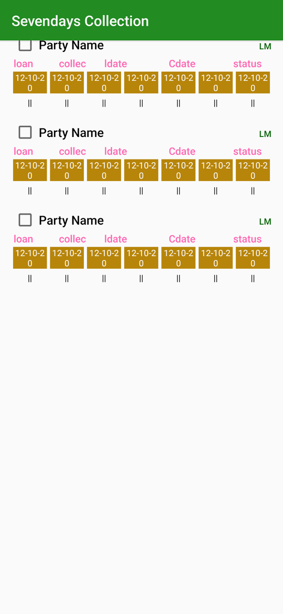</a> |
| **Collection Abstract for a Day** `todaycollectionabstractlist` activity [Spec](brain/modules/06-collection-reports-collection-day-abstract-7.md#collection-abstract-for-a-day--todaycollectionabstractlist) · [SQL](work/sql/06-collection-reports-collection-day-abstract-7.md#todaycollectionabstractlist) | <a href="work/screens/todaycollectionabstractlist.png">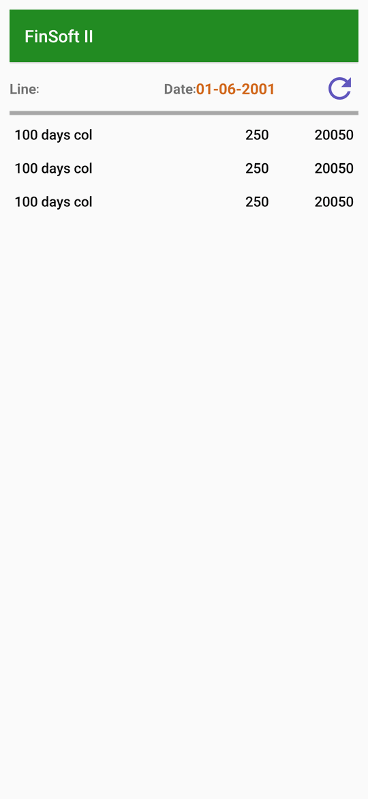</a> |  |
| **Collection areas for Loan Parties/Loans** `collectionarealistforloanpartyandloans` activity [Spec](brain/modules/06-collection-reports-collection-day-abstract-7.md#collection-areas-for-loan-partiesloans--collectionarealistforloanpartyandloans) · [SQL](work/sql/06-collection-reports-collection-day-abstract-7.md#collectionarealistforloanpartyandloans) |  | <a href="work/screens/collectionarealistforloanpartyandloans.ta.png">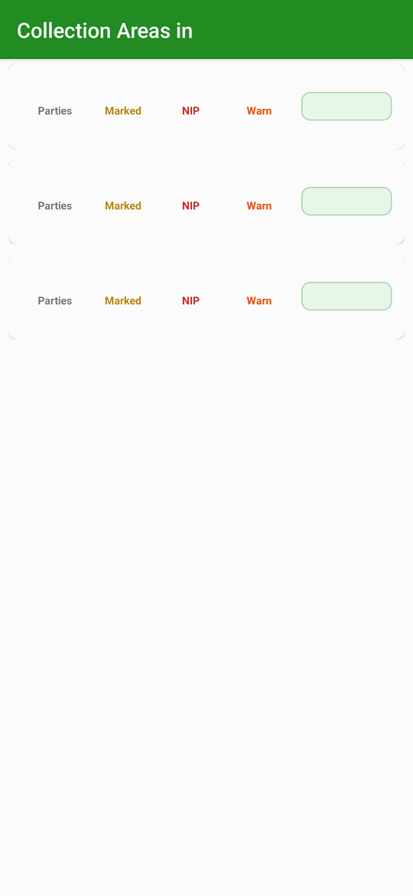</a> |
| **Collection for a Day** `todaycollectionlist` activity [Spec](brain/modules/06-collection-reports-collection-day-abstract-7.md#collection-for-a-day--todaycollectionlist) · [SQL](work/sql/06-collection-reports-collection-day-abstract-7.md#todaycollectionlist) | <a href="work/screens/todaycollectionlist.png">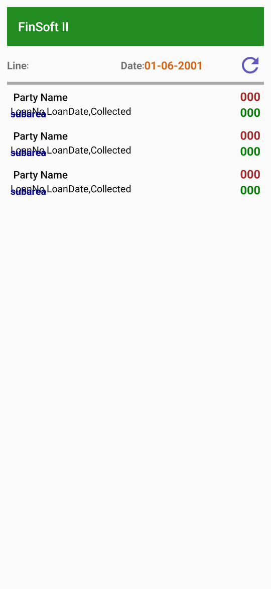</a> |  |
| **Day-wise Pending** `daywisependingreport_act` activity [Spec](brain/modules/06-collection-reports-collection-day-abstract-7.md#day-wise-pending--daywisependingreportact) · [SQL](work/sql/06-collection-reports-collection-day-abstract-7.md#daywisependingreportact) | <a href="work/screens/daywisependingreport_act.png">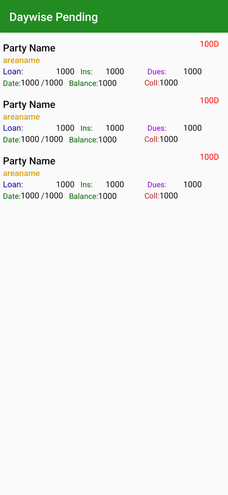</a> | <a href="work/screens/daywisependingreport_act.ta.png">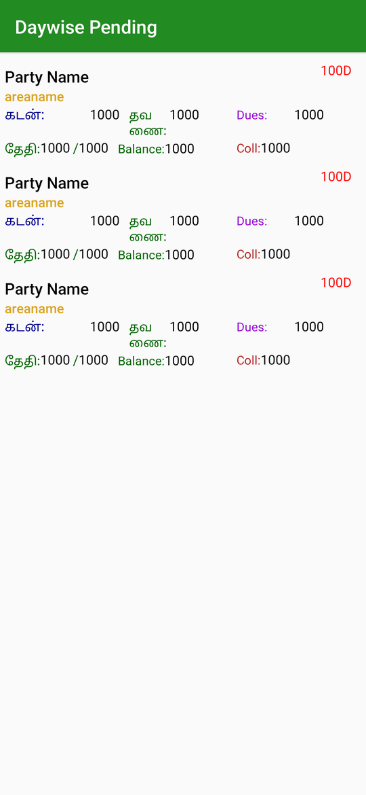</a> |
| **Periodic Loans** `periodicloareportlist_act` activity [Spec](brain/modules/06-collection-reports-collection-day-abstract-7.md#periodic-loans--periodicloareportlistact) · [SQL](work/sql/06-collection-reports-collection-day-abstract-7.md#periodicloareportlistact) | <a href="work/screens/periodicloareportlist_act.png">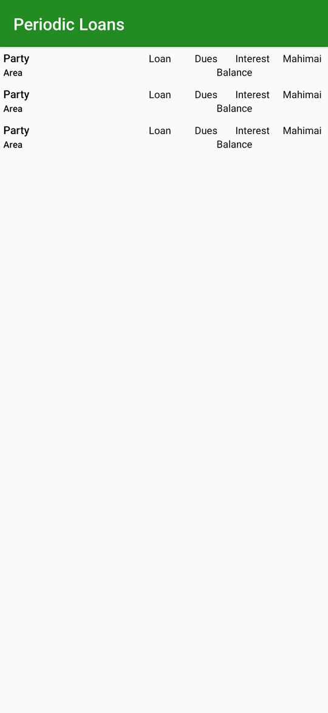</a> |  |
| **Seven-days tabbed stub (unused template)** `newsevendayscollection` activity [Spec](brain/modules/06-collection-reports-collection-day-abstract-7.md#seven-days-tabbed-stub-unused-template--newsevendayscollection) |  |  |
| **Unpaid Parties (result)** `unpaidpartiesonselectedday` activity [Spec](brain/modules/06-collection-reports-collection-day-abstract-7.md#unpaid-parties-result--unpaidpartiesonselectedday) · [SQL](work/sql/06-collection-reports-collection-day-abstract-7.md#unpaidpartiesonselectedday) | <a href="work/screens/unpaidpartiesonselectedday.png">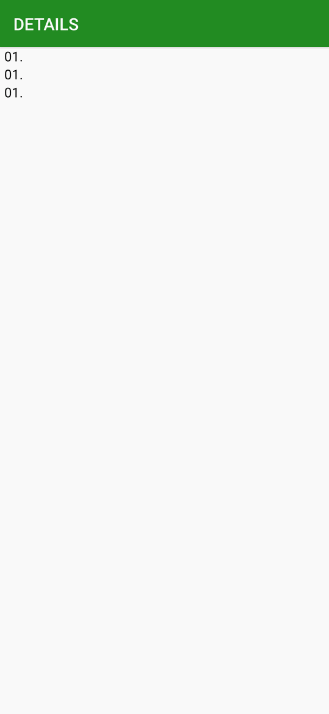</a> |  |
| **Unpaid Parties — date selection** `selectdateforreport` activity [Spec](brain/modules/06-collection-reports-collection-day-abstract-7.md#unpaid-parties--date-selection--selectdateforreport) · [SQL](work/sql/06-collection-reports-collection-day-abstract-7.md#selectdateforreport) |  | <a href="work/screens/selectdateforreport.ta.png">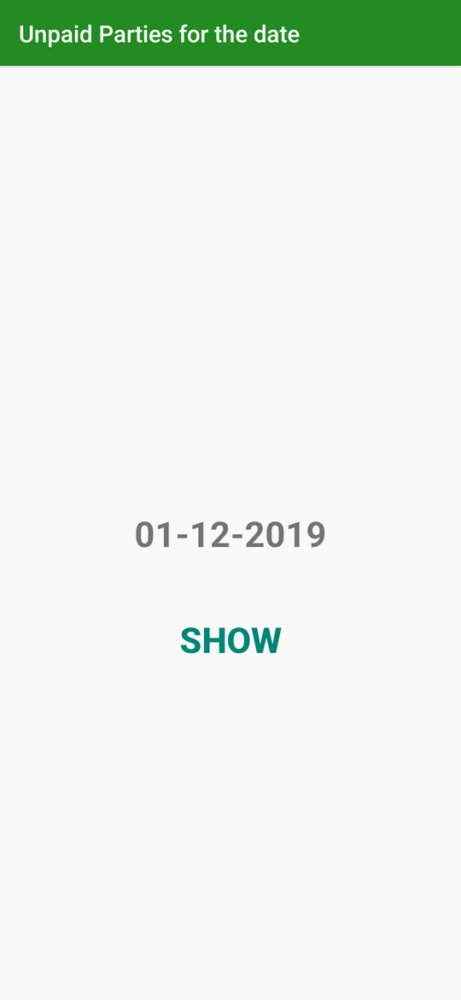</a> |

### 8.7 Parties (borrowers), new loan creation and KYC documents

| Screen | English | தமிழ் (Tamil) |
|---|---|---|
| **Full-screen image viewer** `fullimageview` activity [Spec](brain/modules/07-parties-borrowers-new-loan-creation-kyc.md#full-screen-image-viewer--fullimageview) |  |  |
| **Image picker & cropper** `ImagePickerActivity` activity [Spec](brain/modules/07-parties-borrowers-new-loan-creation-kyc.md#image-picker--cropper--imagepickeractivity) |  |  |
| **Loan documents (photo list)** `documentsphotossearchlist` activity [Spec](brain/modules/07-parties-borrowers-new-loan-creation-kyc.md#loan-documents-photo-list--documentsphotossearchlist) · [SQL](work/sql/07-parties-borrowers-new-loan-creation-kyc.md#documentsphotossearchlist) | <a href="work/screens/documentsphotossearchlist.png">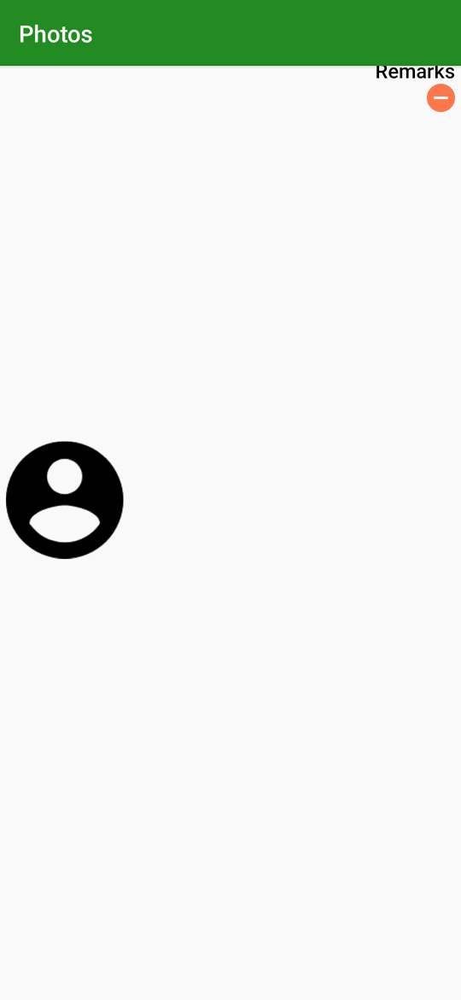</a> |  |
| **Loan parties admin list** `partydetails_searchlist` activity [Spec](brain/modules/07-parties-borrowers-new-loan-creation-kyc.md#loan-parties-admin-list--partydetailssearchlist) · [SQL](work/sql/07-parties-borrowers-new-loan-creation-kyc.md#partydetailssearchlist) | <a href="work/screens/partydetails_searchlist.png">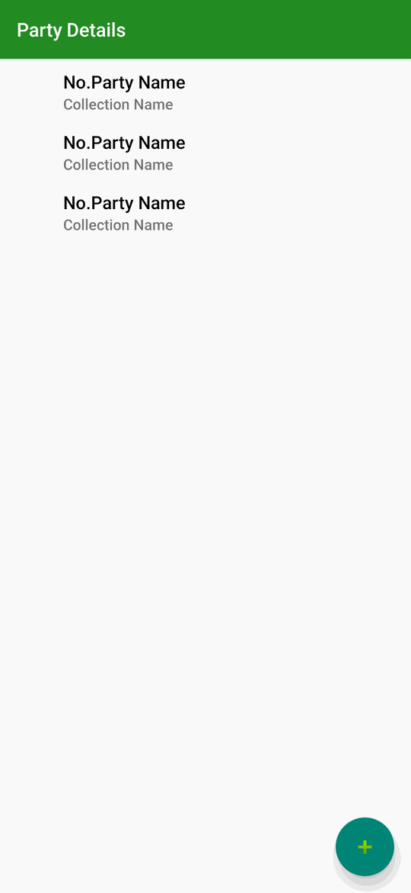</a> |  |
| **New / edit MC loan** `newloancreation` activity [Spec](brain/modules/07-parties-borrowers-new-loan-creation-kyc.md#new--edit-mc-loan--newloancreation) · [SQL](work/sql/07-parties-borrowers-new-loan-creation-kyc.md#newloancreation) | <a href="work/screens/newloancreation.png">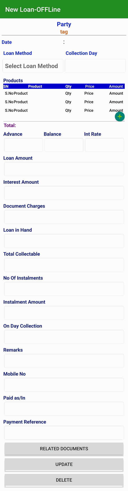</a> | <a href="work/screens/newloancreation.ta.png">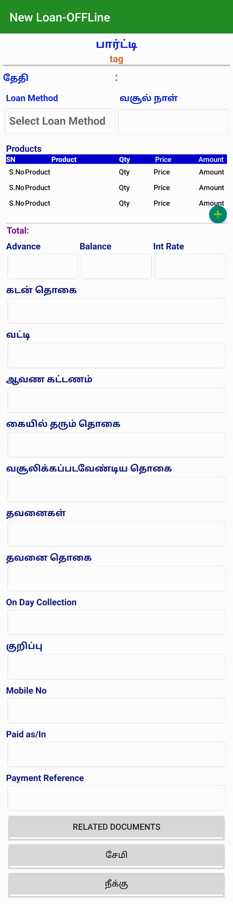</a> |
| **Party (borrower) details & KYC** `partydetails_act` activity [Spec](brain/modules/07-parties-borrowers-new-loan-creation-kyc.md#party-borrower-details--kyc--partydetailsact) · [SQL](work/sql/07-parties-borrowers-new-loan-creation-kyc.md#partydetailsact) |  |  |
| **Party / partner ledger master** `partyandpartnerdetails` activity [Spec](brain/modules/07-parties-borrowers-new-loan-creation-kyc.md#party--partner-ledger-master--partyandpartnerdetails) · [SQL](work/sql/07-parties-borrowers-new-loan-creation-kyc.md#partyandpartnerdetails) |  |  |
| **Party picker for a new loan (per collection area)** `partylistwithprevloansfornewloanselection` activity [Spec](brain/modules/07-parties-borrowers-new-loan-creation-kyc.md#party-picker-for-a-new-loan-per-collection-area--partylistwithprevloansfornewloanselection) · [SQL](work/sql/07-parties-borrowers-new-loan-creation-kyc.md#partylistwithprevloansfornewloanselection) |  |  |
| **Upload one loan document** `documentsupload` activity [Spec](brain/modules/07-parties-borrowers-new-loan-creation-kyc.md#upload-one-loan-document--documentsupload) · [SQL](work/sql/07-parties-borrowers-new-loan-creation-kyc.md#documentsupload) |  |  |

### 8.8 Loan lists, loan & savings closures, party transfer and rearrangement

| Screen | English | தமிழ் (Tamil) |
|---|---|---|
| **Live loans picker for closure** `closableloanssearchlistact` activity [Spec](brain/modules/08-loan-lists-loan-savings-closures-party.md#live-loans-picker-for-closure--closableloanssearchlistact) · [SQL](work/sql/08-loan-lists-loan-savings-closures-party.md#closableloanssearchlistact) |  |  |
| **Live saving accounts** `closablesavings_list` activity [Spec](brain/modules/08-loan-lists-loan-savings-closures-party.md#live-saving-accounts--closablesavingslist) · [SQL](work/sql/08-loan-lists-loan-savings-closures-party.md#closablesavingslist) |  |  |
| **Loan closure entry** `loanclosoureentry` activity [Spec](brain/modules/08-loan-lists-loan-savings-closures-party.md#loan-closure-entry--loanclosoureentry) · [SQL](work/sql/08-loan-lists-loan-savings-closures-party.md#loanclosoureentry) |  |  |
| **Loans list for a line / for today** `loanslist_act` activity [Spec](brain/modules/08-loan-lists-loan-savings-closures-party.md#loans-list-for-a-line--for-today--loanslistact) · [SQL](work/sql/08-loan-lists-loan-savings-closures-party.md#loanslistact) |  |  |
| **Loans of a party by loan index** `loanindexloanswiselist_act` activity [Spec](brain/modules/08-loan-lists-loan-savings-closures-party.md#loans-of-a-party-by-loan-index--loanindexloanswiselistact) · [SQL](work/sql/08-loan-lists-loan-savings-closures-party.md#loanindexloanswiselistact) |  |  |
| **New Party Loans report** `newpartiesnewloanslist_act` activity [Spec](brain/modules/08-loan-lists-loan-savings-closures-party.md#new-party-loans-report--newpartiesnewloanslistact) · [SQL](work/sql/08-loan-lists-loan-savings-closures-party.md#newpartiesnewloanslistact) |  |  |
| **Parties to be Reviewed (closed & renewed loans)** `closed_renewedloanslist_act` activity [Spec](brain/modules/08-loan-lists-loan-savings-closures-party.md#parties-to-be-reviewed-closed--renewed-loans--closedrenewedloanslistact) · [SQL](work/sql/08-loan-lists-loan-savings-closures-party.md#closedrenewedloanslistact) |  |  |
| **Party loan history** `prevloanslist_act` activity [Spec](brain/modules/08-loan-lists-loan-savings-closures-party.md#party-loan-history--prevloanslistact) · [SQL](work/sql/08-loan-lists-loan-savings-closures-party.md#prevloanslistact) |  |  |
| **Party transfer** `partytransfer` activity [Spec](brain/modules/08-loan-lists-loan-savings-closures-party.md#party-transfer--partytransfer) · [SQL](work/sql/08-loan-lists-loan-savings-closures-party.md#partytransfer) |  |  |
| **Previous loan closures** `prevloanclosure_list_act` activity [Spec](brain/modules/08-loan-lists-loan-savings-closures-party.md#previous-loan-closures--prevloanclosurelistact) · [SQL](work/sql/08-loan-lists-loan-savings-closures-party.md#prevloanclosurelistact) |  |  |
| **Previous saving closures** `prevsavingclosure_list_act` activity [Spec](brain/modules/08-loan-lists-loan-savings-closures-party.md#previous-saving-closures--prevsavingclosurelistact) · [SQL](work/sql/08-loan-lists-loan-savings-closures-party.md#prevsavingclosurelistact) |  |  |
| **Rearrange parties** `partyrearrange` activity [Spec](brain/modules/08-loan-lists-loan-savings-closures-party.md#rearrange-parties--partyrearrange) · [SQL](work/sql/08-loan-lists-loan-savings-closures-party.md#partyrearrange) |  |  |
| **Savings account closure** `closingsavingsaccount` activity [Spec](brain/modules/08-loan-lists-loan-savings-closures-party.md#savings-account-closure--closingsavingsaccount) · [SQL](work/sql/08-loan-lists-loan-savings-closures-party.md#closingsavingsaccount) |  |  |
| **Today New Loans (offline)** `newloanslist_act` activity [Spec](brain/modules/08-loan-lists-loan-savings-closures-party.md#today-new-loans-offline--newloanslistact) · [SQL](work/sql/08-loan-lists-loan-savings-closures-party.md#newloanslistact) |  |  |
| **Today New Parties (offline)** `newpartieslist_act` activity [Spec](brain/modules/08-loan-lists-loan-savings-closures-party.md#today-new-parties-offline--newpartieslistact) · [SQL](work/sql/08-loan-lists-loan-savings-closures-party.md#newpartieslistact) |  |  |

### 8.9 Collection areas, maps, GPS staff tracking and attendance

| Screen | English | தமிழ் (Tamil) |
|---|---|---|
| **Add / Edit Collection Area** `collectionareadetails_act` activity [Spec](brain/modules/09-collection-areas-maps-gps-staff-tracking.md#add--edit-collection-area--collectionareadetailsact) · [SQL](work/sql/09-collection-areas-maps-gps-staff-tracking.md#collectionareadetailsact) |  |  |
| **Collection Areas list** `collectionareassearchlist` activity [Spec](brain/modules/09-collection-areas-maps-gps-staff-tracking.md#collection-areas-list--collectionareassearchlist) · [SQL](work/sql/09-collection-areas-maps-gps-staff-tracking.md#collectionareassearchlist) |  |  |
| **Collection areas on map** `maps_collectionareadisplay` activity [Spec](brain/modules/09-collection-areas-maps-gps-staff-tracking.md#collection-areas-on-map--mapscollectionareadisplay) · [SQL](work/sql/09-collection-areas-maps-gps-staff-tracking.md#mapscollectionareadisplay) |  |  |
| **Parties on map** `maps_partydisplay` activity [Spec](brain/modules/09-collection-areas-maps-gps-staff-tracking.md#parties-on-map--mapspartydisplay) · [SQL](work/sql/09-collection-areas-maps-gps-staff-tracking.md#mapspartydisplay) |  |  |
| **Rearrange Areas** `collectionarearearrangeact` activity [Spec](brain/modules/09-collection-areas-maps-gps-staff-tracking.md#rearrange-areas--collectionarearearrangeact) · [SQL](work/sql/09-collection-areas-maps-gps-staff-tracking.md#collectionarearearrangeact) |  |  |
| **Staff Route (GPS track replay)** `staffgpstrackmap_act` activity [Spec](brain/modules/09-collection-areas-maps-gps-staff-tracking.md#staff-route-gps-track-replay--staffgpstrackmapact) · [SQL](work/sql/09-collection-areas-maps-gps-staff-tracking.md#staffgpstrackmapact) |  |  |

### 8.10 Accounts reports: trial balance, balance sheet, P&L, month-wise P&L

| Screen | English | தமிழ் (Tamil) |
|---|---|---|
| **Accounts report parameters** `accountsreports_parameters` activity [Spec](brain/modules/10-accounts-reports-trial-balance-balance-sheet.md#accounts-report-parameters--accountsreportsparameters) · [SQL](work/sql/10-accounts-reports-trial-balance-balance-sheet.md#accountsreportsparameters) |  |  |
| **Balance Sheet / Trial Balance / P&L Statement** `tbbspl_list` activity [Spec](brain/modules/10-accounts-reports-trial-balance-balance-sheet.md#balance-sheet--trial-balance--pl-statement--tbbspllist) · [SQL](work/sql/10-accounts-reports-trial-balance-balance-sheet.md#tbbspllist) |  |  |
| **Component particulars (drill-down)** `tbbspl_particulars` activity [Spec](brain/modules/10-accounts-reports-trial-balance-balance-sheet.md#component-particulars-drill-down--tbbsplparticulars) · [SQL](work/sql/10-accounts-reports-trial-balance-balance-sheet.md#tbbsplparticulars) |  |  |
| **Month-wise P&L pager** `monthwisepandl` activity [Spec](brain/modules/10-accounts-reports-trial-balance-balance-sheet.md#month-wise-pl-pager--monthwisepandl) |  |  |
| **Monthly P&L page** `monthlypandl_fragment` fragment [Spec](brain/modules/10-accounts-reports-trial-balance-balance-sheet.md#monthly-pl-page--monthlypandlfragment) · [SQL](work/sql/10-accounts-reports-trial-balance-balance-sheet.md#monthlypandlfragment) |  |  |

### 8.11 Daily Patti (outstanding) reports and meeting report

| Screen | English | தமிழ் (Tamil) |
|---|---|---|
| **All-finance daily patti pager (legacy)** `allfinancedailypatti` activity [Spec](brain/modules/11-daily-patti-outstanding-reports-meeting-report.md#all-finance-daily-patti-pager-legacy--allfinancedailypatti) · [SQL](work/sql/11-daily-patti-outstanding-reports-meeting-report.md#allfinancedailypatti) |  |  |
| **Bad-debt loss list** `dailypatti_varakadanillapulist_act` activity [Spec](brain/modules/11-daily-patti-outstanding-reports-meeting-report.md#bad-debt-loss-list--dailypattivarakadanillapulistact) · [SQL](work/sql/11-daily-patti-outstanding-reports-meeting-report.md#dailypattivarakadanillapulistact) |  |  |
| **Collection-type list (collection, nippu posting, extra collection, closed loans)** `dailypatti_nadapunippucollectionlist_act` activity [Spec](brain/modules/11-daily-patti-outstanding-reports-meeting-report.md#collection-type-list-collection-nippu-posting-extra-collection-closed-loans--dailypattinadapunippucollectionlistact) |  |  |
| **Daily Patti statement** `dailypattinew_act` activity [Spec](brain/modules/11-daily-patti-outstanding-reports-meeting-report.md#daily-patti-statement--dailypattinewact) · [SQL](work/sql/11-daily-patti-outstanding-reports-meeting-report.md#dailypattinewact) |  |  |
| **Live / nippu balance list** `dailypatti_nadapunippuphakkilist_act` activity [Spec](brain/modules/11-daily-patti-outstanding-reports-meeting-report.md#live--nippu-balance-list--dailypattinadapunippuphakkilistact) |  |  |
| **New loans (kadan patru) list** `dailypatti_kadanpatrulist_act` activity [Spec](brain/modules/11-daily-patti-outstanding-reports-meeting-report.md#new-loans-kadan-patru-list--dailypattikadanpatrulistact) · [SQL](work/sql/11-daily-patti-outstanding-reports-meeting-report.md#dailypattikadanpatrulistact) |  |  |
| **Patti line loan details (legacy)** `pattidetails_loans_act` activity [Spec](brain/modules/11-daily-patti-outstanding-reports-meeting-report.md#patti-line-loan-details-legacy--pattidetailsloansact) · [SQL](work/sql/11-daily-patti-outstanding-reports-meeting-report.md#pattidetailsloansact) |  |  |
| **ST/OF loan interest-pending meeting report** `meetingreport` activity [Spec](brain/modules/11-daily-patti-outstanding-reports-meeting-report.md#stof-loan-interest-pending-meeting-report--meetingreport) · [SQL](work/sql/11-daily-patti-outstanding-reports-meeting-report.md#meetingreport) |  |  |

### 8.12 Thittam (collection plan) and weekly analysis reports

| Screen | English | தமிழ் (Tamil) |
|---|---|---|
| **Daily Thittam all finances (orphan)** `allfinancedailythittam` activity [Spec](brain/modules/12-thittam-collection-plan-weekly-analysis-reports.md#daily-thittam-all-finances-orphan--allfinancedailythittam) · [SQL](work/sql/12-thittam-collection-plan-weekly-analysis-reports.md#allfinancedailythittam) |  |  |
| **Daily Thittam for one line (legacy)** `singlefinancedailythittam_act` activity [Spec](brain/modules/12-thittam-collection-plan-weekly-analysis-reports.md#daily-thittam-for-one-line-legacy--singlefinancedailythittamact) · [SQL](work/sql/12-thittam-collection-plan-weekly-analysis-reports.md#singlefinancedailythittamact) |  |  |
| **Daily Thittam per line (swipe pager)** `dailythittamforallowedlines` activity [Spec](brain/modules/12-thittam-collection-plan-weekly-analysis-reports.md#daily-thittam-per-line-swipe-pager--dailythittamforallowedlines) |  |  |
| **Simple Thittam (period cash/bank flow)** `simplethittamlist_act` activity [Spec](brain/modules/12-thittam-collection-plan-weekly-analysis-reports.md#simple-thittam-period-cashbank-flow--simplethittamlistact) · [SQL](work/sql/12-thittam-collection-plan-weekly-analysis-reports.md#simplethittamlistact) |  |  |
| **Weekly Collection Analysis** `weeklycollectionanalysis_act` activity [Spec](brain/modules/12-thittam-collection-plan-weekly-analysis-reports.md#weekly-collection-analysis--weeklycollectionanalysisact) · [SQL](work/sql/12-thittam-collection-plan-weekly-analysis-reports.md#weeklycollectionanalysisact) |  |  |
| **Weekly Thittam sheet (வாரத்திட்டம்)** `varathittam` activity [Spec](brain/modules/12-thittam-collection-plan-weekly-analysis-reports.md#weekly-thittam-sheet-வரததடடம--varathittam) · [SQL](work/sql/12-thittam-collection-plan-weekly-analysis-reports.md#varathittam) |  |  |

### 8.13 Accounts transactions, cash/bank book, expenses & incomes, hand loans and ledger statements

| Screen | English | தமிழ் (Tamil) |
|---|---|---|
| **Account ledger create / edit / delete** `accountledgerdetails` activity [Spec](brain/modules/13-accounts-transactions-cash-bank-book-expenses.md#account-ledger-create--edit--delete--accountledgerdetails) · [SQL](work/sql/13-accounts-transactions-cash-bank-book-expenses.md#accountledgerdetails) |  |  |
| **Account ledgers list** `accledgers_searchlist` activity [Spec](brain/modules/13-accounts-transactions-cash-bank-book-expenses.md#account-ledgers-list--accledgerssearchlist) · [SQL](work/sql/13-accounts-transactions-cash-bank-book-expenses.md#accledgerssearchlist) |  |  |
| **Accounts transaction list** `accounttrans_list` activity [Spec](brain/modules/13-accounts-transactions-cash-bank-book-expenses.md#accounts-transaction-list--accounttranslist) · [SQL](work/sql/13-accounts-transactions-cash-bank-book-expenses.md#accounttranslist) |  |  |
| **Accounts voucher entry (Payment / Receipt / Contra / Journal / Capital / Hand loan / Salary advance)** `accounttransactions_act` activity [Spec](brain/modules/13-accounts-transactions-cash-bank-book-expenses.md#accounts-voucher-entry-payment--receipt--contra--journal--capital--hand-loan--salary-advance--accounttransactionsact) · [SQL](work/sql/13-accounts-transactions-cash-bank-book-expenses.md#accounttransactionsact) |  |  |
| **Cash / bank balance abstract** `cashbookabstract` activity [Spec](brain/modules/13-accounts-transactions-cash-bank-book-expenses.md#cash--bank-balance-abstract--cashbookabstract) · [SQL](work/sql/13-accounts-transactions-cash-bank-book-expenses.md#cashbookabstract) |  |  |
| **Day cash / bank book with verification** `cashbook` activity [Spec](brain/modules/13-accounts-transactions-cash-bank-book-expenses.md#day-cash--bank-book-with-verification--cashbook) · [SQL](work/sql/13-accounts-transactions-cash-bank-book-expenses.md#cashbook) |  |  |
| **Executive cash received from / returned to office** `cashreceiveandreturns` activity [Spec](brain/modules/13-accounts-transactions-cash-bank-book-expenses.md#executive-cash-received-from--returned-to-office--cashreceiveandreturns) · [SQL](work/sql/13-accounts-transactions-cash-bank-book-expenses.md#cashreceiveandreturns) |  |  |
| **Generic searchable picker** `spinnersearch_list` activity [Spec](brain/modules/13-accounts-transactions-cash-bank-book-expenses.md#generic-searchable-picker--spinnersearchlist) |  |  |
| **Hand loans (kaimaathu) report** `handloans_list` activity [Spec](brain/modules/13-accounts-transactions-cash-bank-book-expenses.md#hand-loans-kaimaathu-report--handloanslist) · [SQL](work/sql/13-accounts-transactions-cash-bank-book-expenses.md#handloanslist) |  |  |
| **Ledger and period selection** `ledgerstatmentsdateselection` activity [Spec](brain/modules/13-accounts-transactions-cash-bank-book-expenses.md#ledger-and-period-selection--ledgerstatmentsdateselection) · [SQL](work/sql/13-accounts-transactions-cash-bank-book-expenses.md#ledgerstatmentsdateselection) |  |  |
| **Ledger statement** `ledgerstatement_act` activity [Spec](brain/modules/13-accounts-transactions-cash-bank-book-expenses.md#ledger-statement--ledgerstatementact) · [SQL](work/sql/13-accounts-transactions-cash-bank-book-expenses.md#ledgerstatementact) |  |  |
| **Loan due schedule viewer** `dueschdule` activity [Spec](brain/modules/13-accounts-transactions-cash-bank-book-expenses.md#loan-due-schedule-viewer--dueschdule) |  |  |
| **Offline expense / receipt entry** `expensesandreceipt_offlineentry` activity [Spec](brain/modules/13-accounts-transactions-cash-bank-book-expenses.md#offline-expense--receipt-entry--expensesandreceiptofflineentry) · [SQL](work/sql/13-accounts-transactions-cash-bank-book-expenses.md#expensesandreceiptofflineentry) |  |  |
| **Offline expenses / incomes list** `expensesentry_searchlist` activity [Spec](brain/modules/13-accounts-transactions-cash-bank-book-expenses.md#offline-expenses--incomes-list--expensesentrysearchlist) · [SQL](work/sql/13-accounts-transactions-cash-bank-book-expenses.md#expensesentrysearchlist) |  |  |

### 8.14 ST Loans and OF Loans (interest-bearing loan books)

| Screen | English | தமிழ் (Tamil) |
|---|---|---|
| **OF interest row editor** `ofloan_interestcalculationdetails` activity [Spec](brain/modules/14-st-loans-of-loans-interest-bearing.md#of-interest-row-editor--ofloaninterestcalculationdetails) |  |  |
| **OF Loan entry / edit** `ofloans` activity [Spec](brain/modules/14-st-loans-of-loans-interest-bearing.md#of-loan-entry--edit--ofloans) · [SQL](work/sql/14-st-loans-of-loans-interest-bearing.md#ofloans) |  |  |
| **OF Loan Interest payment** `ofloans_interestcalculationandpayments` activity [Spec](brain/modules/14-st-loans-of-loans-interest-bearing.md#of-loan-interest-payment--ofloansinterestcalculationandpayments) · [SQL](work/sql/14-st-loans-of-loans-interest-bearing.md#ofloansinterestcalculationandpayments) |  |  |
| **ST interest row editor** `stloan_interestcalculationdetails` activity [Spec](brain/modules/14-st-loans-of-loans-interest-bearing.md#st-interest-row-editor--stloaninterestcalculationdetails) |  |  |
| **ST Loan entry / edit** `stloans` activity [Spec](brain/modules/14-st-loans-of-loans-interest-bearing.md#st-loan-entry--edit--stloans) · [SQL](work/sql/14-st-loans-of-loans-interest-bearing.md#stloans) |  |  |
| **ST Loan Interest collection** `stloaninterestcalculationandpayments` activity [Spec](brain/modules/14-st-loans-of-loans-interest-bearing.md#st-loan-interest-collection--stloaninterestcalculationandpayments) · [SQL](work/sql/14-st-loans-of-loans-interest-bearing.md#stloaninterestcalculationandpayments) |  |  |

### 8.15 Finance transactions lists, party/loan ledgers and loan & deposit analysis reports

| Screen | English | தமிழ் (Tamil) |
|---|---|---|
| **Finance and partner-wise (analysis page 2)** `analysisrepfin_partnerwiseabstract_fragment` fragment [Spec](brain/modules/15-finance-transactions-lists-party-loan-ledgers.md#finance-and-partner-wise-analysis-page-2--analysisrepfinpartnerwiseabstractfragment) · [SQL](work/sql/15-finance-transactions-lists-party-loan-ledgers.md#analysisrepfinpartnerwiseabstractfragment) |  |  |
| **Finance-wise abstract (analysis page 0)** `analysisrep_financewiseabstract_fragment` fragment [Spec](brain/modules/15-finance-transactions-lists-party-loan-ledgers.md#finance-wise-abstract-analysis-page-0--analysisrepfinancewiseabstractfragment) · [SQL](work/sql/15-finance-transactions-lists-party-loan-ledgers.md#analysisrepfinancewiseabstractfragment) |  |  |
| **Finance-wise Partners** `financewisepartners_list` activity [Spec](brain/modules/15-finance-transactions-lists-party-loan-ledgers.md#finance-wise-partners--financewisepartnerslist) · [SQL](work/sql/15-finance-transactions-lists-party-loan-ledgers.md#financewisepartnerslist) |  |  |
| **Interest-rate distribution (analysis page 4)** `analysisrepfin_interestratedist_fragment` fragment [Spec](brain/modules/15-finance-transactions-lists-party-loan-ledgers.md#interest-rate-distribution-analysis-page-4--analysisrepfininterestratedistfragment) · [SQL](work/sql/15-finance-transactions-lists-party-loan-ledgers.md#analysisrepfininterestratedistfragment) |  |  |
| **Loan & Deposit Analysis Reports (host)** `loananddepositanalyisreport` activity [Spec](brain/modules/15-finance-transactions-lists-party-loan-ledgers.md#loan--deposit-analysis-reports-host--loananddepositanalyisreport) |  |  |
| **Overall interest-rate distribution (analysis page 5)** `analysisrepfin_overallinterestratedist_fragment` fragment [Spec](brain/modules/15-finance-transactions-lists-party-loan-ledgers.md#overall-interest-rate-distribution-analysis-page-5--analysisrepfinoverallinterestratedistfragment) · [SQL](work/sql/15-finance-transactions-lists-party-loan-ledgers.md#analysisrepfinoverallinterestratedistfragment) |  |  |
| **Parties / Partners list and party picker** `parties_list` activity [Spec](brain/modules/15-finance-transactions-lists-party-loan-ledgers.md#parties--partners-list-and-party-picker--partieslist) · [SQL](work/sql/15-finance-transactions-lists-party-loan-ledgers.md#partieslist) |  |  |
| **Partner-wise abstract (analysis page 1)** `analysisrep_partnerwiseabstract_fragment` fragment [Spec](brain/modules/15-finance-transactions-lists-party-loan-ledgers.md#partner-wise-abstract-analysis-page-1--analysisreppartnerwiseabstractfragment) · [SQL](work/sql/15-finance-transactions-lists-party-loan-ledgers.md#analysisreppartnerwiseabstractfragment) |  |  |
| **Partner-wise interest pending (loans & performance page)** `partnerwiseloansandperformance_fragment` fragment [Spec](brain/modules/15-finance-transactions-lists-party-loan-ledgers.md#partner-wise-interest-pending-loans--performance-page--partnerwiseloansandperformancefragment) · [SQL](work/sql/15-finance-transactions-lists-party-loan-ledgers.md#partnerwiseloansandperformancefragment) |  |  |
| **Partner-wise loans & performance (home)** `partnerwiseloansandperformancehome` activity [Spec](brain/modules/15-finance-transactions-lists-party-loan-ledgers.md#partner-wise-loans--performance-home--partnerwiseloansandperformancehome) |  |  |
| **Party loan-account statement** `partyledgers_list` activity [Spec](brain/modules/15-finance-transactions-lists-party-loan-ledgers.md#party-loan-account-statement--partyledgerslist) · [SQL](work/sql/15-finance-transactions-lists-party-loan-ledgers.md#partyledgerslist) |  |  |
| **Party-wise (analysis page 3)** `analysisrepfin_partyrwiseabstract_fragment` fragment [Spec](brain/modules/15-finance-transactions-lists-party-loan-ledgers.md#party-wise-analysis-page-3--analysisrepfinpartyrwiseabstractfragment) · [SQL](work/sql/15-finance-transactions-lists-party-loan-ledgers.md#analysisrepfinpartyrwiseabstractfragment) |  |  |
| **ST / OF Loans list** `fintrans_list` activity [Spec](brain/modules/15-finance-transactions-lists-party-loan-ledgers.md#st--of-loans-list--fintranslist) · [SQL](work/sql/15-finance-transactions-lists-party-loan-ledgers.md#fintranslist) |  |  |
| **ST/OF loan accounts & ledgers — parameters** `partyledgers_parameters` activity [Spec](brain/modules/15-finance-transactions-lists-party-loan-ledgers.md#stof-loan-accounts--ledgers--parameters--partyledgersparameters) · [SQL](work/sql/15-finance-transactions-lists-party-loan-ledgers.md#partyledgersparameters) |  |  |
| **ST/OF loan ledgers register** `loanledgers_list` activity [Spec](brain/modules/15-finance-transactions-lists-party-loan-ledgers.md#stof-loan-ledgers-register--loanledgerslist) · [SQL](work/sql/15-finance-transactions-lists-party-loan-ledgers.md#loanledgerslist) |  |  |

### 8.16 Admin masters: employees, branch employees, access control, loan methods and finance lines

| Screen | English | தமிழ் (Tamil) |
|---|---|---|
| **Branch employee add / edit** `branch_employee` activity [Spec](brain/modules/16-admin-masters-employees-branch-employees-access.md#branch-employee-add--edit--branchemployee) · [SQL](work/sql/16-admin-masters-employees-branch-employees-access.md#branchemployee) |  |  |
| **Branch employee list clone (unreachable)** `branchemployeesearchlist` activity [Spec](brain/modules/16-admin-masters-employees-branch-employees-access.md#branch-employee-list-clone-unreachable--branchemployeesearchlist) · [SQL](work/sql/16-admin-masters-employees-branch-employees-access.md#branchemployeesearchlist) |  |  |
| **Branch employees (master DB)** `branchemployeelist` activity [Spec](brain/modules/16-admin-masters-employees-branch-employees-access.md#branch-employees-master-db--branchemployeelist) · [SQL](work/sql/16-admin-masters-employees-branch-employees-access.md#branchemployeelist) |  |  |
| **Branch mobile device access control** `branchemployeesaccessearchlist` activity [Spec](brain/modules/16-admin-masters-employees-branch-employees-access.md#branch-mobile-device-access-control--branchemployeesaccessearchlist) · [SQL](work/sql/16-admin-masters-employees-branch-employees-access.md#branchemployeesaccessearchlist) |  |  |
| **Edit line (finance) details** `financelinesaddandedit` activity [Spec](brain/modules/16-admin-masters-employees-branch-employees-access.md#edit-line-finance-details--financelinesaddandedit) · [SQL](work/sql/16-admin-masters-employees-branch-employees-access.md#financelinesaddandedit) |  |  |
| **Employee add / edit** `employeedetails_act` activity [Spec](brain/modules/16-admin-masters-employees-branch-employees-access.md#employee-add--edit--employeedetailsact) · [SQL](work/sql/16-admin-masters-employees-branch-employees-access.md#employeedetailsact) |  |  |
| **Employees list** `employeesearchlist` activity [Spec](brain/modules/16-admin-masters-employees-branch-employees-access.md#employees-list--employeesearchlist) · [SQL](work/sql/16-admin-masters-employees-branch-employees-access.md#employeesearchlist) |  |  |
| **Loan method add / edit** `loanmethods` activity [Spec](brain/modules/16-admin-masters-employees-branch-employees-access.md#loan-method-add--edit--loanmethods) · [SQL](work/sql/16-admin-masters-employees-branch-employees-access.md#loanmethods) |  |  |
| **Loan methods list** `loanmethods_searchlist` activity [Spec](brain/modules/16-admin-masters-employees-branch-employees-access.md#loan-methods-list--loanmethodssearchlist) · [SQL](work/sql/16-admin-masters-employees-branch-employees-access.md#loanmethodssearchlist) |  |  |
| **Mobile device access control** `employeesaccessearchlist` activity [Spec](brain/modules/16-admin-masters-employees-branch-employees-access.md#mobile-device-access-control--employeesaccessearchlist) · [SQL](work/sql/16-admin-masters-employees-branch-employees-access.md#employeesaccessearchlist) |  |  |

### 8.17 Inventory module: stock masters, items, customers/suppliers, purchase and stock in hand

| Screen | English | தமிழ் (Tamil) |
|---|---|---|
| **Item editor** `itemmaster_activity` activity [Spec](brain/modules/17-inventory-module-stock-masters-items-customers.md#item-editor--itemmasteractivity) · [SQL](work/sql/17-inventory-module-stock-masters-items-customers.md#itemmasteractivity) |  |  |
| **Item line editor** `invtrans_rowdetails` activity [Spec](brain/modules/17-inventory-module-stock-masters-items-customers.md#item-line-editor--invtransrowdetails) |  |  |
| **Item master list** `itemmaster_list` activity [Spec](brain/modules/17-inventory-module-stock-masters-items-customers.md#item-master-list--itemmasterlist) · [SQL](work/sql/17-inventory-module-stock-masters-items-customers.md#itemmasterlist) |  |  |
| **Purchase bills list** `inventorytransactionslist_act` activity [Spec](brain/modules/17-inventory-module-stock-masters-items-customers.md#purchase-bills-list--inventorytransactionslistact) · [SQL](work/sql/17-inventory-module-stock-masters-items-customers.md#inventorytransactionslistact) |  |  |
| **Purchase note entry** `invtransactnew` activity [Spec](brain/modules/17-inventory-module-stock-masters-items-customers.md#purchase-note-entry--invtransactnew) · [SQL](work/sql/17-inventory-module-stock-masters-items-customers.md#invtransactnew) |  |  |
| **Stock Categories list** `stockcat_list` activity [Spec](brain/modules/17-inventory-module-stock-masters-items-customers.md#stock-categories-list--stockcatlist) · [SQL](work/sql/17-inventory-module-stock-masters-items-customers.md#stockcatlist) |  |  |
| **Stock Category editor** `stockcategories` activity [Spec](brain/modules/17-inventory-module-stock-masters-items-customers.md#stock-category-editor--stockcategories) · [SQL](work/sql/17-inventory-module-stock-masters-items-customers.md#stockcategories) |  |  |
| **Stock Group editor** `stockgroup_act` activity [Spec](brain/modules/17-inventory-module-stock-masters-items-customers.md#stock-group-editor--stockgroupact) · [SQL](work/sql/17-inventory-module-stock-masters-items-customers.md#stockgroupact) |  |  |
| **Stock Groups list** `stockgrp_list` activity [Spec](brain/modules/17-inventory-module-stock-masters-items-customers.md#stock-groups-list--stockgrplist) · [SQL](work/sql/17-inventory-module-stock-masters-items-customers.md#stockgrplist) |  |  |
| **Stock in hand** `stockinhand_list` activity [Spec](brain/modules/17-inventory-module-stock-masters-items-customers.md#stock-in-hand--stockinhandlist) · [SQL](work/sql/17-inventory-module-stock-masters-items-customers.md#stockinhandlist) |  |  |
| **Stock UOM editor** `stockUOM_act` activity [Spec](brain/modules/17-inventory-module-stock-masters-items-customers.md#stock-uom-editor--stockuomact) · [SQL](work/sql/17-inventory-module-stock-masters-items-customers.md#stockuomact) |  |  |
| **Stock UOM list** `stockUOM_list` activity [Spec](brain/modules/17-inventory-module-stock-masters-items-customers.md#stock-uom-list--stockuomlist) · [SQL](work/sql/17-inventory-module-stock-masters-items-customers.md#stockuomlist) |  |  |
| **Supplier / customer details** `customerdetails_act` activity [Spec](brain/modules/17-inventory-module-stock-masters-items-customers.md#supplier--customer-details--customerdetailsact) · [SQL](work/sql/17-inventory-module-stock-masters-items-customers.md#customerdetailsact) |  |  |
| **Suppliers list** `customers_list` activity [Spec](brain/modules/17-inventory-module-stock-masters-items-customers.md#suppliers-list--customerslist) · [SQL](work/sql/17-inventory-module-stock-masters-items-customers.md#customerslist) |  |  |

### 8.18 Printing: collection list prints, receipts and Bluetooth printers

| Screen | English | தமிழ் (Tamil) |
|---|---|---|
| **Collection List Print** `collectionlistprints` activity [Spec](brain/modules/18-printing-collection-list-prints-receipts-bluetooth.md#collection-list-print--collectionlistprints) · [SQL](work/sql/18-printing-collection-list-prints-receipts-bluetooth.md#collectionlistprints) |  |  |
| **NGX Bluetooth printer setup (unreachable)** `BluetoothPrinterMain` activity [Spec](brain/modules/18-printing-collection-list-prints-receipts-bluetooth.md#ngx-bluetooth-printer-setup-unreachable--bluetoothprintermain) |  |  |

## 3. SQL catalogue (every query)

**1664 statements**: 970 on the local SQLite database `venusmicrofinv005` and 694 on SQL Server (via jTDS), plus 42 SQL fragments that are completed elsewhere ([unlinked](work/sql/unlinked.md)). They touch 104 tables and call 123 stored procedures.

| By execution method | Count | By operation | Count |
|---|---|---|---|
| `sqlite.execSQL` | 481 | SELECT | 493 |
| `jdbc.Statement.executeQuery` | 326 | DELETE | 304 |
| `sqlite.rawQuery` | 302 | UPDATE | 211 |
| `jdbc.prepareStatement` | 213 | INSERT | 198 |
| `sqlite.insertOrThrow(ContentValues)` | 104 | CREATE | 179 |
| `jdbc.prepareCall` | 89 | EXEC | 108 |
| `jdbc.Statement.execute` | 48 | CALL | 89 |
| `sqlite.insert(ContentValues)` | 37 | ? | 26 |
| `sqlite.update(ContentValues)` | 23 | DROP | 9 |
| `jdbc.Statement.executeUpdate` | 18 | GETALLOWEDFINANCES | 4 |
| `sqlite.delete(ContentValues)` | 17 | APP_MCLOANCOLLECTIONDATAWITHLOANCLOSOUREMONITERING_WITHWEEKDAYSSUPPORT | 3 |
| `sqlite.compileStatement` | 6 | APP_MCLOANCOLLECTIONDATAAUTOLOANCLOSOURE_WITHWEEKDAYSSUPPORT | 3 |
|  |  | APP_MCLOANCOLLECTIONDATAWITHLOANCLOSOUREMONITERING_WITHOUTWEEKDAYSSUPPORT | 3 |
|  |  | APP_MCLOANCOLLECTIONDATAAUTOLOANCLOSOURE_WITHOUTWEEKDAYSSUPPORT | 3 |
|  |  | PREPARELAST5COLLECTIONSFORPREV5DATES | 2 |
|  |  | PREPARELAST5COLLECTIONS | 2 |
|  |  | GET_LOANINDEXWISELOANS | 2 |
|  |  | GETCLEARABLESAVINGACCOUNTS | 1 |
|  |  | GETDETAILSFORDIRECTCOLLECTION | 1 |
|  |  | GET_PARTIESLISTFORWEEKLYLINE | 1 |
|  |  | GET_PARTIESLISTFORWEEKLYLINEONLYACTIVEPARTIES | 1 |
|  |  | PREPARELAST5COLLECTIONSFORPREV5WEEKS | 1 |
|  |  | PREPARELAST5COLLECTIONSFORWEEKLYLINE_WITHAUTOLOANCLOSURE | 1 |
|  |  | GET_LOANINDEXWISELOANSFORWEEKLYLINE | 1 |
|  |  | MCLOANCOLLECTIONDISPLAY | 1 |
|  |  | GET_LOANINDEXWISELOANSFORWEEKLYLINES | 1 |
|  |  | GETRECENTPARTIESWITHCONTRACTVEHICLES | 1 |
|  |  | GET_LOANINDEXWISELOANSFORSELECTEDPARTY | 1 |
|  |  | GETCASHANDBANKLEDGERS | 1 |
|  |  | GETSTLOANSSTATUS | 1 |
|  |  | GETOFLOANSSTATUS | 1 |
|  |  | DELETESELECTEDLOANANDRELATEDENTRIES | 1 |
|  |  | MCLOANCLOSURELIST | 1 |
|  |  | SAVINGACCOUNTCLOSURE | 1 |
|  |  | GETALLOWEDBRANCHSDETAILS | 1 |
|  |  | BRANCH_SETRECEIVEDDEVICEASPRIMEDEVICE | 1 |
|  |  | SETRECEIVEDDEVICEASPRIMEDEVICE | 1 |
|  |  | GETALLOWEDFINANCESUBAREAS | 1 |
|  |  | APP_GETLOANDETAILSFORALL | 1 |
|  |  | STAFFLOCATIONTRACKDISPLAY | 1 |
|  |  | GETITEMDETAILSFORLOANS | 1 |
|  |  | PREPARENIPLIVESTATUS | 1 |

**Indexes:** [SQL by table](work/sql/by-table.md) · [Stored procedures, every call site](work/sql/by-procedure.md) · [Unlinked SQL fragments](work/sql/unlinked.md)

**Per module** (same module numbering as brain.md):

| Module | Statements | Local | Remote |
|---|---|---|---|
| [8.1 App start, registration, device identity, settings and access control](work/sql/01-app-start-registration-device-identity-settings.md) | 291 | 137 | 154 |
| [8.2 Navigation hub, routers and line/branch selection](work/sql/02-navigation-hub-routers-line-branch-selection.md) | 162 | 123 | 39 |
| [8.3 Offline mode: download, upload and sync services](work/sql/03-offline-mode-download-upload-sync-services.md) | 216 | 141 | 75 |
| [8.4 Offline collection entry (area-wise collection list & individual collection)](work/sql/04-offline-collection-entry-area-wise-collection.md) | 70 | 59 | 11 |
| [8.5 Online collection entry & editing](work/sql/05-online-collection-entry-editing.md) | 118 | 76 | 42 |
| [8.6 Collection reports (collection for a day, abstract, 7-days, unpaid parties, day-wise pending, periodic loans)](work/sql/06-collection-reports-collection-day-abstract-7.md) | 24 | 16 | 8 |
| [8.7 Parties (borrowers), new loan creation and KYC documents](work/sql/07-parties-borrowers-new-loan-creation-kyc.md) | 74 | 41 | 33 |
| [8.8 Loan lists, loan & savings closures, party transfer and rearrangement](work/sql/08-loan-lists-loan-savings-closures-party.md) | 75 | 34 | 41 |
| [8.9 Collection areas, maps, GPS staff tracking and attendance](work/sql/09-collection-areas-maps-gps-staff-tracking.md) | 25 | 16 | 9 |
| [8.10 Accounts reports: trial balance, balance sheet, P&L, month-wise P&L](work/sql/10-accounts-reports-trial-balance-balance-sheet.md) | 16 | 1 | 15 |
| [8.11 Daily Patti (outstanding) reports and meeting report](work/sql/11-daily-patti-outstanding-reports-meeting-report.md) | 47 | 34 | 13 |
| [8.12 Thittam (collection plan) and weekly analysis reports](work/sql/12-thittam-collection-plan-weekly-analysis-reports.md) | 41 | 15 | 26 |
| [8.13 Accounts transactions, cash/bank book, expenses & incomes, hand loans and ledger statements](work/sql/13-accounts-transactions-cash-bank-book-expenses.md) | 67 | 30 | 37 |
| [8.14 ST Loans and OF Loans (interest-bearing loan books)](work/sql/14-st-loans-of-loans-interest-bearing.md) | 87 | 20 | 67 |
| [8.15 Finance transactions lists, party/loan ledgers and loan & deposit analysis reports](work/sql/15-finance-transactions-lists-party-loan-ledgers.md) | 42 | 15 | 27 |
| [8.16 Admin masters: employees, branch employees, access control, loan methods and finance lines](work/sql/16-admin-masters-employees-branch-employees-access.md) | 153 | 103 | 50 |
| [8.17 Inventory module: stock masters, items, customers/suppliers, purchase and stock in hand](work/sql/17-inventory-module-stock-masters-items-customers.md) | 70 | 29 | 41 |
| [8.18 Printing: collection list prints, receipts and Bluetooth printers](work/sql/18-printing-collection-list-prints-receipts-bluetooth.md) | 6 | 0 | 6 |
| [8.19 Shared data-access layer, server-driven settings and utilities](work/sql/19-shared-data-access-layer-server-driven.md) | 80 | 80 | 0 |

## 4. Messages, preferences, intent extras, URLs

- [**782 user-facing messages**](work/messages.md): toasts, dialogs, field errors and hints, per class
- [**155 SharedPreferences keys**](work/prefs.md), with every reader and writer
- [**Intent extras**](work/extras.md): what each screen receives and sends (963 put / 359 get sites)

**URLs found in code**

| URL | Used in |
|---|---|
| `http://financesoftware.in/` | `financesoftwaredontinwebview.onCreate:19` |
| `http://maps.google.com/maps?q=loc:` | `tabbedindividualcollectionentry.lambda$onCreateView$15:1506`, `tabbedindividualcollectionentry.lambda$onCreateView$2:1391` |
| `http://microfinapp.venussolutions.co.in/` | `constantvalues.<field>:78` |
| `http://microfinapp.venussolutions.co.in/getdemodbdetailsandmakeadmindevice.aspx?` | `constantvalues.<field>:100` |
| `http://microfinapp.venussolutions.co.in/getdemodbdetailsandmakeadmindevice.aspx?ContactPerson=` | `otpverificationact.doInBackground:205`, `otpverificationact.doInBackground:207` |
| `http://microfinapp.venussolutions.co.in/installpendingcustomer.aspx?` | `constantvalues.<field>:108` |
| `http://microfinapp.venussolutions.co.in/microfinappinstalations.aspx?` | `constantvalues.<field>:141` |
| `http://microfinapp.venussolutions.co.in/microfinappinstalations.aspx?FinanceName=` | `playstoredemouserregistrationact.doInBackground:113` |
| `http://microfinapp.venussolutions.co.in/microfinresendotpandemail.aspx?` | `constantvalues.<field>:147` |
| `http://microfinapp.venussolutions.co.in/microfinresendotpandemail.aspx?FinanceName=` | `otpverificationact.doInBackground:1429` |
| `http://microfinapp.venussolutions.co.in/removemfinstalationdetails.aspx?` | `constantvalues.<field>:166` |
| `http://microfinapp.venussolutions.co.in/removemfinstalationdetails.aspx?deviceid=` | `navigationdrawactivity.doInBackground:565` |
| `https://api.whatsapp.com/send?phone=` | `meetingreport.lambda$voicecallandsmsoptions$7:1332`, `meetingreport.lambda$voicecallandsmsoptions$7:1349`, `partnerwiseloansandperformance_fragment.lambda$voicecallandsmsoptions$4:673` |
| `https://youtu.be/tmIKAI2uftM` | `collectdbinfofromweb.lambda$onCreate$2:111`, `collectdbinfofromweb.lambda$onCreate$2:116` |

## 5. Layouts and assets

- [**Layout images and coverage**](work/layouts.md): all 209 app layouts. Rows, dialogs, sheets and includes are rendered on their own, and each layout is mapped to the screen images that contain it (every layout appears in at least one image)
- [**Image assets**](work/assets.md): launcher icons, bundled images and all 161 app drawables

## 6. Reproducing

The extraction scripts and the render project are in [`work/tools/`](work/tools/): `sqlextract.py` (SQL), `uiextract.py` (messages, prefs, extras, URLs), `screenmap.py` + `compose.py` (screen composition), `appres.py` (app-only resources), `RenderAll.kt` and the Gradle files (Paparazzi render), `postimg.py`, `drawables.py`, `workgen.py`. They need JADX and apktool output from the APK, Python 3 with tree-sitter-java and lxml, and an Android SDK (platform 36) with Gradle 9.1. Decompiled application source is not included in this repository.

