# Image assets

[← work.md](../work.md)

## App icon and bundled images

| Launcher icon | Round icon | `assets/image/img.png` (app logo) | `assets/image/ngx.jpg` (NGX printer sample) |
|---|---|---|---|
|  |  |  |  |

## App drawables (161)

The app's own drawables. Library drawables (AppCompat, Material) are excluded. Rasters are shown at their highest packaged density, vectors are converted to SVG with the app's colours resolved, and shapes, selectors and layer-lists are rendered as 160×56 dp swatches by Android layoutlib.

| Name | Kind | Preview | Densities / source |
|---|---|---|---|
| `baseline_account_circle_black_48` | raster |  | drawable-hdpi, drawable-mdpi, drawable-xhdpi, drawable-xxhdpi, drawable-xxxhdpi |
| `bg_appbar_green` | shape |  | drawable |
| `bg_btn_danger_outline` | shape | 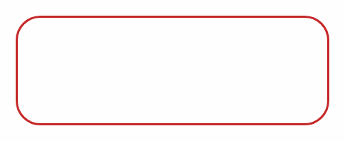 | drawable |
| `bg_btn_primary` | shape | 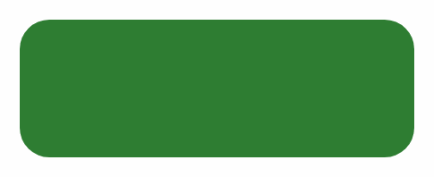 | drawable |
| `bg_btn_primary_state` | selector |  | drawable |
| `bg_due_chip` | shape | 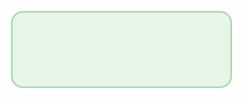 | drawable |
| `bg_loan_card` | shape |  | drawable |
| `bg_loan_header` | shape |  | drawable |
| `bg_overdue_badge` | shape |  | drawable |
| `bg_row_card` | shape |  | drawable |
| `bg_row_card_total` | shape | 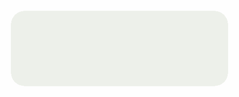 | drawable |
| `bg_section_header` | shape |  | drawable |
| `bg_textview_border` | shape | 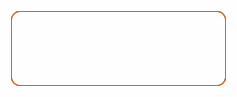 | drawable |
| `bg_thumb_frame` | shape |  | drawable |
| `btn_black` | selector | 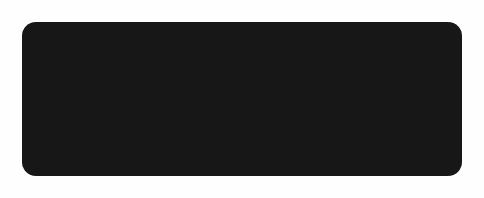 | drawable |
| `btn_blue` | selector | 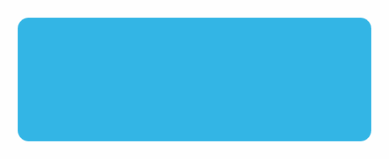 | drawable |
| `btn_green` | selector | 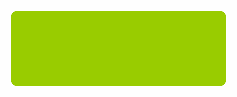 | drawable |
| `btn_red` | selector | 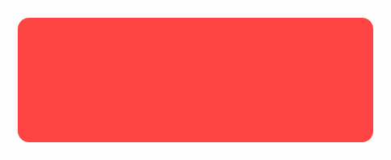 | drawable |
| `common_full_open_on_phone` | raster |  | drawable-hdpi, drawable-xhdpi |
| `common_google_signin_btn_icon_dark` | selector | 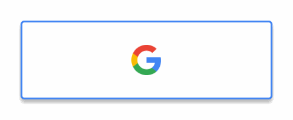 | drawable |
| `common_google_signin_btn_icon_dark_focused` | layer-list | 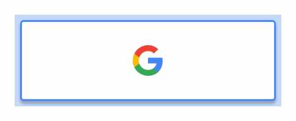 | drawable |
| `common_google_signin_btn_icon_dark_normal` | layer-list | 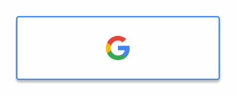 | drawable |
| `common_google_signin_btn_icon_dark_normal_background.9` | raster | 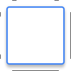 | drawable-hdpi, drawable-mdpi, drawable-xhdpi, drawable-xxhdpi |
| `common_google_signin_btn_icon_disabled` | layer-list |  | drawable |
| `common_google_signin_btn_icon_light` | selector |  | drawable |
| `common_google_signin_btn_icon_light_focused` | layer-list | 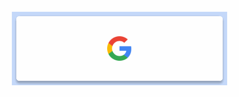 | drawable |
| `common_google_signin_btn_icon_light_normal` | layer-list |  | drawable |
| `common_google_signin_btn_icon_light_normal_background.9` | raster | 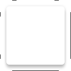 | drawable-hdpi, drawable-mdpi, drawable-xhdpi, drawable-xxhdpi |
| `common_google_signin_btn_text_dark` | selector |  | drawable |
| `common_google_signin_btn_text_dark_focused` | layer-list |  | drawable |
| `common_google_signin_btn_text_dark_normal` | layer-list |  | drawable |
| `common_google_signin_btn_text_dark_normal_background.9` | raster | 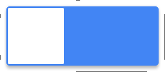 | drawable-hdpi, drawable-mdpi, drawable-xhdpi, drawable-xxhdpi |
| `common_google_signin_btn_text_disabled` | layer-list |  | drawable |
| `common_google_signin_btn_text_light` | selector |  | drawable |
| `common_google_signin_btn_text_light_focused` | layer-list | 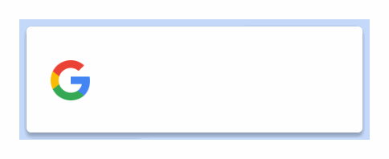 | drawable |
| `common_google_signin_btn_text_light_normal` | layer-list |  | drawable |
| `common_google_signin_btn_text_light_normal_background.9` | raster |  | drawable-hdpi, drawable-mdpi, drawable-xhdpi, drawable-xxhdpi |
| `download_done_48px` | vector |  | drawable |
| `fact_check_24px` | vector |  | drawable |
| `googleg_disabled_color_18` | raster |  | drawable-hdpi, drawable-mdpi, drawable-xhdpi, drawable-xxhdpi |
| `googleg_standard_color_18` | raster |  | drawable-hdpi, drawable-mdpi, drawable-xhdpi, drawable-xxhdpi |
| `grey_border_bottom` | layer-list |  | drawable |
| `hourglass_pause_24px` | vector | 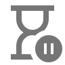 | drawable |
| `ic_action_aboutus` | raster |  | drawable-hdpi, drawable-mdpi, drawable-xhdpi, drawable-xxhdpi |
| `ic_action_accesscontrol` | raster |  | drawable-hdpi, drawable-mdpi, drawable-xhdpi, drawable-xxhdpi |
| `ic_action_accledgers` | raster |  | drawable-hdpi, drawable-mdpi, drawable-xhdpi, drawable-xxhdpi |
| `ic_action_addloan` | raster |  | drawable-hdpi, drawable-mdpi, drawable-xhdpi, drawable-xxhdpi |
| `ic_action_appearancesettings` | raster |  | drawable-hdpi, drawable-mdpi, drawable-xhdpi, drawable-xxhdpi |
| `ic_action_balancesheet` | raster |  | drawable-hdpi, drawable-mdpi, drawable-xhdpi, drawable-xxhdpi, drawable-xxxhdpi |
| `ic_action_branch` | raster |  | drawable-hdpi, drawable-mdpi, drawable-xhdpi, drawable-xxhdpi |
| `ic_action_branchaccesscontrol` | raster |  | drawable-hdpi, drawable-mdpi, drawable-xhdpi, drawable-xxhdpi |
| `ic_action_call` | raster |  | drawable-hdpi, drawable-mdpi, drawable-xhdpi, drawable-xxhdpi |
| `ic_action_capitalreceipts` | raster |  | drawable-hdpi, drawable-mdpi, drawable-xhdpi, drawable-xxhdpi |
| `ic_action_capitalreturns` | raster |  | drawable-hdpi, drawable-mdpi, drawable-xhdpi, drawable-xxhdpi |
| `ic_action_cashbook` | raster |  | drawable-hdpi, drawable-mdpi, drawable-xhdpi, drawable-xxhdpi, drawable-xxxhdpi |
| `ic_action_cashbookabstract` | raster |  | drawable-hdpi, drawable-mdpi, drawable-xhdpi, drawable-xxhdpi |
| `ic_action_clearmydata` | raster |  | drawable-hdpi, drawable-mdpi, drawable-xhdpi, drawable-xxhdpi |
| `ic_action_close` | raster |  | drawable-hdpi, drawable-mdpi, drawable-xhdpi, drawable-xxhdpi |
| `ic_action_collection` | raster | 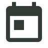 | drawable-hdpi, drawable-mdpi, drawable-xhdpi, drawable-xxhdpi, drawable-xxxhdpi |
| `ic_action_contra` | raster |  | drawable-hdpi, drawable-mdpi, drawable-xhdpi, drawable-xxhdpi |
| `ic_action_contraentries` | raster |  | drawable-hdpi, drawable-mdpi, drawable-xhdpi, drawable-xxhdpi |
| `ic_action_daiypatti` | raster | 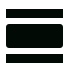 | drawable-hdpi, drawable-mdpi, drawable-xhdpi, drawable-xxhdpi |
| `ic_action_deletechitparty` | raster |  | drawable-hdpi, drawable-mdpi, drawable-xhdpi, drawable-xxhdpi |
| `ic_action_deviceidentity` | raster |  | drawable-hdpi, drawable-mdpi, drawable-xhdpi, drawable-xxhdpi |
| `ic_action_downloadcontrol` | raster |  | drawable-hdpi, drawable-mdpi, drawable-xhdpi, drawable-xxhdpi |
| `ic_action_editemployee` | raster |  | drawable-hdpi, drawable-mdpi, drawable-xhdpi, drawable-xxhdpi |
| `ic_action_editprofile` | raster |  | drawable-hdpi, drawable-mdpi, drawable-xhdpi, drawable-xxhdpi |
| `ic_action_employee` | raster |  | drawable-hdpi, drawable-mdpi, drawable-xhdpi, drawable-xxhdpi |
| `ic_action_financemaster` | raster |  | drawable-hdpi, drawable-mdpi, drawable-xhdpi, drawable-xxhdpi |
| `ic_action_finwisepartner` | raster |  | drawable-hdpi, drawable-mdpi, drawable-xhdpi, drawable-xxhdpi |
| `ic_action_handloanspayment` | raster |  | drawable-hdpi, drawable-mdpi, drawable-xhdpi, drawable-xxhdpi |
| `ic_action_handloansreceipt` | raster |  | drawable-hdpi, drawable-mdpi, drawable-xhdpi, drawable-xxhdpi |
| `ic_action_hlreports` | raster |  | drawable-hdpi, drawable-mdpi, drawable-xhdpi, drawable-xxhdpi |
| `ic_action_incomes` | raster |  | drawable-hdpi, drawable-mdpi, drawable-xhdpi, drawable-xxhdpi |
| `ic_action_info` | raster |  | drawable-hdpi, drawable-mdpi, drawable-xhdpi, drawable-xxhdpi |
| `ic_action_itemmaster` | raster |  | drawable-hdpi, drawable-mdpi, drawable-xhdpi, drawable-xxhdpi |
| `ic_action_journalentries` | raster |  | drawable-hdpi, drawable-mdpi, drawable-xhdpi, drawable-xxhdpi |
| `ic_action_ledgers` | raster |  | drawable-hdpi, drawable-mdpi, drawable-xhdpi, drawable-xxhdpi |
| `ic_action_loancosoure` | raster |  | drawable-hdpi, drawable-mdpi, drawable-xhdpi, drawable-xxhdpi |
| `ic_action_loanmethods` | raster |  | drawable-hdpi, drawable-mdpi, drawable-xhdpi, drawable-xxhdpi |
| `ic_action_loanparties` | raster |  | drawable-hdpi, drawable-mdpi, drawable-xhdpi, drawable-xxhdpi |
| `ic_action_loans` | raster |  | drawable-hdpi, drawable-mdpi, drawable-xhdpi, drawable-xxhdpi |
| `ic_action_loanscollection` | raster |  | drawable-hdpi, drawable-mdpi, drawable-xhdpi, drawable-xxhdpi |
| `ic_action_location` | raster |  | drawable-hdpi, drawable-mdpi, drawable-xhdpi, drawable-xxhdpi |
| `ic_action_mpandl` | raster |  | drawable-hdpi, drawable-mdpi, drawable-xhdpi, drawable-xxhdpi, drawable-xxxhdpi |
| `ic_action_msg` | raster |  | drawable-hdpi, drawable-mdpi, drawable-xhdpi, drawable-xxhdpi |
| `ic_action_newpartynewloan` | raster |  | drawable-hdpi, drawable-mdpi, drawable-xhdpi, drawable-xxhdpi |
| `ic_action_pandl` | raster |  | drawable-hdpi, drawable-mdpi, drawable-xhdpi, drawable-xxhdpi, drawable-xxxhdpi |
| `ic_action_partiestoberenewed` | raster |  | drawable-hdpi, drawable-mdpi, drawable-xhdpi, drawable-xxhdpi |
| `ic_action_partners` | raster |  | drawable-hdpi, drawable-mdpi, drawable-xhdpi, drawable-xxhdpi |
| `ic_action_paymoney` | raster |  | drawable-hdpi, drawable-mdpi, drawable-xhdpi, drawable-xxhdpi |
| `ic_action_prevsavingclosure` | raster |  | drawable-hdpi, drawable-mdpi, drawable-xhdpi, drawable-xxhdpi |
| `ic_action_quickpayments` | raster |  | drawable-hdpi, drawable-mdpi, drawable-xhdpi, drawable-xxhdpi |
| `ic_action_quickreceipts` | raster |  | drawable-hdpi, drawable-mdpi, drawable-xhdpi, drawable-xxhdpi |
| `ic_action_rearange` | raster |  | drawable-hdpi, drawable-mdpi, drawable-xhdpi, drawable-xxhdpi |
| `ic_action_receivemoney` | raster |  | drawable-hdpi, drawable-mdpi, drawable-xhdpi, drawable-xxhdpi |
| `ic_action_refresh` | raster |  | drawable-hdpi, drawable-mdpi, drawable-xhdpi, drawable-xxhdpi |
| `ic_action_relateddocuments` | raster |  | drawable-hdpi, drawable-mdpi, drawable-xhdpi, drawable-xxhdpi |
| `ic_action_remove` | raster |  | drawable-hdpi, drawable-mdpi, drawable-xhdpi, drawable-xxhdpi |
| `ic_action_savingsclosure` | raster |  | drawable-hdpi, drawable-mdpi, drawable-xhdpi, drawable-xxhdpi |
| `ic_action_search` | raster |  | drawable-hdpi, drawable-mdpi, drawable-xhdpi, drawable-xxhdpi, drawable-xxxhdpi |
| `ic_action_sevendayscollection` | raster |  | drawable-hdpi, drawable-mdpi, drawable-xhdpi, drawable-xxhdpi, drawable-xxxhdpi |
| `ic_action_simplethittam` | raster |  | drawable-hdpi, drawable-mdpi, drawable-xhdpi, drawable-xxhdpi |
| `ic_action_specilacess` | raster |  | drawable-hdpi, drawable-mdpi, drawable-xhdpi, drawable-xxhdpi |
| `ic_action_stockcat` | raster |  | drawable-hdpi, drawable-mdpi, drawable-xhdpi, drawable-xxhdpi |
| `ic_action_stockgrp` | raster |  | drawable-hdpi, drawable-mdpi, drawable-xhdpi, drawable-xxhdpi |
| `ic_action_stockinhand` | raster |  | drawable-hdpi, drawable-mdpi, drawable-xhdpi, drawable-xxhdpi |
| `ic_action_stockuom` | raster |  | drawable-hdpi, drawable-mdpi, drawable-xhdpi, drawable-xxhdpi |
| `ic_action_supplier` | raster |  | drawable-hdpi, drawable-mdpi, drawable-xhdpi, drawable-xxhdpi |
| `ic_action_todaycollectionabstract` | raster |  | drawable-hdpi, drawable-mdpi, drawable-xhdpi, drawable-xxhdpi |
| `ic_action_trailbalance` | raster |  | drawable-hdpi, drawable-mdpi, drawable-xhdpi, drawable-xxhdpi, drawable-xxxhdpi |
| `ic_action_transfer` | raster |  | drawable-hdpi, drawable-mdpi, drawable-xhdpi, drawable-xxhdpi |
| `ic_action_translist` | raster |  | drawable-hdpi, drawable-mdpi, drawable-xhdpi, drawable-xxhdpi |
| `ic_action_unpaidparties` | raster |  | drawable-hdpi, drawable-mdpi, drawable-xhdpi, drawable-xxhdpi |
| `ic_action_uploadcontrol` | raster |  | drawable-hdpi, drawable-mdpi, drawable-xhdpi, drawable-xxhdpi |
| `ic_action_warning` | raster |  | drawable-hdpi, drawable-mdpi, drawable-xhdpi, drawable-xxhdpi |
| `ic_backarrow_teal` | raster |  | drawable-hdpi, drawable-mdpi, drawable-xhdpi, drawable-xxhdpi |
| `ic_collectionentry` | raster |  | drawable-hdpi, drawable-mdpi, drawable-xhdpi, drawable-xxhdpi |
| `ic_collectionlistprint` | raster |  | drawable-hdpi, drawable-mdpi, drawable-xhdpi, drawable-xxhdpi |
| `ic_drawer` | raster |  | mipmap-xxhdpi |
| `ic_launcher` | raster |  | drawable-xxhdpi |
| `ic_launcher_foreground` | raster |  | mipmap-hdpi, mipmap-mdpi, mipmap-xhdpi, mipmap-xxhdpi, mipmap-xxxhdpi |
| `ic_launcher_round` | raster |  | mipmap-hdpi, mipmap-mdpi, mipmap-xhdpi, mipmap-xxhdpi, mipmap-xxxhdpi |
| `ic_menu_areas` | vector |  | drawable |
| `ic_menu_download` | vector |  | drawable |
| `ic_menu_expenses` | vector |  | drawable |
| `ic_menu_login` | vector |  | drawable |
| `ic_menu_newloan` | vector |  | drawable |
| `ic_menu_parties` | vector |  | drawable |
| `ic_menu_sync` | vector |  | drawable |
| `ic_menu_upload` | vector |  | drawable |
| `ic_menuaccesscontrol` | raster |  | drawable-hdpi, drawable-mdpi, drawable-xhdpi, drawable-xxhdpi |
| `ic_plus` | raster |  | drawable-hdpi, drawable-mdpi, drawable-xhdpi, drawable-xxhdpi, drawable-xxxhdpi |
| `input_bg` | shape | 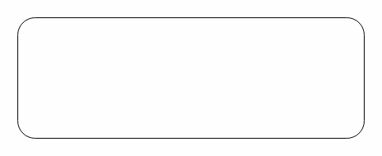 | drawable |
| `metric_card_bg` | shape |  | drawable |
| `noimage` | raster |  | drawable-hdpi, drawable-mdpi, drawable-xhdpi, drawable-xxhdpi |
| `print_24px` | vector |  | drawable |
| `reduce_capacity_24px` | vector |  | drawable |
| `reglogo` | raster |  | drawable |
| `side_nav_bar` | shape |  | drawable |
| `spinner_bg` | layer-list |  | drawable |
| `tag_bg` | shape | 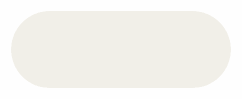 | drawable |
| `ucrop_crop` | selector | 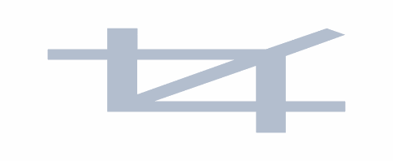 | drawable |
| `ucrop_ic_angle` | raster |  | drawable-hdpi, drawable-ldpi, drawable-mdpi, drawable-xhdpi, drawable-xxhdpi, drawable-xxxhdpi |
| `ucrop_ic_crop` | vector | 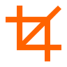 | drawable |
| `ucrop_ic_crop_unselected` | vector | 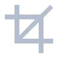 | drawable |
| `ucrop_ic_cross` | vector |  | drawable |
| `ucrop_ic_done` | raster |  | drawable-hdpi, drawable-ldpi, drawable-mdpi, drawable-xhdpi, drawable-xxhdpi, drawable-xxxhdpi |
| `ucrop_ic_next` | vector |  | drawable |
| `ucrop_ic_reset` | vector |  | drawable |
| `ucrop_ic_rotate` | vector |  | drawable |
| `ucrop_ic_rotate_unselected` | vector |  | drawable |
| `ucrop_ic_scale` | vector |  | drawable |
| `ucrop_ic_scale_unselected` | vector |  | drawable |
| `ucrop_rotate` | selector |  | drawable |
| `ucrop_scale` | selector |  | drawable |
| `ucrop_shadow_upside` | shape | 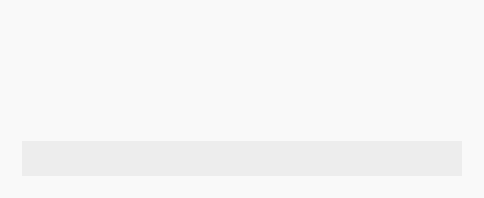 | drawable |
| `ucrop_vector_ic_crop` | vector | 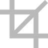 | drawable |
| `ucrop_vector_loader` | vector |  | drawable |
| `ucrop_vector_loader_animated` | animated-vector | 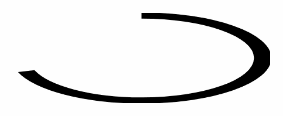 | drawable |
| `ucrop_wrapper_controls_shape` | shape |  | drawable |
