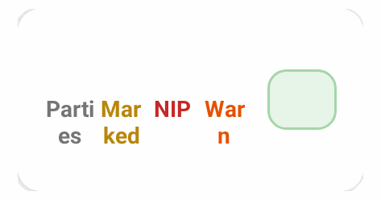
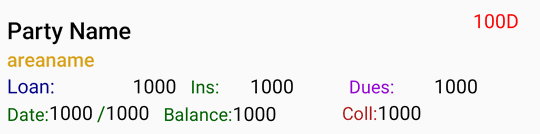
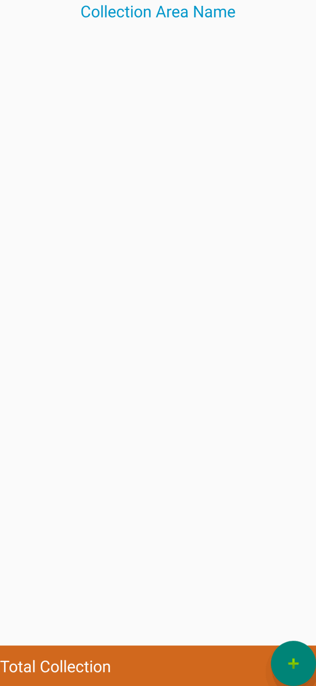
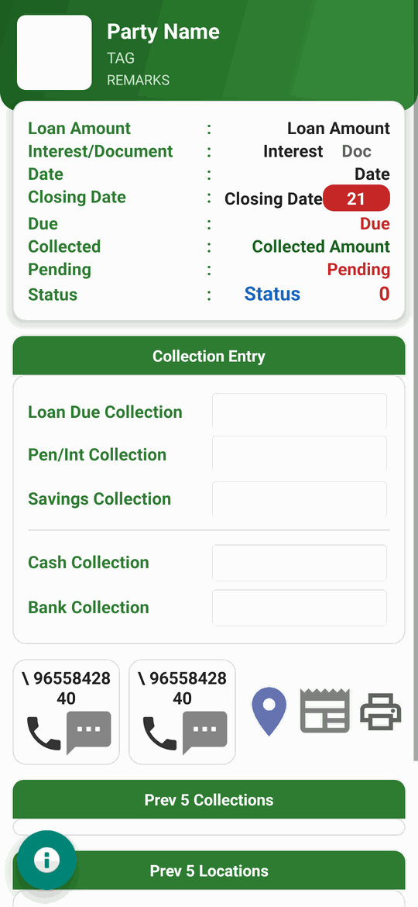
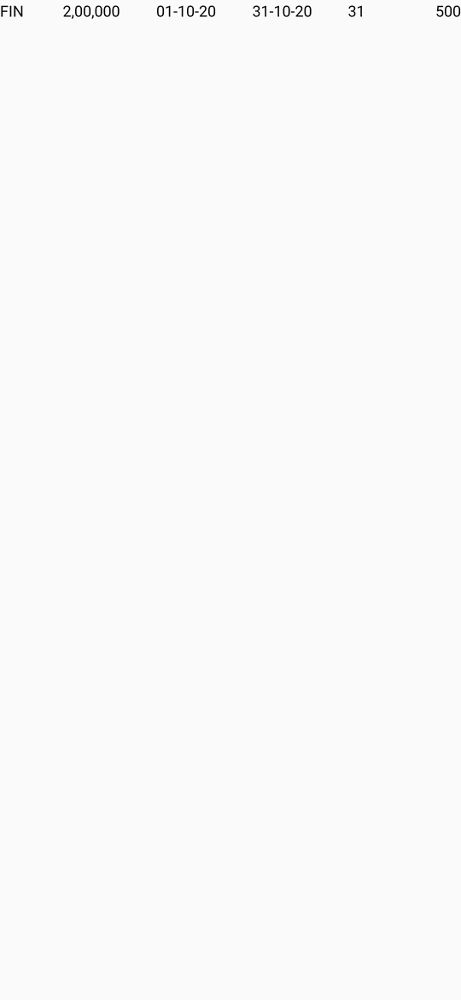
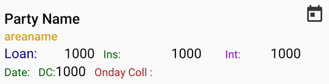
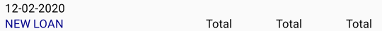
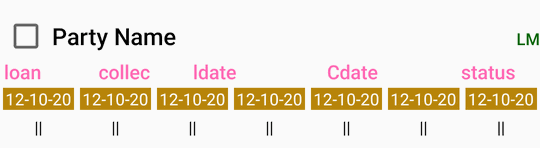
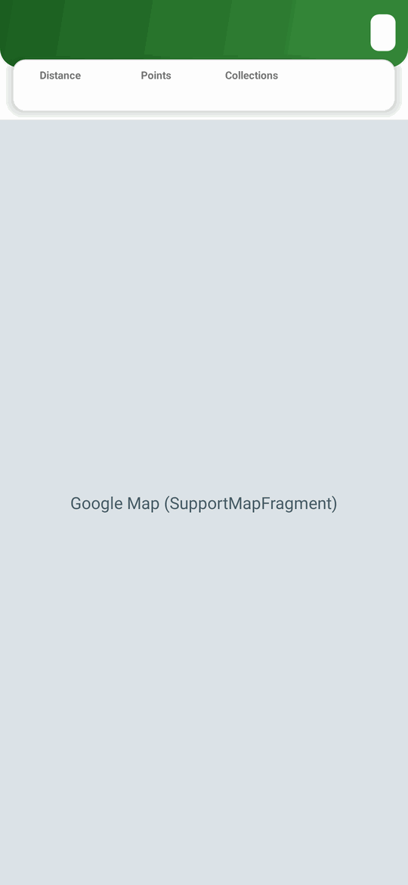
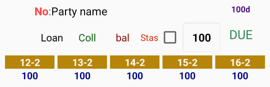

# Layout images and coverage

[← work.md](../work.md)

All **211 app layouts**. Content layouts appear composed into their screen images (see the gallery in work.md). Rows, dialogs, sheets, include fragments and unused layouts are rendered on their own below. Every layout appears in at least one image.

| Layout | Image | Inflated by | Shown inside screen images |
|---|---|---|---|
| `ac_complex.xml` | — | `loananddepositanalyisreport` | [`loananddepositanalyisreport`](screens/loananddepositanalyisreport.png) |
| `accledgers_row.xml` |  | `accledgerssearch_adapter`, `collectionreportprintingmethods_adapter` | [`accledgers_searchlist`](screens/accledgers_searchlist.png), [`collectionreportprintingmethods_searchlist`](screens/collectionreportprintingmethods_searchlist.png) |
| `accountstranslist_row.xml` |  | `accounttranslist_adapter` | [`accounttrans_list`](screens/accounttrans_list.png) |
| `activity_acctranslist.xml` | — | `accounttrans_list` | [`accounttrans_list`](screens/accounttrans_list.png) |
| `activity_allfinancedailypatti.xml` | — | `allfinancedailypatti` | [`allfinancedailypatti`](screens/allfinancedailypatti.png) |
| `activity_allfinancedailythittam.xml` | — | `allfinancedailythittam` | [`allfinancedailythittam`](screens/allfinancedailythittam.png) |
| `activity_archievedloandisplay.xml` | — | `archievedloandisplay` | [`archievedloandisplay`](screens/archievedloandisplay.png) |
| `activity_branchmobiledeviceaccesscontrol.xml` | — | `branchmobiledeviceaccescontrol_act` | [`branchmobiledeviceaccescontrol_act`](screens/branchmobiledeviceaccescontrol_act.png) |
| `activity_cashbook.xml` | — | `cashbook` | [`cashbook`](screens/cashbook.png) |
| `activity_cashbookabstract.xml` | — | `cashbookabstract` | [`cashbookabstract`](screens/cashbookabstract.png) |
| `activity_cashreceiveandreturns.xml` | — | `cashreceiveandreturns` | [`cashreceiveandreturns`](screens/cashreceiveandreturns.png) |
| `activity_closed_remevedloanslist.xml` | — | `closed_renewedloanslist_act` | [`closed_renewedloanslist_act`](screens/closed_renewedloanslist_act.png) |
| `activity_closingsavingsaccount.xml` | — | `closingsavingsaccount` | [`closingsavingsaccount`](screens/closingsavingsaccount.png) |
| `activity_collectdbinfofromweb.xml` | — | `collectdbinfofromweb` | [`collectdbinfofromweb`](screens/collectdbinfofromweb.png) |
| `activity_collectionareaarangment.xml` | — | `collectionarearearrangeact` | [`collectionarearearrangeact`](screens/collectionarearearrangeact.png) |
| `activity_collectionareasearch.xml` | — | `collectionareassearchlist` | [`collectionareassearchlist`](screens/collectionareassearchlist.png) |
| `activity_collectionedit_individualcollection.xml` | — | `collectionedit_individualcollection` | [`collectionedit_individualcollection`](screens/collectionedit_individualcollection.png) |
| `activity_collectionlistprints.xml` | — | `collectionlistprints` | [`collectionlistprints`](screens/collectionlistprints.png) |
| `activity_customerdetails.xml` | — | `customerdetails_act` | [`customerdetails_act`](screens/customerdetails_act.png) |
| `activity_customersearch.xml` | — | `loanindexloanswiselist_act`, `partylistwithprevloansfornewloanselection`, `pattidetails_loans_act`, `prevloanslist_act` | [`loanindexloanswiselist_act`](screens/loanindexloanswiselist_act.png), [`partylistwithprevloansfornewloanselection`](screens/partylistwithprevloansfornewloanselection.png), [`pattidetails_loans_act`](screens/pattidetails_loans_act.png), [`prevloanslist_act`](screens/prevloanslist_act.png) |
| `activity_dailypattinew.xml` | — | `dailypattinew_act` | [`dailypattinew_act`](screens/dailypattinew_act.png) |
| `activity_dailythittamforallowedlines.xml` | — | `dailythittamforallowedlines` | [`dailythittamforallowedlines`](screens/dailythittamforallowedlines.png) |
| `activity_daywisependingreport.xml` | — | `daywisependingreport_act` | [`daywisependingreport_act`](screens/daywisependingreport_act.png) |
| `activity_deviceidentity.xml` | — | `deviceidentity` | [`deviceidentity`](screens/deviceidentity.png) |
| `activity_directcollectionentry.xml` | — | `directcollectionentry` | [`directcollectionentry`](screens/directcollectionentry.png) |
| `activity_documentsearchlist.xml` | — | `documentsphotossearchlist` | [`documentsphotossearchlist`](screens/documentsphotossearchlist.png) |
| `activity_documentupload.xml` | — | `documentsupload` | [`documentsupload`](screens/documentsupload.png) |
| `activity_downloaddata.xml` | — | `downloaddata` | [`downloaddata`](screens/downloaddata.png) |
| `activity_dueschdule.xml` | — | `dueschdule` | [`dueschdule`](screens/dueschdule.png) |
| `activity_editingcollections.xml` | — | `editing_collections_act` | [`editing_collections_act`](screens/editing_collections_act.png) |
| `activity_editingfullcollections.xml` | — | `editing_collectionswithfulloptions_act` | [`editing_collectionswithfulloptions_act`](screens/editing_collectionswithfulloptions_act.png) |
| `activity_employeesearch.xml` | — | `accledgers_searchlist`, `branchemployeelist`, `branchemployeesaccessearchlist`, `branchemployeesearchlist`, `closableloanssearchlistact`, `closablesavings_list`, `collectionreportprintingmethods_searchlist`, `employeesaccessearchlist`, `employeesearchlist`, `expensesentry_searchlist`, `itemmaster_list`, `loanmethods_searchlist`, `partydetails_searchlist`, `stockUOM_list`, `stockcat_list`, `stockgrp_list`, `stockinhand_list` | [`accledgers_searchlist`](screens/accledgers_searchlist.png), [`branchemployeelist`](screens/branchemployeelist.png), [`branchemployeesaccessearchlist`](screens/branchemployeesaccessearchlist.png), [`branchemployeesearchlist`](screens/branchemployeesearchlist.png), [`closableloanssearchlistact`](screens/closableloanssearchlistact.png), [`closablesavings_list`](screens/closablesavings_list.png), [`collectionreportprintingmethods_searchlist`](screens/collectionreportprintingmethods_searchlist.png), [`employeesaccessearchlist`](screens/employeesaccessearchlist.png) … +9 |
| `activity_expensesentry.xml` | — | `expensesandreceipt_offlineentry` | [`expensesandreceipt_offlineentry`](screens/expensesandreceipt_offlineentry.png) |
| `activity_financelinesaddandedit.xml` | — | `financelinesaddandedit` | [`financelinesaddandedit`](screens/financelinesaddandedit.png) |
| `activity_financewisepartners.xml` | — | `financewisepartners_list` | [`financewisepartners_list`](screens/financewisepartners_list.png) |
| `activity_fullimageview.xml` | — | `fullimageview` | [`fullimageview`](screens/fullimageview.png) |
| `activity_handloanslist.xml` | — | `handloans_list` | [`handloans_list`](screens/handloans_list.png) |
| `activity_image_picker.xml` | — | `ImagePickerActivity` | [`ImagePickerActivity`](screens/ImagePickerActivity.png) |
| `activity_interestcalculationandpayments.xml` | — | `stloaninterestcalculationandpayments` | [`stloaninterestcalculationandpayments`](screens/stloaninterestcalculationandpayments.png) |
| `activity_interestcalculationdetails.xml` | — | `ofloan_interestcalculationdetails`, `stloan_interestcalculationdetails` | [`ofloan_interestcalculationdetails`](screens/ofloan_interestcalculationdetails.png), [`stloan_interestcalculationdetails`](screens/stloan_interestcalculationdetails.png) |
| `activity_invtrans_rowdetails.xml` | — | `invtrans_rowdetails` | [`invtrans_rowdetails`](screens/invtrans_rowdetails.png) |
| `activity_invtransactnew.xml` | — | `invtransactnew` | [`invtransactnew`](screens/invtransactnew.png) |
| `activity_itemmaster.xml` | — | `itemmaster_activity` | [`itemmaster_activity`](screens/itemmaster_activity.png) |
| `activity_ledgerstatmentsdateselection.xml` | — | `ledgerstatmentsdateselection` | [`ledgerstatmentsdateselection`](screens/ledgerstatmentsdateselection.png) |
| `activity_loanclosoureentry.xml` | — | `loanclosoureentry` | [`loanclosoureentry`](screens/loanclosoureentry.png) |
| `activity_loanledgerslist.xml` | — | `loanledgers_list` | [`loanledgers_list`](screens/loanledgers_list.png) |
| `activity_loanmethods.xml` | — | `loanmethods` | [`loanmethods`](screens/loanmethods.png) |
| `activity_loanpartyledgers_parameters.xml` | — | `partyledgers_parameters` | [`partyledgers_parameters`](screens/partyledgers_parameters.png) |
| `activity_maps.xml` | — | `maps_collectionareadisplay` | [`maps_collectionareadisplay`](screens/maps_collectionareadisplay.png) |
| `activity_maps_partydisplay.xml` | — | `maps_partydisplay` | [`maps_partydisplay`](screens/maps_partydisplay.png) |
| `activity_meetingreport.xml` | — | `meetingreport` | [`meetingreport`](screens/meetingreport.png) |
| `activity_mobiledeviceaccesscontrol.xml` | — | `mobiledeviceaccescontrol_act` | [`mobiledeviceaccescontrol_act`](screens/mobiledeviceaccescontrol_act.png) |
| `activity_nadapunippucollectionlist.xml` | — | `dailypatti_kadanpatrulist_act`, `dailypatti_nadapunippucollectionlist_act` | [`dailypatti_kadanpatrulist_act`](screens/dailypatti_kadanpatrulist_act.png), [`dailypatti_nadapunippucollectionlist_act`](screens/dailypatti_nadapunippucollectionlist_act.png) |
| `activity_nadapunippuphakkilist.xml` | — | `dailypatti_nadapunippuphakkilist_act` | [`dailypatti_nadapunippuphakkilist_act`](screens/dailypatti_nadapunippuphakkilist_act.png) |
| `activity_navigationdrawactivity.xml` | — | `navigationdrawactivity` | [`navigationdrawactivity`](screens/navigationdrawactivity.png) |
| `activity_newacccountsledgers.xml` | — | `accountledgerdetails` | [`accountledgerdetails`](screens/accountledgerdetails.png) |
| `activity_newcollectionareacreation.xml` | — | `collectionareadetails_act` | [`collectionareadetails_act`](screens/collectionareadetails_act.png) |
| `activity_newemployee.xml` | — | `branch_employee`, `employeedetails_act` | [`branch_employee`](screens/branch_employee.png), [`employeedetails_act`](screens/employeedetails_act.png) |
| `activity_newloandetails.xml` | — | `newloancreation` | [`newloancreation`](screens/newloancreation.png) |
| `activity_newloanscollectionlist.xml` | — | `editing_collectionlist_act` | [`editing_collectionlist_act`](screens/editing_collectionlist_act.png) |
| `activity_newloanslist.xml` | — | `ledgerstatement_act`, `loanslist_act`, `newloanslist_act`, `newpartieslist_act`, `newpartiesnewloanslist_act`, `newtodaycollectionofflinedata_list` | [`ledgerstatement_act`](screens/ledgerstatement_act.png), [`loanslist_act`](screens/loanslist_act.png), [`newloanslist_act`](screens/newloanslist_act.png), [`newpartieslist_act`](screens/newpartieslist_act.png), [`newpartiesnewloanslist_act`](screens/newpartiesnewloanslist_act.png), [`newtodaycollectionofflinedata_list`](screens/newtodaycollectionofflinedata_list.png) |
| `activity_newpartycreation.xml` | — | `partydetails_act` | [`partydetails_act`](screens/partydetails_act.png) |
| `activity_newsevendayscollection.xml` | — | `newsevendayscollection` | [`newsevendayscollection`](screens/newsevendayscollection.png) |
| `activity_ofloan.xml` | — | `ofloans` | [`ofloans`](screens/ofloans.png) |
| `activity_ofloans_interestcalculationandpayments.xml` | — | `ofloans_interestcalculationandpayments` | [`ofloans_interestcalculationandpayments`](screens/ofloans_interestcalculationandpayments.png) |
| `activity_otpverification.xml` | — | `otpverificationact` | [`otpverificationact`](screens/otpverificationact.png) |
| `activity_partieslist.xml` | — | `customers_list`, `fintrans_list`, `parties_list` | [`customers_list`](screens/customers_list.png), [`fintrans_list`](screens/fintrans_list.png), [`parties_list`](screens/parties_list.png) |
| `activity_partyandpartnerdetailsnew.xml` | — | `partyandpartnerdetails` | [`partyandpartnerdetails`](screens/partyandpartnerdetails.png) |
| `activity_partyledgers_parameters.xml` | — | `accountsreports_parameters` | [`accountsreports_parameters`](screens/accountsreports_parameters.png) |
| `activity_partyledgerslist.xml` | — | `partyledgers_list` | [`partyledgers_list`](screens/partyledgers_list.png) |
| `activity_partyrearrange.xml` | — | `partyrearrange` | [`partyrearrange`](screens/partyrearrange.png) |
| `activity_partytransfer.xml` | — | `partytransfer` | [`partytransfer`](screens/partytransfer.png) |
| `activity_periodicloanreportlist.xml` | — | `periodicloareportlist_act` | [`periodicloareportlist_act`](screens/periodicloareportlist_act.png) |
| `activity_playstoredemouserregistration.xml` | — | `playstoredemouserregistrationact` | [`playstoredemouserregistrationact`](screens/playstoredemouserregistrationact.png) |
| `activity_prevloanclosure.xml` | — | `prevloanclosure_list_act` | [`prevloanclosure_list_act`](screens/prevloanclosure_list_act.png) |
| `activity_prevsavingclosure.xml` | — | `prevsavingclosure_list_act` | [`prevsavingclosure_list_act`](screens/prevsavingclosure_list_act.png) |
| `activity_quickacccounttransactions.xml` | — | `accounttransactions_act` | [`accounttransactions_act`](screens/accounttransactions_act.png) |
| `activity_refreshoreloadfinancelist.xml` | — | `refreshorreloadbrancheslist`, `refreshorreloadfinancelist` | [`refreshorreloadbrancheslist`](screens/refreshorreloadbrancheslist.png), [`refreshorreloadfinancelist`](screens/refreshorreloadfinancelist.png) |
| `activity_selectbranchandfinance.xml` | — | `selectbranchandfinance` | [`selectbranchandfinance`](screens/selectbranchandfinance.png) |
| `activity_selectdateforreport.xml` | — | `selectdateforreport` | [`selectdateforreport`](screens/selectdateforreport.png) |
| `activity_selectedloancollectiondetails.xml` | — | `selectedloancollectiondetails` | [`selectedloancollectiondetails`](screens/selectedloancollectiondetails.png) |
| `activity_settings_appearance.xml` | — | `settings_act` | [`settings_act`](screens/settings_act.png) |
| `activity_sevendayscollection.xml` | — | `sevendayscollectionforselline` | [`sevendayscollectionforselline`](screens/sevendayscollectionforselline.png) |
| `activity_sevendayscollectionsubarealist.xml` | — | `collectionarealistforloanpartyandloans`, `collectionarealistforsevendayscollection` | [`collectionarealistforloanpartyandloans`](screens/collectionarealistforloanpartyandloans.png), [`collectionarealistforsevendayscollection`](screens/collectionarealistforsevendayscollection.png) |
| `activity_simplethittamlist.xml` | — | `simplethittamlist_act`, `singlefinancedailythittam_act` | [`simplethittamlist_act`](screens/simplethittamlist_act.png), [`singlefinancedailythittam_act`](screens/singlefinancedailythittam_act.png) |
| `activity_specialaccesscontrol.xml` | — | `specialaccesscontrolact` | [`specialaccesscontrolact`](screens/specialaccesscontrolact.png) |
| `activity_spinnersearchlist.xml` | — | `spinnersearch_list` | [`spinnersearch_list`](screens/spinnersearch_list.png) |
| `activity_splash.xml` | — | `splash` | [`splash`](screens/splash.png) |
| `activity_sqlserverconnectionproperties.xml` | — | `sqlserverconnectionproperties` | [`sqlserverconnectionproperties`](screens/sqlserverconnectionproperties.png) |
| `activity_staffgpstrackmap01.xml` | — | `staffgpstrackmap_act` | [`staffgpstrackmap_act`](screens/staffgpstrackmap_act.png) |
| `activity_stloan.xml` | — | `stloans` | [`stloans`](screens/stloans.png) |
| `activity_stockcat.xml` | — | `stockUOM_act`, `stockcategories` | [`stockUOM_act`](screens/stockUOM_act.png), [`stockcategories`](screens/stockcategories.png) |
| `activity_stockgroup.xml` | — | `stockgroup_act` | [`stockgroup_act`](screens/stockgroup_act.png) |
| `activity_syncresources.xml` | — | `syncresources` | [`syncresources`](screens/syncresources.png) |
| `activity_tabbedcollectionlist.xml` | — | `tabbedcollectionlist` | [`tabbedcollectionlist`](screens/tabbedcollectionlist.png) |
| `activity_tabbedcollectionlistforviewpager1.xml` | — | `tabbedcollectionlistmviewpager` | [`tabbedcollectionlistmviewpager`](screens/tabbedcollectionlistmviewpager.png) |
| `activity_tabbedindividualcollectionentry.xml` | — | `tabbedindividualcollectionentry` | [`tabbedindividualcollectionentry`](screens/tabbedindividualcollectionentry.png) |
| `activity_tbbspl.xml` | — | `tbbspl_list` | [`tbbspl_list`](screens/tbbspl_list.png) |
| `activity_tbbspl_particulars.xml` | — | `tbbspl_particulars` | [`tbbspl_particulars`](screens/tbbspl_particulars.png) |
| `activity_todaycollectionlist.xml` | — | `todaycollectionabstractlist`, `todaycollectionlist` | [`todaycollectionabstractlist`](screens/todaycollectionabstractlist.png), [`todaycollectionlist`](screens/todaycollectionlist.png) |
| `activity_transactionslist.xml` | — | `inventorytransactionslist_act` | [`inventorytransactionslist_act`](screens/inventorytransactionslist_act.png) |
| `activity_unpaidpartiesselectedday.xml` | — | `unpaidpartiesonselectedday` | [`unpaidpartiesonselectedday`](screens/unpaidpartiesonselectedday.png) |
| `activity_uploadalloweddetails.xml` | — | `uploaddownloadcontroling` | [`uploaddownloadcontroling`](screens/uploaddownloadcontroling.png) |
| `activity_uploadcollection.xml` | — | `uploadcollection` | [`uploadcollection`](screens/uploadcollection.png) |
| `activity_userprevillages.xml` | — | `userroleprevilages_act` | [`userroleprevilages_act`](screens/userroleprevilages_act.png) |
| `activity_varakadanillapulist.xml` | — | `dailypatti_varakadanillapulist_act` | [`dailypatti_varakadanillapulist_act`](screens/dailypatti_varakadanillapulist_act.png) |
| `activity_varathittam.xml` | — | `varathittam` | [`varathittam`](screens/varathittam.png) |
| `activity_webview.xml` | — | `financesoftwaredontinwebview` | [`financesoftwaredontinwebview`](screens/financesoftwaredontinwebview.png) |
| `activity_weeklycollanalysis.xml` | — | `weeklycollectionanalysis_act` | [`weeklycollectionanalysis_act`](screens/weeklycollectionanalysis_act.png) |
| `addnewloanbar.xml` |  | — (not referenced in code) | [`navigationdrawactivity`](screens/navigationdrawactivity.png) |
| `allfinancedailypattirow.xml` |  | `allfinancedailypattiadapter`, `allfinancedailypattinew_adapter` | [`allfinancedailypatti`](screens/allfinancedailypatti.png), [`dailypattinew_act`](screens/dailypattinew_act.png) |
| `allfinancedailythittamrow.xml` |  | `allfinancedailuthittamadapter` | [`allfinancedailythittam`](screens/allfinancedailythittam.png), [`dailythittamforallowedlines`](screens/dailythittamforallowedlines.png), [`singlefinancedailythittam_act`](screens/singlefinancedailythittam_act.png) |
| `anarep_finace_partnerwiseabs_row.xml` |  | `anarep_fin_partwiseabstrat_adapter` | [`analysisrepfin_partnerwiseabstract_fragment`](screens/analysisrepfin_partnerwiseabstract_fragment.png) |
| `anarep_finacewiseabs_row.xml` |  | `anarep_finwiseabstrct_adapter` | [`analysisrep_financewiseabstract_fragment`](screens/analysisrep_financewiseabstract_fragment.png), [`analysisrep_partnerwiseabstract_fragment`](screens/analysisrep_partnerwiseabstract_fragment.png) |
| `anarep_interestratedist_row.xml` |  | `anarep_interestratedist_adapter` | [`analysisrepfin_interestratedist_fragment`](screens/analysisrepfin_interestratedist_fragment.png), [`loananddepositanalyisreport`](screens/loananddepositanalyisreport.png) |
| `anarep_overallinterestratedist_row.xml` |  | `anarep_overallinterestratedist_adapter` | [`analysisrepfin_overallinterestratedist_fragment`](screens/analysisrepfin_overallinterestratedist_fragment.png) |
| `anarep_partywiseabs_row.xml` |  | `anarep_partywiseabstrat_adapter` | [`analysisrepfin_partyrwiseabstract_fragment`](screens/analysisrepfin_partyrwiseabstract_fragment.png) |
| `areawisecollectionlistrow.xml` |  | `areawisecollectionlistadapter`, `collectionarealistadapterforloanpartiesandloans` | [`collectionarealistforloanpartyandloans`](screens/collectionarealistforloanpartyandloans.png), [`navigationdrawactivity`](screens/navigationdrawactivity.png) |
| `btp_main.xml` | — | `BluetoothPrinterMain` | [`BluetoothPrinterMain`](screens/BluetoothPrinterMain.png) |
| `cashbookabstract_row.xml` |  | `cashbookabstract_adapter` | [`cashbookabstract`](screens/cashbookabstract.png) |
| `cashbookverifyrow.xml` |  | `cashbook_adapter` | [`cashbook`](screens/cashbook.png) |
| `closablesavings_row.xml` |  | `closablesavings_adapter` | [`closablesavings_list`](screens/closablesavings_list.png) |
| `closed_renewedloansrow.xml` |  | `closed_renewedloanslist_adapter` | [`closed_renewedloanslist_act`](screens/closed_renewedloanslist_act.png) |
| `clubsandgroupsmarked_row.xml` |  | `selectablelist_adapter` | [`branchmobiledeviceaccescontrol_act`](screens/branchmobiledeviceaccescontrol_act.png), [`mobiledeviceaccescontrol_act`](screens/mobiledeviceaccescontrol_act.png) |
| `collectionarea_row.xml` |  | `collectionarea_adapter` | [`collectionareassearchlist`](screens/collectionareassearchlist.png) |
| `collectionarearearangelist_row.xml` |  | `collectionarearearrangeAdapter` | [`collectionarearearrangeact`](screens/collectionarearearrangeact.png), [`partyrearrange`](screens/partyrearrange.png) |
| `collectiondetails_row.xml` |  | `collectionlist_adapter` | [`editing_collectionlist_act`](screens/editing_collectionlist_act.png) |
| `content_main2.xml` |  | — (not referenced in code) | — |
| `customersearchlist.xml` |  | — (not referenced in code) | [`accledgers_searchlist`](screens/accledgers_searchlist.png), [`allfinancedailythittam`](screens/allfinancedailythittam.png), [`branchemployeelist`](screens/branchemployeelist.png), [`branchemployeesaccessearchlist`](screens/branchemployeesaccessearchlist.png), [`branchemployeesearchlist`](screens/branchemployeesearchlist.png), [`closableloanssearchlistact`](screens/closableloanssearchlistact.png), [`closablesavings_list`](screens/closablesavings_list.png), [`closed_renewedloanslist_act`](screens/closed_renewedloanslist_act.png) … +31 |
| `dailypattinew_kadanpatru_row.xml` |  | `dailypatti_kadanpatru_adapter` | [`dailypatti_kadanpatrulist_act`](screens/dailypatti_kadanpatrulist_act.png) |
| `dailypattinew_nadapunippucollection_row.xml` |  | `dailypatti_nadapunippucollection_adapter` | [`dailypatti_nadapunippucollectionlist_act`](screens/dailypatti_nadapunippucollectionlist_act.png) |
| `dailypattinew_nadapunippuphakki_row.xml` |  | `dailypatti_nadapunippuphakki_adapter` | [`dailypatti_nadapunippuphakkilist_act`](screens/dailypatti_nadapunippuphakkilist_act.png) |
| `dailypattinew_varakadanillapu_row.xml` |  | `dailypatti_varakadanillapu_adapter` | [`dailypatti_varakadanillapulist_act`](screens/dailypatti_varakadanillapulist_act.png) |
| `daywisependingreport_row.xml` |  | `daywisependingreport_adapter` | [`daywisependingreport_act`](screens/daywisependingreport_act.png) |
| `dialog.xml` |  | — (not referenced in code) | — |
| `documents_row.xml` |  | `documentsphotossearchlist_adapter` | [`documentsphotossearchlist`](screens/documentsphotossearchlist.png) |
| `documentsdisplay_row.xml` |  | `documentsphotossearchlist_adapter` | — |
| `duelist_row.xml` |  | `duelist_adapter` | [`dueschdule`](screens/dueschdule.png) |
| `employeesearchrow.xml` |  | `branchemployeesaccessearch_adapter`, `employeesaccessearchadapter`, `employeesearchadapter` | [`branchemployeelist`](screens/branchemployeelist.png), [`branchemployeesaccessearchlist`](screens/branchemployeesaccessearchlist.png), [`branchemployeesearchlist`](screens/branchemployeesearchlist.png), [`employeesaccessearchlist`](screens/employeesaccessearchlist.png), [`employeesearchlist`](screens/employeesearchlist.png) |
| `expenseslist01_row.xml` |  | `expensesentrylist_adapter` | [`expensesentry_searchlist`](screens/expensesentry_searchlist.png) |
| `file_selector_main.xml` |  | — (not referenced in code) | — |
| `financelist_withselectablecheckbox_row.xml` |  | `financelist_selectable_adabpter` | [`accountsreports_parameters`](screens/accountsreports_parameters.png), [`partyledgers_parameters`](screens/partyledgers_parameters.png) |
| `financelistrow.xml` |  | `branchlistadabpter`, `financelistadabpter` | [`refreshorreloadbrancheslist`](screens/refreshorreloadbrancheslist.png), [`refreshorreloadfinancelist`](screens/refreshorreloadfinancelist.png) |
| `financewisepartners_row.xml` |  | `financewisepartners_adabpter` | [`financewisepartners_list`](screens/financewisepartners_list.png) |
| `fr_image_list.xml` | — | `analysisrep_financewiseabstract_fragment`, `analysisrep_partnerwiseabstract_fragment`, `analysisrepfin_interestratedist_fragment`, `analysisrepfin_overallinterestratedist_fragment`, `analysisrepfin_partnerwiseabstract_fragment`, `analysisrepfin_partyrwiseabstract_fragment` | [`analysisrep_financewiseabstract_fragment`](screens/analysisrep_financewiseabstract_fragment.png), [`analysisrep_partnerwiseabstract_fragment`](screens/analysisrep_partnerwiseabstract_fragment.png), [`analysisrepfin_interestratedist_fragment`](screens/analysisrepfin_interestratedist_fragment.png), [`analysisrepfin_overallinterestratedist_fragment`](screens/analysisrepfin_overallinterestratedist_fragment.png), [`analysisrepfin_partnerwiseabstract_fragment`](screens/analysisrepfin_partnerwiseabstract_fragment.png), [`analysisrepfin_partyrwiseabstract_fragment`](screens/analysisrepfin_partyrwiseabstract_fragment.png), [`loananddepositanalyisreport`](screens/loananddepositanalyisreport.png) |
| `fr_monthlypandl.xml` | — | `monthlypandl_fragment` | [`monthlypandl_fragment`](screens/monthlypandl_fragment.png), [`monthwisepandl`](screens/monthwisepandl.png) |
| `fragment_allfinancedailypatti.xml` |  | `allfinancedailypatti` | [`allfinancedailypatti`](screens/allfinancedailypatti.png) |
| `fragment_allfinancedailythittam.xml` |  | `allfinancedailythittam` | [`allfinancedailythittam`](screens/allfinancedailythittam.png) |
| `fragment_allowedfinancedailythittam.xml` |  | `dailythittamforallowedlines` | [`dailythittamforallowedlines`](screens/dailythittamforallowedlines.png) |
| `fragment_newsevendayscollection.xml` |  | `newsevendayscollection` | [`newsevendayscollection`](screens/newsevendayscollection.png) |
| `fragment_partnerwiseloansandperfomance.xml` | — | `partnerwiseloansandperformance_fragment` | [`partnerwiseloansandperformance_fragment`](screens/partnerwiseloansandperformance_fragment.png), [`partnerwiseloansandperformancehome`](screens/partnerwiseloansandperformancehome.png) |
| `fragment_sevendayscollection.xml` |  | `sevendayscollectionforselline` | [`sevendayscollectionforselline`](screens/sevendayscollectionforselline.png) |
| `fragment_tabbedcollectionlist.xml` |  | `tabbedcollectionlist`, `tabbedcollectionlistmviewpager` | [`tabbedcollectionlist`](screens/tabbedcollectionlist.png), [`tabbedcollectionlistmviewpager`](screens/tabbedcollectionlistmviewpager.png) |
| `fragment_tabbedindividualcollectionentry.xml` |  | `tabbedindividualcollectionentry` | [`tabbedindividualcollectionentry`](screens/tabbedindividualcollectionentry.png) |
| `fragment_uploadalloweddetails.xml` |  | `uploaddownloadcontroling` | [`uploaddownloadcontroling`](screens/uploaddownloadcontroling.png) |
| `handloans_row.xml` |  | `handloans_adapter` | [`handloans_list`](screens/handloans_list.png) |
| `individualloanordepositdetails_row.xml` |  | `individualloansanddepositsstatuslist_adapter` | [`ofloans`](screens/ofloans.png), [`ofloans_interestcalculationandpayments`](screens/ofloans_interestcalculationandpayments.png), [`stloaninterestcalculationandpayments`](screens/stloaninterestcalculationandpayments.png), [`stloans`](screens/stloans.png) |
| `interestcalculation_row.xml` |  | `ofloans_interestcalculationlist_adapter`, `stloansinterestcalculationlist_adapter` | [`ofloans_interestcalculationandpayments`](screens/ofloans_interestcalculationandpayments.png), [`stloaninterestcalculationandpayments`](screens/stloaninterestcalculationandpayments.png) |
| `invtransdetails_row.xml` |  | `invtransdetails_adapter`, `invtransdetailsdisplay_adapter` | [`directcollectionentry`](screens/directcollectionentry.png), [`invtransactnew`](screens/invtransactnew.png), [`newloancreation`](screens/newloancreation.png), [`tabbedindividualcollectionentry`](screens/tabbedindividualcollectionentry.png) |
| `item_collectionareaunpaid.xml` |  | `unpaidpartiesonselectedday_adapter` | [`unpaidpartiesonselectedday`](screens/unpaidpartiesonselectedday.png) |
| `item_collectiondetailsunpaid.xml` |  | `unpaidpartiesonselectedday_adapter` | — |
| `item_partiesunpaid.xml` |  | `unpaidpartiesonselectedday_adapter` | — |
| `itemmaster_row.xml` |  | `itemmaster_adapter` | [`itemmaster_list`](screens/itemmaster_list.png) |
| `layout_toolbar_profile.xml` |  | — (not referenced in code) | [`partyandpartnerdetails`](screens/partyandpartnerdetails.png), [`partydetails_act`](screens/partydetails_act.png) |
| `ledgersstatementlist_row.xml` |  | `ledgerstatementselecteledger_adapter` | [`ledgerstatmentsdateselection`](screens/ledgerstatmentsdateselection.png) |
| `ledgerstatment_row.xml` |  | `ledgerstatement_adapter` | [`ledgerstatement_act`](screens/ledgerstatement_act.png) |
| `loanclosurelistrow.xml` |  | `loanclosureloanlist_adapter` | [`closableloanssearchlistact`](screens/closableloanssearchlistact.png) |
| `loanindexloanwielistrow.xml` |  | `loanindexloanswiselist_adapter` | [`loanindexloanswiselist_act`](screens/loanindexloanswiselist_act.png) |
| `loanledgers_row.xml` |  | `loanledgers_adapter` | [`loanledgers_list`](screens/loanledgers_list.png) |
| `loanmethods_row.xml` |  | `loanmethods_adapter` | [`loanmethods_searchlist`](screens/loanmethods_searchlist.png) |
| `meetingreport_loanlevel_row.xml` |  | `meetingreports_expandablelist_adapter` | [`meetingreport`](screens/meetingreport.png), [`partnerwiseloansandperformance_fragment`](screens/partnerwiseloansandperformance_fragment.png), [`partnerwiseloansandperformancehome`](screens/partnerwiseloansandperformancehome.png) |
| `mettingreport_partylevel_row.xml` |  | `meetingreports_expandablelist_adapter` | — |
| `monthwisepl_home.xml` | — | `monthwisepandl` | [`monthwisepandl`](screens/monthwisepandl.png) |
| `nav_header_main2.xml` |  | — (not referenced in code) | [`navigationdrawactivity`](screens/navigationdrawactivity.png) |
| `newloanslistrow.xml` |  | `newloanslist_adapter` | [`loanslist_act`](screens/loanslist_act.png), [`newloanslist_act`](screens/newloanslist_act.png), [`newpartiesnewloanslist_act`](screens/newpartiesnewloanslist_act.png) |
| `newpartieslistrow.xml` |  | `newpartieslist_adapter` | [`newpartieslist_act`](screens/newpartieslist_act.png) |
| `partieslistrow.xml` |  | `partieslist_adapter` | [`customers_list`](screens/customers_list.png), [`parties_list`](screens/parties_list.png) |
| `partnerwiseloanandperformancehome.xml` | — | `partnerwiseloansandperformancehome` | [`partnerwiseloansandperformancehome`](screens/partnerwiseloansandperformancehome.png) |
| `partydetailssingle_row.xml` |  | `partydetails_adapter` | [`partydetails_searchlist`](screens/partydetails_searchlist.png) |
| `partyledgers_row.xml` |  | `partyledgers_adapter` | [`partyledgers_list`](screens/partyledgers_list.png) |
| `partyrearrangelist_row.xml` |  | — (not referenced in code) | — |
| `partysearchrowfornewloan.xml` |  | `customersearchadapter` | [`partylistwithprevloansfornewloanselection`](screens/partylistwithprevloansfornewloanselection.png) |
| `pattidetails_loans_row.xml` |  | `pattidetails_loans_adapter` | [`pattidetails_loans_act`](screens/pattidetails_loans_act.png) |
| `periodicloanreport_row.xml` |  | `periodicloanreport_adapter` | [`periodicloareportlist_act`](screens/periodicloareportlist_act.png) |
| `prevloanclosure_row.xml` |  | `prevloanclosure_adapter` | [`prevloanclosure_list_act`](screens/prevloanclosure_list_act.png) |
| `prevloanlistrow.xml` |  | `prevloanslist_adapter` | [`prevloanslist_act`](screens/prevloanslist_act.png) |
| `prevreceipts_row.xml` |  | `prevreceiptslist_adapter` | [`ofloans_interestcalculationandpayments`](screens/ofloans_interestcalculationandpayments.png), [`stloaninterestcalculationandpayments`](screens/stloaninterestcalculationandpayments.png) |
| `prevsavingclosure_row.xml` |  | `prevsavingclosure_adapter` | [`prevsavingclosure_list_act`](screens/prevsavingclosure_list_act.png) |
| `proposedcashbookrow.xml` |  | `proposedcashbook_adapter` | [`uploadcollection`](screens/uploadcollection.png) |
| `selectedloancollection_row.xml` |  | `selectedloancollectionadapter` | [`directcollectionentry`](screens/directcollectionentry.png), [`selectedloancollectiondetails`](screens/selectedloancollectiondetails.png) |
| `sevendayscollectionrow.xml` |  | `sevendaycollectionlistadapter` | [`sevendayscollectionforselline`](screens/sevendayscollectionforselline.png) |
| `simplethittam_row.xml` |  | `simplethittam_adapter` | [`simplethittamlist_act`](screens/simplethittamlist_act.png) |
| `spinner_item.xml` |  | `selectbranchandfinance` | — |
| `spinnersearch_row.xml` |  | `spinnersearch_adapter` | [`spinnersearch_list`](screens/spinnersearch_list.png) |
| `staffgpstrackmap.xml` |  | — (not referenced in code) | — |
| `stloanslist_row.xml` |  | `fintranslist_adapter` | [`fintrans_list`](screens/fintrans_list.png) |
| `stockcat_row.xml` |  | `stockUOM_adapter`, `stockcat_adapter`, `stockgrp_adapter` | [`stockUOM_list`](screens/stockUOM_list.png), [`stockcat_list`](screens/stockcat_list.png), [`stockgrp_list`](screens/stockgrp_list.png) |
| `stockinhand_row.xml` |  | `stockinhand_adapter` | [`stockinhand_list`](screens/stockinhand_list.png) |
| `subarealistforsevendayscollection_row.xml` |  | `collectionaarealistadapterforsevendayscollection` | [`collectionarealistforsevendayscollection`](screens/collectionarealistforsevendayscollection.png) |
| `tabbedcollectionlistrow.xml` |  | `editing_collectionsadapter`, `tabbedcollectionlistadapter`, `tabbedcollectionlistadaptermviewpager` | [`editing_collections_act`](screens/editing_collections_act.png), [`editing_collectionswithfulloptions_act`](screens/editing_collectionswithfulloptions_act.png), [`tabbedcollectionlist`](screens/tabbedcollectionlist.png), [`tabbedcollectionlistmviewpager`](screens/tabbedcollectionlistmviewpager.png) |
| `tbbspl_particulars_row.xml` |  | `tbbspl_particulars_adapter` | [`tbbspl_particulars`](screens/tbbspl_particulars.png) |
| `tbbspl_row.xml` |  | `tbbspl_adapter` | [`monthlypandl_fragment`](screens/monthlypandl_fragment.png), [`monthwisepandl`](screens/monthwisepandl.png), [`tbbspl_list`](screens/tbbspl_list.png) |
| `todaycollectionabstract_row.xml` |  | `todaycollectionabstract_adapter` | [`todaycollectionabstractlist`](screens/todaycollectionabstractlist.png) |
| `todaycollectionlist_row.xml` |  | `todaycollectionlistadapter` | [`newtodaycollectionofflinedata_list`](screens/newtodaycollectionofflinedata_list.png), [`todaycollectionlist`](screens/todaycollectionlist.png) |
| `translist_row.xml` |  | `transist_adapter` | [`inventorytransactionslist_act`](screens/inventorytransactionslist_act.png) |
| `uploadcontrolingrow.xml` |  | `uploadcontrolingadabter` | [`uploaddownloadcontroling`](screens/uploaddownloadcontroling.png) |
| `userroleprevilages_row.xml` |  | `userroleprevilages_adapter` | [`userroleprevilages_act`](screens/userroleprevilages_act.png) |
| `weekday_selection_sheet.xml` |  | `collectionareassearchlist` | — |
| `weeklycollectionanalysis_row.xml` |  | `weeklycollectionanalysis_adapter` | [`weeklycollectionanalysis_act`](screens/weeklycollectionanalysis_act.png) |

Also packaged in the APK but owned by the Material library (not app layouts, so supplied by the library during rendering): `m3expressive_alert_dialog.xml`, `m3expressive_alert_dialog_title.xml`.
